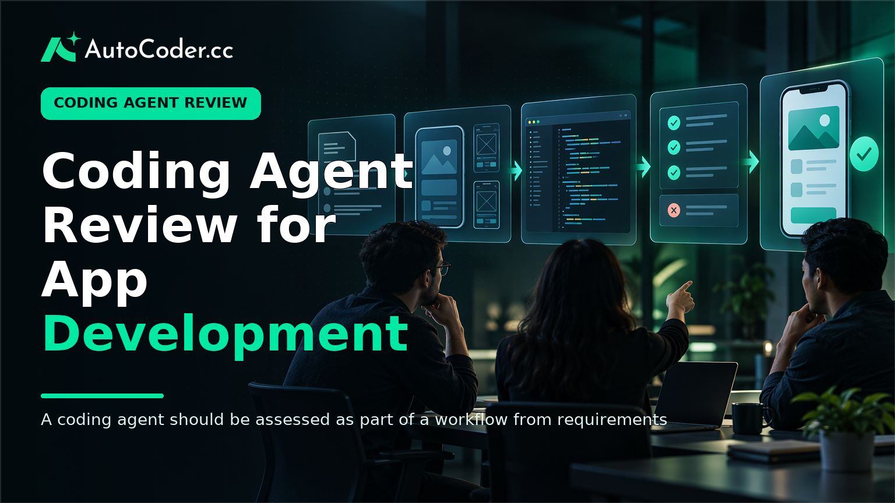
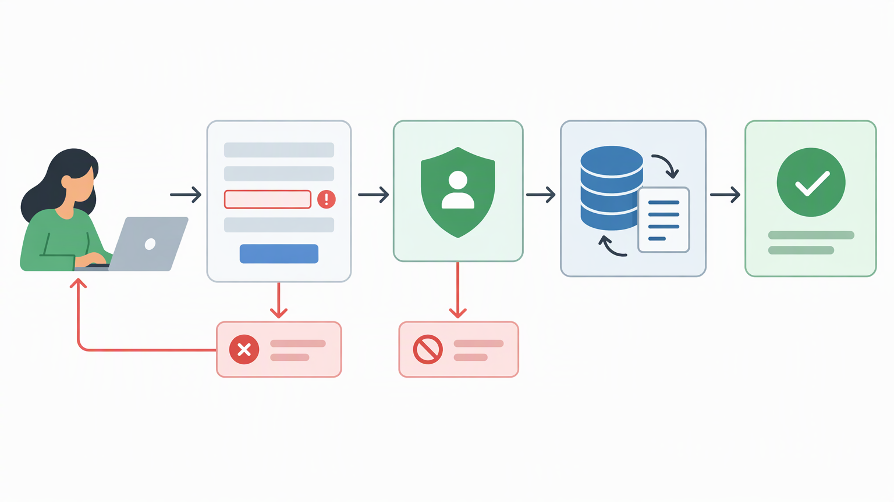
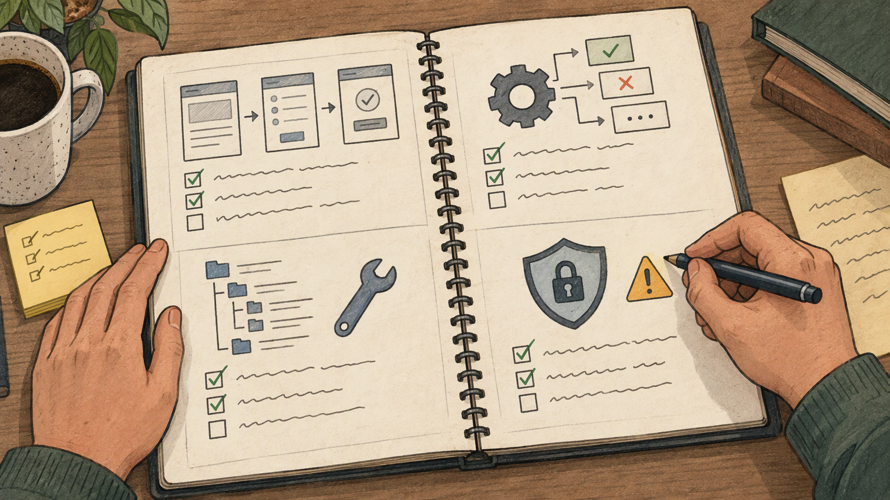

*Published November 3, 2026*

<Frame caption="A coding agent should be assessed as part of a workflow from requirements through review and verification, not only by a generated screen.">
  
</Frame>

A useful **coding agent review** does not begin with a broad question such as whether an AI tool can write code. It begins with a narrower one: can the tool complete a defined application task in a way that your team can inspect, change, test, and maintain? That distinction matters for founders validating an idea, product teams building a workflow, and developers deciding where AI assistance belongs in an established delivery process.

An AI coding agent may help turn written requirements into working components or a larger application structure. Its value depends less on a generic capability claim than on the fit between the task, the expected output, and the controls around that output.

This guide provides a repeatable way to evaluate agents for application development. It focuses on scope, quality, verification, security-sensitive work, maintainability, and control of the resulting source code.

## What a coding agent review should assess

**Practical point: assess an agent against a specific delivery job, not against an abstract idea of intelligence.** A coding agent is software that can use an instruction to plan, generate, modify, or connect parts of a software project. It differs from a simple code-completion feature because the intended task can extend beyond a line or function to multiple files, user flows, data structures, and supporting configuration.

That definition is useful, but it can also obscure meaningful differences. Some agents are most appropriate for bounded changes inside an existing repository. Others are designed to create a new application from a product description. Neither category is automatically better. The relevant question is whether the operating model matches the work at hand.

Start a coding agent evaluation by classifying the task into one of four practical categories:

- **Prototype creation:** turning an idea into a navigable, functional proof of concept.
- **Feature delivery:** adding a defined workflow to an existing application.
- **Workflow automation:** creating an internal tool, intake process, dashboard, or operational interface.
- **Production maintenance:** changing a live system while preserving established behavior and controls.

A task description should identify users, the action they need to take, the information involved, and the expected result. For example, “build a booking system” is too broad to evaluate consistently. “Allow staff to create appointments, show availability, and let customers request a time slot” gives reviewers something concrete to check.

Define what the agent is and is not responsible for. If the team will provide the visual design, authentication rules, or deployment environment, say so before beginning. This prevents a pilot from appearing successful merely because reviewers silently filled in missing work later.

A common misconception is that an agent either replaces a development process or has no value at all. In practice, its usefulness often sits between those positions. It may accelerate early implementation while leaving architecture choices, testing, security review, and final integration with people. An evaluation should reveal where that boundary falls for your team.

## Evaluate application-building scope and task fit

<Frame caption="Full-stack task fit is demonstrated by a connected user flow that includes validation, permissions, and data handling.">
  
</Frame>

**Practical point: test whether the agent can connect the application layers your use case actually needs.** An attractive interface is not enough evidence for an application task that also requires stored data, user access, business rules, and deployment considerations. For full-stack AI development, scope means the relationship between those layers, not just their separate presence.

Review the requested work as a simple chain: a user takes an action, the application validates it, data is read or changed, permissions are applied, and the user receives an understandable result. Then ask whether the generated application represents each relevant part of that chain.

For a new application, write a short pilot brief with the following elements:

1. **Primary users and roles.** State who can view, create, edit, approve, or administer information. 2. **Core user flow.** Describe the shortest complete path from entry to outcome. 3. **Data model.** List the essential records and the relationships between them. 4. **Rules and exceptions.** Include required fields, invalid states, duplicate handling, and permission boundaries. 5.

This structure is particularly important when requirements begin in natural language. Natural-language prompts are useful for expressing intent, but they can leave key terms ambiguous. “Managers can manage requests,” for example, does not state whether managers can see every request, alter ownership, approve an item, or delete records.

A tool such as [AutoCoder's AI app builder](https://www.autocoder.cc/platform?utm_source=blog&utm_medium=latest&utm_campaign=CodingAgentReview) is positioned for turning natural-language product requirements into editable, deployable full-stack applications. For that type of product, a fair review task should test a connected flow rather than a static landing page: a portal, directory, marketplace, booking system, dashboard, or internal workflow with a defined record lifecycle.

Scope also has limits. An agent can generate frontend, backend, and database components, yet still require team decisions about domain logic, integrations, data migration, accessibility expectations, and operational ownership. Do not interpret a broad set of generated components as proof that every production concern has been resolved.

Use cases lead to different recommendations. A founder validating demand may prioritize speed to a credible prototype and the ability to revise it after feedback. A product manager may prioritize whether stakeholders can examine a working flow before engineering investment.

## Review output quality and verification methods

<Frame caption="Generated applications need review at the interface, behavior, implementation, and security-sensitive levels before they are relied upon.">
  
</Frame>

**Practical point: regard generated work as a reviewable implementation, not as accepted software.** The most useful evidence in an AI app builder review comes from explicit acceptance criteria and repeatable checks. A polished first screen can conceal missing validation, inconsistent state handling, or incomplete permissions.

Before running a pilot, convert the brief into observable checks. For a booking workflow, reviewers might confirm that a user can submit a request, that required information is rejected when absent, that staff can view the request, and that the displayed status changes after an action.

Inspect output at three levels. First, assess the visible user flow: labels, navigation, empty states, confirmations, and error messages should make the intended task understandable. Second, inspect behavior: test ordinary inputs, incomplete inputs, invalid inputs, repeated actions, and changes in sequence. Third, inspect implementation: review file organization, naming, data access, dependency choices, environment configuration, and comments or documentation where they are needed.

AI-generated source code should be evaluated for clarity as well as immediate function. Code that works in a demo but is difficult to locate, reason about, or modify can create a delayed cost for the team.

Verification should include security-sensitive flows without making unsupported assumptions about automated protection. Review authentication-related behavior, authorization boundaries, input handling, secrets management, and any operation that exposes, changes, or deletes user data. If the pilot includes roles, try to access a restricted action from the wrong role. If it accepts user-entered text, test unexpected or malformed values.

Maintainability is another practical test. Ask a developer who did not write the original prompt to make a modest change: add a field, change a validation rule, introduce a status, or alter a screen. The effort and side effects of that change often reveal more than the initial generation.

A second misconception is that testing generated code is redundant because the agent produced it from a precise prompt. Prompts express desired behavior, but they do not remove the possibility of incomplete interpretation or implementation errors. Verification remains part of responsible application delivery.

## Check editability, ownership, and team workflow fit

**Practical point: confirm that useful output can remain useful after the initial generation session.** Application work rarely ends at a first version. Teams need to adjust requirements, fix defects, connect services, review changes, and decide who is responsible for the code over time.

For any coding agent, establish what your team can inspect and continue editing. Can developers access the generated source code? Can the work move into the team’s usual version-control and review process? Is there a clear path from an early prototype to further development? These questions affect risk and staffing decisions as much as the initial output does.

[AutoCoder](https://www.autocoder.cc/platform?utm_source=blog&utm_medium=latest&utm_campaign=CodingAgentReview) states that users can export and continue editing generated source code. In an evaluation, confirm how that capability fits your own repository conventions, review practices, environments, and deployment responsibilities. Product facts describe an available capability; a pilot establishes whether it works cleanly within a particular team’s process.

Include non-developers in the review where they have ownership of requirements. Product managers can assess whether the generated flow represents the intended policy. Designers can identify interaction and presentation issues. Operations or support colleagues can surface the exceptions that a happy-path brief may omit. Developers should retain responsibility for implementation review and for deciding what is ready to merge or deploy.

Set expectations for change control early. Save the prompt or requirements used for each generated version, record any manual edits, and note unresolved limitations. This creates a basic audit trail for a pilot and reduces confusion when a later result differs from an earlier one. It also makes it easier to distinguish a product requirement gap from a generation issue.

## Use a repeatable coding agent evaluation process

**Practical point: a small fixed-scope pilot produces more decision-ready evidence than an open-ended trial.** Choose one task that matters enough to reflect real work but is bounded enough to review thoroughly. Avoid a task that is either a trivial form or an entire product roadmap.

Use this process:

1. **Write the pilot brief.** Define users, flow, data, rules, exclusions, and completion criteria. 2. **Generate from the same brief.** Preserve the instruction so the work can be repeated or compared fairly. 3. **Run acceptance checks.** Test the primary flow and representative error or edge conditions. 4. **Inspect the implementation.** Review code structure, data handling, configuration, and relevant security-sensitive areas. 5.

The final decision should describe conditions, not just a yes-or-no verdict. For example, a team may find an agent appropriate for creating functional prototypes and early internal workflows, provided that developers review exported code before production use. Another team may use it for application scaffolding while retaining its existing process for integrations and security-critical changes.

## FAQ

### What is a coding agent?

A coding agent is software that can use instructions to generate, modify, or coordinate software work across one or more parts of a project. Its scope may range from a bounded code change to a multi-component application flow.

### How should a coding agent be evaluated?

Evaluate a defined pilot task with explicit acceptance criteria. Review the visible flow, behavior under normal and invalid inputs, implementation quality, security-sensitive areas, and the effort required to make a later change.

### Can coding agents generate full-stack applications?

Some are intended to generate connected frontend, backend, and database components from requirements. Teams should still verify user flows, data rules, authentication-related behavior, integrations, and deployment readiness for their own use case.

### What should teams verify before deploying code from a coding agent?

Verify functional requirements, error handling, permissions, input handling, configuration, secrets practices, test coverage appropriate to the change, and compatibility with the team’s deployment and review process.

### Do users own the source code generated by a coding agent?

This depends on the product terms and workflow. Confirm access, export options, applicable ownership terms, and whether the code can be maintained in the team’s normal development environment.

## Conclusion

A disciplined **coding agent review** treats an agent as part of a delivery workflow rather than as a standalone answer to application development. Define a realistic task, make expected behavior testable, inspect generated code, test sensitive flows, and confirm that the team can continue editing and governing the result. That process helps teams identify where an AI coding agent can reduce early implementation effort and where conventional engineering review remains essential.
