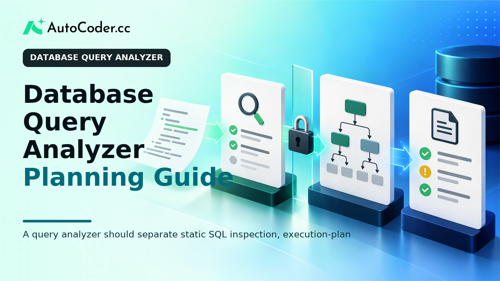
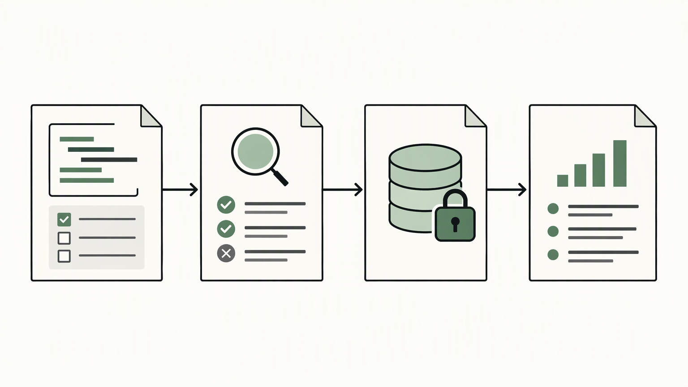

*Published November 4, 2026*

<Frame caption="A query analyzer should separate static SQL inspection, execution-plan evidence, and final findings instead of presenting one undifferentiated score.">
  
</Frame>

A **database query analyzer** is an internal tool for inspecting SQL, reviewing how a database may handle it, and documenting evidence for follow-up. Its purpose is not to label every query as fast or slow. It is to separate what can be learned from query text, execution-plan output, and approved runtime observations while keeping risky operations under control.

For developers and technical product teams, this makes diagnostic work more repeatable. A useful tool captures the submitted statement, its environment and dialect, the analysis method used, and the resulting findings. Those records give the next reviewer enough context to verify an issue rather than relying on an unexplained warning.

## What a database query analyzer should analyze

**Separate SQL structure, execution behavior, and runtime evidence from the start.** Each source supports a different conclusion, and combining them into one score can obscure important limits.

The first layer is static SQL query analysis. The tool parses or inspects submitted SQL to identify statement type, referenced objects, joins, predicates, grouping, ordering, subqueries, and parameters. These details can support useful checks. For example, the analyzer can identify a statement without an expected limiting predicate or flag a query shape that needs review before it is tested against a shared environment.

Static checks are not proof of a performance problem. A join can be appropriate, and the presence of a predicate does not prove an index will be used. Database behavior also depends on the engine, schema, statistics, parameter values, permissions, transaction state, and data distribution. Findings should therefore distinguish between a structural observation, an inference, and a suggested follow-up.

The second layer is execution plan analysis. Where a supported engine provides a safe planning or explain operation, the analyzer can capture plan output and retain both the original response and a normalized representation. A normalized record may identify access paths, join order, sorting or aggregation work, estimates, and plan nodes. The original output remains important because engine-specific detail is often needed during investigation.

The third layer is runtime context. A query performance dashboard can associate a saved query or normalized fingerprint with approved monitoring observations, such as available timing, error, or execution information. This is different from running the submitted SQL. It is also different from plan evidence: historical signals may be aggregated, incomplete, or associated with different parameter patterns. Always display the environment and collection context beside such observations.

Define the first release boundary before building detectors. Specify the database engines, dialect versions, environments, and statement classes you support. A read-only scope is a sensible starting point for many internal tools. Data-definition and data-modification statements need separate policy and review paths rather than being treated as ordinary diagnostic requests.

## Why SQL query analysis needs context

**Store the conditions behind every result so a plausible finding does not become a misleading instruction.** Query text alone is rarely enough to explain a database outcome.

An analyzer should retain the submitted SQL, declared dialect, selected connection or environment, analysis timestamp, and source of each finding. It should also record whether the output came from static inspection, a plan request, or a monitoring feed. This provenance lets users understand what evidence was actually available at the time.

Schema awareness can make explanations more concrete, but metadata must have its own context. If the service retrieves table, column, or index information, retain when it was collected and identify the relevant schema or connection. An index available when a plan was captured may later change. Likewise, a development plan can help review query shape without demonstrating production behavior.

Parameters require explicit handling. Parameterized SQL may produce different plans or runtime behavior depending on the supplied values and the engine's planning rules. Do not silently substitute guessed literals. Preserve placeholders, allow approved sample values only in defined workflows, and show exactly what parameter policy was used for a plan operation.

A database monitoring tool can help teams prioritize repeated patterns, but it cannot independently explain why one execution behaved as it did. Keep monitoring records connected to a query fingerprint, environment, and collection window. Avoid presenting measurements from unlike systems as though they were directly comparable.

Context also supports collaboration. Saved analyses should include an owner or team, status, tags, and a concise investigation note. These fields let users see whether a finding is new, under review, resolved after a change, or accepted because of a documented use case.

## Core architecture for a query analyzer

<Frame caption="A controlled backend workflow should validate and constrain requests before any approved database operation occurs.">
  
</Frame>

**Route requests through a controlled backend workflow instead of allowing the interface to decide what SQL can execute.** This creates a clear place to enforce policy, authorization, auditing, and engine-specific rules.

A practical architecture separates five responsibilities. The client collects SQL and analysis options. An application service validates the request and checks user access. A parser or dialect-aware inspection layer extracts query structure. An engine adapter performs only approved metadata or planning operations. A result service stores normalized findings, original artifacts, and audit details.

The request model should include more than query text. Useful fields include a target connection identifier, dialect, requested analysis mode, parameter policy, and whether the user requests static inspection only or an approved plan operation. Keep connection credentials server-side rather than accepting them from the browser as a normal workflow.

Represent findings as structured records, not one generated paragraph. A finding can contain its detector name, category, source layer, affected query fragment, evidence payload, explanation, confidence limit, and recommended next action. A plan record can retain the engine response, parse status, and normalized node structure. This preserves evidence even as the interface changes.

Keep engine adapters narrow. Each adapter should validate dialect syntax, apply supported plan commands, retrieve permitted metadata, parse responses, and translate errors. Broad application policy should remain outside the adapter. This boundary reduces the spread of engine assumptions and makes later support for another database more manageable.

Teams that need a foundation for authentication, data models, dashboards, and review screens can use [AutoCoder's AI app builder](https://www.autocoder.cc/platform?utm_source=blog&utm_medium=latest&utm_campaign=DatabaseQueryAnalyzer) to generate editable full-stack application components from written requirements. The team should still define execution policy, database permissions, and adapter behavior explicitly, because those controls are specific to the environment being analyzed.

A restrained initial implementation might support saved read-only queries, static checks, controlled plan collection for one engine, and results history. That scope is usually easier to verify than an early attempt to cover every dialect, statement class, and observability source.

## Safety controls for query execution

**Treat every submitted statement as untrusted input, including requests from internal users.** The key safeguard is making analysis possible without granting unrestricted database execution.

Static inspection should be the default mode because it can operate without a database connection. This is useful when a user needs syntax-aware checks or query-shape feedback while drafting a statement.

When interaction with a database is required, use a dedicated least-privilege connection with narrowly defined rights. Prefer metadata or plan operations over executing the submitted query. Whether an explain command is non-executing depends on the database engine and command variant, so verify that behavior per supported engine and document the accepted modes.

Reject or route for review statements outside the supported boundary. Classification should detect data-modification statements, transaction controls, administrative commands, multi-statement input, and unsupported dialect constructs. A string blocklist is not sufficient on its own. Use reliable parsing or statement classification where possible, and fail closed when classification is uncertain.

Add limits around every approved operation: timeouts, result-size controls, concurrency limits, connection targeting restrictions, and audit logs. Record who requested analysis, which mode was selected, which connection was targeted, and whether a request reached an engine adapter. Sensitive literal values should not be retained without a defined access and retention policy.

Make environment selection obvious in the interface. Production access, if it is allowed, should have stricter roles and fewer permitted operations than lower environments. A diagnostic tool should not make a consequential request appear routine.

## Present findings without overstating certainty

<Frame caption="Query text, plans, and runtime context each support different conclusions and should carry clear confidence limits.">
  
</Frame>

**Show what the analyzer knows, what it infers, and what the user needs to verify next.** Clear evidence boundaries make results more useful than broad warnings.

Organize output by evidence type: static observations, execution-plan observations, and monitored runtime signals. Within each section, identify the relevant SQL fragment or plan node, explain why it was noted, and state the limitation. Preserve enough textual context for shared or exported results even if the application can link directly to a code range.

Avoid treating a detector as a verdict. An analyzer may identify sorting in a plan, but whether that matters depends on workload, data volume, resources, and user-facing requirements. A useful finding can recommend a next step: review the intended result set, inspect relevant schema design, compare approved plan captures, or consult the owning team.

Confidence should match the evidence. Static checks have limited runtime knowledge. A plan gives engine-specific detail but may rely on estimates. Monitoring adds operational context but can be incomplete or aggregated. A visible distinction helps users prioritize investigation without confusing diagnosis with proof.

Comparisons need the same safeguards. When comparing saved query versions or plan captures, keep environment, schema context, parameter policy, and capture time beside the comparison. Otherwise, users may attribute a difference to SQL changes when it reflects different conditions.

## Common misconceptions when building a database query analyzer

**Correcting scope assumptions early prevents the tool from promising more than its evidence supports.** Most design errors arise from treating unlike evidence as interchangeable.

SQL linting is not performance diagnosis. Linting can identify syntax and maintainability concerns, while performance depends on engine behavior and data context. Both belong in the product, but they should not be blended into an unexplained result.

An execution plan is not a complete account of runtime behavior. It is a planning artifact that becomes more useful when paired with the right environment, query form, parameter policy, and approved operational context.

Internal users do not remove the need for security boundaries. Internal tools can expose sensitive schemas, enable harmful requests, and create ambiguous audit trails. Least privilege and explicit analysis modes are product requirements.

Finally, a dashboard is not automatically an investigation workflow. Tables and charts only help when users can identify the query, evidence source, ownership, and next action.

## FAQ

### What does a database query analyzer do?

A database query analyzer inspects SQL and related database evidence to surface structured observations. It can perform static checks, collect approved execution-plan output, and associate saved queries with monitoring context. It supports investigation rather than guaranteeing performance.

### What inputs does a query analyzer need?

At minimum, it needs SQL text and a declared database dialect. Context-aware analysis may also require an approved connection identifier, permitted schema metadata, parameter handling rules, and a chosen analysis mode.

### How can a query analyzer avoid unsafe query execution?

Default to static analysis, restrict statement types, use server-managed least-privilege connections, and permit only documented metadata or plan operations. Add limits, audit logs, environment controls, and fail-closed behavior for uncertain classification.

### Is execution plan analysis enough to find a query problem?

No. Plan output provides useful engine-specific evidence, but interpretation still depends on query intent, schema state, parameter values, and operational context.

## Conclusion

A **database query analyzer** is most useful when it preserves the boundary between SQL structure, execution-plan evidence, and observed runtime context. Start with a narrow read-only workflow, layered services, bounded engine adapters, and visible permissions and environment controls.

The practical goal is not to classify every query as good or bad. It is to provide a safe path from submitted SQL to documented evidence and a sensible next investigation step. That foundation can later support a query performance dashboard or broader monitoring workflow without weakening the safeguards that make findings trustworthy.
