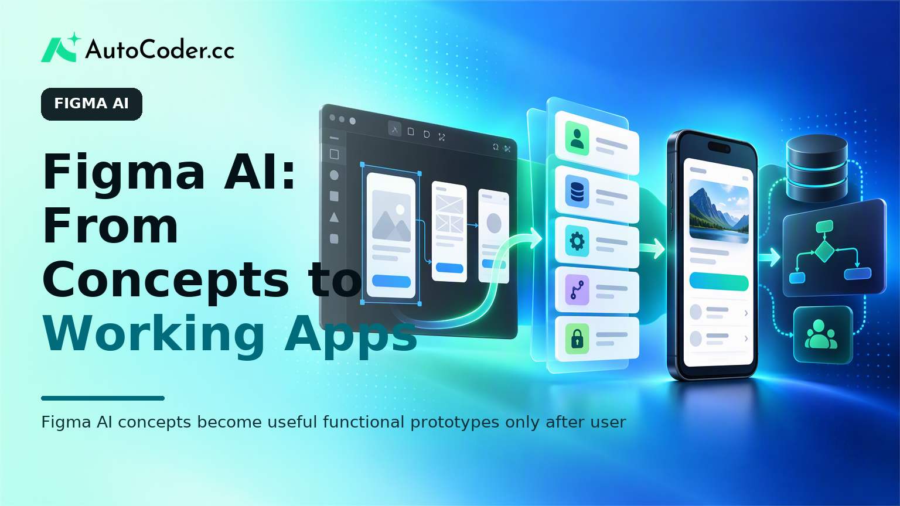
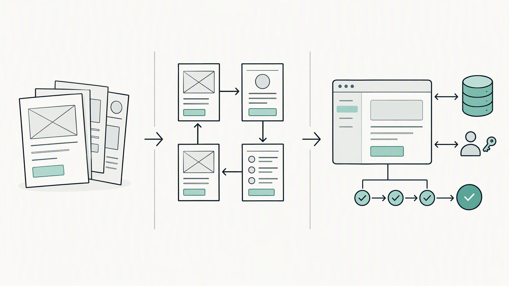

*Published November 2, 2026*

<Frame caption="Figma AI concepts become useful functional prototypes only after user actions, data, rules, and access needs are made explicit.">
  
</Frame>

**Figma AI** can help product teams explore interface directions more quickly, but an interface concept is not the same as software that users can operate. For founders, product managers, and designers, the practical question is not simply whether an early screen looks credible. It is whether the proposed workflow, data, permissions, and decisions can be tested in a realistic form.

That distinction matters when a team moves from an idea to a functional prototype or a full-stack MVP. AI-assisted design can make early exploration easier to discuss, while a functional application introduces requirements that static screens and clickable flows do not resolve.

## What Figma AI can help product teams do

The practical use of Figma AI is to accelerate early interface exploration while keeping product judgment with the team. AI UI design workflows can help create rough screen concepts, compare layout directions, draft interface copy, and turn an abstract product idea into something stakeholders can inspect.

This work is most useful when it begins with a defined problem rather than a request for a generic interface. A founder may need to show how a customer requests a service. A product manager may need to map a review queue for an internal team.

A disciplined Figma AI app design process starts with a concise brief. Describe the intended user, the task they need to complete, the information they need at that moment, and the decision the screen should support. That gives early concepts a product purpose beyond visual polish.

Early outputs still require review because they can imply decisions without resolving them. A screen may show a status label, a filter, or a call to action, but the team must decide what each status means, who can change it, and what happens after an action is taken.

Use early exploration to answer practical questions:

- Can the user identify the next step without explanation?
- Is the needed information visible when a decision must be made?
- Are important states missing, such as an empty list, error, or incomplete form?
- Can stakeholders describe the same user journey after reviewing the screens?

This is also the point to remove unnecessary scope. If a concept needs many tabs, roles, and settings before anyone can complete the central task, the team may be designing around assumptions that have not been tested.

A common misconception is that a polished interface represents a validated product. It does not. Design artifacts make assumptions visible and easier to challenge. They do not, by themselves, confirm that information can be stored, users can access the correct records, or a process works from beginning to end.

## The difference between a design prototype and a functional app

<Frame caption="Visual designs, clickable prototypes, and functional apps answer different product questions and include different levels of behavior.">
  
</Frame>

Match the prototype type to the question the team needs to answer. A visual design prototype explains what an interface could look like. A clickable prototype demonstrates an intended route between screens. A functional prototype lets people perform actions and observe the resulting behavior.

A design prototype can be sufficient when the central uncertainty is comprehension or layout. For example, a team may compare two onboarding sequences to see whether people can identify the product's purpose. A clickable flow can be enough to assess whether the apparent order of steps makes sense.

A functional prototype becomes more useful when the product promise depends on behavior. This is often the case when:

- A user creates, edits, or retrieves information.
- Different users have different access or responsibilities.
- A workflow changes the status of a record.
- A decision depends on information entered earlier in the process.
- The concept must be tested in a deployed environment rather than presented as screens.

These conditions introduce elements that a visual mockup does not contain: a frontend that accepts input, backend logic that applies rules, a database that retains information, and authentication when access must be controlled. Not every early concept needs every component, but a design-only artifact should not be described as a working app when its core value depends on them.

Consider a booking concept. A set of screens can show date selection, confirmation, and a provider view. A clickable flow can communicate the intended journey. Only a functional version can expose questions such as whether a selected slot remains available after another booking, whether a customer can cancel, how a provider sees a changed request, and which details persist between sessions.

The boundary matters for expectation-setting. Stakeholders may approve a visual direction while still disagreeing about business rules. Developers may receive screens that omit exceptions. Test users may respond positively to a concept but be unable to complete a task in a realistic environment.

The limitation works in both directions. Building a functional app too early can embed untested interface decisions and broaden scope before the team understands the problem. Keeping a concept solely in design for too long can hide workflow, access, and data constraints.

## How to prepare a Figma concept for functional prototyping

<Frame caption="Before building a functional prototype, teams should convert interface screens into explicit roles, actions, data needs, and business rules.">
  
</Frame>

Prepare the concept as product requirements rather than as a collection of screens. Before turning a Figma concept into a functional prototype, translate its visual elements into clear statements about users, actions, data, and rules.

Start with the smallest useful user journey. This is the shortest complete path through which a target user receives the intended value. It might be submitting a request, reviewing an application, creating a listing, or assigning a task. A narrow journey provides a practical boundary for a first functional prototype.

Next, identify participants precisely. “User” is usually too broad. Specify whether the workflow involves a customer, staff member, administrator, provider, or another role. For each role, state what that person can view, create, update, approve, or delete. This avoids treating permissions as a late implementation detail.

Then define the data behind every meaningful screen. A request record, for example, may need a title, description, owner, status, submitted date, and internal note. The aim is not to design a complete data model at this stage. It is to identify the information required for the workflow to function.

Business rules deserve the same treatment. Write them in plain language before attempting to encode them. Examples include: a request cannot be approved without required information; only administrators can set a final status; users can see only their own submissions.

Finally, define success criteria for the functional prototype. These should describe what a representative user must be able to do, not how refined the app should appear. A useful criterion may be that a user can sign in, submit a request, and later view its updated status.

## Moving from product requirements to a working MVP

Use a working MVP to test the core workflow under realistic conditions while keeping scope deliberately limited. Once requirements are specific enough, an AI app builder can provide a starting point for a functional application rather than another set of interface concepts.

[AutoCoder's AI app builder](https://www.autocoder.cc/platform?utm_source=blog&utm_medium=latest&utm_campaign=FigmaAI) is designed to turn natural-language product requirements into editable, deployable full-stack applications. Its stated capabilities include generating frontend, backend, and database components, with support for authentication and deployment workflows. That makes it relevant when the open question shifts from “what should this screen look like?” to “can this user complete the workflow in a working application?”

The input should describe behavior, not merely reproduce visual styling. A useful requirement set identifies user roles, pages needed for the narrow workflow, information each page displays, actions available to each role, required data, and rules that govern status changes.

For a simple review portal, a requirement might state that applicants submit a form, reviewers see submitted items in a queue, reviewers can approve or return an item with a note, and applicants can sign in to view the current status. It should also address whether reviewers can edit submissions, whether applicants can resubmit, and which fields are mandatory.

After generation, review the app against the intended journey in sequence. Sign in as each relevant role where applicable. Create a record, change its state, and confirm that the appropriate user can see the result. Review empty states and error handling as carefully as the main success path, because those states often reveal unclear rules.

A working MVP has limits. It should not be assumed to meet every production requirement simply because it is deployable or includes application components. Teams still need to assess security, reliability, accessibility, integrations, operational processes, and the quality of requirements for their own context.

## How to iterate without losing flexibility

Keep design, requirements, and implementation aligned through short review cycles. A useful loop is to observe people attempting the core workflow, record where they hesitate or fail, identify whether the issue is visual, behavioral, or conceptual, and update the relevant artifact.

When someone cannot find a control, the design may need revision. When someone does not understand why an action is unavailable, the business rule or feedback may need revision. When the team discovers that a workflow is not valuable, the scope may need revision. Separating these causes prevents a visual adjustment from masking a product problem.

Maintain a lightweight decision record alongside Figma files and application requirements. For each meaningful change, note the user problem, the interface or rule decision, and what the team expects to learn next. This helps founders, designers, product managers, and developers avoid working from diverging versions of the same concept.

Flexibility also matters when a prototype advances. Teams expecting to continue development should consider whether they can retain and edit the implementation. [AutoCoder](https://www.autocoder.cc/platform?utm_source=blog&utm_medium=latest&utm_campaign=FigmaAI) supports source-code export and continued editing, which can be useful when a functional prototype enters an existing development process. The relevant question is not whether a tool removes all later engineering work, but whether it supports a sensible transition after the workflow has been validated.

## FAQ

### What is Figma AI used for in product design?

Figma AI can support early interface exploration, including screen concepts, layout alternatives, and clearer visual representations of a proposed user journey. Teams still need to review usability, product assumptions, and business rules.

### Can Figma AI create a working app or only interface concepts?

Interface concepts and clickable flows differ from a working application. A functional app requires behavior such as data storage, user access, workflow rules, and potentially deployment. Teams should choose the artifact that matches the question they need to test.

### How can teams move from a Figma design to a functional prototype?

Translate the concept into requirements for users, core actions, data, roles, and business rules. Then build the smallest complete workflow needed to test the product assumption and review it through realistic user tasks.

### What should be defined before turning a design into an MVP?

Define the target user, smallest useful journey, roles, required information, key rules, success criteria, and explicit scope exclusions. These details make it easier to decide what a functional prototype must include.

## Conclusion

**Figma AI** is most useful when product teams treat it as part of a broader discovery process rather than as a substitute for functional validation. It can make interface ideas concrete and easier to discuss. When the product question involves real data, permissions, changing states, or an end-to-end task, a focused functional prototype is a more appropriate test.

The move from concept to a full-stack MVP begins with clear requirements: who the user is, what they need to accomplish, what information the workflow requires, and which rules govern it. By keeping scope narrow and evaluating behavior as carefully as appearance, teams can use design exploration and functional software for the distinct decisions each supports.
