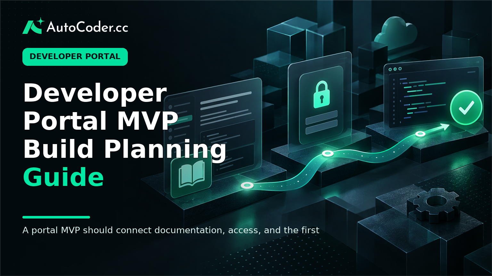
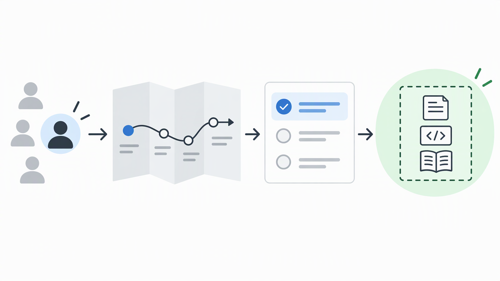
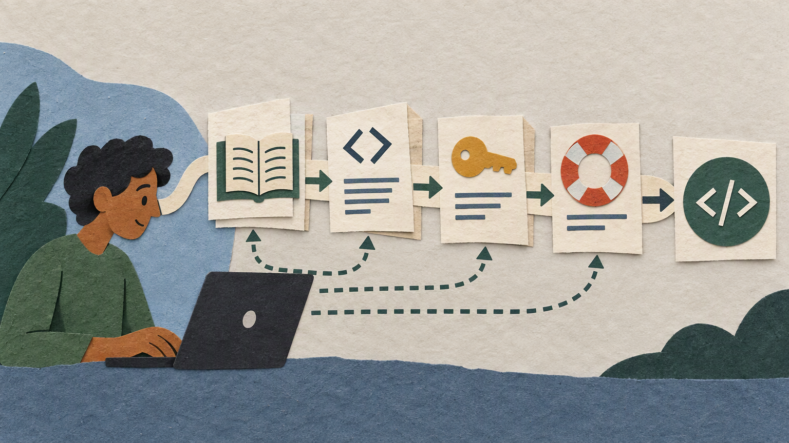

*Published November 3, 2026*

<Frame caption="A portal MVP should connect documentation, access, and the first implementation task into one coherent user journey.">
  
</Frame>

A **developer portal** MVP should help a defined technical audience complete a real task with less searching, waiting, or manual guidance. That task might be finding the correct API guide, understanding authentication requirements, locating partner resources, or identifying the owner of an internal service. The first release does not need to be a complete developer platform.

A developer portal is a central place for technical users to discover resources, understand how to use a product or service, obtain or request appropriate access, and find the next support route. Its value comes from connecting those activities into a usable journey. A collection of pages without clear sequencing can still leave users blocked.

This guide explains how product teams and developers can plan a focused MVP for API users, partners, or internal teams. The approach starts with one audience and workflow, then adds only the documentation, access, navigation, and operating practices needed to support that path.

## Define the developer portal purpose and primary user

<Frame caption="Scope becomes manageable when a team chooses one audience, maps its current journey, and commits to one primary workflow.">
  
</Frame>

**Start with one audience and one outcome the portal must support.** External API users, implementation partners, and internal engineers often need different information, access boundaries, and support routes. Trying to serve all of them equally in an MVP usually produces vague navigation and unclear content priorities.

Before implementation, establish a few practical prerequisites:

- A product owner who can make scope decisions.
- Existing technical material, such as API references, setup notes, runbooks, or support questions.
- A decision on the first audience to serve.
- A basic map of how accounts, credentials, approvals, or roles work today.
- A publishing process for reviewing and updating technical content.

The portal purpose should describe a user outcome, not a list of components. For example, an API user may need to move from an account request to a first authenticated request. A partner may need to find approved integration requirements after signing in. An internal engineer may need a dependable path to service ownership and operational guidance.

### Step 1: map the current journey

Write down the path users take now, including where they enter, what they need at each stage, and where they ask for help. A journey might begin with a product page, move through account approval, continue to authentication setup, and end with a first integration task.

For each stage, record the user goal, required information or permission, and likely blocker. This prevents the team from mistaking a workflow problem for a visual design problem. If users are delayed by credential approval, adding another documentation landing page may not solve the issue. If they cannot find a correct guide, structure and labels may be the priority.

### Step 2: select one primary workflow

Choose a workflow that is narrow enough to test but meaningful enough to improve the experience. Suitable MVP workflows include moving from approved access to authentication, finding the correct guide and reference for a first integration, locating partner requirements, or discovering service ownership internally.

Write the scope as a completion statement: “An approved partner can sign in, find the relevant integration guide, and identify the next implementation step.” This statement provides a useful test for later requests. If a feature does not help that user complete the stated outcome, it can wait.

Also document exclusions. The MVP may link to an existing support channel rather than create a new case-management workflow. It may explain access requests instead of automating provisioning. Clear exclusions keep a first release from becoming an unbounded platform project.

## Choose developer portal MVP capabilities around the workflow

<Frame caption="Guides, reference material, access instructions, and help routes should work as connected parts of the primary workflow.">
  
</Frame>

**Build connected capabilities, not a generic feature checklist.** Each part of the MVP should move a user toward the next step in the chosen workflow. Documentation, access guidance, navigation, and help should reinforce one another.

### Step 3: create a minimum content structure

A developer documentation portal needs predictable organization before it needs a large library of pages. Start with the questions users need answered in sequence:

1. What is available, and who is it for?
2. What must be in place before implementation begins?
3. How does access or authentication work?
4. Which guide applies to the task?
5. Where can technical details be verified?
6. What should the user do if the documented path does not fit?

These questions can become a compact navigation model, such as Getting started, Guides, Reference, Access, and Help. Use terms that match user tasks rather than internal team names. Each guide should state its audience, prerequisites, expected result, and responsible owner.

Reference material and explanatory guides have different roles. Reference pages help users verify exact technical details. Guides explain the sequence, context, and decisions behind an implementation task. An API developer portal can contain both, but neither should obscure the other.

### Step 4: make access visible in developer onboarding

Access is often where a promising onboarding path becomes fragmented. Users may need an account, approval, credentials, a role assignment, or a separate environment before they can act on the documentation. Identify which of these steps are part of the initial workflow and describe them plainly.

For an MVP, show the status and next action. If approval is manual, explain what users submit and what happens afterward. If some material is authenticated, distinguish public information from signed-in resources. If roles are necessary, define what each role can see and who maintains assignments.

Avoid treating permissions as a final implementation detail. Access rules influence what users can discover, what they can test, and which support route they need. At the same time, avoid creating a detailed permission model without a clear use case. A small number of understandable roles is easier to operate and review.

### Step 5: provide discovery and help routes

Users approach portals differently. Some know an API or service name and want to search directly. Others know only the outcome they need and must browse through a task-oriented structure. The MVP should give both groups a route.

Use descriptive page titles, consistent groupings, and links to the next relevant action. Avoid copying the same instructions across many pages unless a single owner maintains them. When users reach a dead end, provide a defined help path that makes clear what type of issue belongs there.

The first release does not need a broad catalog or extensive self-service tooling. It does need to prevent users from becoming stranded between documentation, access, and support. Review each major page by asking whether a visitor can take a meaningful next action, check a prerequisite, or request help.

## Build the MVP in a maintainable sequence

**Treat the portal as an operating product with content and workflow ownership.** A maintainable foundation lets the team revise guides, roles, and delivery processes without rebuilding the experience whenever the underlying product changes.

### Step 6: turn scope into an outcome-based backlog

Create backlog items around observable user results rather than isolated components. “A new API user can find the authentication guide” is easier to validate than “create documentation pages.” “A partner can view approved resources after signing in” connects identity, access, and content into one testable outcome.

For each item, identify the content owner, technical owner, acceptance condition, and dependency on an existing system. This exposes work that is easy to overlook, especially identity handling, source-content review, and approval procedures.

Teams that need an editable full-stack starting point can use [AutoCoder's AI app builder](https://www.autocoder.cc/platform?utm_source=blog&utm_medium=latest&utm_campaign=DeveloperPortal) to generate applications from natural-language requirements, including frontend, backend, database, authentication, and deployment workflows. The requirement brief should remain constrained: name the users, initial roles, page structure, content model, and primary workflow. Generated scaffolding still needs review against actual access policies and technical content.

### Step 7: establish content governance

A portal loses usefulness when nobody owns updates. Identify who can draft, review, approve, and publish core content types. API reference material, onboarding guidance, access instructions, and partner resources may involve different subject-matter owners, but the release process should be understandable.

Set a lightweight review rule for changes that affect implementation or permissions. For example, technical changes should be reviewed by the responsible technical owner, while access instructions should be checked by the team that operates the access process. Make page ownership visible so inaccurate information has a clear correction path.

Governance also includes lifecycle work. Mark deprecated guidance, retire or redirect obsolete pages, and avoid retaining duplicate instructions in navigation. These activities may appear less visible than new features, but they determine whether users can rely on the portal.

### Step 8: test the complete workflow

Test the primary workflow with representative users or colleagues who did not build it. Ask them to complete the task using the portal and the documented access route. Observe where they hesitate, misread labels, miss a prerequisite, or cannot identify the next action.

Check public and signed-in areas, applicable roles, content updates, changed links, and the deployment process. The aim is not to simulate every possible production scenario. It is to confirm that the MVP delivers the journey it promises.

Turn observations into specific fixes. “Navigation is unclear” is too broad. “Users reach the reference before learning how to authenticate” identifies a sequencing problem. “A partner guide appears before approval, but the next resource is restricted” identifies an access-boundary problem. Resolve workflow blockers before adding secondary capabilities.

## Iterate from observed friction, not assumptions

**Use a short review routine to decide what belongs in the next release.** The most useful signals are tied to the original outcome: recurring onboarding questions, repeated requests for clarification, failed access handoffs, and reports of stale guidance.

Review feedback with the people responsible for content, access, and the underlying product. Separate isolated requests from recurring obstacles. A recurring obstacle may justify a new guide, clearer navigation, or a revised role boundary. A specialized need may remain in support while the team determines whether a broader pattern exists.

This discipline addresses a common misconception: a focused portal is not necessarily an incomplete portal. API documentation alone may be sufficient when the central problem is technical explanation. A broader developer platform becomes appropriate when users also need consistent onboarding, access, discovery, and support coordination.

Another misconception is that every workflow should be automated immediately. Manual approval can remain workable if the portal accurately explains the process and gives users a predictable next step. Automation is more useful after a process is stable and understood.

If requirements expand, [AutoCoder](https://www.autocoder.cc/platform?utm_source=blog&utm_medium=latest&utm_campaign=DeveloperPortal) supports continued editing and source-code export. The team remains responsible for architecture, permission policy, content accuracy, and release ownership.

## FAQ

### What is a developer portal?

A developer portal is a central experience for technical users that organizes product or service discovery, documentation, access guidance, and support routes. It may serve external API consumers, partners, internal developers, or separate audiences with clear boundaries.

### What should a developer portal include?

An MVP commonly includes task-oriented documentation, clear navigation, relevant reference material, access or authentication guidance, and a defined help route. The exact set should follow the primary workflow rather than a standard feature list.

### How is a developer portal different from API documentation?

API documentation explains interfaces and implementation details. A developer portal can include that documentation while also organizing onboarding, identity or access steps, roles, product discovery, and support pathways.

### Can a small team build a developer portal MVP?

Yes. A small team can focus on one audience and workflow, reuse established identity and support processes, assign content ownership early, and postpone complex automation until the core journey is working.

## Conclusion

A useful **developer portal** MVP begins with a precise audience and one workflow that currently creates unnecessary searching, waiting, or support dependency. Build the content path, access guidance, and help route required for that workflow; assign owners; and test the full journey before broadening scope. That creates a practical foundation for a developer documentation portal or a wider developer platform without assuming every capability belongs in the first release.
