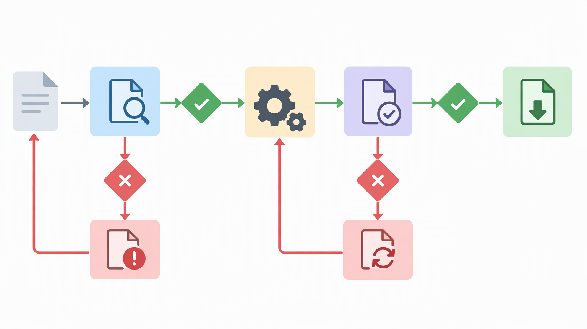
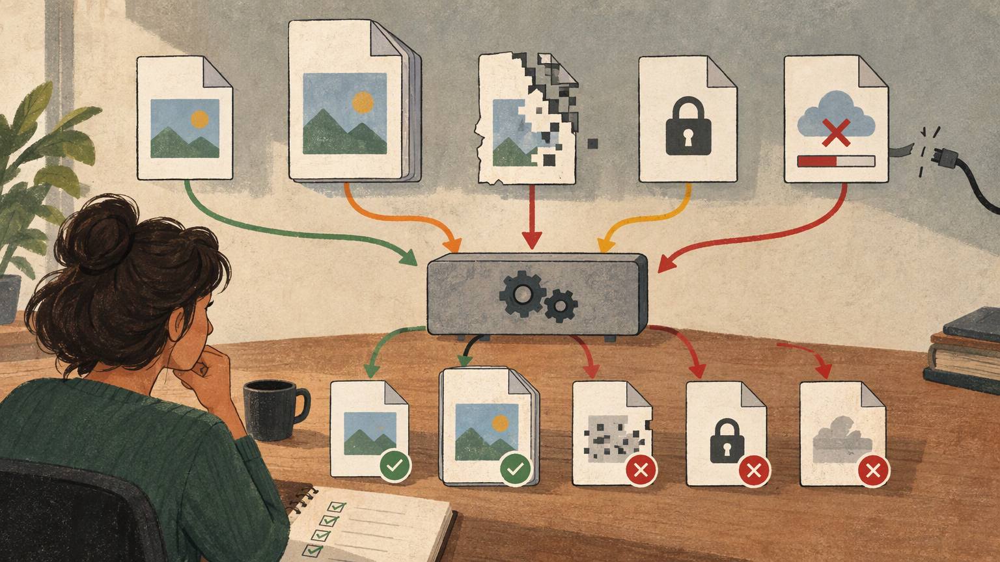

*Published November 3, 2026*

<Frame caption="A conversion product is a sequence of accountable stages, not merely an upload button and a download link.">
  
</Frame>

A useful **file converter** MVP solves one narrowly defined transformation problem reliably before it tries to become a general-purpose utility. That means deciding who needs the conversion, which formats matter, what happens to uploaded files, and how users learn whether a job succeeded. The interface may appear simple, but the product depends on clear constraints around validation, processing, output delivery, and failure handling.

This guide sets out a practical way to plan a focused file conversion tool. It is intended for entrepreneurs and developers evaluating an online file converter, a document converter, or another file upload web app. The goal is not to prescribe a specific processing library or infrastructure stack. It is to help you define an MVP whose behavior is understandable, testable, and realistic to operate.

## Scope Your File Converter Before You Build

Start with one user task and a small format pair, because broad format support creates uncertainty in validation, processing, and quality assurance. “Convert files” is a category, not yet a product requirement. A more workable starting point is a specific job such as turning one common document format into a shareable output, or converting a defined image input into a web-ready version.

### Set prerequisites before implementation

Write down the decisions below before producing screens or backend jobs. They turn a vague tool idea into requirements that can be reviewed.

- **User and outcome:** Identify the person using the tool and the result they need. A user preparing a document for distribution has different expectations from someone preparing images for a website. - **Source and output formats:** Specify each accepted input and each available output. Treat every conversion direction as its own requirement; supporting A to B does not automatically define B to A.

These constraints should appear in plain language near the upload action. Users should not have to submit a file to discover that a format or size is outside the product’s scope.

### Choose a narrow first release

A first release should favor a conversion that is frequent enough to evaluate and bounded enough to test. Avoid beginning with a large menu of unrelated formats. Each additional format introduces distinct input validation, processing behavior, output checks, error messages, and support questions.

A focused document converter, for example, might accept one source type and produce one destination type. Its first version can then concentrate on whether the right files are accepted, whether the job state is visible, and whether the downloaded result meets the stated expectation. Once that path is dependable, adjacent formats can be assessed using the same criteria.

Create a short compatibility matrix for the team. For every source-output pair, record the allowed input conditions, known limitations, expected processing path, and user-facing failure message. This matrix is more useful than an undifferentiated list of file extensions because it exposes incomplete decisions early.

## Design the File Conversion Workflow

<Frame caption="Validation and recovery branches should be designed alongside the successful conversion path.">
  
</Frame>

Make the workflow legible from upload through download, because users need clear status and recovery options when a conversion cannot complete. A file upload web app should show what the system is doing without implying that every submitted file will succeed.

### Map the job lifecycle

Use the following numbered sequence as the MVP workflow. The exact implementation can vary, but the states should be explicit in the product design.

1. **Select or drop a file.** Show accepted formats and relevant limits before upload. If multiple output formats are available, let the user choose one only after confirming that the input is compatible. 2. **Validate the request.** Check file extension, type where available, size, and basic request rules. Reject clearly incompatible submissions promptly, with a reason and a next action. 3.

This lifecycle also helps separate product errors from user-correctable issues. A file that exceeds a stated limit is not the same as a temporary processing failure. Treating both as a generic “conversion failed” message leaves users unable to respond usefully.

### Design error states as part of the product

For each workflow stage, write the message, cause, and next action. Good messages identify the failed stage without exposing unnecessary internal detail. For example, an unsupported source format should say which format was expected and point to the supported choices. An unreadable or protected input can ask the user to provide an accessible version.

Do not automatically invite retries for every failure. Repeating an incompatible request consumes time and may mislead users. Conversely, removing the file and forcing a complete restart after a temporary interruption can be needlessly frustrating. Match recovery behavior to the category of failure.

The UI should also preserve context after a problem. Keep the filename, requested output, and visible status where doing so is appropriate. That allows a user to understand what occurred rather than guessing which of several uploads failed.

## Build the Application Foundation

Build the smallest set of application components that supports accountable jobs, controlled access, and a manageable operating model. A conversion product can begin without accounts, but it still needs a coherent way to associate uploads, job status, generated files, and cleanup actions.

### Define the minimum data and service boundaries

At a conceptual level, the MVP usually needs records for a conversion job and its files. A job can track the requested source and output formats, status, timestamps, error category, and delivery state. File metadata may include the original name, size, detected type, storage reference, and relationship to its job. Avoid storing more metadata than the product actually needs.

Keep the conversion worker or service separate from the web request that begins the upload. This makes it easier to represent waiting, processing, completion, and failure states accurately. It also supports later changes to processing capacity without requiring a redesign of the user workflow.

Authentication is optional when the product offers a one-time conversion flow and does not promise history. It becomes more relevant when users need to revisit downloads, manage prior conversions, collaborate in a workspace, or control access to files. If accounts are deferred, be precise about what the product does not retain.

Teams that want to move from requirements to an editable prototype can use [AutoCoder's AI app builder](https://www.autocoder.cc/platform?utm_source=blog&utm_medium=latest&utm_campaign=FileConverter) to generate frontend, backend, and database components from a defined brief. The brief should include the job states, format matrix, validation rules, and retention choices described above; generating an application does not remove the need to verify conversion behavior and operational safeguards.

### Treat files as an operational responsibility

A file conversion tool handles content supplied by users, so its operational decisions should be visible in the plan. Define where files are accepted, how access to uploaded and generated files is controlled, when files are removed, and what happens when a job is abandoned. Review logging carefully so it supports troubleshooting without unnecessarily exposing file contents or sensitive names.

Set limits before traffic or usage patterns force hurried decisions. Limits can cover upload size, number of simultaneous jobs per user or session, allowed formats, and output availability. The correct limits depend on the conversion type and infrastructure, so avoid publishing promises that have not been tested.

## Test Reliability and Usability Before Expanding Formats

<Frame caption="Reliable conversion requires testing difficult and interrupted cases, not only ideal files.">
  
</Frame>

Test representative and difficult files against the stated promise, because a successful technical request is not necessarily a useful output. Reliability includes the quality of the downloaded file, the accuracy of job status, and the usefulness of the response when something goes wrong.

### Build a deliberate test set

Prepare files that reflect the intended use case, not only ideal examples. Include ordinary valid files, files near your chosen boundaries, inputs with complex content relevant to the format pair, invalid extensions, corrupted files, protected files where applicable, and requests that stop during upload or processing.

Check the output in the ways users will use it. For a document converter, this may mean opening the output in the intended reader and reviewing the elements that the product says it preserves. For an image-oriented tool, it may mean checking the expected dimensions, visual result, and file accessibility. Do not reduce acceptance testing to whether a download button appears.

Test the interface under ordinary interruptions as well. Navigate away during upload, refresh while a job is running, submit the same file twice, and attempt a download after the output is no longer available. The application should display a truthful state rather than leaving users with a permanent spinner or a link to an unavailable file.

### Use feedback to govern expansion

Before adding a format, review the failures and questions arising from the existing path. Look for ambiguity in compatibility messages, repeated unsupported inputs, output limitations that require clearer disclosure, and workflow stages that users misunderstand. These observations should inform the next format pair rather than simply adding more choices to the interface.

Maintain a visible limitations page or in-product note as the scope grows. It should distinguish supported conversions from planned or unsupported ones and explain meaningful constraints without technical jargon. This documentation reduces avoidable submissions and gives the team a stable reference for support and testing.

## Common Misconceptions About File Conversion Products

The practical point is to avoid treating conversion as a single, uniform capability. Different file types carry different structures, permissions, layouts, and quality expectations, so identical-looking controls can hide very different outcomes.

One misconception is that accepting a file extension proves compatibility. Extensions are only one signal; the actual file may be malformed, protected, or contain content the conversion path cannot handle as intended. Validation should therefore be layered and messages should avoid guarantees based solely on a filename.

Another misconception is that more formats automatically make a better online file converter. Broad support can be valuable, but only if every route has defined constraints and adequate tests. A smaller tool with an explicit, dependable use case is often easier for users to understand and for a team to operate.

Finally, a download is not by itself proof of a successful conversion. The output must be available, openable, and aligned with the documented expectation. Defining this distinction early prevents a misleading success state.

## FAQ

### What is a file converter?

A file converter changes a file from one format to another, such as a defined source document or image format into a chosen output format. A web-based tool also needs to manage upload, validation, processing, delivery, and errors around that transformation.

### Which file formats should a file converter support first?

Start with the smallest source-to-output pair tied to a clear user need. Choose formats you can define, validate, test, and explain, including known limitations. Add further pairs only after the initial workflow is reliable.

### How should a file conversion workflow handle errors?

Identify the failed stage, use a clear message, and give an appropriate next action. Unsupported files should be rejected before processing; temporary processing issues may allow a retry; and no failure should be presented as a completed download.

### Can I build a file converter as a web app?

Yes. A web application can provide file selection, validation, job tracking, conversion processing, download delivery, and optional account history. The MVP should begin with a narrow format scope and explicit rules for retention, access, and failures.

## Conclusion

A dependable **file converter** begins with disciplined scope rather than a long list of formats. Define one user outcome, document acceptable inputs and output limitations, and design the full path from upload to failure recovery before expanding the interface. Then test representative files and interruptions against the promise users see. This approach gives a file conversion tool a clearer foundation for further formats, accounts, or workflow features without obscuring its initial purpose.
