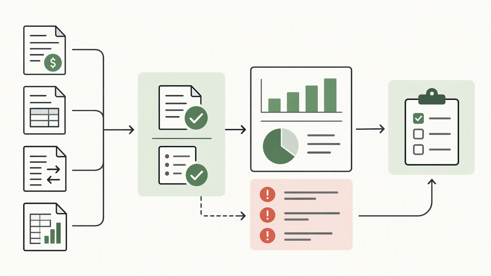

*Published November 3, 2026*

<Frame caption="A useful finance dashboard is planned as a connected system of decisions, definitions, source data, and controlled access.">
  
</Frame>

A **finance dashboard** is most useful when it answers a small number of recurring business questions with clearly defined, trusted data. For small business teams, that usually means prioritizing visibility over visual complexity: what cash is available, what is owed, what has been spent, and where attention is needed.

The first version does not need every accounting measure or a polished executive scorecard. It needs a defined audience, consistent metric rules, an appropriate data workflow, and access controls that match the sensitivity of the information. This guide lays out a practical path for building an internal reporting MVP without treating the dashboard as a replacement for accounting review or financial judgment.

## Set the Finance Dashboard Scope Before Building

Start by naming the decisions the dashboard should support. A dashboard built around decisions is easier to scope than one built around a broad request for “financial visibility.”

Different users need different levels of detail. A founder may need a concise view of cash position, expected payments, and major cost categories. A finance team may need the underlying transaction records, status exceptions, and reconciliation context. Department managers may only need approved budget-related information for their area. Trying to serve all of these needs in one initial screen often creates a confusing financial dashboard.

### Prerequisites for a useful first version

Before designing pages or connecting data, establish the following:

- **A primary user group.** Choose the people who will use the first release regularly, rather than designing for every possible stakeholder. - **A recurring review cadence.** Decide whether the dashboard supports daily monitoring, weekly operating reviews, or monthly reporting. Cadence determines refresh needs and the appropriate level of detail. - **A defined reporting boundary.** Clarify the entities, accounts, departments, currencies, and time periods included in the tool. - **An accountable data owner.** Assign someone who can answer how a metric is calculated, what its source is, and when its data was last updated.

A useful opening exercise is to write five to eight questions users should be able to answer quickly. Examples include: “Which invoices need follow-up?”, “How does this period’s spending compare with the approved plan?”, or “What cash movements are expected in the near term?” The questions should reflect real operating decisions, not merely available fields in a spreadsheet.

Then define what the dashboard will not do. A first release might exclude forecasting models, multi-entity consolidation, expense approvals, or direct transaction edits. These exclusions protect the MVP from becoming an unfinished finance system.

## Select Metrics and Define the Data Behind Them

<Frame caption="Reliable reporting depends on validating source records and metric definitions before presenting dashboard summaries.">
  
</Frame>

Choose measures only after establishing their definitions, source fields, and update rules. The practical goal is not to display more metrics; it is to make each displayed number interpretable and traceable.

A business finance dashboard commonly organizes information around a few operational areas:

1. **Cash position and movement.** A cash flow dashboard can show available balances where appropriate, money received, money paid, and upcoming expected movements. Be explicit about whether the view is based on cleared transactions, scheduled items, invoices, bills, or another basis. 2. **Revenue and collections.** Depending on the workflow, this may include issued invoices, received payments, overdue receivables, or revenue categories. Do not label a measure “revenue” unless its accounting treatment and period logic are clear. 3. **Expenses and commitments.** Teams may need actual spending by category, department, vendor, or project, along with approved budgets and known future commitments when those records exist. 4.

For every metric, maintain a short metric definition. It can live in an internal documentation page or within the application. At minimum, record the formula or aggregation rule, source system, source fields, reporting period, refresh timing, owner, and known limitations. For example, “overdue receivables” must define whether it includes disputed invoices, partial payments, credit notes, or only items past a due date.

This discipline matters because similar labels can hide different calculations. “Cash flow,” “profit,” “spend,” and “budget variance” are not self-explanatory. If users cannot tell what a number includes, the dashboard may create confidence without providing clarity.

Data structure should reflect the questions being asked. A simple internal MVP may use records for transactions, invoices, bills, budgets, categories, departments, and reporting periods. Keep raw imported values distinct from derived fields where possible. For instance, an invoice status from a source record is different from a calculated “days overdue” field.

Plan for data quality controls from the start. Required dates, controlled category values, duplicate checks, and visible import status can be more valuable than another chart. Include a “last updated” indicator and a way to identify missing or unclassified records. If data is imported manually, record when the import occurred and who performed it.

## Design Views That Lead to Action

Build the first screens around review tasks, then provide drill-down paths to the records behind a summary. The practical test is whether a user can move from a concerning figure to the item that requires follow-up.

A finance reporting dashboard often benefits from separate views rather than one dense home screen. A compact overview can surface key current-period indicators and exceptions. Dedicated pages can then handle receivables, payables, expenses, budgets, and data imports. This structure makes it easier to apply relevant filters without turning every screen into a general-purpose report builder.

Use filters with a specific purpose. Common choices include date range, entity, department, category, project, and record status. Avoid adding filters simply because a field exists. Each one adds cognitive load and increases the chance that users interpret filtered results as a complete picture.

The overview should emphasize exceptions and context. A list of overdue invoices is actionable when users can see due dates, owners, amounts, and status. A spending summary is more useful when the chosen period and category logic are visible. Trend lines or charts can help when they reveal a pattern that a table cannot, but they should not obscure exact values or underlying records.

Design for traceability in every important view. A user should be able to answer:

- What period am I viewing?
- Which records contribute to this total?
- When was the information refreshed?
- Is the value imported, calculated, or entered manually?
- Who should resolve an exception?

Labels and empty states deserve the same care as the primary views. If a filter returns no records, say whether that means no matching data, no data has been imported, or access restrictions prevent visibility. If a measure is unavailable, avoid displaying a blank value that could be mistaken for zero.

## Build a Controlled MVP in Numbered Steps

Treat the MVP as a controlled reporting workflow, not merely a collection of screens. The following sequence keeps scope, data, and permissions connected.

1. **Write a one-page dashboard brief.** State the primary users, their decisions, the reporting cadence, included data domains, excluded features, and success criteria. Keep the criteria behavioral: users should be able to review exceptions or prepare a recurring meeting without assembling information from multiple uncontrolled files.

2. **Create a metric dictionary.** List each metric, its definition, calculation approach, source, refresh expectation, and owner. Resolve ambiguous terms before implementation. If a metric cannot be defined reliably yet, leave it out of the first version.

3. **Map source data to a minimum data model.** Identify the required records and fields. Normalize categories, statuses, dates, and identifiers enough to support consistent filtering and aggregation. Preserve source identifiers so users can investigate a displayed record.

4. **Build the overview and one priority workflow.** For example, pair a summary overview with a receivables follow-up view, or pair spending review with budget comparison. Delivering one complete workflow is generally more useful than delivering partial views for every finance topic.

5. **Add validation and operational states.** Show import status, refresh time, missing classifications, and records that fail basic checks. Test what happens when data is incomplete, duplicated, late, or not yet available.

6. **Apply authentication and role-based access.** Define who can view summaries, inspect detailed records, import data, change classifications, or manage users. Restrict sensitive detail according to job need, not convenience. Also decide how access is removed when responsibilities change.

7. **Review the dashboard against real questions.** Use a controlled set of known records from the intended workflow. Ask users to locate an exception, explain a total, and identify its contributing records. Capture unclear labels, missing context, and requests that belong in a later release.

Small teams that want to turn requirements into an editable internal tool can use [AutoCoder's AI app builder](https://www.autocoder.cc/platform?utm_source=blog&utm_medium=latest&utm_campaign=FinanceDashboard) to generate frontend, backend, and database components from a written specification. The specification should still describe the metric dictionary, source records, roles, and constraints; application generation does not remove the need to define financial logic.

## Manage Access, Change, and Ongoing Reliability

<Frame caption="Financial reporting tools need separate permissions for viewing, data changes, imports, and user administration.">
  
</Frame>

Make ownership and review practices part of the product, because financial reporting changes as systems, categories, and responsibilities change. A dashboard that is accurate at launch can become misleading if its definitions and imports drift.

Start with a simple permissions model. Separate viewers from people who can edit classifications, import data, or manage access. Consider whether some users should see aggregate information without seeing individual payments, vendor details, compensation-related entries, or other sensitive records. The right roles depend on the organization, but permissions should be intentional and documented.

Maintain a change process for metric definitions and category mappings. When a definition changes, record what changed, why, who approved it, and from which reporting period it applies. This does not require a complex governance program; a short change log and a clear owner are often enough for an MVP.

Reliability also depends on routine checks. Review failed imports, unmatched records, unexpected category values, and gaps in reporting periods. Establish an escalation path for material discrepancies: users need to know whether they should correct a source record, request a mapping change, or flag a calculation issue.

If the dashboard needs to evolve from prototype to a more complete application, [AutoCoder](https://www.autocoder.cc/platform?utm_source=blog&utm_medium=latest&utm_campaign=FinanceDashboard) supports editable, deployable full-stack applications and source-code continuation. Regardless of the implementation approach, test access boundaries and data handling before expanding the user group.

## FAQ

### What should a finance dashboard include?

Include the measures and records needed for the dashboard’s defined decisions. A first version often covers cash movement, receivables, payables, spending, budget comparison, or a focused combination of these. Each item should have a documented source, definition, reporting period, and owner.

### How do I choose finance dashboard metrics?

Start with recurring questions users need to answer, then select metrics that directly support those questions. Prefer measures with a reliable source and clear calculation rule. Exclude attractive but poorly defined measures until their data and meaning can be established.

### Can I build a finance dashboard without coding?

It may be possible to create a functional internal tool with an application builder or low-code approach, particularly for a focused MVP. The implementation method does not replace work on data mapping, metric definitions, permissions, and testing. Those requirements remain necessary regardless of how the interface is built.

### How should access to financial data be managed?

Use authentication and role-based permissions aligned with each person’s work responsibilities. Separate viewing, editing, importing, and administrative actions where appropriate. Review access regularly and remove it when roles change.

## Conclusion

A dependable **finance dashboard** begins with disciplined scope rather than a long feature list. Define the decisions, document the metrics, connect only understood data, and build one complete reporting workflow before expanding. With clear ownership, visible data status, and role-based access, a financial dashboard can become a practical internal reporting tool without overstating what its data can support.
