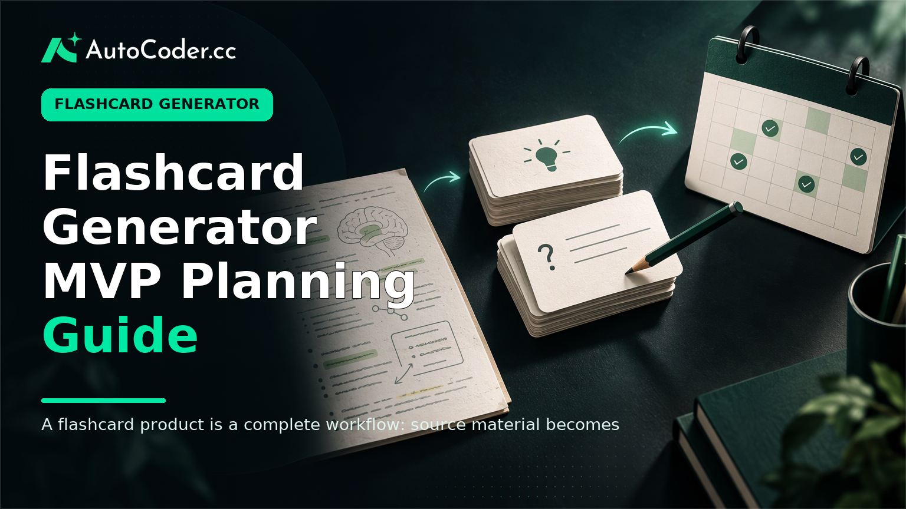
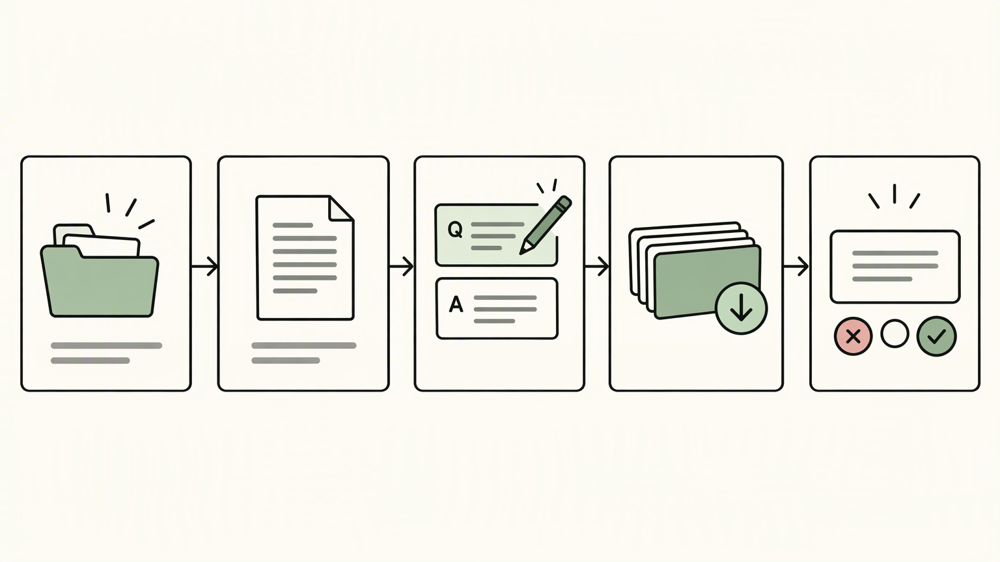
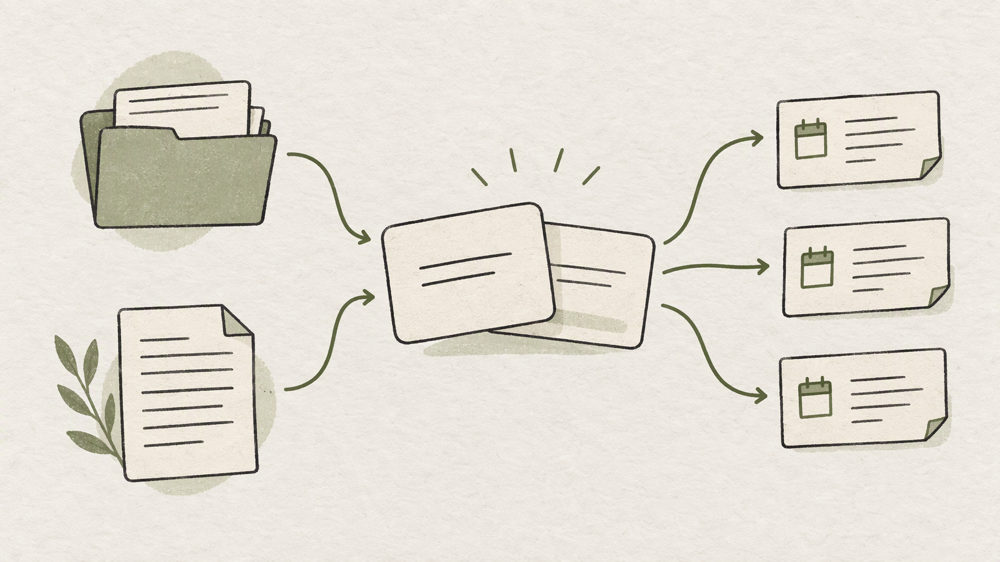

*Published November 4, 2026*

<Frame caption="A flashcard product is a complete workflow: source material becomes editable cards, then repeatable review.">
  
</Frame>

A **flashcard generator** is most useful when it turns learning material into cards learners can review, correct, organize, and return to over time. For founders, educators, and product teams, the first version does not need to solve every study problem. It needs to support one reliable path: bring in source material, create usable cards, review them, and improve the deck when the output is weak.

That scope matters because a study tool MVP is both a content workflow and a learning workflow. Generating a question and answer is only one part of the product. Learners also need enough context to judge a card, a way to edit it, and a predictable route back to material that needs further practice.

## Define the flashcard generator’s first use case

**Start with one learner, one source format, and one study outcome.** A broad promise such as “make any subject easier to learn” makes product decisions harder. A narrower starting point gives the team a basis for choosing inputs, card formats, validation rules, and review behavior.

Choose a first use case by answering three questions:

- Who creates the cards: an individual learner, an instructor, or a team preparing shared material?
- What material do they start with: pasted text, structured notes, manually entered prompts, or another clearly defined format?
- What should happen after creation: a short self-test, ongoing recall practice, or classroom preparation?

For example, an individual preparing for an exam from pasted lecture notes has different needs from an educator creating a shared vocabulary deck. The individual may value quick import and private editing. The educator may need deck structure, clear wording, and a way to review cards before students see them.

### Set MVP prerequisites before building

A usable MVP needs decisions that are easy to overlook when attention is on generation. Write these down before designing screens or data models:

1. **Primary input.** Define the supported input precisely. “Text pasted into a source field” is testable; “all documents” is not. If file upload is important later, leave room in the model for an attached source but avoid making it a launch dependency. 2. **Card type.** Begin with a basic front-and-back card.

The first use case also establishes the right level of automation. An AI flashcard generator can propose cards from source text, but it should not imply that generated wording is automatically accurate or suitable for every learner. Design the product around reviewable suggestions.

## Design the core flashcard workflow

<Frame caption="Generation should sit within a clear path from source input to editable cards and a completed review session.">
  
</Frame>

**Make generation a checkpoint inside a complete study path, not the destination.** A learner should be able to move from material to an editable deck and then into a review session without losing orientation. A simple workflow prevents generation from becoming a dead end.

A practical initial flow is:

1. Create a deck and give it a recognizable title. 2. Add source text or create a card manually. 3. Request proposed cards from the source. 4. Review proposals in an editing state before relying on them for study. 5. Save approved cards to the deck, with optional tags. 6.

Each stage should make the next action obvious. After source text is submitted, show that card creation is in progress or that proposals are ready to inspect. After editing, distinguish saved cards from unsaved changes. During review, keep deck navigation separate from the question itself so the learner can focus on recall.

### Build card creation around editing, not just generation

The editing screen is the quality-control layer of the flashcard app. It should make it quick to correct common weaknesses rather than force users to discard a whole result. At a minimum, provide controls to edit the front and back, delete a proposal, add a card manually, and reorder or filter cards in the current deck.

A source preview can also be valuable when cards originate from notes. It helps users compare a proposed answer with the material they provided and catches cards that combine unrelated ideas. If a full source preview is too large for the first interface, show a short source excerpt or identify the input block from which a card was derived.

Keep wording constraints visible in the product requirements. A good prompt asks for one response that a learner can attempt before revealing the back. A good answer is specific enough to verify but not so long that it becomes a paragraph to memorize.

### Model the data for future changes

A small, explicit data model makes it easier to adjust the workflow later. The MVP can use entities such as:

- **User:** account identity and ownership of personal content. - **Deck:** title, description, owner, and optional organization fields. - **Card:** front, back, deck reference, creation state, and timestamps. - **Tag:** optional label that can connect cards or decks by topic. - **Source:** stored input text or a reference to material used to create proposals.

Do not collapse review state into the card text itself. A card’s content and a learner’s progress are different things. Separating them also prepares the product for shared decks, where several people may study the same card at different paces.

Tags should solve a real retrieval problem. Useful tags might represent a chapter, learning objective, language, or course unit. Unstructured tagging can become clutter, so an MVP can make tags optional and allow deck-level organization to do most of the work.

## Build the study and review experience

<Frame caption="Card content, source material, and each learner’s review history should be modeled as separate records.">
  
</Frame>

**Prioritize a dependable recall loop before adding elaborate learning mechanics.** The review screen is where a generated deck becomes a study tool. Its job is to present a prompt, let the learner attempt an answer, reveal the back, and capture a judgment that informs what happens next.

For a first release, a straightforward pattern is sufficient: show the card front, provide a reveal action, then offer a small set of response choices such as “again,” “hard,” or “known.” The labels matter less than their meaning. Document how each choice changes the next review opportunity, and use consistent language across the interface.

A spaced repetition app requires scheduling logic, but that logic can begin simply. Rather than implementing a complex adaptive system before learners can complete a session, establish a transparent rule for new, difficult, and familiar cards.

Make progress understandable without turning it into a scoreboard. A learner benefits from knowing how many cards are currently due, which deck is active, and whether a session is complete. Avoid presenting uncertain indicators as evidence of mastery. Completing reviews records engagement with cards; it does not by itself establish learning outcomes.

### Design for interruptions and imperfect behavior

Study sessions rarely happen under ideal conditions. Users may leave midway through a deck, switch devices, or realize a card is poorly phrased while reviewing. Preserve the current state where feasible, allow a return to the deck, and provide an edit route that does not erase review history by accident.

Also plan for empty and boundary states. A new user needs a clear way to create the first deck. A deck with no cards needs a creation prompt rather than a blank review screen. A learner with no cards due should see what that means and be able to browse or add material.

## Build and test a functional MVP

**Translate the workflow into buildable requirements, then test the entire path with realistic material.** A specification should describe both what users see and what the system must preserve. This is especially important when using an application builder, because broad instructions can create broad, disconnected screens.

A team can use [AutoCoder’s AI app builder](https://www.autocoder.cc/platform?utm_source=blog&utm_medium=latest&utm_campaign=FlashcardGenerator) to generate editable frontend, backend, and database components from natural-language requirements. The useful input is not simply “build an AI flashcard generator.” It is a concise product brief that identifies user roles, entities, screen states, permissions, and the primary flow.

For example, specify that authenticated users can create private decks; paste text into a source field; create, edit, and delete cards; start a review session; submit a response judgment; and return to a dashboard listing cards due for review. State which actions are deliberately out of scope, such as public publishing, payments, or collaborative editing.

### Test in the order users encounter the product

Test the product as a sequence, not as isolated pages. Start with account access, then deck creation, source entry, card proposal, editing, saving, review, and return visits. Check that the correct user sees only the decks and progress records they should access.

Use varied but realistic sample material during testing: concise definitions, process notes, terminology lists, and text containing ambiguity. Inspect whether generated prompts stay anchored to the source, whether answers are readable, and whether manual edits persist. Test deletion and cancellation paths as carefully as creation paths.

Review technical and product questions together. Authentication, ownership checks, input limits, error messages, and deployment configuration affect trust in a study tool just as much as card layout. If the team needs to move beyond a generated prototype, [AutoCoder](https://www.autocoder.cc/platform?utm_source=blog&utm_medium=latest&utm_campaign=FlashcardGenerator) supports continuing to edit and extend the application’s source code. Keep a short issue list that separates defects in the basic flow from future feature ideas.

### Decide what to defer

A disciplined backlog protects the first release. Common candidates for later work include multiple question formats, image-based cards, shared libraries, classroom management, advanced analytics, and sophisticated scheduling controls. They may be useful, but each introduces additional content rules, permissions, or support needs.

Defer a feature when its absence does not break the core path from material to review. Bring it forward only when the initial users consistently encounter a specific limitation that the basic deck, editor, and review loop cannot address.

## FAQ

### What features should a flashcard generator include?

A first version should include deck creation, manual card entry, a defined source-input method, editable generated proposals, card deletion, basic organization, and a review screen that records a response judgment. Authentication and clear ownership rules are also important when users save personal study material. Start with these connected features before adding sharing, advanced statistics, or many card formats.

### Can a flashcard generator create cards from notes?

Yes, if the product supports a clear note input such as pasted text. Treat the resulting cards as proposals that users can inspect and revise. The workflow should preserve enough source context for users to check whether a prompt and answer match their notes. Supporting additional file types is a separate implementation decision, not a requirement for an initial MVP.

### How should users organize generated flashcards?

Use decks as the primary structure, since they naturally represent a subject, unit, or exam topic. Add optional tags only when users need to retrieve cards across several decks, such as by learning objective or chapter. Keep organization editable so a user can move cards when a generated deck is too broad.

### Does an MVP need spaced repetition from the start?

An MVP needs a repeatable review rule, but it does not need complex scheduling. Begin by storing each review event and assigning a transparent next-review behavior based on the learner’s response. This creates a usable return loop and leaves room to refine the scheduling model after the core experience has been tested.

## Conclusion

A focused **flashcard generator** MVP connects source material, editable cards, and a reliable review routine. Begin with one learner and input format, define a modest data model, and test the complete path from creation through return visits. By treating generated cards as reviewable learning material rather than final output, product teams can build a study tool that is clearer to validate and easier to extend.
