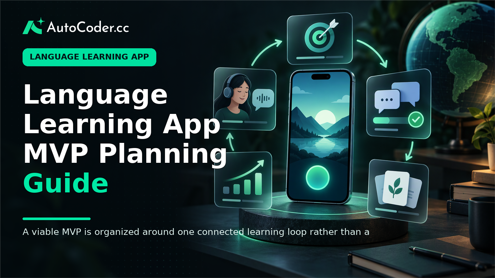
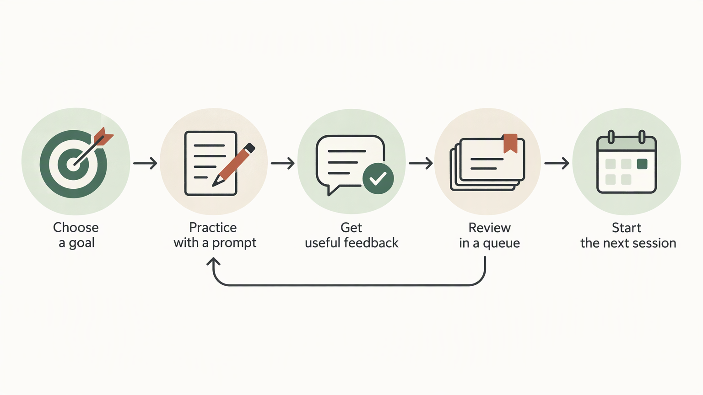

*Published November 4, 2026*

<Frame caption="A viable MVP is organized around one connected learning loop rather than a broad collection of unrelated features.">
  
</Frame>

A **language learning app** becomes easier to plan when it solves one defined learning problem for one defined group. Rather than beginning with a large course catalog or a long feature list, begin with the learner’s situation: what they need to do in another language, where they get stuck, and what a short successful practice session looks like.

This guide sets out a practical route from product focus to a testable MVP. It is intended for entrepreneurs, educators, and product teams developing a niche product, whether the first version emphasizes vocabulary, dialogues, listening, or guided speaking practice.

## Choose a clear learner and learning outcome

**Start by limiting the first release to a learner, a context, and an observable outcome.** This decision gives every later product choice a useful boundary. A broad promise such as “learn Spanish” leaves unresolved questions about level, motivation, time available, and the skills the app should prioritize.

Define the learner in enough detail that a team can reject out-of-scope ideas. For example, a product might serve beginner English learners preparing for hospitality work, intermediate Japanese learners who want to handle travel interactions, or heritage-language learners rebuilding everyday vocabulary. These groups may share a language, but their content and practice needs differ.

Write a short product premise using this structure:

- **Learner:** their level, language pair, and relevant setting.
- **Immediate goal:** one task they want to perform more confidently.
- **Practice format:** the main type of activity they will complete.
- **Evidence of progress:** what a learner can do, recall, recognize, or complete after practice.

A focused premise might be: “Help beginner Italian speakers learn the English phrases and vocabulary needed to take a restaurant order.” It does not claim to teach all English. It creates a basis for selecting lessons, feedback, and progress measures.

### Prerequisites before you build

Before starting language learning app development, prepare a small set of decisions and materials. You do not need a complete curriculum, but you do need enough content to make the learning loop real.

1. **A learner definition.** Include the starting ability, target language, and use context. 2. **One learning objective.** Phrase it as a practical outcome, not merely content coverage. 3. **A small content set.** Prepare a limited collection of words, prompts, examples, or dialogues relevant to the objective. 4. **A review rule.** Decide what makes an item return: an incorrect response, a self-reported lack of confidence, elapsed time, or a combination you can explain. 5.

This preparation also exposes an important constraint: content quality is part of the product. An app can present exercises smoothly while still using examples that are unclear, mismatched to the learner, or too difficult. Treat content review as a continuing product responsibility, not a task to defer until after the interface is complete.

## Design the core learning loop for your language learning app

<Frame caption="The core product loop should give learners a clear activity, useful feedback, a reason to review, and a next action.">
  
</Frame>

**Make each session follow a repeatable sequence of practice, feedback, review, and progress.** A learner should understand what to do now, receive a useful response to what they did, and see a credible reason to return. That sequence is the core learning loop.

Choose one primary content format for the MVP. A vocabulary learning app may introduce a word in context, ask the learner to recognize or produce it, then schedule it for review. A dialogue-focused product may present a brief scenario, ask the learner to choose or compose a response, and show an alternative phrasing with an explanation. Listening and speaking products can use similarly focused loops, provided the feedback is clear about what is being assessed.

Avoid combining every format in the first version. Mixing flashcards, grammar modules, long-form lessons, live classes, social feeds, and open-ended chat makes it harder to learn whether any one experience is useful. A narrow loop is not a permanent limitation; it is a way to test the product’s central assumption.

### Build the loop in numbered steps

1. **Set a session purpose.** Tell learners what the short session covers and why it relates to their stated goal. “Practice checking in a hotel” is more actionable than a generic unit label. 2. **Present meaningful input.** Introduce a small amount of new language through a phrase, image, audio clip, dialogue line, or scenario. Keep the context sufficient to clarify intended meaning. 3.

The feedback step deserves particular care. For a simple recognition activity, a correct answer may be enough. For production activities, show an answer model and distinguish between a response that is understandable and one that better fits the scenario. Do not imply linguistic precision that the app cannot reliably assess.

A learning progress tracker should reflect the loop rather than become a separate dashboard full of vague totals. Track useful states such as completed sessions, items due for review, recent response patterns, and progress toward the chosen goal. If an indicator does not help the learner decide what to do next, it may not belong in the MVP.

## Specify the first language learning app

**Turn the learning loop into a small set of screens, records, and rules before building.** A specification does not need to be formal or lengthy. Its purpose is to make assumptions visible, prevent scope drift, and allow a prototype to be evaluated as a connected experience.

Start with the learner-facing journey. In many MVPs, the essential screens are an onboarding or goal-selection view, a home screen that recommends the next activity, a practice screen, feedback states, a review queue, and a simple progress view. Authentication may be needed if progress must persist across sessions or testers need individual accounts.

Then outline the information the product must retain. For a vocabulary learning app, records might include language items, translations or explanations, example contexts, lesson or scenario associations, learner responses, review status, and session history. For dialogue practice, you may also need scenario metadata, turns, response options, and feedback notes. Keep the model aligned with the first learning loop; do not create structures for hypothetical future modules.

Write acceptance criteria in plain language. Examples include: a learner can select a goal; a learner can complete a short practice set; an incorrect or uncertain item is available for later review; and returning learners can see a relevant next activity. These criteria are more useful than a feature inventory because they describe an outcome a tester can verify.

A functional prototype requires more than static screens. It needs the frontend interactions, a way to store content and learner progress, and an account approach if the test requires persistence. Teams that want to move from requirements to a working full-stack starting point can use [AutoCoder's AI app builder](https://www.autocoder.cc/platform?utm_source=blog&utm_medium=latest&utm_campaign=LanguageLearningApp), which generates editable frontend, backend, and database components from natural-language product requirements and can support authentication and deployment workflows. The generated result still needs product review, content checks, and testing with the intended learners.

Keep ownership and changeability in view. A language product will likely need revised content structures, different review rules, and new learner states as evidence emerges. Use a workflow that lets the team inspect and continue editing the source code rather than treating the initial prototype as fixed.

## Test usability and learning relevance

<Frame caption="Early testing should examine whether representative learners understand the practice activity and find it relevant to their goal.">
  
</Frame>

**Observe real learners completing one short session before expanding the feature set.** Early testing is not a final proof of learning effectiveness. It is a way to discover whether people understand the task, whether the content fits their stated need, and whether the feedback supports another attempt.

Recruit people who resemble the defined learner rather than general testers alone. Give them a realistic starting prompt, such as preparing for a work interaction or reviewing vocabulary before a trip. Ask them to use the product without a detailed walkthrough. Note where they hesitate, misunderstand an instruction, abandon an activity, or question the relevance of an example.

After the session, ask focused questions:

- What did you think you were practicing?
- Which feedback was useful or unclear?
- Did the activity match the goal you selected?
- What would you expect to happen when you return?
- Was anything too easy, too difficult, or missing context?

Separate usability findings from content findings. If learners cannot locate the next activity, that is a navigation issue. If they can complete the activity but do not understand why an answer is preferred, the issue may be feedback or content design. If they understand the lesson but see no connection to their real-world goal, revisit the product premise.

Do not overread a small set of sessions. Qualitative feedback helps identify problems and hypotheses; it does not establish broad outcomes. Record observations consistently, prioritize issues that block the core loop, and make one or two targeted changes before the next test round.

## Prepare the MVP for measured iteration

**Prioritize reliable content operations and review behavior over broad feature expansion.** Once the basic loop is usable, the next work should make it easier to improve that loop: updating content, examining learner paths, correcting confusing feedback, and refining what appears for review.

Define a small operational process for adding and checking learning materials. Someone should be responsible for language accuracy, appropriate register, context, and alignment with the learner’s level. If the product uses translations, examples, or generated prompts, specify how those materials are reviewed before reaching learners.

Review the product through a few practical questions. Are learners finishing a session? Are they returning to items marked uncertain? Do they have a clear next action? Which exercise types create confusion? These questions support iteration without pretending that a single metric captures learning.

Expansion is justified when it strengthens the established use case. For example, a dialogue MVP might add new workplace scenarios after the first scenario flow is clear. It should not automatically add unrelated grammar libraries or social functionality simply because those features are common elsewhere. Maintain a short backlog divided into core-loop fixes, content improvements, and future possibilities, then work in that order.

## FAQ

### What features should a language learning app have?

An MVP needs features that support one learning loop: a clear goal, relevant practice activity, feedback, review behavior, and a simple way to see the next step. Accounts and persistent progress are useful when learners will return across sessions. Broader features should wait until the central loop has been tested.

### How do you choose a niche for a language learning app?

Choose a group with a specific language context and immediate task. Define their level, target language, setting, and desired outcome. A niche is useful when it changes the content and practice design, not merely the marketing label.

### Can a non-technical founder build a language learning app prototype?

Yes, a non-technical founder can define the learner journey, content model, and acceptance criteria, then use an application-building workflow to create a functional starting point. Technical review remains important for security, maintainability, integrations, and production readiness as the product grows.

### How should a language learning app measure progress?

Measure progress in ways connected to the product’s learning goal: completed practice, recalled items, review status, and ability to finish relevant tasks. Present these measures as guidance for the next activity rather than as a broad claim about proficiency.

## Conclusion

A focused **language learning app** begins with a narrow learner problem and a practice loop that can be observed in use. Define the learner and outcome, prepare enough reviewed content for short sessions, build only the screens and data needed to support practice and review, and test the result with representative users. This approach gives a language learning MVP a clearer basis for iteration than a broad feature list, while keeping future changes grounded in actual learner needs.
