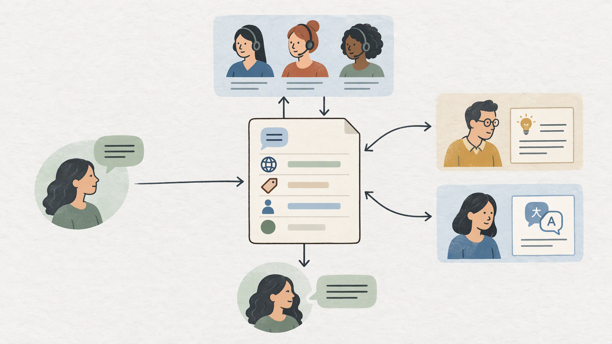
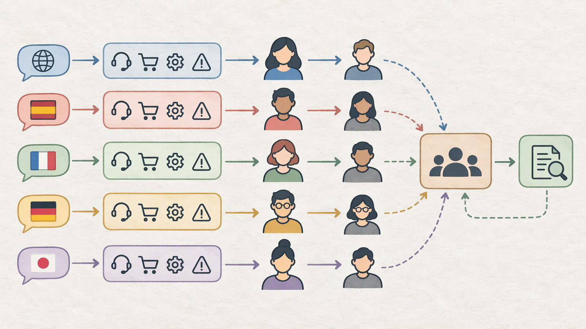

*Published November 3, 2026*

<Frame caption="Multilingual support is a connected operational process from intake through routing, review, and response.">
  
</Frame>

Effective **multilingual customer support** depends on operational choices rather than on translation alone. Small teams need a clear way to capture language preferences, assign requests, preserve context during handoffs, and review customer-facing replies when necessary. The aim is not to offer every language immediately. It is to create a support process that the team can run consistently, explain internally, and extend without losing ownership of tickets.

This guide outlines a minimum viable workflow for a customer portal or internal tool. It covers the prerequisites, build steps, routing rules, and review practices that make multilingual service manageable.

## Map the multilingual customer support workflow

**Map the route from request to resolution before configuring forms or queues.** This ensures language is treated as one useful decision point within the wider customer support workflow, alongside issue type, urgency, permissions, and escalation needs.

### Prerequisites

Prepare a short operating brief before building anything. It should identify the languages the team can currently support, the channels where requests arrive, and the people responsible for first response, specialist input, language review, and final closure. Also define the categories used to sort work, such as account access, billing, product issues, or general questions.

Set expectations for language coverage at this stage. A customer-facing language selector should not imply that every request will receive the same level of coverage or timing. For languages without a dedicated owner, decide whether the fallback is a general queue, a reviewed response, or a request for further clarification.

### 1. Capture language at intake

Ask customers for their preferred response language in the support form. Keep this as a controlled field that customers can change, rather than relying only on the language detected in their message. A customer may write in one language but prefer a reply in another, or may need a regional variant.

Collect only the information needed to start work: issue category, a free-text description, relevant account or order reference where appropriate, and a way to reply. If the form itself is available in multiple languages, keep its labels, error messages, and submission confirmation aligned with the selected language.

### 2. Separate routing from resolution

Language-based ticket routing should establish initial ownership; it should not assume that the first assigned agent will resolve every issue. A language-capable agent may need a technical or billing specialist, while that specialist may need help preparing the final customer response.

Keep the preferred language visible through each handoff. Without that context, a specialist can solve the underlying problem but leave the team uncertain about how the result should be communicated. Treat the language requirement as part of the ticket record, not as a note that can disappear during reassignment.

### 3. Define states and escalation rules

Use a limited set of ticket states with clear meanings, such as new, assigned, waiting for customer, waiting for internal input, language review needed, resolved, and closed. The labels can vary, but each state should indicate what is preventing the next action and who owns it.

Write escalation rules in plain language. Escalate requests involving unclear intent, sensitive account changes, complaints, policy exceptions, legal or safety concerns, or wording an agent cannot confidently interpret. A useful escalation note includes the customer's preferred language, a neutral issue summary, the requested decision, and any relevant urgency.

## Build a multilingual support portal MVP around clear records

<Frame caption="A shared ticket record keeps language and ownership context intact across staff handoffs.">
  
</Frame>

**Build the smallest multilingual help desk that makes requests, ownership, and status visible.** The first version does not need separate portals for every market or a large translated knowledge base. It needs a reliable shared record and role-appropriate views.

### 4. Create one durable ticket record

A ticket record should contain the customer details, preferred response language, message language if it differs, category, status, assigned owner, timestamps, conversation history, and internal notes. Include a visible review or escalation flag instead of placing critical information only in free text.

Separate internal notes from customer-visible messages. This protects unfinished drafts, working summaries, and staff instructions while allowing agents and reviewers to collaborate. The customer history should communicate useful events in clear terms, such as confirmation that a request was received, a request for more information, or notice that an issue has been resolved.

### 5. Give staff useful queue views

Staff queues should show the fields needed for prompt decisions: language, category, status, owner, and how long the request has been open. Filters can help agents find work they can handle, while administrators need visibility into unassigned, escalated, and review-needed tickets.

Do not make language the only organizing principle. A person who can communicate in a given language may not be responsible for all request types. Conversely, a specialist may only need a translated summary and a reviewed response rather than direct access to every related queue. Combining language, category, and state leads to more practical assignment choices.

Role-based access supports this division of work. Agents may need their assigned tickets and reply tools. Administrators may need assignment controls and workflow settings. Permissions should be narrow enough to protect customer information while still allowing work to move when an owner is unavailable.

### 6. Publish help content gradually

A multilingual support portal is most useful when its published guidance is accurate and maintainable. Start with recurring questions that have stable answers. Establish an owner for the source content, then define how translated versions are reviewed before publication.

Do not assume a direct translation is always sufficient. Account steps, product terms, screenshots, and policy language may need local review even if the underlying process remains unchanged. When a translated article is not ready, direct the customer to the support form rather than publishing uncertain instructions.

Teams building a tailored portal or internal tool can use [AutoCoder's AI app builder](https://www.autocoder.cc/platform?utm_source=blog&utm_medium=latest&utm_campaign=MultilingualCustomerSupport) to turn defined requirements into an editable full-stack application. Describe the ticket fields, roles, queues, and states precisely; those decisions shape the resulting MVP.

## Configure language-based ticket routing with practical fallbacks

<Frame caption="A routing matrix provides each language and category combination with an owner, backup, and safe fallback.">
  
</Frame>

**Give every ticket a primary route, a backup route, and a safe default.** A routing system does not need to be complex to be dependable, but it must prevent requests from remaining unassigned when an ideal language match is unavailable.

### 7. Create a routing matrix

Create a simple matrix that links each supported language and issue category to a primary owner, backup owner, and fallback queue. Add the person or role responsible for reviewing the final response when the resolver is not comfortable writing in the customer's preferred language.

The matrix can begin as an internal document. Its purpose is practical: agents should be able to determine who receives the ticket, who can resolve it, who reviews the reply if needed, and what happens when nobody assigned is available.

Keep data fields distinct. Preferred language, routing tag, and the language of the latest message may overlap, but they are not the same fact. Separate fields make routing decisions easier to understand and correct later.

### 8. Use templates within clear limits

Acknowledgement and information-request templates can reduce repetitive drafting. Keep templates short, factual, and approved for each language in which they are offered. Assign an owner so that template changes are reviewed rather than copied informally.

Templates should not replace judgment for complaints, sensitive account actions, or nuanced policy questions. If an agent needs help interpreting a message, retain the original text in the ticket and keep any working summary in internal notes. This preserves context for reviewers and avoids confusing a draft interpretation with the customer's wording.

### 9. Test exceptions before launch

Test the workflow with realistic cases, not only straightforward requests. Submit a ticket with an assigned language owner, one that requires a category specialist, one with missing information, and one in a language outside current coverage. Confirm that every request obtains visible ownership and that customer-facing status messages make sense.

Test permissions as well. Customers should see only their own history. Agents should access the work needed for their role. Administrators should be able to correct assignments and settings without accidentally altering customer messages. If the workflow requires fields or routing logic that a standard tool cannot accommodate, [AutoCoder](https://www.autocoder.cc/platform?utm_source=blog&utm_medium=latest&utm_campaign=MultilingualCustomerSupport) can generate frontend, backend, database, authentication, and deployment components from natural-language requirements, with source code available for continued editing.

## Maintain quality across languages without overextending the team

**Use review and ticket patterns to improve the process instead of trying to perfect every language at launch.** Quality is an ongoing operational practice that checks whether the meaning, action, and next step remain clear for customers.

### 10. Match review to message risk

Set review expectations according to the consequence of a message. A routine status update may use an approved template. A policy decision, account restriction, refund-related message, or sensitive complaint may require a language-capable reviewer before it is sent.

Review for more than grammar. Check that the response preserves the intended action, does not create unsupported commitments, uses understandable terms, and tells the customer what happens next. A polished sentence is not helpful if it changes the meaning of a policy or instruction.

### 11. Turn ticket patterns into improvements

At a cadence the team can sustain, review tickets that remain unresolved, are reassigned repeatedly, or need frequent language escalation. Look for operational causes: a confusing language field, overly broad categories, missing knowledge content, unclear ownership, or templates that prompt follow-up questions.

Record each change in one maintained place. When a routing rule changes, update the routing matrix and staff guidance. When an article changes, check related templates. This reduces drift between the portal, the internal playbook, and day-to-day agent practice.

A common misconception is that multilingual support requires translating every asset before launch. A better starting point is a defined scope with clear fallbacks and reviewed content. Another is that automated language detection or translation removes human accountability. These tools may assist staff, but the team still owns the final customer-facing decision.

## FAQ

### What is multilingual customer support?

Multilingual customer support is a service process that lets customers ask for help and receive information in more than one language. It includes language-aware intake, routing, response review, knowledge content, and escalation practices.

### What languages should a support team offer first?

Start with languages that align with known customers, current team capabilities, and content the team can review responsibly. Define the level of support for each language before expanding coverage.

### How can support requests be routed by language?

Collect the preferred response language in the request form, store it in the ticket record, and use a routing matrix with a primary owner, backup, and fallback queue. Keep that language field visible during specialist handoffs and review.

### What should be tested before launching multilingual support?

Test form labels, language selection, ticket creation, routing, ownership, customer-visible updates, permissions, escalation, and requests outside normal language coverage. Exception testing is particularly important because it confirms that unmatched tickets still have a path.

## Conclusion

A workable **multilingual customer support** process begins with explicit choices about language coverage, intake fields, ownership, routing, and review. Build the first version around a shared ticket record, role-appropriate queues, documented fallbacks, and a limited set of reviewed resources. Then use unresolved and escalated tickets to refine the customer support workflow before expanding languages or adding complexity.
