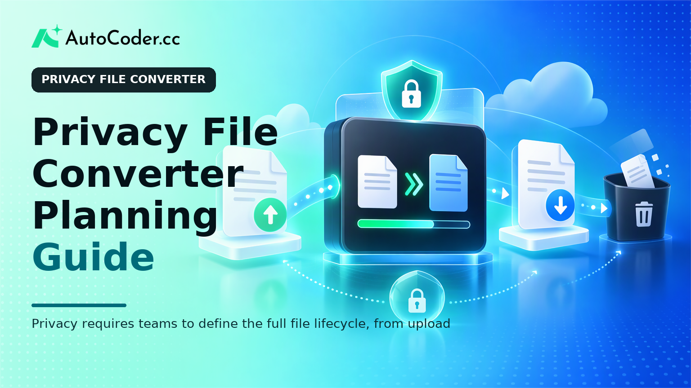
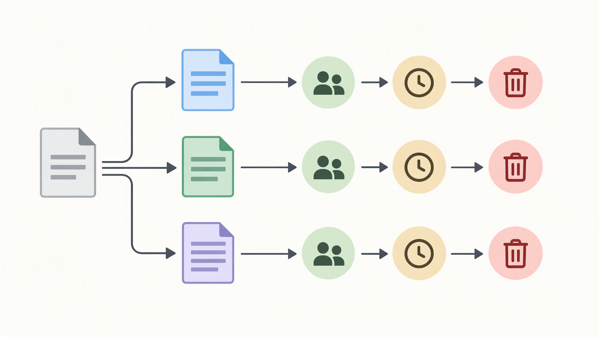

*Published November 3, 2026*

<Frame caption="Privacy requires teams to define the full file lifecycle, from upload through deletion.">
  
</Frame>

A **privacy file converter** depends on operational decisions, not a privacy label in a footer. Teams need to decide what the product receives, why processing is necessary, where files move, who can access them, and what happens after conversion. Those decisions must be reflected consistently in the interface, technical design, support process, and public documentation.

This guide is for founders and development teams planning a conversion product where privacy is a core requirement. It does not prescribe one architecture or retention period. Instead, it provides a practical method for defining the file lifecycle, minimizing collection, communicating handling rules, and testing whether the product works as described.

## Prerequisites: map the conversion workflow

**Begin with a shared view of the workflow before selecting retention language or building screens.** A team cannot make credible commitments about file conversion privacy if it has not identified every step between upload and deletion.

Create a simple workflow map covering upload, validation, conversion, delivery, optional account activity, support activity, and removal. Include the systems involved at each stage, even when a stage appears temporary. A file might pass through upload handling, conversion processing, output storage, queues, caches, logs, and backups.

Before proceeding, assemble four practical inputs:

- A list of supported file types and conversion actions.
- A description of guest and signed-in user journeys.
- A named product, engineering, and operations owner for data-handling decisions.
- Appropriate technical and legal review for the intended users, infrastructure, and jurisdictions.

Also separate product goals from assumptions. For example, “users should be able to retrieve a result later” is a product goal. “therefore every upload must be retained” is an implementation assumption that should be examined. A private file converter may offer saved history, but it should do so because it serves a defined user need and can be explained accurately.

## Define the privacy file converter promise

**Write a narrow, testable description of what happens to a file.** A useful promise explains the workflow in concrete terms instead of relying on broad statements such as “completely private” or “fully secure.” Those phrases are difficult to interpret and may create expectations the service cannot support.

Start by listing the data categories a conversion may involve: source files, converted outputs, file metadata, selected formats, conversion job records, error messages, download events, account details, support submissions, and technical logs. For each category, answer four questions:

- What does the product collect?
- Why is that information needed?
- Where is it processed or stored during the workflow?
- What happens after the conversion is completed, cancelled, or abandoned?

A document and selected output format may be necessary to perform a conversion. A profile, saved history, or behavioral tracking may not be necessary for a one-time task. Reducing unnecessary collection can make the workflow easier to explain, implement, and review.

Use terms consistently. “Deleted,” “removed from active storage,” “retained,” and “available in history” describe different states. If a file may remain in a backup or a separate operational record after it is no longer available to the user, avoid language suggesting immediate removal from every system. Clear boundaries are more useful than absolute assurances.

This is also where teams should address a common misconception: privacy is not a binary feature. A privacy-focused web app can reduce collection, limit access, and provide clear controls without claiming that all risk has disappeared. The practical standard is whether the product’s stated handling rules match its actual behavior.

## Set data handling and retention rules before building

<Frame caption="Source files, output files, job records, and logs need separate purpose, access, retention, and deletion decisions.">
  
</Frame>

**Assign a purpose, access model, and deletion rule to each data category before the interface makes retention accidental.** Secure file conversion becomes harder to manage when files, outputs, records, and logs accumulate without a defined lifecycle.

Create a data inventory that includes source files, output files, conversion job records, account information, support materials, and technical logs. For each item, record its purpose, likely storage location, authorized roles, deletion trigger, and retention rule. Keep this document current as features change.

Follow these numbered steps:

1. **Minimize inputs.** Request only what the conversion workflow needs. If a feature does not require an account, do not require registration solely to collect an email address. If a job already contains a format selection, avoid asking users to repeat it elsewhere.

2. **Separate files from records.** A job record can help diagnose a failed conversion without requiring retention of the full source file. Treat source files, generated outputs, and metadata as separate decisions rather than applying one broad rule to all of them.

3. **Choose explicit deletion events.** A trigger might be successful download, session end, cancellation, user-initiated removal, or expiration under a stated rule. The right choice depends on the intended experience, but it should be known before release.

4. **Limit access by role and task.** Conversion systems, support staff, and administrators should not automatically receive identical access. Define who can access content, who can view job records, and how exceptional access is requested and reviewed.

5. **Plan for failure states.** Interrupted uploads, unsupported formats, duplicate submissions, malware-related detections, and failed conversions can produce files outside the normal successful path. Decide whether those items are deleted, quarantined, retried, or reviewed, then ensure public explanations reflect that decision.

6. **Make deletion implementable.** Review application storage, processing queues, caches, generated outputs, logs, and backups. A deletion control is only meaningful if its scope is understood and its behavior can be verified across relevant systems.

These rules shape support as well. When a user requests removal, support staff should know what can be removed, which records may have a separate operational purpose, and how to escalate unusual cases. A clear internal procedure helps prevent inconsistent answers.

## Build transparent product flows for users

<Frame caption="Users need retention and handling information when they upload, download, and delete files, not only in a policy page.">
  
</Frame>

**Place handling information where users decide to upload, convert, download, save, or delete a file.** A privacy-focused web app should not depend on users finding a dense policy after completing a transaction.

At upload, show supported formats and a concise explanation of what the service needs to do with the file. If handling differs between guest users and account holders, state that difference before upload. Do not present format support or file limits unless the product can enforce them reliably.

During conversion, use statuses that correspond to actual job states, such as received, processing, complete, or unable to convert. Avoid wording that implies a precise outcome when the system can only report that a task is pending or queued. Meaningful error messages should distinguish between a file issue, an unsupported request, and a service problem without exposing unnecessary technical detail.

At download, explain what happens next. If a result remains available under a defined rule, present that information beside the download action. If the product removes a result after download or provides a direct deletion control, describe the scope of that action.

Accounts are a separate product choice, not a default requirement. They can support saved conversion history, recurring use, team workflows, settings, or other defined needs. They are less persuasive when they exist only because every application is assumed to need a login.

Teams moving from a requirements document to an editable application can use [AutoCoder's AI app builder](https://www.autocoder.cc/platform?utm_source=blog&utm_medium=latest&utm_campaign=PrivacyFileConverter) to generate a full-stack starting point. The team still needs to specify lifecycle rules, access decisions, and user disclosures; generated application components do not define a privacy model on their own.

## Review security and operational requirements

**Treat privacy as an operating model that must continue to work after launch.** A clear upload screen does not resolve broader access if hosting, credentials, monitoring, or support tools permit handling that differs from the stated workflow.

Review the system boundary with qualified technical and legal input suitable for the product. Consider how files enter the service, where conversion jobs execute, where results are stored, and which infrastructure providers or other parties are involved. The aim is to identify handling responsibilities, not to apply a generic checklist without context.

Examine access controls in practical terms. Identify administrative functions, support tools, deployment credentials, and storage permissions that could expose files or metadata. Restrict permissions to necessary roles, remove access when responsibilities change, and document how exceptional access is approved and recorded.

Apply the same discipline to logs. Diagnostic records can help investigate failures and outages, but routine logging may not require raw filenames, file paths, document contents, or broad user identifiers. Define what is needed for operations, who can read it, and how long it remains available.

Prepare an incident-response process before an incident occurs. It should identify who assesses a potential issue, who coordinates technical containment, how evidence is preserved, and who decides on user communications. The point is not to claim that incidents are impossible. It is to make response responsibilities clear when an unexpected event affects files or related data.

Maintain editable source code and working documentation as requirements evolve. Teams using [AutoCoder](https://www.autocoder.cc/platform?utm_source=blog&utm_medium=latest&utm_campaign=PrivacyFileConverter) for an initial build can continue adapting generated code as they refine upload rules, deletion actions, account behavior, and administrative controls. Those changes should remain subject to ordinary engineering review and testing.

## Test privacy behavior before launch

**Test the promise against successful, failed, and administrative workflows rather than treating privacy text as the final review.** File handling requirements should become acceptance criteria that the team can verify.

Create scenarios for guest and signed-in users, successful and unsuccessful conversions, cancellation, repeated downloads, expired results, account deletion, and support requests. For each scenario, compare three things: what the user sees, what the application stores, and what authorized staff can access. A mismatch between those elements is a product issue even when the converter produces the correct output.

Test deletion and retention behavior across the components named in the data inventory. Confirm that user-facing controls do what their labels indicate, that expired items no longer appear in ordinary product flows, and that documented exceptions are understood by support and operations.

Finally, assign ongoing ownership. A named person or team should review the inventory when features change, update user-facing explanations when workflow rules change, and coordinate questions between product, engineering, operations, and appropriate advisors. This does not require a large organization, but it does require a repeatable process.

## FAQ

### What makes a privacy file converter different?

A privacy file converter is designed around explicit choices for collection, processing, access, retention, and deletion. Its difference is not the label alone, but whether the product can explain and operate according to those choices.

### What privacy information should a file converter disclose?

It should explain what files and related data are collected, why they are needed, how conversion works, whether files or outputs are retained, what users can control, and whether account use changes the handling model.

### How long should converted files be retained?

There is no universal period. Choose a rule that supports the intended workflow, limits unnecessary storage, can be implemented across relevant systems, and is communicated accurately. Review the decision with appropriate technical and legal input.

### Can a privacy-focused file converter include user accounts?

Yes. Accounts can support saved history, recurring use, team workflows, and settings. The product should clearly distinguish account data from file content and explain what users can delete or do without signing in.

## Conclusion

A credible **privacy file converter** is built from specific, reviewable decisions rather than broad assurances. Define the lifecycle of files and records, minimize unnecessary collection, limit access, communicate rules at relevant moments, and test the behavior users and staff will encounter. When the interface, infrastructure, and internal processes describe the same reality, file conversion privacy becomes a practical part of the product.
