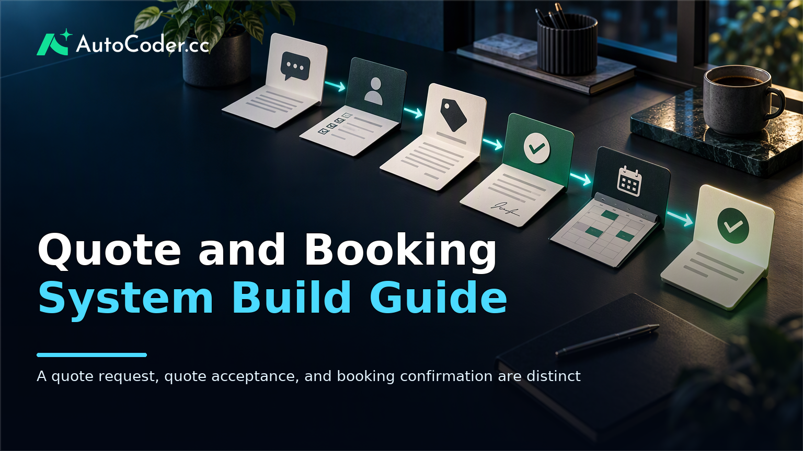
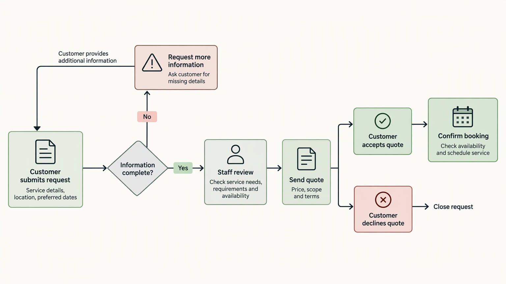
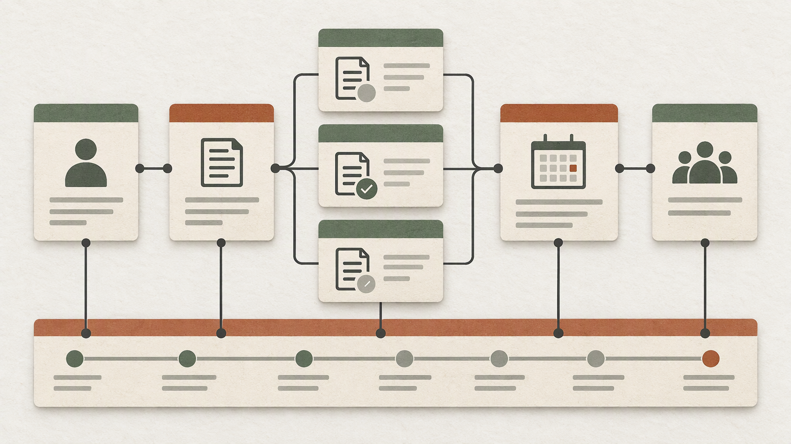

*Published November 3, 2026*

<Frame caption="A quote request, quote acceptance, and booking confirmation are distinct operational stages that need explicit handoffs.">
  
</Frame>

A **quote and booking** system should reflect how your service is actually sold and delivered, rather than forcing every customer through the same checkout path. For many service businesses, the work starts with an inquiry, moves through a scoped quote, and only becomes a confirmed appointment after approval and availability checks.

That distinction matters when building a custom workflow. A simple calendar alone may be appropriate for fixed-price, standard services. A workflow with variable scope, locations, durations, or staffing needs requires more context before a slot can be confirmed. This guide explains how to map the process, design the customer experience, build the operational foundation, and test it before relying on it for live requests.

## Map the quote and booking workflow before building screens

<Frame caption="Each state needs an owner and an exception path, especially when a quote is accepted before availability is confirmed.">
  
</Frame>

**Start by defining each status and its owner.** A clear workflow prevents a request form, staff inbox, and calendar from becoming separate sources of truth.

Begin with the path a customer takes from first contact to completed work. A practical baseline may include: submitted request, under review, quote sent, quote accepted or declined, booking pending, booking confirmed, completed, cancelled, and reschedule requested. Your business may need fewer stages, but each one should have an unambiguous meaning.

The important distinction is between a quote and a booking. A request is not a promise to perform work. A quote is a proposed scope and price. Acceptance signals customer intent, while booking confirmation signals that the business has assigned a viable time, person, and any other required resources. Combining these states can lead customers to assume an appointment is secured when it is still awaiting review.

Before implementation, document these prerequisites:

- A defined service catalogue or a clear process for bespoke work.
- The staff members, service areas, equipment, or rooms that affect capacity.
- Policies for response times, quote validity, cancellations, and rescheduling.
- A staff member or team responsible for reviewing new requests and updating status.
- The customer details needed to assess a request and communicate a decision.

Then build the workflow in numbered steps:

1. **Classify services by booking model.** Mark each service as direct booking, quote first, or staff-assisted booking. A standard consultation might permit direct booking; a complex installation might require a site description and review.
2. **Set the minimum information required at each handoff.** At submission, collect what is necessary to assess the job. At quoting, capture scope, assumptions, validity, and proposed pricing. At confirmation, record the selected time and assigned resources.
3. **Assign responsibility for every transition.** Specify whether a customer, staff member, or automated rule can change each status. For example, a customer can accept a quote, but only staff should confirm a booking if availability requires a manual check.
4. **Write the exception paths.** Decide what happens when a requested slot is unavailable, a customer provides incomplete details, a quote expires, or the requested service is outside your operating area.
5. **Define the visible status language.** Customer-facing labels should explain what happens next, such as “We are reviewing your request” or “Your appointment is confirmed.” Internal labels can be more detailed if needed.

A workflow diagram is useful here because it exposes gaps. If a quote is accepted but no availability can be assigned, the system needs a pending state and a clear customer message. If a cancellation occurs after staff have prepared for the job, the record should retain the cancellation reason and timing rather than simply disappear.

## Design the customer experience for a quote and booking journey

**Ask only for details that change the decision, price, or delivery plan.** The customer-facing flow should make it easy to request service while setting accurate expectations about what is and is not confirmed.

Start with a service-selection page that helps customers choose the right route. For each service, state whether they can select a time immediately or whether they should submit a quote request form. Avoid presenting a calendar too early for services where timing depends on inspection, travel, scope, or staff approval.

A useful quote request form generally collects contact details, the service needed, location when relevant, preferred timing, and a concise description of requirements. Conditional fields can keep the form shorter: show property details only for property-related services, for example, or show upload options only where photos materially help assessment. Explain why sensitive or potentially burdensome information is requested.

The confirmation page after submission should not overstate the outcome. It can acknowledge receipt, summarize the submitted details, and explain the next step. If the business reviews requests manually, say that a quote or follow-up will be sent after review rather than implying a booking exists.

For direct booking, display only availability that the business can genuinely support. The online booking system should account for the duration of the service, preparation or travel buffers where applicable, time zones, and resource limits. If staff approval remains necessary, label the chosen time as requested until that approval is complete.

Customer communications should mirror the actual state of the record. A quote email or portal notice needs enough detail for an informed decision: service scope, exclusions or assumptions, any validity conditions, and the action required to proceed. A booking confirmation should include the confirmed date and time, service location or joining instructions, and the process for changes.

Make self-service actions deliberate. Customers may be allowed to accept or decline a quote, request a different appointment time, or cancel according to your policy. They should not be able to alter information that changes scope without triggering a review. A change from a small repair to a larger project, for instance, should return the request to assessment rather than silently modify a confirmed job.

Accessibility and mobile use also deserve attention. Use clear field labels, readable error messages, keyboard-operable controls, and a form layout that does not rely on hover states or dense calendar interactions. Test the complete path on a phone, including uploads, confirmation messages, and links in follow-up communications.

If your team is prototyping a custom application, [AutoCoder's AI app builder](https://www.autocoder.cc/platform?utm_source=blog&utm_medium=latest&utm_campaign=QuoteAndBooking) can generate editable frontend, backend, and database components from written requirements. Treat the generated starting point as an implementation aid, not a substitute for defining your service rules first.

## Build the operational system behind it

<Frame caption="Keeping requests, quote versions, bookings, resources, and status history as connected records preserves operational context.">
  
</Frame>

**Use one structured record for each request so staff can see the current state without reconstructing it from messages.** The operational layer is what turns a customer form into a manageable booking workflow.

At a minimum, model separate but connected records for customers, service requests, quotes, bookings, staff or resources, and status history. A request may lead to more than one quote revision, while an accepted quote may result in one booking. Keeping those concepts separate preserves the history of what was requested, offered, accepted, and scheduled.

For each service request, store the submitted answers, preferred dates, service type, source, and current status. For a quote, store its scope, version, issue date, expiry rule if used, and acceptance status. For a booking, store the confirmed start and end time, assigned staff or resource, location, and operational notes. Avoid replacing older quote terms in place; versioning lets staff understand what the customer accepted.

Build staff-facing views around decisions, not just lists. A new-requests queue should surface missing information and review priority. A quoting view should show relevant request details and prior communication. A calendar or schedule view should reveal confirmed commitments alongside pending requests that may affect planning. Filters for status, service type, date range, and assignee make routine work less dependent on memory.

Permissions should follow job responsibilities. A staff member may need to view assigned bookings without being able to alter pricing rules. A manager may approve exceptions. Customers should only access their own requests, quotes, and bookings. Where staff-facing data includes personal or commercially sensitive information, require authentication and keep internal notes separate from customer-visible text.

Availability needs explicit rules. Decide whether a booking consumes an individual staff member’s time, a shared resource, a geographic service area, or several of these at once. A conflict check should run when staff confirm or modify a booking, not only when a customer first sees a slot. This is especially important when staff also accept work by phone or through other channels.

Record status changes with a timestamp and actor where the system supports it. This history helps staff answer basic questions—when a quote was sent, who confirmed an appointment, or why a job was cancelled—without relying on informal notes. It also supports a safer review of workflow problems later.

A full-stack tool such as [AutoCoder](https://www.autocoder.cc/platform?utm_source=blog&utm_medium=latest&utm_campaign=QuoteAndBooking) may be suitable when a team needs to create a tailored portal, dashboard, or service booking software and continue editing the source code. The design still needs your own validation rules, permissions, and operational review process.

## Test common scenarios before opening the workflow

**Test the exceptions first, because routine submissions rarely reveal the costly failures.** A reliable launch review follows realistic requests from customer entry to staff completion and back to the customer’s view.

Create test cases for an incomplete request, a service outside your coverage area, a quote that is declined, an accepted quote with no suitable slot, a double-booking attempt, a reschedule, and a cancellation. For each case, confirm the customer sees an appropriate explanation, the responsible staff member receives the needed information, and the status remains accurate across all views.

Check the boundaries between stages. Submit a request with only required fields and verify it enters the review queue. Send a quote and ensure the customer can identify its scope and next action. Accept it and verify that it does not create a confirmed appointment unless your rules permit that. Confirm a booking, then check that the relevant capacity is no longer offered to another customer.

Review notifications and manual work together. A message can be technically delivered while still being unhelpful if it lacks the reference details staff need to act. Likewise, automation should not hide decisions that require judgment. Establish a simple daily routine for reviewing new requests, pending quotes, upcoming bookings, and exceptions.

Finally, use feedback from the people doing the work. Staff may identify fields that are missing, status names that are ambiguous, or calendar views that obscure useful context. Adjust the workflow based on these observed operational needs, while keeping customer forms focused on information customers can reasonably provide.

## FAQ

### What is a quote and booking system?

A quote and booking system manages the path from a service inquiry through pricing, customer acceptance, scheduling, and confirmation. It separates a request for work from a confirmed appointment when scope or availability needs review.

### What information should a quote request form collect?

Collect contact details, the requested service, enough information to assess scope, location where relevant, and preferred timing. Use conditional questions for service-specific details, and avoid collecting information that will not affect the response or booking decision.

### Can a booking workflow include staff availability?

Yes. A booking workflow can use staff, room, equipment, or service-area availability as constraints. Define which resources a booking consumes and check for conflicts whenever a booking is confirmed or changed.

### How should a business handle quote requests before confirmation?

Place new requests in a review status, acknowledge receipt without promising an appointment, and assign clear ownership for follow-up. Once a quote is accepted, either offer suitable times or have staff confirm availability before changing the booking to confirmed.

## Conclusion

A dependable **quote and booking** system begins with accurate service rules, not a form or calendar widget. Map the difference between inquiry, quote, acceptance, and confirmation; collect only decision-relevant information; and maintain a structured operational record behind the customer experience. Testing incomplete requests, availability conflicts, and changes before launch will make the booking workflow clearer for customers and more manageable for staff.
