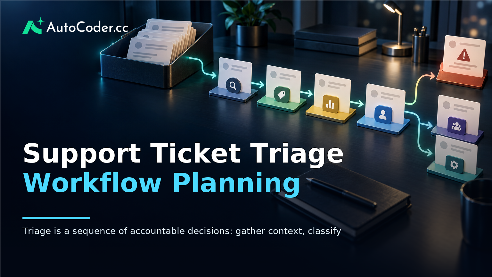
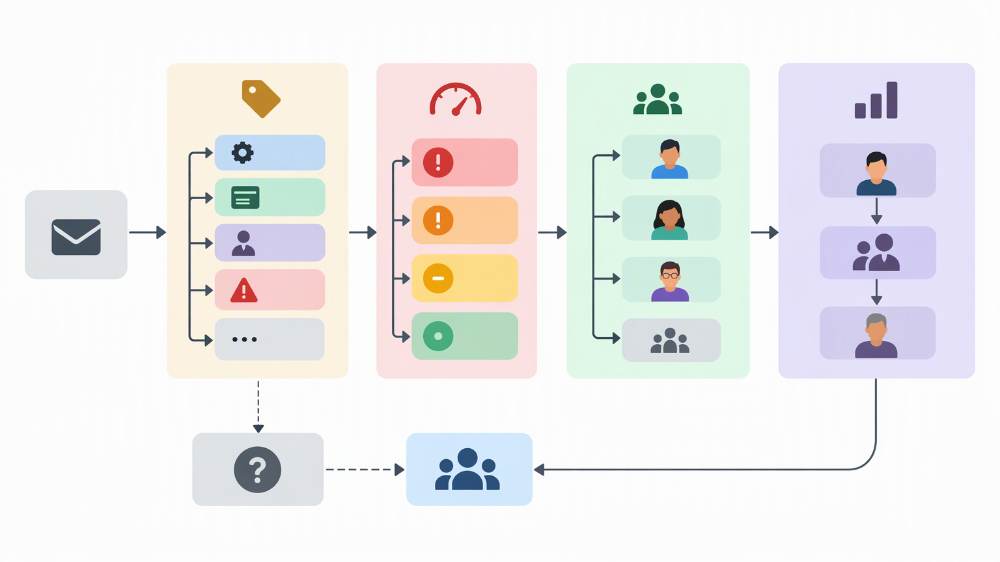
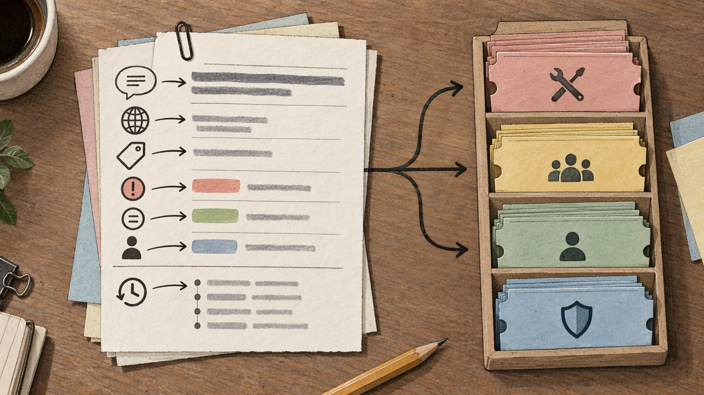

*Published November 4, 2026*

<Frame caption="Triage is a sequence of accountable decisions: gather context, classify, set priority, assign ownership, and escalate when needed.">
  
</Frame>

A reliable **support ticket triage** process turns incoming requests into owned, actionable work. Rather than asking agents to interpret every message from scratch, it gives the team a consistent way to capture context, set a priority, route the ticket, and document the next step.

The right workflow is not necessarily a large help desk implementation. For a small team, it may be a focused internal tool with a shared queue and a few carefully defined rules. For a growing team, it may connect several sources, track handoffs between functions, and make exceptions visible.

This guide explains how to map those decisions, define a minimum viable workflow, build a tailored application, and test its routing logic before relying on it for live support.

## Define the support ticket triage problem

<Frame caption="Category, priority, ownership, and escalation are separate decisions, and uncertain tickets need a visible fallback route.">
  
</Frame>

Start by documenting the decisions your team must make for every request. A workflow is only useful when it reflects real ownership boundaries and service expectations, not a generic list of labels.

List the sources that create tickets first. These may include a contact form, shared inbox, chat channel, account portal, or manual entry by a teammate. Then identify the basic question that triage must answer at each stage: Is this request complete enough to act on? What type of issue is it? Who owns the next action?

A practical map usually includes four elements:

- **Ticket categories:** Broad, stable groups such as account access, billing, product question, defect report, or partnership request. Categories should be distinct enough to support assignment. - **Priority signals:** The conditions that change urgency, such as a blocked user, a time-sensitive request, a security-related concern, or a high-impact service issue. Define them in operational terms rather than relying on subjective labels alone.

Write down the current path for a few representative requests. For example, a billing question may go to an operations queue, while an account access problem first goes to support and then to a technical owner if basic checks do not resolve it.

Avoid treating category and priority as the same decision. A product defect is a category; its priority depends on the impact and context captured in the ticket. Keeping those choices separate makes the process easier to review later.

Also decide what is outside the workflow. Some messages may be spam, sales outreach, duplicate requests, or feedback that does not need a support response. A defined disposition for these items prevents the main queue from becoming a catch-all list.

## Choose the smallest useful ticket routing workflow

<Frame caption="A useful triage tool needs enough structured context in both the queue and ticket record to support consistent routing decisions.">
  
</Frame>

Build the first version around intake, classification, assignment, and status—not every possible automation. A narrow workflow is easier to explain to agents and easier to adjust when its rules meet real cases.

Before building, establish a few prerequisites:

1. **A named workflow owner** who can decide on categories, routing changes, and exceptions.
2. **A short list of support roles or queues** that reflects how work is actually divided.
3. **Representative tickets** with sensitive information removed or replaced, so the workflow can be checked against realistic patterns.
4. **A definition of ticket states** that the team can use consistently.

For many teams, a useful first set of ticket states is new, needs information, assigned, in progress, waiting on requester, escalated, resolved, and closed. The exact labels can differ, but each state should communicate whether the ticket has an owner and what is blocking the next action.

Next, decide which fields agents need at intake. The minimum is often a request summary, request description, source, requester identity or contact method, category, priority, current status, owner, and timestamps. Teams may also need account or order references, product area, affected environment, attachments, or a link to a related ticket. Only require information that changes a decision or enables follow-up.

A customer support dashboard should make the next decision visible without forcing agents to open every record. At a glance, the queue might show the ticket title, category, priority, age, owner, status, and an indicator for missing information. The ticket record can hold the full conversation, internal notes, routing history, and linked context.

Define routing rules in plain language before encoding them. For instance: “New billing requests go to the operations queue unless they mention inability to access an account, in which case they first go to support.” Plain-language rules expose ambiguity. What counts as inability to access an account? Who handles a request that matches two categories?

Set a default route for uncertain cases. No classification system will interpret every message cleanly, so an unassigned-review queue or designated triage owner is safer than silently applying an unreliable rule. This is one of the main limits of help desk automation: automation can propose or apply predictable decisions, but it needs a deliberate path for incomplete, unusual, or conflicting information.

Finally, choose the smallest set of reports or views the team needs. A queue by owner, a view for unassigned tickets, a view for escalations, and a list of tickets awaiting requester input are often more actionable than a broad dashboard with many metrics. Add reporting only when the underlying fields and statuses are being used consistently.

## Build the workflow from written requirements

Translate the process map into a working internal tool by specifying the records, screens, permissions, and rules. Clear requirements are more valuable than highly technical wording because they connect each component to an operational decision.

A tailored build can be useful when an off-the-shelf setup cannot reflect your internal handoffs or required context. An [AutoCoder AI app builder](https://www.autocoder.cc/platform?utm_source=blog&utm_medium=latest&utm_campaign=SupportTicketTriage) can turn natural-language product requirements into an editable, deployable full-stack application. Based on the supplied requirements, it can generate frontend, backend, and database components, with authentication and deployment workflows available for an initial version.

Use the following numbered steps to create a focused specification.

1. **Describe the people and permissions.** Define who can create a ticket, triage new requests, update assignments, view internal notes, and change workflow rules. Permissions should follow the work itself. For example, an agent may update status and add notes, while a workflow owner can edit categories and routing logic.

2. **Define the ticket record.** List every field, its type, whether it is required, and who can edit it. Include a ticket identifier, requester details, source, summary, full description, category, priority, status, owner, creation and update times, and a history of assignment or status changes. If a field is optional, state when it becomes necessary.

3. **Describe the core screens.** Start with a triage queue, a ticket-detail view, and a simple administration area for categories and rules. In the queue, specify the filters and sorting agents need. In the detail view, show the information needed for a decision before less urgent metadata. In administration, make it clear which changes affect future routing.

4. **Encode the routing sequence.** State the order of operations: capture the ticket, check required details, suggest or set a category, evaluate priority signals, assign a queue or owner, and record the decision. Include a fallback for no match and a rule for re-triage when an agent changes the category or discovers new context.

5. **Add handoff and audit requirements.** A handoff should retain the original request, the reason for escalation, any attempted actions, and the current owner. Keep a record of meaningful changes so the team can understand why a ticket moved. This is especially useful when an issue returns to triage or crosses functions.

6. **Build the first version and inspect it against the specification.** Prompt [AutoCoder](https://www.autocoder.cc/platform?utm_source=blog&utm_medium=latest&utm_campaign=SupportTicketTriage) with the workflow in direct terms, then review the generated application as a working draft rather than assuming every detail is final. Check that the generated screens, data model, authentication approach, and routing behavior match the written requirements. Because the application and source code can continue to be edited, the team can refine fields, rules, and screens as operational needs become clearer.

Keep the first release limited to one complete path from intake to resolution. Integrations, notification preferences, advanced reporting, and broader self-service features can wait until the core support ticket management process produces consistent records. A complete narrow path provides a better basis for refinement than a partially built system with many disconnected options.

## Test routing rules before live use

Treat testing as a review of decisions, not just a check that buttons and forms work. The central question is whether different people reach the same reasonable outcome when they see the same ticket.

Create a test set from representative historical tickets with identifying details removed, or write realistic sample cases that include ordinary requests and known edge cases. Include incomplete messages, tickets that fit more than one category, repeated requests, requests that should be closed without action, and issues that must escalate.

Run the test set through the workflow in stages. First, verify that the intake form captures enough context for classification. Then check the category, priority, route, and initial owner that each case receives. Record where the outcome differed from the expected path, but do not assume the rule is always at fault.

Review exceptions separately from routine tickets. If an agent overrides a route, require a brief reason such as missing information, conflicting signals, or specialist knowledge. Over time, override reasons can show whether the workflow needs a new category, a revised rule, or a clearer escalation path. They can also reveal cases that should remain human decisions instead of becoming automated.

Check operational safeguards before rollout:

- A ticket cannot disappear without a visible status, owner, or disposition.
- Reassignment preserves enough context for the receiving person to act.
- Escalated tickets have a clear receiving queue or role.
- Restricted internal notes and requester-facing information are treated differently where needed.
- Changes to routing rules have an owner and a review process.

Start with a limited group or one request source if possible. During the early period, review the unassigned queue, overrides, and stalled tickets on a regular schedule. The purpose is not to force every case into a rule; it is to find the smallest changes that reduce unnecessary manual sorting while preserving accountable decisions.

## FAQ

### What is support ticket triage?

Support ticket triage is the process of reviewing incoming support requests, collecting relevant context, setting an appropriate priority, and assigning the next owner or queue. It gives the team a consistent starting point before detailed investigation or resolution begins.

### What information should a ticket triage workflow collect?

Collect the request summary and description, source, requester details, category, priority, status, current owner, and relevant timestamps. Add account, product, order, environment, or attachment fields only when they help agents route or resolve work.

### Can a small team build a custom ticket triage app?

Yes. A small team can begin with a narrow internal tool focused on one intake path, a shared queue, ticket records, assignments, and status changes. The important constraint is maintaining clear ownership and reviewing rules as the team learns from exceptions.

### How should teams test triage rules before using them live?

Use anonymized historical tickets or realistic sample tickets, including ambiguous and incomplete cases. Compare the resulting category, priority, and assignment with the intended outcome, then review overrides and stalled tickets to improve the underlying rule or required fields.

## Conclusion

A useful **support ticket triage** workflow makes the next decision clear: capture the right context, classify the request, assign an accountable owner, and preserve the reason for important handoffs. Begin with the smallest complete path, write routing rules in operational language, and test exceptions before expanding automation. That approach keeps the workflow aligned with the way your team actually manages support work.
