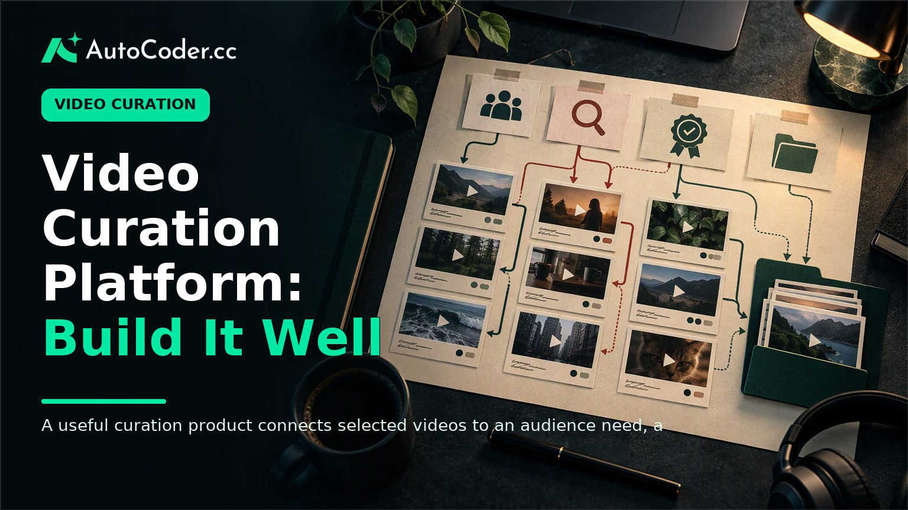
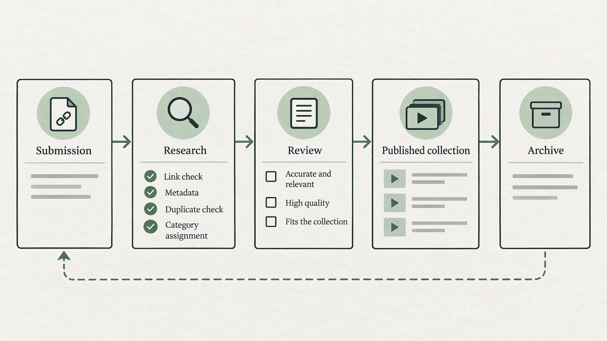
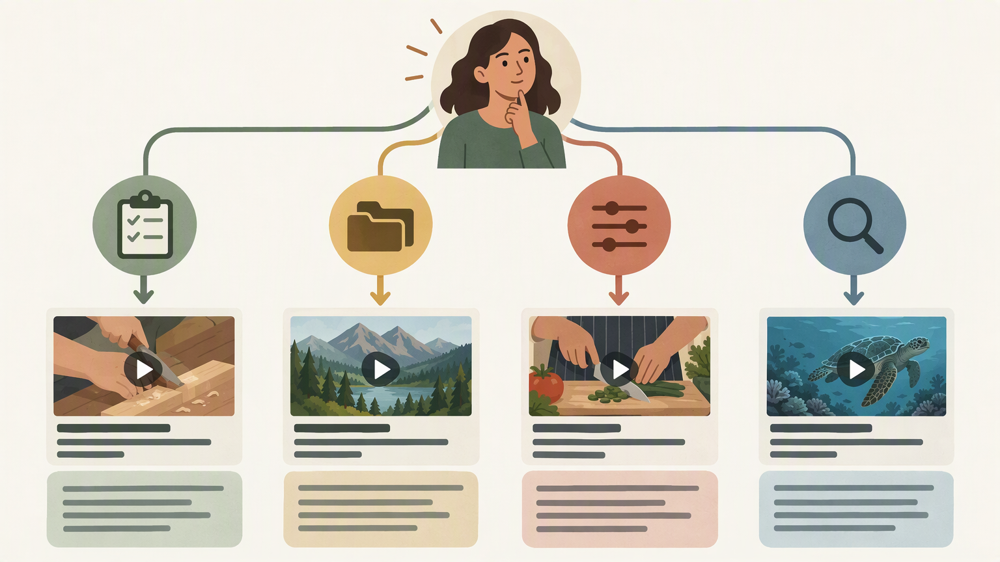

*Published November 3, 2026*

<Frame caption="A useful curation product connects selected videos to an audience need, a review decision, and a navigable collection.">
  
</Frame>

**Video curation** becomes useful when it helps a defined audience find the right material for a particular task, question, or stage of learning. A focused platform is not simply a page of embedded clips or a large list of links. It is a maintained resource with an editorial purpose, consistent records, and navigation that explains why each video belongs.

For creators, community operators, and founders, the central decision is scope. A library for independent documentary editors, for example, should make different choices from one for local history teachers or early-stage product teams. The audience determines what to include, what to exclude, how to group content, and which details viewers need before they invest time in a video.

This guide sets out a practical way to define, build, and operate a curated video platform. It treats the product as both an editorial system and a usable directory: one part selection process, one part structured database, and one part discovery experience.

## Define the purpose of video curation

**Start with a narrow audience problem, because a collection without a decision rule soon becomes an unfiltered archive.** Write a short statement describing the people you serve, the outcome they seek, and the kinds of videos that can help. This statement should guide every later product and editorial choice.

A useful scope might be: “Short practical lessons for volunteer community organizers planning their first event.” That is more actionable than “the best community videos.” It identifies the audience, the context, and the expected benefit. It also gives you grounds to exclude material that is interesting but not helpful for that job.

Before collecting videos, answer four questions:

1. **Who is the primary viewer?** Describe their level of knowledge, available time, and reason for visiting. Avoid treating several very different groups as one audience unless the platform will provide distinct paths for them. 2.

Next, choose how selection will work. Editorial selection gives one person or team responsibility for standards and consistency. Community submissions can surface material that editors may miss, but they require a review queue and clear submission guidelines. Automated collection can help identify candidates from predefined sources or topics, yet it still needs human checks for relevance and context.

Do not promise comprehensiveness unless you can sustain it. A smaller collection with an explicit point of view is often easier to browse and maintain than a broad directory with uncertain coverage. Publish a short “about this collection” note that explains its purpose, selection method, and any important limitations.

## Create a content model for a curated video platform

**Use structured fields from the first entry onward, so browsing and maintenance do not depend on memory or inconsistent notes.** A video directory should store more than a title and a link. The entry record is what enables filters, collection pages, editorial context, and future updates.

Begin with a simple core record for each video:

- Title and destination link
- Source or publisher name
- Brief editorial description
- Primary topic and secondary tags
- Format, such as tutorial, interview, or lecture
- Publication date when available
- Duration when available and relevant
- Collection membership
- Review status and last-reviewed date

The description deserves particular care. Write it for the intended viewer, not as a copied summary. In two or three sentences, state the video’s subject, its practical value, and any boundary that affects whether it is suitable. For instance, a tutorial may assume prior knowledge, focus on a particular tool, or explain principles rather than a complete process.

Categories and tags do different jobs. Categories are stable, high-level routes through the platform, such as “Planning,” “Production,” or “Research.” Tags are more specific attributes that can cross categories, such as “budgeting,” “beginner,” “interview,” or “accessibility.” Keep the category set small enough that a new editor can apply it consistently.

Collections provide another useful layer. A collection has an editorial argument or a task-based use case, rather than merely sharing a tag. Examples include “First-week essentials,” “Different approaches to oral history,” or “Preparation for a community workshop.” Each collection page should explain who it is for, what the videos cover, and a sensible order if sequence matters.

Create a controlled vocabulary before the library grows. Record approved category names, tag definitions, and rules for plural forms, abbreviations, and overlapping terms. Without this reference, “beginner,” “beginners,” and “introductory” may become separate filters that describe the same idea. The aim is not rigid taxonomy for its own sake; it is predictable discovery and easier editorial maintenance.

If you are building a custom product, define the content model before concentrating on visual details. An application builder such as [AutoCoder's AI app builder](https://www.autocoder.cc/platform?utm_source=blog&utm_medium=latest&utm_campaign=VideoCuration) can be used to turn requirements for records, roles, review states, and collection pages into an editable full-stack application. Describe the fields and workflow plainly, then inspect the generated structure against your editorial model before loading a substantial library.

## Design a review and publishing workflow

<Frame caption="A visible status workflow separates candidate links from reviewed, published, and archived entries.">
  
</Frame>

**Make every item pass through a visible workflow, because quality control is difficult once unpublished and published links are mixed together.** Even a one-person operation benefits from separating candidate material from approved entries.

A practical workflow can use five states: submitted, researching, ready for review, published, and archived. The labels can change, but each state should have a clear meaning. A submitted link is only a candidate; it has not yet met your standards. A published entry has the required metadata and context.

Set prerequisites before asking contributors to submit material. Prepare your audience statement, selection criteria, category list, entry template, and a named person or role responsible for final approval. If multiple people will work on the platform, establish authenticated roles early.

For each candidate, use a repeatable review checklist:

1. Confirm that the destination link works and leads to the expected video. 2. Check that the subject fits the audience problem and the platform’s stated scope. 3. Watch enough of the material to write an accurate description and identify important caveats. 4. Check for duplicate entries, near-duplicate uploads, or a better canonical source. 5.

Documenting declines is valuable. It prevents the same unsuitable material from reappearing in the queue and helps refine the submission guidance. Common reasons may include poor fit, insufficient context, broken links, duplication, or a topic already adequately represented. Keep these internal notes factual rather than evaluative of the creator.

Plan routine maintenance as part of publishing, not as an occasional cleanup. A regular review can identify broken links, removed videos, outdated descriptions, shifting source information, and collections that no longer have a coherent purpose.

## Build a useful video discovery platform

<Frame caption="Visitors need different routes to relevant videos because some arrive with a task, a topic, or a specific search term.">
  
</Frame>

**Give visitors several clear ways to find an appropriate video, rather than expecting search alone to interpret their intent.** The browsing experience should reflect the different ways people arrive: some know a topic, some have a task, and some want a reliable place to start.

A useful landing page can lead with a short explanation of the platform’s scope and then offer a few deliberate entry points. Feature task-based collections for people who need a guided route. Present categories for people exploring a subject. Offer search and filters for people with a specific requirement.

On listing pages, show enough context to support a choice before a click. A title, source, concise description, topic label, and relevant format or duration detail may be sufficient. Do not overload every card with every field. Reserve deeper metadata, related collections, and editorial notes for the individual entry page.

Filters are most useful when they match information visitors can reasonably use. Topic, format, skill level, collection, and source are common candidates. Avoid creating filters for sparse or inconsistently applied fields, since empty or unreliable results weaken confidence. Test the taxonomy with a realistic set of entries: can a visitor locate a beginner tutorial without accidentally excluding relevant material?

Search should complement navigation, not replace it. Search results need clear titles and descriptive snippets, while category and collection pages provide context that a keyword query may not capture. If search returns a large range of results, consider whether a stable tag or collection would better express a recurring intent.

Accessibility and link context matter in a video discovery platform. Use meaningful link text, readable headings, descriptive labels for filters, and text summaries that do not require playback to understand an entry’s relevance. If a video is hosted elsewhere, make that clear.

For a custom build, [AutoCoder](https://www.autocoder.cc/platform?utm_source=blog&utm_medium=latest&utm_campaign=VideoCuration) can support the underlying application requirements for a directory, including database-backed records, authentication workflows, and editable interfaces. Treat the generated application as a starting point for review: test permissions, check that fields support the workflow, and verify that editors can maintain the taxonomy without developer intervention.

## Measure maintenance quality, not just collection size

**Use editorial signals to decide what needs attention, because the number of entries says little about whether the directory remains useful.** A platform can grow while becoming harder to navigate if tags drift, descriptions become uneven, or old links remain visible.

Maintain a simple internal review view that surfaces entries without a recent check, records missing required fields, candidates waiting for a decision, and collections with unclear descriptions. This makes the work concrete. It also allows you to identify where your process is failing: perhaps submissions lack source information, or reviewers use tags inconsistently.

Periodically sample the library as a new visitor would. Start with a common task and attempt to find an appropriate item using only the visible categories, collections, filters, and search. Note where terminology is unclear or where multiple routes lead to similar but differently labeled results. Update the model and guidance before adding more entries.

When audience needs change, revise the scope statement and explain material changes where readers can see them. You may decide to archive a collection, split a broad category, or add a new route for an emerging use case. Those changes are editorial decisions, not signs that the original system failed.

## FAQ

### What is video curation?

Video curation is the deliberate selection, organization, and contextual presentation of videos for a defined audience or purpose. It includes deciding what belongs, recording useful metadata, and helping viewers discover relevant material.

### How is video curation different from video recommendations?

Recommendations can be individual suggestions based on a person, topic, or system. Video curation is a broader editorial practice that creates a maintained collection with selection criteria, organization, and explanatory context.

### What features should a video curation platform have?

At a minimum, include structured video records, categories or tags, collection pages, search or browsing routes, editorial descriptions, and a review process. Platforms with multiple contributors also need clear publishing permissions and status tracking.

### How should curated video collections be organized?

Organize collections around a viewer’s task, learning path, or specific question. Use stable categories for broad browsing and tags for cross-cutting attributes. Give every collection a short explanation of its purpose and intended audience.

## Conclusion

**Effective video curation depends on making disciplined choices that help a particular audience act.** Define the audience problem first, then translate it into selection criteria, structured records, a review workflow, and multiple discovery paths. A curated video platform does not need to contain everything on a topic. It needs to make its scope legible, its entries trustworthy in context, and its maintenance process sustainable.

Start with a small, coherent library and test how people move through it. The resulting observations will be more useful than expanding indiscriminately. As the directory develops, preserve the editorial rules and content model that allow viewers—and future editors—to understand why each video is there.
