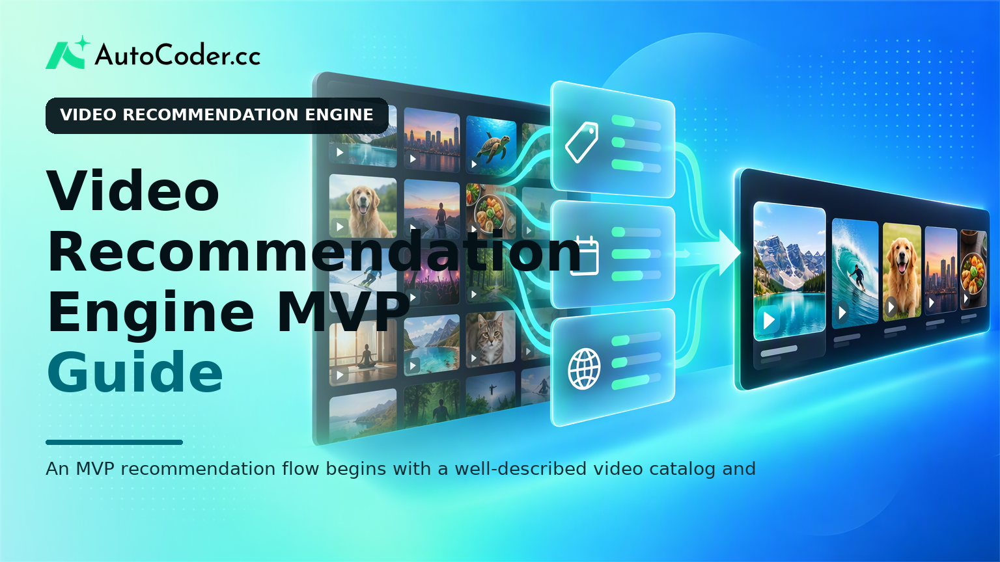
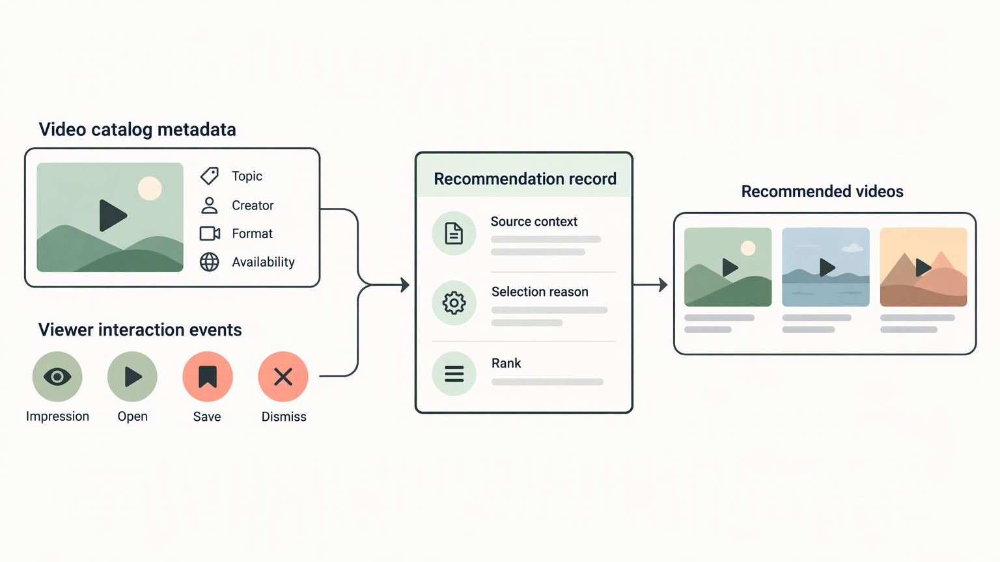
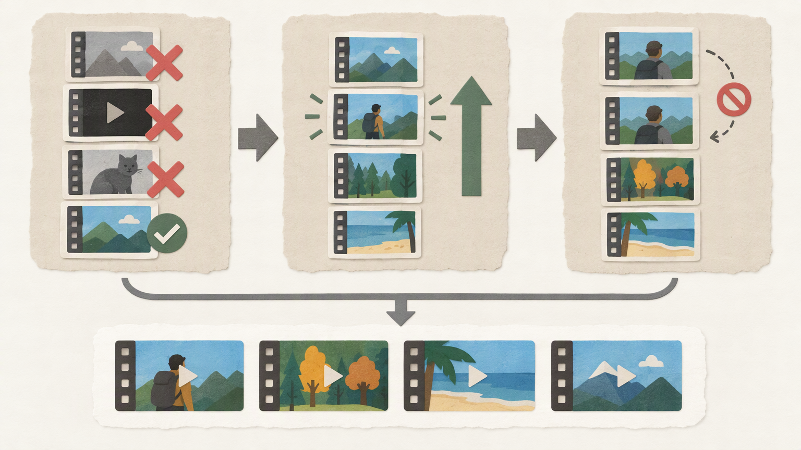

*Published November 3, 2026*

<Frame caption="An MVP recommendation flow begins with a well-described video catalog and transparent selection rules before it reaches the discovery interface.">
  
</Frame>

A **video recommendation engine** does not need to begin with a complex ranking model. For an MVP, the more important task is defining one discovery problem, preparing a dependable catalog, and making the first recommendations understandable enough to inspect and improve. That approach gives founders, product managers, and developers a product surface they can test before committing to broader personalization work.

This guide outlines a practical path for building a video discovery app: decide what users should accomplish, model videos and interactions, implement transparent ranking rules, and use feedback to refine the experience. The goal is not to imitate a large media platform.

## Choose one recommendation problem before building

The practical starting point is to specify the user decision your recommendations should improve. “Recommend videos” is too broad to guide product design, data collection, or evaluation. A focused job gives the MVP a clear catalog boundary and a meaningful place in the interface.

Common starting problems include helping a viewer continue a series, discover material in a selected topic, find videos similar to one they just watched, or return to saved interests. These are related but not interchangeable. A “continue watching” row depends chiefly on viewing progress.

Write a short scope statement before designing screens or schemas. It should answer the following questions:

- Who is the first user segment? Define a concrete audience, such as members of a learning library, viewers of a niche creator catalog, or employees using internal training material. - What catalog is in scope? Set limits by source, language, content type, subject, or access permissions.

Avoid combining every recommendation surface in the first release. A page that shows related videos after a user opens an item is often easier to reason about than a full personalized homepage. It works even before substantial user history exists and exposes whether your metadata actually describes the catalog well.

Define constraints at this stage as well. Identify which content must never be shown together, which items should be restricted by entitlement or age suitability, and whether creators, topics, or formats need representation rules. These decisions are product requirements, not cleanup work for a future ranking system.

Finally, describe what the MVP will not do. It may not infer sensitive preferences, optimize for long sessions, or recommend across unrelated catalog sections. Clear exclusions protect the scope and make later changes easier to evaluate.

## Prepare catalog and interaction data for a video recommendation engine

<Frame caption="Catalog metadata and interaction events need contextual records so teams can understand why recommendations were shown and how viewers responded.">
  
</Frame>

The most useful early investment is a clean catalog and a small set of interpretable user signals. A video recommendation engine can only make defensible choices when its available items are consistently described and its interactions have clear meanings.

Start with a video record that separates stable metadata from operational fields. Stable metadata may include title, description, creator or publisher, topic, tags, format, language, duration band, publication date, and availability status. Operational fields can include a content identifier, thumbnail location, playback URL or reference, access rules, and timestamps used to maintain the catalog.

Keep controlled vocabulary where it matters. If one editor labels a topic “product management,” another uses “PM,” and a third uses “product,” a simple tag-based recommender will treat them as separate concepts. Establish canonical topic names and allow aliases only where your product needs them.

Next, decide which interactions to record. Collect only signals that have a direct purpose in the MVP and are appropriate for your users. Useful events can include:

1. **Impression:** a recommendation was shown in a specific module and position. 2. **Open or play:** the user selected an item after seeing it. 3. **Watch progress or completion:** the viewer engaged beyond opening the player, where that distinction is relevant. 4.

Store context with each event. At minimum, keep the user or anonymous session reference where permitted, the video shown or viewed, the recommendation surface, the time, and the rule or reason that selected the item.

Plan for users with no history. New users and infrequent viewers are normal conditions, not edge cases. Let them choose a few topics during onboarding if that fits the product, or start with a carefully selected pool based on the current page, catalog category, and availability.

Also create editorial review paths. Someone should be able to correct a tag, remove outdated content, mark a video unavailable, or flag a poor recommendation relationship. A content recommendation engine is shaped as much by catalog governance as by its ranking code.

## Start with transparent rules, not premature complexity

<Frame caption="A useful ranking rule filters ineligible items, prioritizes clear matches, and deliberately prevents repetitive results.">
  
</Frame>

For an MVP, explainable ranking rules make debugging and product review possible. They let the team see why an item appeared, identify weak metadata, and change behavior without treating the recommendation process as opaque.

A straightforward first approach is content-based matching. For the current video or selected user interest, retrieve candidates that share approved topics, tags, creator, series, or format. Then apply practical filters: remove the current item, exclude unavailable content, respect permissions, and avoid items the viewer dismissed when that information exists.

Rank the remaining candidates with a simple documented score. For example, you might give greater weight to a shared primary topic than to a shared secondary tag, then use freshness only as a tie-breaker where newer content matters. The specific weights are product decisions.

Build diversity into the rule set from the beginning. If the top results are nearly identical, a row can look repetitive even when each item is individually relevant. You can limit how many videos come from one creator, series, or narrow tag cluster.

Expose a concise reason near the recommendation when it is useful, such as “Because you watched videos tagged with accessibility” or “More from this series.” The explanation should describe a genuine selection rule, not a generic assurance that the feed is personalized. It helps viewers set expectations and gives internal reviewers a quick way to spot incorrect associations.

Design the data model so you can add techniques later without replacing the product. A recommendation record can store the source item or audience input, candidates considered, rule version, score components, final rank, and delivery time. This creates an audit trail for testing changes.

Machine learning is not a required milestone. It can become useful when simple rules no longer represent relationships in the catalog or when there is enough reliable behavior to learn from. Until then, complexity may obscure a weak taxonomy or an unclear product objective.

## Build the MVP in numbered, testable steps

The practical way to reduce delivery risk is to build one vertical slice from catalog entry to recommendation display, then test it with real product review. The following sequence keeps the first version focused.

1. **Create the catalog and access model.** Add the video fields, taxonomy, availability state, and permission checks needed for the chosen catalog. Include a basic editorial workflow for updates and removals.

2. **Implement the interaction event flow.** Record impressions separately from opens and playback activity. Attach surface, position, and recommendation rule information so later review has context.

3. **Build candidate retrieval.** Given a source video or selected topic, return eligible items that share the fields your MVP uses. Verify that unavailable, duplicate, current, and unauthorized videos cannot enter the final list.

4. **Add a deterministic ranker.** Apply the documented relevance and diversity rules. Log the reason and score components for each chosen result. A deterministic initial ranker makes test failures reproducible.

5. **Create one recommendation surface.** Display a limited set of results on the page that matches the original problem statement. Include title, concise metadata, and an accurate explanation where appropriate. Make dismissed or saved actions available only if you will use them responsibly.

6. **Provide internal inspection tools.** Give the team a way to select a video or test profile and view candidates, exclusions, ranks, and reasons. This need not be a complex analytics product; a protected review screen or structured logs can be sufficient for an MVP.

7. **Test cold starts and awkward catalog cases.** Check new users, videos with sparse tags, empty categories, one-creator catalogs, restricted content, and recently removed items. Define a fallback, such as category-selected or editorially curated items, rather than returning an unexplained blank state.

Teams that want to turn this sequence into a working prototype can use [AutoCoder's AI app builder](https://www.autocoder.cc/platform?utm_source=blog&utm_medium=latest&utm_campaign=VideoRecommendationEngine) to generate editable frontend, backend, and database components from a product specification. The specification should still state the catalog fields, recommendation rules, permissions, and event definitions; generation does not replace those product decisions.

## Evaluate relevance, diversity, and user control

The practical test of an MVP is whether recommendations support the chosen user task without creating obvious blind spots. Do not rely on a single engagement measure, since an open may indicate curiosity, confusion, or a misleading title as well as relevance.

Begin with structured qualitative review. Assemble a small set of representative source videos and test profiles, including a new user and users with distinct topic interests. For each case, inspect the recommended set and ask: Are the results on-topic? Are they sufficiently varied?

Then observe product behavior in context. Compare impressions with subsequent actions, but interpret them alongside placement and interface design. A recommendation at the top of a screen has a different opportunity to be selected than one below the fold.

Use feedback to change one variable at a time where possible. If a topic produces weak results, first review its taxonomy and candidate pool before altering every ranking weight. If rows are repetitive, adjust diversity caps and inspect the underlying catalog distribution.

User control is part of quality. Provide a clear way to dismiss a recommendation, correct an inferred interest, or adjust selected topics when the product uses them. Explain data use in language appropriate to your context, and avoid collecting interaction data simply because it might be useful later.

## FAQ

### What is a video recommendation engine?

A video recommendation engine is the part of an application that selects and orders videos for a viewer or context. It can use catalog metadata, stated preferences, interaction history, editorial rules, or a combination of these inputs.

### Do I need machine learning to build video recommendations?

No. A rules-based approach using topics, tags, series relationships, availability filters, and basic diversity controls can be suitable for an MVP. Machine learning may be considered later when it solves a defined limitation and the necessary data is available responsibly.

### What data is needed for a video recommendation engine?

At minimum, use consistent video metadata such as topics, tags, creator, format, and availability. If you personalize, record purposeful interaction signals such as impressions, opens, saves, dismissals, and viewing progress with enough context to interpret them.

### How can I evaluate recommendation quality?

Review representative recommendation sets for relevance, diversity, permissions, and explainability. Then assess interaction patterns in their interface context and incorporate direct feedback, rather than treating one engagement signal as a complete quality measure.

## Conclusion

A useful **video recommendation engine** MVP begins with a narrow discovery problem and reliable catalog data, not with an assumption that advanced modeling is required. Build one recommendation surface, use transparent rules, log how items were selected, and test cold starts alongside ordinary cases. That foundation lets a team improve a video recommendation system through observed gaps in relevance, diversity, and control instead of adding complexity without a clear reason.

For teams building the surrounding application, [AutoCoder](https://www.autocoder.cc/platform?utm_source=blog&utm_medium=latest&utm_campaign=VideoRecommendationEngine) can help turn the defined workflows into an editable full-stack prototype. Keep the recommendation policy explicit, review the generated implementation, and treat the first release as a controlled product experiment rather than a finished personalization strategy.
