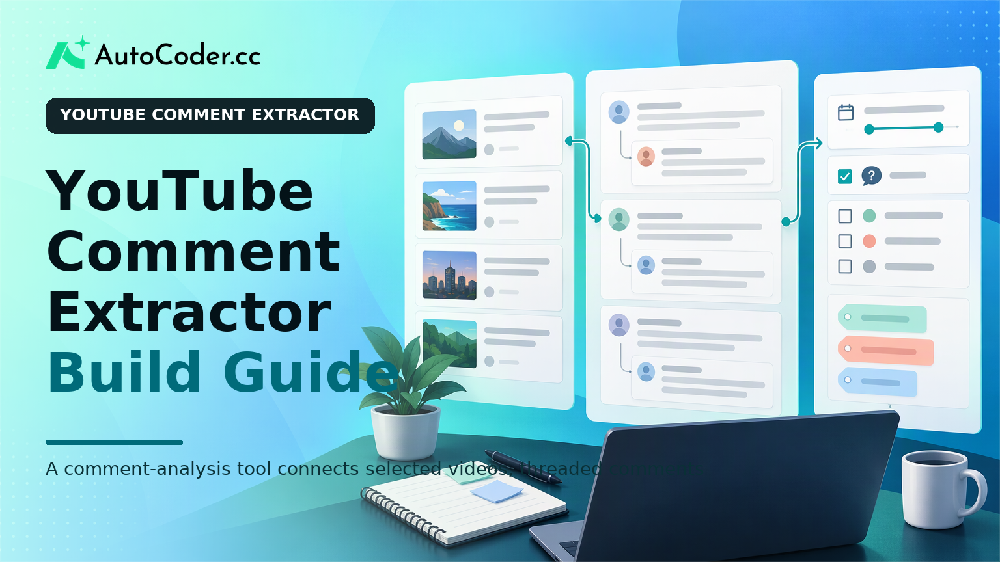
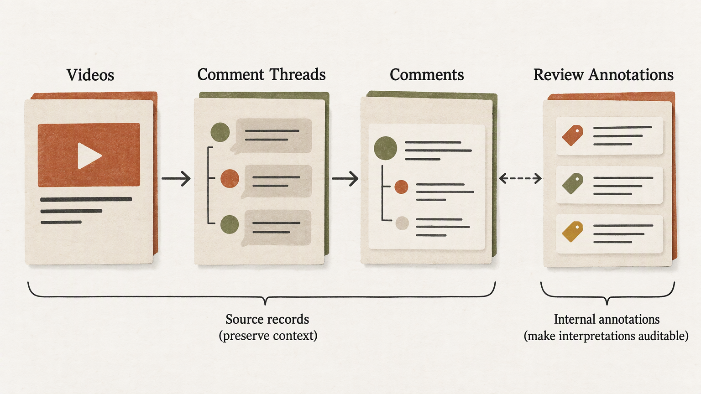
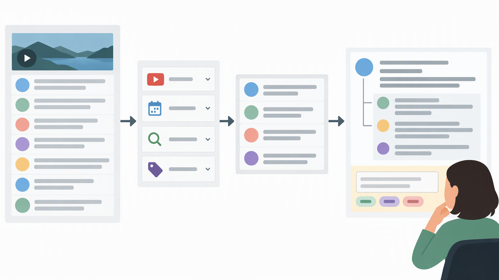

*Published November 3, 2026*

<Frame caption="A comment-analysis tool connects selected videos, threaded comments, filters, and human review labels in one structured workflow.">
  
</Frame>

A **YouTube comment extractor** should be built around a defined research or review question, not around collecting the largest possible volume of text. Researchers, creators, marketers, and product teams may need to identify recurring questions, compare discussion across videos, review feedback, or organize public responses to a topic. In each case, the useful work starts with boundaries: which videos matter, what context must remain attached to each comment, and how a team will interpret results.

This guide explains how to design an internal workflow for **YouTube comment analysis**. It covers prerequisites, data structure, a practical review workspace, a repeatable extraction process, and validation practices that keep findings tied to their source context.

## Set the extraction use case and boundaries

Start with the decision the tool needs to support. A narrow purpose determines what to collect, what to show reviewers, and what should remain out of scope.

A creator might review comments on selected tutorials to find unanswered questions. A marketing team might compare the language used in discussions around a defined set of videos. A product team might organize feature requests or recurring points of confusion. A research project may require a documented snapshot of responses within a specific time window. These uses overlap, but they do not need the same filters, records, or permissions.

Write a short requirements statement before building. For example: “Review comments on selected educational videos to identify unanswered questions; allow video, date, and keyword filters; limit internal annotations to the review team.” This statement gives the project a practical test: if a proposed feature does not support the stated task, it may not be necessary yet.

Document four boundaries:

- **Video scope:** Define a channel, selected videos, or a documented research set.
- **Time scope:** Specify whether the tool uses a snapshot, recurring updates, or a date range.
- **Data scope:** Retain fields needed for review instead of assuming all available information is useful.
- **Use scope:** Define who can access records, add notes, or create exports.

The essential prerequisites are an authorized method for accessing comment information, a process that follows applicable platform terms and organizational policies, and a clear owner for the workflow. Availability and permitted fields can change. Design the tool to report unavailable records or incomplete context rather than treating absence as a finding.

Also set exclusions. The workflow should not infer private attributes, attempt to identify people beyond displayed public context, or turn individual remarks into claims about an entire audience. Those limits improve both responsible handling and the quality of the analysis.

## Plan the comment data structure

<Frame caption="Separating source records from internal annotations preserves context and makes team interpretations auditable.">
  
</Frame>

Preserve enough source context to make each record interpretable. A comment body on its own is often insufficient, especially when it is a reply or refers to a specific moment in a video.

For each item, consider storing the comment text, source video reference, video title captured for the workspace, available publication time, displayed author information when appropriate, and reply relationship. A source record identifier, where available through the authorized method, can support duplicate checks and later updates.

The core relationship is usually video, thread, and comment. A top-level comment belongs to a video; a reply belongs to a video and a parent thread. Modeling this explicitly matters because the meaning of a short reply may depend entirely on the earlier message. A flat export can still be useful, but the review workspace should retain thread context where possible.

Keep source information separate from team interpretation. Source fields can include text, timestamps, video references, and parent relationships. Internal fields can hold tags, reviewer notes, review status, or categories such as question, request, criticism, or off-topic. The separation makes it possible to distinguish what came from the source from what the team concluded.

A practical schema may include four entities:

1. **Videos** hold a source reference, captured title, relevant channel context, and retrieval marker.
2. **Comment threads** connect a source video to a top-level comment and retain reply links.
3. **Comments** contain text, available contextual fields, and an availability or update status.
4. **Review annotations** contain team-created tags, notes, statuses, and reviewer details when accountability requires them.

Account for imperfect records from the outset. Comments may later be unavailable, text can contain links, emojis, line breaks, or quoted material, and reply context may not always be retrievable. Use a visible state such as available, unavailable, or context not retrieved. Avoid silently overwriting a record in ways that obscure what changed.

Useful filters include video selection, date range, keyword search, review status, and internal tag. Filters should narrow the review queue, not conceal the underlying evidence. Keep original text and source context accessible because keyword matches can be quoted, negated, or used in an unrelated sense.

## Build a YouTube comment extractor workspace

<Frame caption="Filters should narrow a review queue while keeping original comment context available for human interpretation.">
  
</Frame>

Make the first version a reliable review surface rather than an elaborate analytics display. A searchable table or queue is usually the most useful starting point for a **YouTube comment extractor**.

A reviewer should be able to select a video or collection, set a date range, search comment text, and inspect the context needed to assess an entry. A row may show a text preview, source video, available posting time, thread status, assigned tags, and review state. Selecting it should reveal the full text, parent-comment context for replies, and relevant internal notes.

Begin with a limited action set: search, filter, tag, add a note, mark reviewed, and export a purpose-specific subset. These functions support many early workflows without forcing the team to define complex categories before it has reviewed real material.

Add views only when they solve a known review problem. A question view can show comments tagged as questions grouped by video. A theme view can bring together comments with the same internal label while preserving original wording. A moderation-oriented queue can emphasize unreviewed items and their thread relationships. Each view should answer a concrete question that a standard table answers poorly.

If multiple reviewers annotate records, create a short tagging guide. Define each tag, explain how to handle ambiguous cases, and periodically compare a small set of shared annotations. Consistent, limited categories are more useful than a large, loosely defined vocabulary.

Authentication is appropriate when the workspace includes team-only notes, classifications, or research decisions. Public source material does not make internal interpretation public. Give users access that matches their role, particularly where exports or annotation histories are involved.

Teams can translate a workflow specification into an editable internal application with [AutoCoder's AI app builder](https://www.autocoder.cc/platform?utm_source=blog&utm_medium=latest&utm_campaign=YoutubeCommentExtractor), which can generate frontend, backend, database, authentication, and deployment components from natural-language requirements. The useful input is still the same: describe the records, review actions, access rules, and source-data boundaries before generating screens.

Avoid presenting automated labels as settled conclusions. Labels can organize a queue, but reviewers need a direct path back to the original comment and video context. This is particularly important for short remarks, sarcasm, and replies whose meaning depends on the thread.

## Extract and review comments in a repeatable workflow

Use a documented sequence so another reviewer can understand what was collected, when it was collected, and how it was assessed.

1. **Create a source list.** Add selected video references and record why each belongs in scope. For collections, document the membership criteria.
2. **Retrieve needed fields.** Use the authorized access method, map incoming data to the schema, and record a retrieval date or run marker.
3. **Check duplicates.** Use available source identifiers to prevent repeated inserts. When matching is uncertain, flag the record for review rather than merging automatically.
4. **Preserve thread context.** Link replies to parent threads when permitted and available. Mark context limitations when it cannot be retrieved.
5. **Run an import check.** Review records for missing video references, malformed timestamps, empty text where text is expected, or incorrect source assignments.
6. **Assign review work.** Apply the tagging guide, let reviewers add explanatory notes, and allow labels to be revised as understanding improves.
7. **Export a limited subset.** Export only what the next task requires, such as comments tagged as unanswered questions for an editorial planning session.

For recurring work, maintain a run log with the source set, collection window, retrieval outcome, and known limitations. For a one-off study, include the same details in project documentation. Reproducibility often depends less on complex analysis than on being able to explain how a result was assembled.

## Validate outputs and maintain the tool

Treat validation as a recurring part of **YouTube comment analysis**. Source material changes, tags can drift, and a sound interface cannot compensate for weak record quality.

Begin with record-level checks. Confirm that a sample of comments points to the intended video, replies link correctly where available, and filters return items that meet their stated conditions. Test keyword search with punctuation, casing variations, and phrases with different contexts. Keep retrieval time distinct from a source publication time; they describe different events.

Then assess interpretation quality. Ask whether tags answer the project question and whether reviewers apply them consistently. If one label repeatedly covers unrelated ideas, split it or clarify its definition. If a reviewer cannot explain a label using the source text and documented guidance, the category may be too vague.

Maintain a visible change record for schema adjustments, tag-guide revisions, and workflow changes. This context is important when comparing periods: an apparent trend may reflect changed definitions, altered source availability, or a different collection set rather than changed discussion.

Data handling should be part of maintenance. Limit retention to the project need, restrict access to internal annotations, and establish a process for source changes or removal requests where applicable. Do not republish individual comments outside their original context without a clear reason and appropriate review. Aggregated themes can aid decisions, but they should not imply that a selected group represents every viewer.

Extend the tool only in response to a real bottleneck. Saved views, audit trails, and structured exports can be useful additions once the basic review path is working. Teams that need to retain and adapt the application can use [AutoCoder](https://www.autocoder.cc/platform?utm_source=blog&utm_medium=latest&utm_campaign=YoutubeCommentExtractor) to continue editing generated source code as requirements evolve.

## FAQ

### What is a YouTube comment extractor?

A YouTube comment extractor is a tool or workflow that collects and organizes comment information from selected videos through an authorized method. It helps teams make discussion searchable and reviewable for a defined research, content, moderation, or feedback task.

### What data can a YouTube comment extractor organize?

Depending on authorized access and project need, it can organize comment text, source video references, available timestamps, displayed author context, reply relationships, and retrieval status. Internal tags, notes, and review states should remain separate from source information.

### How can extracted comments be analyzed?

Reviewers can filter records by video, date, keyword, status, or internal tag, then inspect full text and thread context before identifying recurring questions or themes. Findings should remain tied to the documented source set and its limitations.

### What should I consider when handling YouTube comment data?

Follow applicable platform rules and organizational policies, collect only what the project needs, protect internal notes, retain reply context where possible, and avoid unsupported conclusions about people or broader audiences.

## Conclusion

A dependable **YouTube comment extractor** starts with a bounded question, a data structure that preserves video and thread context, and a workspace built for human review. A documented extraction routine and recurring validation then make the workflow more useful for research, planning, and feedback review. Keep source data distinct from team interpretation, control access to internal annotations, and add features only when they address a demonstrated review need.
