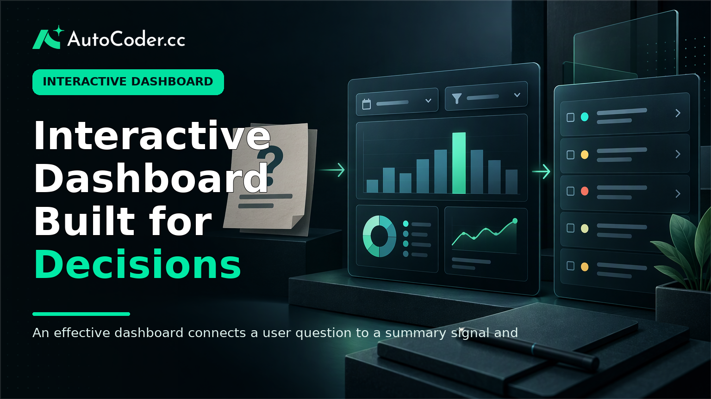
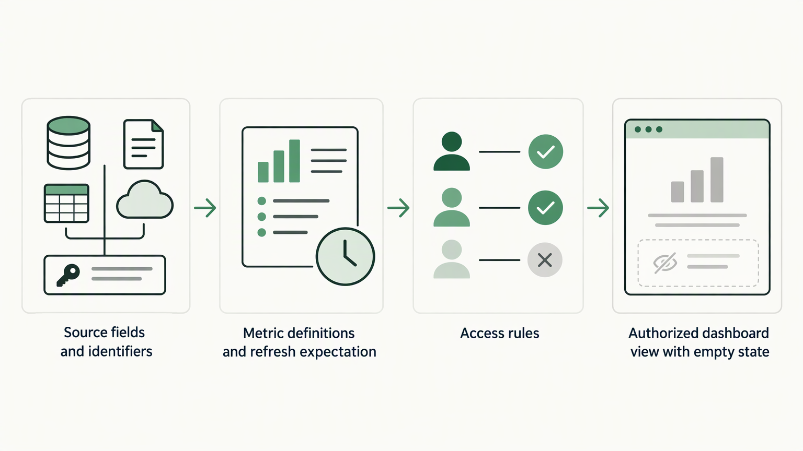
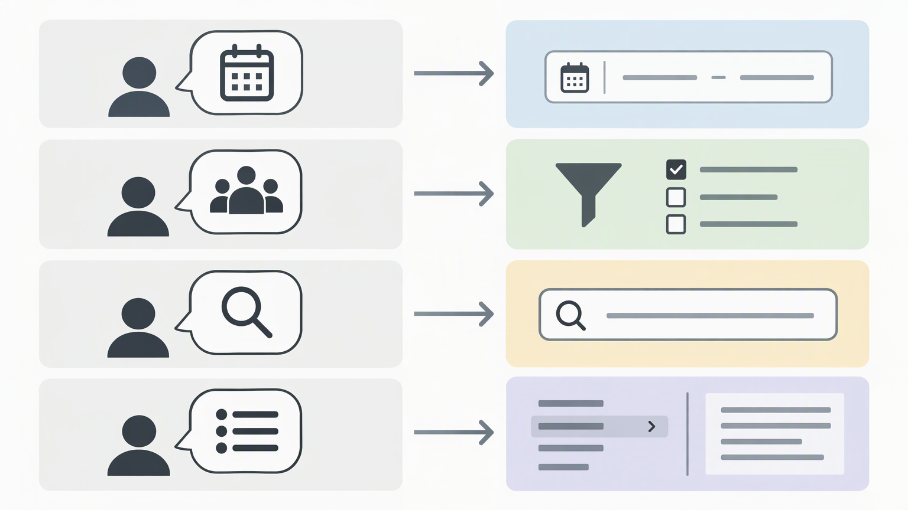

*Published November 3, 2026*

<Frame caption="An effective dashboard connects a user question to a summary signal and then to actionable underlying records.">
  
</Frame>

An **interactive dashboard** should help a person recognize a condition, investigate what caused it, and take a suitable next step. That is a more practical standard than counting charts, controls, or visual effects. For founders, operations teams, and product managers, the work begins by connecting a limited set of information to recurring decisions.

A dashboard may support internal work, such as managing a queue, or give customers a view of their own activity. Both uses require the same discipline: define the user, decision, metric, and follow-up path before selecting interface components. The process below focuses on a first version that is useful, understandable, and possible to validate.

## Start with the user and the decision

**Practical point: define the decision each view must support before selecting metrics or charts.** A decision-led page gives every element a purpose. A page built around whatever data is available can become a report that people scan without acting on.

Identify the specific role using the view. “Operations team” is often too broad. A support lead, workflow coordinator, and founder may work from the same underlying records but need different answers. Describe the person’s context, the choice they make, and how often they make it.

For example, an operations manager may need to identify work requiring attention today. That view needs a current queue, status, ownership, and a path to the affected item. A leadership view may instead need to review a pattern over time and inspect a selected period. Combining both needs on one opening screen can make neither task easier.

Write a decision statement for every proposed view:

- **User:** Who opens this view?
- **Question:** What do they need to understand?
- **Decision:** What can they assign, approve, change, or investigate?
- **Signal:** Which metric or record indicates that attention may be needed?
- **Follow-up:** Where does the user go after finding that signal?

This exercise exposes metrics that sound important but do not guide a choice. A total may provide context, yet it is rarely a useful central measure if no one can say what would change when it rises or falls. Keep it as supporting context, remove it, or pair it with a breakdown that leads to action.

Set the first-release scope deliberately. Choose one user group and a small number of high-frequency decisions. A business dashboard does not need to represent every department or data source immediately. A narrower scope makes definitions, permissions, and accuracy checks much easier to manage.

Agree on metric definitions in plain language. Specify the record population, time period, status rules, and treatment of missing values. If teams calculate the same label differently, a polished visual will not settle the disagreement. Keep these definitions near the implementation requirements so they can be reviewed whenever the logic changes.

## Prepare the data, access, and delivery prerequisites

<Frame caption="Reliable dashboard interactions depend on defined data, refresh expectations, and access rules before interface design.">
  
</Frame>

**Practical point: establish a dependable path from source data to an authorized user before designing interactions.** An attractive data dashboard cannot compensate for stale, incomplete, or improperly exposed information.

Inventory the data sources needed for each decision statement. For each source, note the system of record, fields required, update timing, record owner, and known gaps. This does not require an extensive data program. A practical inventory is enough to show when a planned view depends on unavailable fields or identifiers that cannot be matched reliably.

Prepare four prerequisites before the interface becomes detailed:

1. **Defined source fields.** List fields used in calculations and identifiers used to connect records across sources. Prefer stable identifiers over display labels where possible.
2. **A refresh expectation.** State whether users need current information, scheduled updates, or manually refreshed snapshots. Make the relevant status visible where it affects a decision.
3. **Access rules.** Decide who can see records, segments, and actions. Customer-facing views commonly need account boundaries; internal views may need role-based restrictions.
4. **Delivery ownership.** Identify who reviews business logic, maintains source connections, and receives reports of data issues after release.

Sketch the data model at the level needed to support the first dashboard. Define the entities, relationships, and fields used for filtering, grouping, and drill-down. A workflow view, for instance, may relate work items to owners, teams, dates, and statuses. The aim is not a perfect technical diagram; it is a shared understanding of what the interface can reliably ask of the data.

If a team needs a working application rather than a static mockup, an AI application builder such as [AutoCoder](https://www.autocoder.cc/platform?utm_source=blog&utm_medium=latest&utm_campaign=InteractiveDashboard) can generate editable frontend, backend, and database components from written requirements. Treat generated output as an implementation starting point, not a replacement for reviewing definitions, permissions, and business rules.

## Design an interactive dashboard around real questions

<Frame caption="Each control should be selected because it answers a specific user question, not because it fills a dashboard pattern.">
  
</Frame>

**Practical point: add an interaction only when it changes the answer to a user’s question.** Filters, search, date ranges, and drill-downs are useful when they move a person from a broad signal to a specific cause or record.

Start with a useful default state. Users should see a meaningful answer without configuring the page first. Set a relevant date range, ordering, and scope based on the decision statement. When a view opens blank or needs several selections before it shows anything, it transfers setup work to the user.

Choose controls according to the question they answer:

1. **Date range controls** help users review a defined period or inspect change. Use them when timing affects interpretation, and make the active range clear.
2. **Segment filters** help users narrow results by a meaningful attribute, such as team, account, status, or region. Offer segments people recognize and can act on.
3. **Search** helps locate a known entity, such as an account, project, or item. It should not substitute for a clear information structure.
4. **Drill-downs** help users investigate a summary by reaching the records behind it. Preserve the relevant filter context as they move into detail.

Controls need predictable scope. If a team filter affects one visual but not another, explain that difference or reconsider the layout. Keep active selections visible and provide an easy way to return to the default state. These details help users retain orientation during interactive data visualization.

Select visual forms for the task, not for variety. Tables are often appropriate when users need exact values, sorting, or record-level review. Trend views suit change over time. Categorical comparisons can clarify relative differences among a manageable number of groups. Labels, units, and definitions matter as much as the visual form; users should not have to infer whether a number is a count, rate, duration, or monetary value.

Design for states beyond the ideal populated screen. Empty results, loading, limited access, and unavailable data are routine conditions. Explain what happened and, when possible, offer a recovery action such as changing a filter or checking the selected period. Do not display missing data in a way that looks identical to zero.

## Build the dashboard in a testable sequence

**Practical point: build the smallest complete path from an authenticated user to an actionable detail view, then expand it.** This tests the full application rather than producing disconnected interface pieces.

Use the following sequence for an initial release:

1. **Write acceptance criteria.** For each view, document the intended user, default scope, metrics, controls, detail destination, access expectations, and empty or error behavior.
2. **Create the data layer and calculations.** Implement records, relationships, queries, and aggregation logic for the initial scope. Keep each metric calculation reviewable by the people responsible for the definition.
3. **Build the default view first.** Deliver the opening state, main signal, and clear route to relevant records before adding optional controls or secondary views.
4. **Add interactions one at a time.** Test each filter, range, search field, and drill-down against the question it is intended to answer. Avoid adding a control simply because similar dashboards use it.
5. **Apply authentication and permissions early.** Test authorization through ordinary navigation and direct routes. A correct summary does not make an application safe if a detail page exposes the wrong records.
6. **Prepare deployment and maintenance steps.** Confirm how changes will be released, how source data problems are reported, and who can update metric logic.

Teams converting requirements into a working application can use [AutoCoder's AI app builder](https://www.autocoder.cc/platform?utm_source=blog&utm_medium=latest&utm_campaign=InteractiveDashboard) to support an initial full-stack build while retaining the ability to continue editing source code. The same review process applies: the generated interface and logic still need to match agreed decision statements and access rules.

## Validate usefulness before adding complexity

<Frame caption="Dashboard validation should test data, permissions, interactions, and operating conditions rather than appearance alone.">
  
</Frame>

**Practical point: test whether users can reach a correct next step, not simply whether they like the layout.** A dashboard can render correctly and still fail because people cannot interpret the metric or locate records that explain it.

Run scenario-based checks with people who will use the product. Give each participant a realistic task tied to a decision statement, such as finding items requiring review or explaining a change within a selected period. Observe whether they know where to begin, which control to use, and what the displayed values mean. Ask what action they would take after reaching the result.

Validate the dashboard at four levels:

- **Data accuracy:** Compare a small known set of records with the source, including metric definitions, filters, and time boundaries.
- **Permission behavior:** Confirm every role sees the appropriate scope and cannot access restricted details through navigation or direct routes.
- **Interaction behavior:** Check defaults, filter combinations, resets, loading states, empty states, and drill-down context.
- **Operational behavior:** Review common screen sizes, expected response behavior, and communication of refresh or data-status conditions.

Record issues in terms of decisions rather than interface preferences. “Users cannot tell which work needs attention” is more useful than “the chart is confusing.” It directs the team to reconsider the signal, label, default ordering, or detail path.

Use feedback to remove as well as add. If a control does not alter a meaningful answer, it may not belong in the first version. If two views answer the same question, consolidate them. A dashboard builder can make adding components straightforward, but a clear decision path depends on choosing what not to include.

## FAQ

### What makes a dashboard interactive?

A dashboard is interactive when users can change the scope of information or inspect the details behind a result. Useful interactions include filters, date ranges, search, sorting, and drill-downs. Each should help answer a defined question rather than add configuration for its own sake.

### What data should an interactive dashboard include?

Include information that supports recurring decisions: the main signal, context needed to interpret it, and records needed for follow-up. Define each metric's source, time basis, status rules, and treatment of missing information. Avoid adding fields simply because they are available.

### Can I build an interactive dashboard without coding?

A no-code or low-code approach can help create an initial dashboard when requirements are clear. For applications involving custom logic, authentication, permissions, or ongoing changes, verify that the chosen approach supports the required backend, deployment, and maintenance workflow.

### How do I decide which charts to use?

Match the format to the task. Use tables for exact record-level review, trend views for change over time, and categorical comparisons for a limited set of groups. When action happens at the item level, provide a clear route from a summary to relevant records.

## Conclusion

A useful **interactive dashboard** follows a clear sequence: a user sees a relevant signal, explores the context needed to interpret it, and reaches a practical next step. Begin with decisions and definitions, establish data and access prerequisites, and introduce controls deliberately. Testing realistic scenarios and removing unnecessary complexity helps create a data dashboard that supports everyday work rather than becoming another page to monitor.
