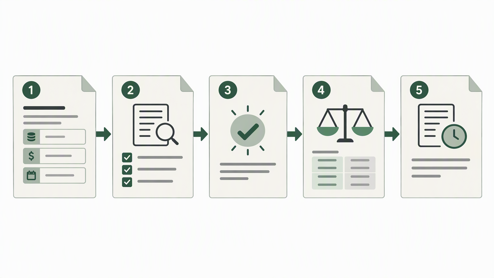
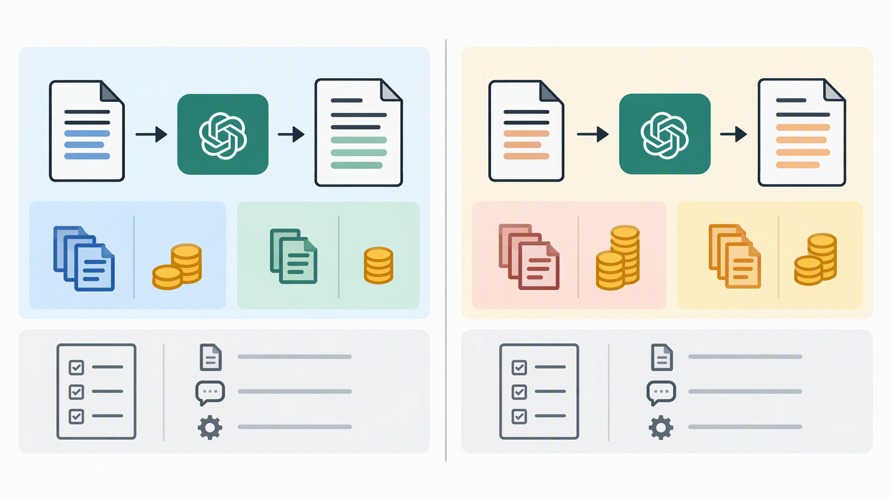

*Published November 2, 2026*

<Frame caption="Reliable cost comparison depends on connecting dated pricing records to explicit usage assumptions rather than treating a price list as fixed.">
  
</Frame>

An **LLM API pricing** tracker is most useful when it treats prices as dated operational data, not as a permanent reference table. For product teams, developers, and founders, the practical goal is to record the terms that affect an application’s estimated cost, compare saved records on consistent assumptions, and make it clear when each record needs review.

A basic spreadsheet can support early research, but a dedicated tracker becomes valuable once several people need to inspect model options, estimate usage, or maintain provider references. This guide covers the data model, workflows, calculations, and review habits needed to build one without implying that saved pricing is always current.

## Define the LLM API pricing questions your tracker should answer

Start by limiting the tracker to decisions people actually need to make. A broad directory of models may look comprehensive while failing to answer whether a particular integration fits a product requirement or a working budget.

Write down the primary questions before creating tables or screens. Common examples include:

- Which saved model records meet a given capability, provider, or deployment requirement?
- What would a request cost under a stated input and output token assumption?
- How do two records compare when the same usage scenario is applied to both?
- When was a rate last checked, and where did the team record its source?
- Which estimates could change because of tiers, caching, batch processing, or other conditions?

This scope separates four related but different jobs: model lookup, model pricing comparison, cost estimation, and historical record keeping. A team may need only the first two at the start. Adding an estimate calculator later is easier when the underlying records are already structured.

### Set prerequisites and boundaries

Before implementation, collect three things: access to the provider material your team is permitted to reference, a clear owner for updates, and a small set of representative usage scenarios. A scenario might describe an expected input size, expected output size, request volume, and any relevant assumptions. It is not a prediction; it is a repeatable basis for comparison.

Also decide what the tracker will not claim. It should not present an estimate as an invoice, conceal conditions that affect a rate, or replace the original provider documentation. A visible source reference and review date help users verify information before making a procurement or architecture decision.

## Model LLM API pricing data clearly

Use a record structure that preserves both the number and its context. Storing a single generic “price” field is usually insufficient because input and output can be priced differently, while units and conditions can vary.

A practical core record includes these fields:

- **Provider:** the organization or platform associated with the API offering.
- **Model identifier:** the exact saved identifier, plus a readable display name if useful.
- **Pricing unit:** the unit used in the source material, kept explicitly rather than inferred.
- **Input rate and output rate:** separate values, each connected to the stated unit.
- **Currency:** the currency represented by the entry.
- **Effective date:** the date the saved terms apply from, when known.
- **Checked date:** when the team last reviewed the source.
- **Source reference:** a link or internal reference that lets an editor return to the original material.
- **Status:** for example, active, replaced, pending review, or archived.
- **Notes:** conditions, exclusions, tier details, or interpretation notes that do not belong in a rate field.

Keep numeric fields machine-readable. Store rates as numbers and units as separate fields rather than embedding them together in prose. This supports sorting, calculation, validation, and later exports. It also reduces ambiguity when editors update a record.

Treat a change as a new dated record when possible instead of overwriting the earlier value. The current view can surface the newest approved record, while a history view preserves what the team used for past estimates. That distinction is important when a product owner asks why an earlier forecast used a different assumption.

The notes field should not become an unstructured substitute for data design. If a condition repeatedly matters—for example, a pricing category or processing mode—consider adding a dedicated field. Reserve notes for context that is specific, uncertain, or not yet stable enough to standardize.

## Build the core pricing tracker workflow

<Frame caption="A practical tracker needs an edit-and-review workflow, not only a table of rates.">
  
</Frame>

Build the tracker around a controlled edit path, a readable comparison view, and a calculator that exposes its assumptions. These three parts turn a collection of entries into a usable process for API cost tracking.

1. **Create an administrative entry form.** Require provider, model identifier, unit, separate input and output rates where applicable, currency, checked date, and source reference. Let editors add notes and an effective date. Validate required fields before a record can be marked ready for use.

2. **Preserve review status.** New entries should not silently appear as trusted defaults. Use a simple status such as draft, reviewed, active, or archived. This makes the editing workflow visible and gives teams a way to distinguish a newly captured reference from one that has been checked.

3. **Create a searchable model view.** Let users filter by provider, status, model family, or other fields that match the team’s actual decisions. Display the pricing unit beside every rate. A rate without its unit is not useful for a quick comparison.

4. **Add a side-by-side comparison view.** Allow users to select saved records and apply one usage scenario across them. Show the scenario inputs near the resulting estimate so that the comparison does not imply identical real-world behavior or performance.

5. **Build an LLM cost calculator with explicit inputs.** Ask for input quantity, output quantity, request count or period, and the selected records. The calculation should show the separate input and output components before presenting a combined estimate. If a field is unavailable or a condition cannot be modeled, state that rather than producing a misleading total.

6. **Maintain a change log.** Record what changed, who edited it if appropriate for the team, and the date of the change. A lightweight log helps reviewers identify whether a new estimate comes from changed usage assumptions, a different model selection, or updated saved rates.

7. **Add a review queue.** Filter records by checked date or status so the owner can revisit older entries. The queue does not prove that a price has changed; it creates a repeatable prompt to compare the saved record with its source.

For teams that want to move beyond a spreadsheet, [AutoCoder's AI app builder](https://www.autocoder.cc/platform?utm_source=blog&utm_medium=latest&utm_campaign=LLMAPIPricing) can be used to generate an editable full-stack starting point from a description of these records, views, and approval states. The important design work still comes first: define fields, ownership, and calculation rules before asking any tool to create screens.

## Make AI API pricing calculations transparent

<Frame caption="Fair estimates keep input and output components separate and display the scenario assumptions used for each comparison.">
  
</Frame>

Show the formula and assumptions alongside every estimate. Transparency is more useful than a polished total when users need to judge whether a scenario fits their own application.

At a general level, an estimate combines an input component and an output component:

`estimated cost = (input quantity × input rate) + (output quantity × output rate)`

If the scenario includes many requests, multiply the per-request assumptions by the stated request count before applying the rates. Keep conversions visible whenever the stored pricing unit differs from the scenario’s unit. Do not hide a conversion inside a label or round values so early that reviewers cannot reproduce the result.

A good calculator also labels what it excludes. Depending on the records and use case, an estimate may not account for optional service features, non-token billing dimensions, taxes, account-specific arrangements, minimum commitments, or conditions described only in source notes. The exact exclusions will vary, but the tracker should make its own limitations plain.

Use scenarios to support decisions, not to declare a winner. For example, a short-response support workflow and a long-form generation workflow can produce very different input-to-output relationships. Comparing models under only one scenario may be useful for that scenario, but it is not a universal model pricing comparison.

Store scenarios separately from rate records. This lets a team update usage assumptions without changing historical rate data, and update rates without rewriting a scenario. It also makes it easier to compare a conservative, expected, and high-usage case without confusing those assumptions with provider terms.

## Validate records and keep the tracker current

Make review a recurring operating task rather than a cleanup project. Pricing data becomes less reliable when nobody can tell which entries were reviewed, what source was used, or whether a record was superseded.

Start each review by opening the saved source reference and checking the unit, currency, model identifier, input rate, output rate, and any conditions recorded in notes. Then compare the source date or effective date with the existing record. If information differs, create or update the appropriate dated entry and record the reason for the change.

Build a few validation rules into the application:

- Require a unit and currency for every active rate.
- Reject negative quantities or rates in calculator inputs.
- Flag entries that lack a source reference or checked date.
- Warn when a record marked active has been replaced by a newer approved record for the same model identifier.
- Keep archived records out of default selections while retaining them for historical review.

There are several common misconceptions to avoid. First, a tracker is not a live provider price feed unless it has an explicitly maintained integration and a way to validate results. Second, a lower saved rate does not by itself establish that a model is appropriate for a workload; quality, latency, operational constraints, and application design can matter. Third, an LLM cost calculator produces a scenario-based estimate, not a guaranteed bill.

Assign ownership even for a small team. One person can own source review, while another approves schema changes or calculation logic. The role names matter less than the handoff: someone should know which records need attention, and users should know what “reviewed” means in the tracker.

## Conclusion

A dependable **LLM API pricing** tracker combines structured records, visible units, dated source references, scenario-based calculations, and a routine for review. Its purpose is not to promise fixed costs. It gives product teams a clearer way to compare saved information, explain assumptions, and revisit estimates as provider terms or application usage change.

Start with the smallest useful schema and a few representative scenarios. Then add approval states, history, and comparison views as the team’s API cost tracking needs become more specific. A focused internal tool built with [AutoCoder](https://www.autocoder.cc/platform?utm_source=blog&utm_medium=latest&utm_campaign=LLMAPIPricing) can support that workflow when the data model and review responsibilities are already defined.

## FAQ

### What is LLM API pricing?

LLM API pricing is the set of charges and conditions associated with using a language model through an API. A tracker should record the stated unit, separate input and output rates where relevant, currency, applicable conditions, source reference, and dates rather than reducing the information to one undated number.

### How should an LLM API pricing tracker store input and output pricing?

Store input and output rates in separate numeric fields, with a separate field for the stated pricing unit and another for currency. Add effective and checked dates, a source reference, and notes for conditions. This structure supports reproducible calculations and clearer review.

### Why should pricing data include an effective date?

An effective date helps distinguish the period a saved record describes from the date someone entered or reviewed it. It also supports historical estimates, because a team can identify which record was intended to apply when a forecast was made.

### Can a pricing tracker compare multiple LLM providers?

Yes, provided the tracker compares saved records using consistent units and a clearly stated usage scenario. The output should be treated as a cost comparison under those assumptions, not as a complete assessment of model suitability or an assurance that provider terms are unchanged.
