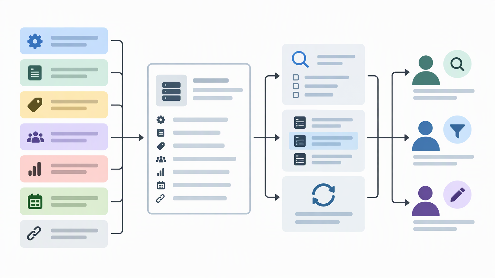
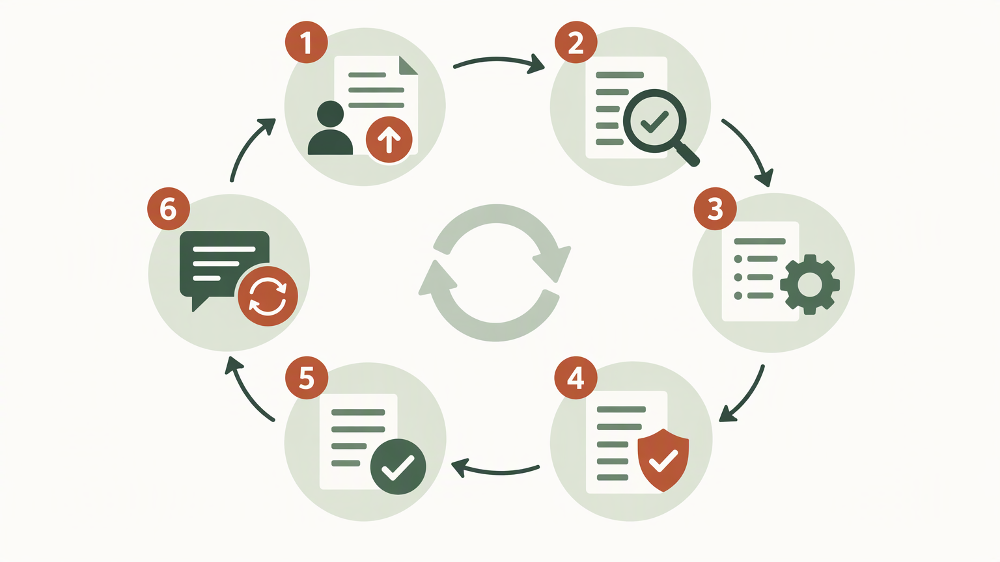

*Published November 4, 2026*

<Frame caption="An effective MCP directory connects structured submissions, editorial review, and task-based discovery rather than acting as an uncurated link list.">
  
</Frame>

An **MCP directory** is useful only when it helps a builder move from a vague need to a server they can assess and use. That requires more than collecting links. A dependable directory gives each listing enough context to compare Model Context Protocol servers, understand how they connect, and judge whether the information is current.

For AI product builders, the work is partly editorial and partly operational. You need a clear scope, a consistent listing schema, a discovery experience based on real tasks, and a process for reviewing changes. This guide lays out those decisions in an order that makes the directory easier to launch and maintain.

## Set the scope of an MCP directory

**Start by defining what the directory is for before choosing categories or building pages.** Scope determines which submissions you accept, what fields matter, and what a visitor can reasonably expect from the resource.

Begin with the audience. An MCP server directory aimed at individual developers may emphasize quick setup, local transports, and source repositories. A directory for product teams may need clearer ownership, supported environments, documentation quality, and operational notes.

Write a short scope statement that answers four questions:

1. Which Model Context Protocol servers are in scope: public, internal, open-source, hosted, or a defined mix?
2. Which user needs should discovery support, such as file access, data retrieval, developer workflows, customer systems, or content operations?
3. What qualifies a server for inclusion?
4. What is outside the directory’s editorial responsibility?

The fourth point prevents overreach. A directory can describe a project and link to its documentation without certifying its safety, availability, or suitability for a particular deployment. Use wording that distinguishes observed listing information from a recommendation.

Next, choose categories based on jobs users are trying to complete. Broad labels such as “productivity” can be useful as secondary tags, but they are rarely enough for comparison. A visitor looking to connect an AI application to a repository, calendar, database, or internal knowledge source should be able to start with that task.

Use a limited set of primary categories, then add tags for narrower distinctions. A practical category structure might include developer tools, data and databases, business systems, knowledge and documents, communication, and local system tools. Tags can then identify specific services, deployment patterns, authentication needs, or intended use cases.

Avoid treating every new integration as a top-level category. Too many categories make browsing harder and create inconsistent choices for submitters. Review categories periodically and promote a tag only when it represents a meaningful, recurring discovery path.

Finally, decide whether your directory lists servers, server collections, client integrations, or all three. These are related but not interchangeable. Keeping the primary unit of the directory clear makes search results and listing pages easier to understand.

## Create a useful MCP server listing data model

<Frame caption="Consistent structured fields make listings comparable, filterable, and easier to update over time.">
  
</Frame>

**Make every listing answer the same core evaluation questions so visitors can compare options without opening many tabs.** A good data model also gives reviewers a reliable checklist and makes future filtering possible.

At minimum, each MCP server listing should include a name, concise description, canonical project or documentation link, and a source or publisher link where available. The description should state the practical capability of the server, not repeat a product slogan.

Add structured fields for information that users will need during evaluation:

- **Primary capability:** the task or system the server exposes. - **Category and tags:** controlled vocabulary for browsing and filtering. - **Transport or connection details:** only where stated in the supplied project documentation. - **Setup reference:** a direct link to installation or configuration instructions.

Separate facts from editorial interpretation. Fields such as URLs, declared capabilities, and documented setup requirements can be structured. Editorial notes should be brief, attributable to documentation where possible, and framed cautiously. A “review notes” field can explain why a listing is incomplete or why a maintainer should update it, but it should not become a place for unsupported judgments.

Design for incomplete information from the beginning. Some projects will not publish every detail you would like to show. Rather than leaving users to infer missing data, display a neutral state such as “not provided in linked documentation” or omit the field consistently.

A listing schema should also support revisions. Store the submission source, reviewer, review date, and an update path separately from public-facing copy. This gives your team an audit trail without burdening readers with internal workflow details. It also makes it easier to contact a submitter when documentation changes.

If you are building the directory as an application rather than a static page, define the schema before designing the interface. Tables for listings, categories, tags, maintainers, submissions, and review events generally map more cleanly to the workflow than a single free-form content record. An application builder such as [AutoCoder’s AI app builder](https://www.autocoder.cc/platform?utm_source=blog&utm_medium=latest&utm_campaign=MCPDirectory) can help turn those product requirements into an editable directory foundation, but the quality of the result still depends on the fields and review rules you specify.

## Build discovery around evaluation tasks

**Search and filters should reduce uncertainty, not merely produce a long list of matching names.** Directory visitors are usually trying to answer a practical question: which server is relevant, how difficult is it to evaluate, and where can I verify its details?

Start with a search index that covers the listing name, description, categories, tags, and named systems. This supports both broad searches, such as “database,” and direct searches for a particular service or repository. Keep the displayed result focused: name, short capability statement, relevant tags, maintenance label, and links to documentation or source are usually more helpful than a dense card full of metadata.

Then add filters only for decisions users can act on. Useful candidates include category, task, deployment context, documented transport, authentication requirement, maintenance label, and source availability. Each filter should correspond to a consistently populated field.

Provide a listing detail page that supports a careful evaluation. Put the practical description first, followed by setup links, connection details, permissions notes, compatibility information, and maintenance context. Keep external links visible. A directory should help users find authoritative project information, not obscure it behind summary text.

Use related listings with restraint. Related items can be based on shared task, system, category, or tags, but they should offer a meaningful next comparison. Automatically linking every listing in a broad category can create noise.

Create browse pages for the tasks your target users repeat. For instance, a page for data access servers can explain what the category covers, show the filters that matter, and surface listings with concise distinctions. This adds useful context to an AI tool directory without making the taxonomy overly rigid.

Test discovery with realistic scenarios before launch. Ask whether a visitor can find a relevant server for a specified task, identify its source and setup documentation, distinguish documented facts from missing information, and report an inaccurate entry. If any step takes too much interpretation, revise the information architecture before adding more listings.

## Establish submission and moderation workflows

<Frame caption="Directory maintenance depends on a repeatable review loop with a visible route for corrections and updates.">
  
</Frame>

**A clear submission process is the main defense against stale, inconsistent MCP server listings.** It also reduces the time reviewers spend translating unstructured claims into your data model.

Use a submission form that mirrors the public schema. Request the project name, a practical description, documentation link, source or publisher link, categories, tags, setup reference, and maintainer contact route. Where a field depends on documentation, ask submitters to link the relevant page rather than paste an unverified assertion.

Set expectations on the form. State that submission does not guarantee publication, that entries may be edited for clarity and consistency, and that incomplete information may delay review. If you accept entries from maintainers and community members, record the submitter type internally.

A basic review workflow can be handled in numbered steps:

1. **Check identity and canonical links.** Confirm that the project name, documentation, and source or publisher references point to the intended server. 2. **Verify the listing description.** Ensure the capability statement matches the linked materials and avoids unqualified performance, security, or compatibility claims. 3.

Moderation is not a one-time gate. Establish a recurring review queue for broken links, listings marked as needing updates, and reports from users. The cadence can match your team’s capacity; the important part is that the maintenance label reflects your own review process rather than implying continuous monitoring.

Keep a separate policy for removals and archival. A listing may need to be removed when it is clearly unrelated, misleading, or no longer has a valid canonical reference. Archival can be more appropriate when a project remains useful as a reference but its linked materials indicate that it is no longer maintained.

Security-related information deserves particular care. Your directory can encourage visitors to review permissions, credentials, deployment boundaries, and source materials, but it should not make broad security assurances without a defined assessment process. A short disclosure note and direct documentation links are often more responsible than a simplistic safety badge.

## Launch the directory with maintainable operations

**Treat launch as the start of a content operation, not the finish of a build.** The initial collection should be large enough to make categories and search useful, but it does not need to cover every possible server.

Before publishing, review navigation labels, empty states, filter behavior, external-link handling, and the reporting route. Check that a visitor can understand why an item appears in a search result and can reach the primary documentation without friction.

Create simple editorial rules for titles, descriptions, tag selection, capitalization, and link priority. These rules protect consistency when more than one person edits the directory. They are especially valuable once community submissions begin to introduce varied terminology for similar capabilities.

Measure operational signals rather than assuming that page views equal usefulness. Search terms with no results may reveal missing categories or unlisted servers. Repeated correction requests may indicate unclear fields. Frequent abandoned submissions can point to an overly demanding form.

If you need a working prototype to test these workflows, [AutoCoder](https://www.autocoder.cc/platform?utm_source=blog&utm_medium=latest&utm_campaign=MCPDirectory) supports building full-stack applications from natural-language product requirements and continuing to edit the generated source code. Define the listing schema, roles, review states, and submission flow first so the prototype reflects the directory operation you actually intend to run.

## FAQ

### What is an MCP directory?

An MCP directory is a structured resource for finding and evaluating Model Context Protocol servers. It typically organizes listings by capability or use case and links users to project documentation, source materials, and setup information.

### What information should an MCP server listing include?

A useful listing includes the server name, a practical description, canonical documentation and source or publisher links, categories and tags, setup references, documented connection details, relevant permission notes, and a transparent maintenance label.

### How can an MCP directory keep listings current?

Use a review queue, record a last-reviewed date, provide a correction route, and give each entry a maintenance status. Recheck broken links and reported changes regularly, then archive or remove entries according to published rules.

### Should a directory rank Model Context Protocol servers?

Ranking can be misleading unless the criteria are explicit, consistently applied, and supported by evidence. For many directories, filters, maintenance context, and clear documentation links are more useful than a single score.

## Conclusion

A durable **MCP directory** is built around trustworthy comparison, not sheer volume. Define the audience and scope, collect structured information, make discovery reflect real evaluation tasks, and maintain a transparent submission and review process. With those foundations in place, an MCP server directory can remain useful as listings, documentation, and user needs change.
