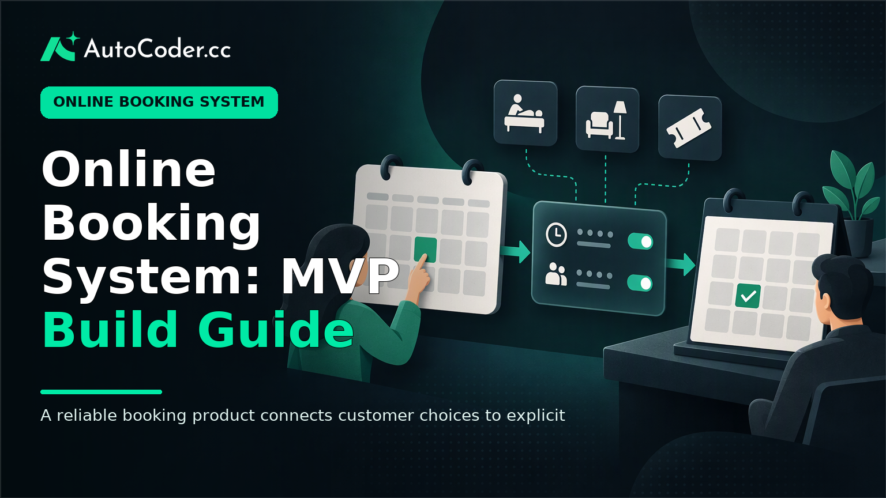
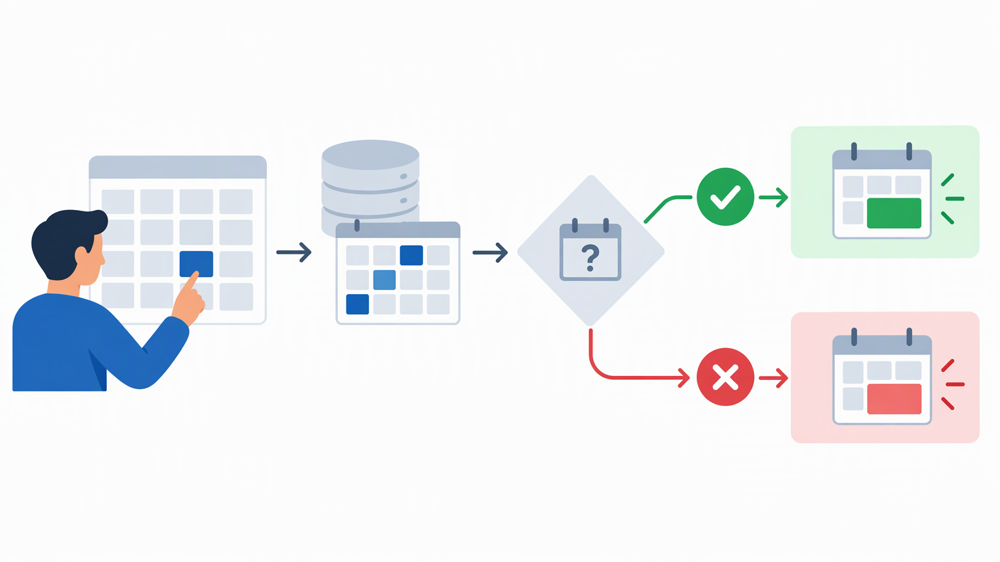

*Published November 3, 2026*

<Frame caption="A reliable booking product connects customer choices to explicit availability and staff operations, rather than acting as a standalone calendar.">
  
</Frame>

An **online booking system** is not simply a calendar embedded on a website. It is a set of rules that decides what can be booked, by whom, at what time, and what happens when plans change. For founders building services, events, spaces, or appointments, the first task is to define those rules before choosing screens or writing code.

A useful MVP keeps the path short: a customer finds an available option, supplies the required details, receives a clear outcome, and staff can manage the result. The complexity usually sits behind that simple path—in availability, capacity, timing, cancellations, and conflict prevention. This guide outlines how to scope that workflow into a practical application.

## Define the booking workflow before building

**Start by documenting one complete customer-to-staff booking journey.** A narrow, explicit workflow prevents an MVP from becoming a collection of loosely connected calendar features.

Begin with the bookable resource. It may be a staff member’s time, a treatment room, a class seat, a desk, a venue, or an event ticket. A resource can have different booking rules even when it appears on the same customer-facing site. For example, an individual consultation may permit one booking per time slot, while a workshop may permit several bookings until its capacity is reached.

Before development, prepare these prerequisites:

- A defined resource and the person or team responsible for it.
- A standard duration or a clear set of duration options.
- Operating hours, blackout dates, and any lead-time requirement.
- Capacity rules, including whether one booking reserves the whole resource or one place within it.
- A cancellation and rescheduling policy that staff can apply consistently.
- The customer details required to complete a booking.

Then write the workflow in plain language. For a service appointment, it may be: a customer selects a service, chooses a staff member or accepts an assigned one, sees valid times, enters contact details, submits the request, and receives confirmation. For a space reservation, it may include selecting a date, start and end time, room configuration, and attendee count.

Separate what customers can request from what staff must approve. An online reservation system can confirm bookings immediately when availability is reliable, or place requests into a pending state when staff need to check details. Neither approach is inherently better; the choice depends on whether the resource and its rules can be represented consistently in the application.

Also decide which exceptions belong in the first release. A booking system may eventually need recurring bookings, waitlists, multiple locations, linked resources, deposits, or group bookings. These are distinct workflows, not minor settings. If they are not essential to validating the product, record them as later requirements rather than adding them to the initial build.

## Turn availability rules into an MVP data model

<Frame caption="Double-booking prevention requires checking current availability during booking creation, not merely displaying an open slot earlier.">
  
</Frame>

**Make availability a stored rule rather than a visual assumption.** A calendar view can display open time, but the application needs structured data to determine whether a request is valid at the moment it is submitted.

At minimum, define the records the application must manage. Most booking MVPs need a resource record, an availability record, a booking record, and customer or contact information. A booking should preserve the facts relevant to that transaction: the resource, selected time range, status, customer details, and any notes needed by staff. Keeping the booking state explicit makes later actions easier to reason about.

Common states include pending, confirmed, cancelled, and completed. Use only states that lead to a real action. For instance, a pending state makes sense if staff approval exists; it adds confusion if every booking is automatically accepted.

Availability should account for more than opening hours. Establish how the system treats:

1. **Time boundaries.** Decide whether a booking ends exactly when the next can begin, and whether setup or cleanup time blocks the resource afterward. 2. **Capacity.** Decide whether capacity is one per slot, a fixed number per session, or tied to a resource such as a room with a stated limit. 3. **Overrides.** Staff need a way to close a particular date, adjust hours, or block time without changing the regular weekly pattern. 4.

The last point is central to preventing double bookings. The server-side booking action must check current availability before creating a confirmed record. A browser displaying an open slot is not enough, because the display may be stale by the time the customer submits the form. Where a resource has limited capacity, the validation should check the remaining quantity as part of creating the booking.

A booking management system should also show staff the information they need to intervene. An administrative view may include upcoming bookings, status, assigned resource, customer contact information, and controls for cancellation or rescheduling. Avoid treating the customer calendar and staff operations view as the same interface: they serve different decisions.

## Build the essential online booking system features

<Frame caption="Customer-facing booking and staff administration are distinct workflows that must operate on the same accurate booking record.">
  
</Frame>

**Build the customer flow and staff controls around the rules already agreed, not around a generic calendar template.** This keeps each screen accountable to a specific booking decision.

For a first version, prioritize a small set of connected capabilities:

1. **A discovery page for bookable options.** Customers should be able to understand what they can book and select the relevant service, event, space, or appointment type. Include only details that affect selection, such as duration, location, capacity, or preparation instructions. 2. **An availability selector.** Present only times or dates that meet the resource rules. If customers choose a duration, update available options based on that choice rather than relying on a fixed calendar display. 3.

Treat notifications as part of the workflow, not decoration. A confirmation message should reflect the booking state and provide accurate details. A cancellation or rescheduling action should update the stored booking first, then communicate the revised outcome. If messaging is not ready for the first release, provide an explicit on-screen confirmation and a staff process for follow-up rather than implying that a message was sent.

For founders without an established engineering workflow, an application builder can help turn requirements into an initial full-stack structure. [AutoCoder's AI app builder](https://www.autocoder.cc/platform?utm_source=blog&utm_medium=latest&utm_campaign=OnlineBookingSystem) can generate frontend, backend, and database components from natural-language product requirements, with support for authentication and deployment workflows. It is still important to provide precise booking rules and review the generated workflow against the decisions in this guide.

The distinction matters because booking app development is largely a product-definition exercise. A tool can accelerate implementation, but it cannot decide whether a cancellation should reopen a slot, whether a request needs approval, or how capacity should work. Those decisions should remain visible in the specification and in the application’s validation logic.

## Test booking conflicts and operational edge cases

**Test the rule boundaries before inviting real customers to book.** Happy-path testing confirms that a normal reservation can be made; it does not show whether the system behaves safely when conditions change.

Create a compact test checklist that covers the same workflow from both customer and staff perspectives. Attempt to book a valid open slot, then attempt the same slot again. Test a booking that overlaps only partly with another booking. Check the first and last slot of the day, a date with an override, and a time near any lead-time or cancellation boundary.

Test changes as carefully as initial bookings. When staff cancel a confirmed booking, verify whether the slot becomes available according to the policy. When a booking is rescheduled, verify that the old time is released only after the new time is valid. If capacity is used, confirm that a cancellation adjusts availability correctly.

Time-zone handling deserves a deliberate review. Use a defined operational time zone for each resource or location, and make sure dates and times shown to customers match the intended booking context. Test near midnight and around changes to local clock rules where they affect the business. The goal is not to support every global scenario in an MVP; it is to avoid silently applying an ambiguous one.

Review permissions as an operational test, too. A customer should not be able to access another customer’s booking details. Staff members should see only the management functions appropriate to their role. If the MVP includes customer self-service, verify that the cancellation and rescheduling controls respect the same rules as staff actions.

Finally, define a manual fallback. Staff should know how to respond if a customer reports an incorrect confirmation, if an unavailable slot appears bookable, or if a booking needs a correction. A straightforward procedure and an audit-friendly record of changes are more useful than an untested automated exception path.

## Deploy with a manageable operating process

**Launch only when the team can operate the workflow as well as customers can use it.** Deployment is the point at which business rules, staff habits, and application behavior meet.

Before release, assign ownership for availability updates, booking reviews, and customer inquiries. Write down who can change operating hours, who resolves conflicts, and how cancellations are handled. These tasks are part of the product even when they happen outside the customer interface.

Use a limited initial scope where possible: one location, a small set of services, or a defined group of resources. This does not make the application less valid; it makes it easier to learn whether the workflow matches actual operations. Review early bookings for recurring manual work. If staff repeatedly adjust durations, override availability, or answer the same question, that pattern can inform the next iteration.

Choose a build approach that leaves room for change. [AutoCoder](https://www.autocoder.cc/platform?utm_source=blog&utm_medium=latest&utm_campaign=OnlineBookingSystem) supports editable, deployable full-stack applications and source-code export, which can be relevant when a team wants to continue refining a booking workflow after the initial MVP. Regardless of the implementation route, retain a clear record of the availability and status rules so later changes do not create inconsistent behavior.

## FAQ

### What features should an online booking system include?

An MVP generally needs a way to select a bookable option, show valid availability, collect booking details, create a clear booking status, and let staff manage the result. Authentication, payments, reminders, customer accounts, and advanced reporting should be included when they support the defined workflow rather than by default.

### Can I build an online booking system without coding?

Yes, an application builder or no-code approach can help create an initial booking application without writing every component manually. The team still needs to specify resources, availability, capacity, booking states, and staff processes. These operational rules determine whether the system works reliably.

### How do I prevent double bookings?

Validate availability when the booking is created, not only when a customer first views the calendar. The booking action should check the current resource, time range, capacity, and status conditions before confirming the reservation. Test simultaneous or near-simultaneous requests as part of release preparation.

### Should an MVP accept payments from the start?

Add payments when taking payment is necessary to validate the business workflow or reserve scarce capacity. If the initial goal is to validate demand and booking operations, a payment-free MVP may be appropriate. The key is to communicate the booking status and payment expectation clearly.

## Conclusion

A workable **online booking system** begins with a precise operational model: what is bookable, when it is available, who can change it, and how conflicts are resolved. Scope the MVP around one complete booking journey, store the rules behind availability, and test cancellations, time boundaries, capacity, and permissions before launch. Once that core workflow is dependable, additional capabilities can be added in response to real operating needs rather than assumptions.
