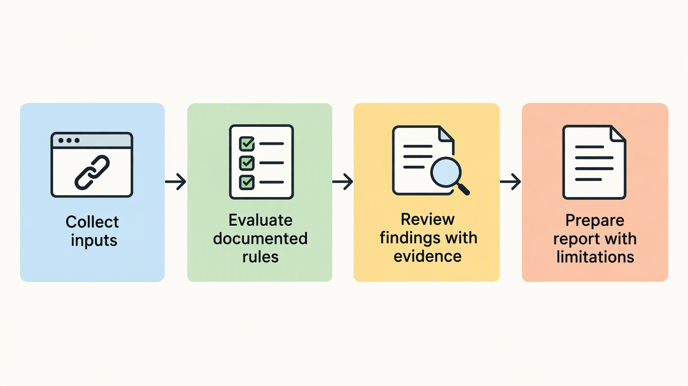

*Published November 4, 2026*

<Frame caption="An effective audit product is a traceable workflow from URL input to evidence-backed findings, not an unexplained score.">
  
</Frame>

An **SEO audit tool** is most useful when it turns observable page and site signals into findings that a person can review, understand, and act on. That requires more than collecting tags or crawl responses. It requires a narrow initial scope, explicit rules, an interface that preserves context, and careful validation before results are shared broadly.

For consultants, agency teams, and founders, the objective is not to reproduce every capability of a broad SEO platform. It is to build a focused website-audit product or internal workflow that answers a defined set of questions consistently. The steps below emphasize transparent checks, understandable prioritization, and a first release that remains maintainable.

## Define the purpose and user of the SEO audit tool

Start by deciding who will use the tool and what decision its output should support. A clear user and use case prevent the first release from becoming an unfocused collection of checks.

A consultant preparing a client review needs an audit that can be explained in a meeting and exported into a concise SEO audit report. An agency team may need project records, repeatable review steps, and access controls. An internal marketing team may instead need page-level checks before publishing. These needs overlap, but they do not require the same workflow.

Before designing screens or writing rules, establish the following prerequisites:

- A defined audience, such as consultants reviewing prospective clients or marketers reviewing a content section.
- A stated audit boundary: a submitted URL, a list of URLs, or a site crawl where that is technically available.
- A working definition of what the tool can inspect from the inputs it receives.
- A policy for saved project data, user access, and the retention of past audit results.

Then write a short product statement. For example: “The tool reviews accessible page and site signals, groups findings by review priority, and explains what each finding means.” This is more useful than a promise to improve visibility, because it identifies an observable job.

Next, separate the first release from later additions. A manageable initial product might accept a URL, retrieve and evaluate available page information, store the run, and display an issue list with explanations. Features such as scheduled monitoring, collaborative annotations, or wider integrations can wait until the basic audit flow is dependable.

This boundary also clarifies responsibility. A tool can flag that a page appears to lack a title element or returns a redirect response. It cannot establish why a business is underperforming in search, whether content meets a searcher’s needs, or what ranking outcome will follow a change. State those limits in the product and in the report language.

## Select transparent checks for a website SEO audit

Choose checks that have a clear input, a stated rule, and an interpretation a user can verify. Transparent checks make the tool easier to test and make its recommendations less likely to be treated as unexplained scores.

Build a rule catalog before building the interface. For every check, record the input being assessed, the condition that produces a result, the result label, the user-facing explanation, and known limitations. A result should answer “what was observed?” before it suggests “what should happen next?”

A practical initial set can include the following numbered checks:

1. **Page retrieval and response handling.** Record whether the submitted address can be retrieved, whether it resolves through redirects, and the final address reviewed. Preserve enough context for the user to understand which page the audit evaluated.
2. **Indexability-related signals.** Inspect available signals that may affect whether a page is intended to be indexed, while clearly distinguishing a page directive from confirmation of search-engine indexing.
3. **Metadata and document structure.** Review title elements, meta descriptions, headings, language declarations where available, and canonical references. Report what is present or absent rather than implying that a particular format is always correct.
4. **Links and references.** Identify links that cannot be followed during the audit, unusual redirect paths, and references that point to unexpected destinations. A link finding needs the source page, destination, and observed outcome.
5. **Content structure indicators.** Surface simple, explainable indicators such as an absent main heading, very limited visible copy, or repeated titles across a submitted set of pages. These are prompts for review, not judgments of content quality.

Keep the language of each finding precise. “No meta description was found in the evaluated document” is a checkable observation. “Your page will not rank” is not. Similarly, do not equate a general score with a diagnosis. If a summary score is needed for triage, let users open it and see the rules and findings that contributed to it.

Assign severity only when it helps order work. A retrieval failure may prevent many other checks from running and deserves prominent treatment. A formatting observation may be useful but lower priority. Make labels such as “review first,” “needs attention,” and “informational” describe workflow priority rather than guaranteed impact.

A good SEO checker tool also handles uncertainty directly. An unavailable page, blocked resource, malformed markup, or partial crawl should produce a clear “could not evaluate” state. Do not convert missing input into a passing result.

## Design the audit workflow and data model

<Frame caption="Separating data collection, evaluation, review, and reporting makes audit results easier to interpret and debug.">
  
</Frame>

Map the complete journey from submission to report before implementing individual screens. This exposes dependencies between URL handling, results storage, permissioning, and the explanations users need at the end.

A straightforward workflow has five stages:

1. **Create a project or run.** The user enters a URL or selects an existing project. Normalize the submitted address while retaining the original input for reference.
2. **Collect audit inputs.** Retrieve the relevant page or allowed set of pages and record timestamps, final URLs, response details, and any collection errors. Treat collection as separate from evaluation so a failed request is not confused with a failed check.
3. **Evaluate rules.** Run each check against recorded inputs and save a structured result: status, severity, evidence, explanation, and suggested next review step.
4. **Review findings.** Present a summary that links directly to individual findings. Let users filter by status, URL, and priority, but avoid hiding the evidence behind a single aggregate score.
5. **Prepare the report.** Generate a shareable view or export that includes scope, audit time, evaluated URLs, limitations, findings, and recommended review order.

The data model should support this flow without assuming one audit equals one page forever. At minimum, separate projects, audit runs, evaluated URLs, check definitions, and check results. A check result should be tied to its audit run and URL, not only to the project. That preserves historical context when a later audit produces a different outcome.

Store the evidence needed to interpret results, but be deliberate about retention. For example, a result may save a retrieved title value or response status, while a larger page snapshot may not be necessary for every product. The appropriate choice depends on the audit scope, debugging needs, and data policy.

Design for exceptions in the primary interface. Show when an audit is incomplete, when a URL could not be reached, and when a rule was skipped. Users should not have to infer these conditions from an empty chart or absent issue count. This is particularly important in a technical SEO audit, where a collection limitation can change the meaning of every downstream result.

## Build a focused prototype and report interface

Build the smallest complete path first: submission, collection, evaluation, results, and report. A usable end-to-end prototype reveals more about the product than a large set of disconnected dashboard components.

Translate the workflow into concrete requirements. Describe the project list, audit submission form, results summary, finding detail view, and report view. For each screen, specify the actions available, the fields displayed, and the empty or error states. Keep the report editable in tone and structure if consultants will use it in client work.

An application builder can speed up the implementation of these connected requirements. For example, [AutoCoder's AI app builder](https://www.autocoder.cc/platform?utm_source=blog&utm_medium=latest&utm_campaign=SEOAuditTool) can generate editable frontend, backend, and database components from a natural-language product brief, helping a team move from workflow definition to a deployable prototype. The generated application still needs explicit rule definitions, input handling, and review of its behavior.

In the results interface, lead with audit scope and audit status. Then show findings in a usable order: what needs review first, the affected URL or URLs, the observed evidence, and the reason the finding was raised. Give users a way to mark an item reviewed or add an internal note only if that supports the intended workflow; do not add collaboration features by default.

The SEO audit report should preserve the same restraint. Include the scope and limitations at the start, followed by grouped findings and next review steps. Avoid language that presents the report as a ranking forecast. Its purpose is to document checks and help people decide what to investigate or fix.

## Validate outputs before wider use

<Frame caption="Validation depends on comparing documented expected conditions with observed evidence, including exceptions such as redirects or inaccessible pages.">
  
</Frame>

Test rule behavior against known conditions before treating the tool as a dependable review system. Validation is not a final stage; it is how the rule catalog becomes more precise over time.

Create a small controlled test set of pages or page examples that represent expected states: a page with a title, a page without one, a redirect, an inaccessible address, a page with an indexability-related directive, and duplicate URL variants. For each case, write the expected collection result and expected check output before running the tool. This makes disagreements visible.

Review validation in four passes:

1. Confirm that the tool evaluated the intended final URL and recorded collection issues accurately.
2. Compare each finding against the underlying evidence rather than relying on the summary status.
3. Test edge cases, including relative links, redirect chains, blocked pages, duplicate forms of a URL, and malformed documents.
4. Read the user-facing explanations as if they were going into an agency deliverable. Remove claims that exceed what the tool observed.

Track false positives, false negatives, skipped checks, and ambiguous cases separately. A rule may be technically consistent but still poorly framed for users. If a result prompts recurring questions, improve the evidence display or explanation before increasing its severity.

Use controlled access for early testing. A small group of experienced reviewers can compare outputs with their own process, identify missing context, and expose places where the report overstates certainty. Changes to rules should be versioned or otherwise recorded so teams can understand why results differ between audit runs.

## FAQ

### What does an SEO audit tool check?

An SEO audit tool can check observable page and site signals, such as retrieval outcomes, redirects, metadata, headings, link behavior, canonical references, and indexability-related directives. The exact scope should be documented, along with checks the tool cannot perform or confirm.

### What should an SEO audit report include?

An SEO audit report should state the audit scope, date, evaluated URLs, collection limitations, findings, supporting evidence, priority labels, and practical next review steps. It should distinguish observations from assumptions about search performance.

### Can I build a custom SEO audit tool?

Yes. A custom tool can focus on the checks, report format, and project workflow used by a particular consultancy, agency, or internal team. Start with a narrow set of explainable rules, then expand only after validating results and user needs.

### How can an SEO audit tool be tested for accuracy?

Test it with controlled examples whose expected outcomes are documented in advance. Compare every finding with the stored evidence, test error conditions and URL variations, and review whether explanations accurately describe the observed condition.

## Conclusion

A focused **SEO audit tool** earns trust through transparent inputs, explicit rules, and reports that preserve evidence and limitations. Define the user and boundary first, implement a small end-to-end workflow, and validate each check against known conditions. That approach produces a clearer technical SEO audit process than a larger feature set with unclear results.
