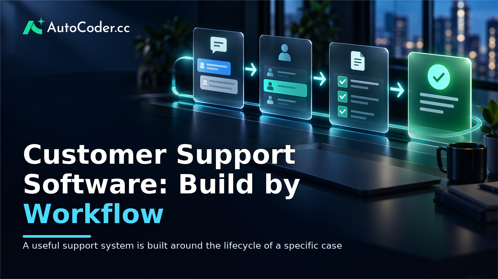
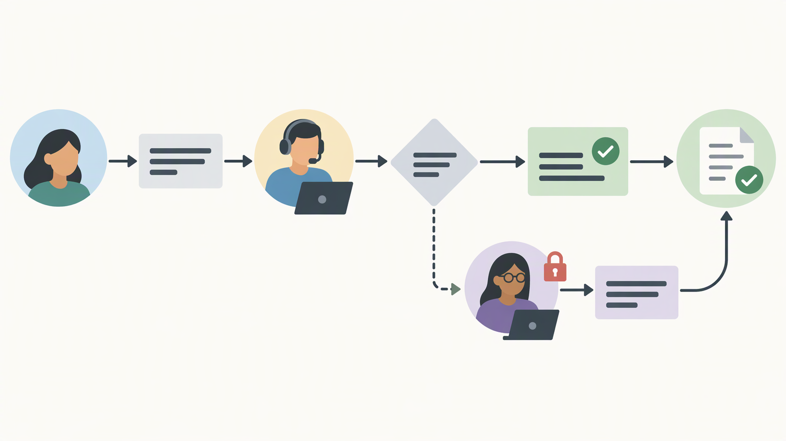
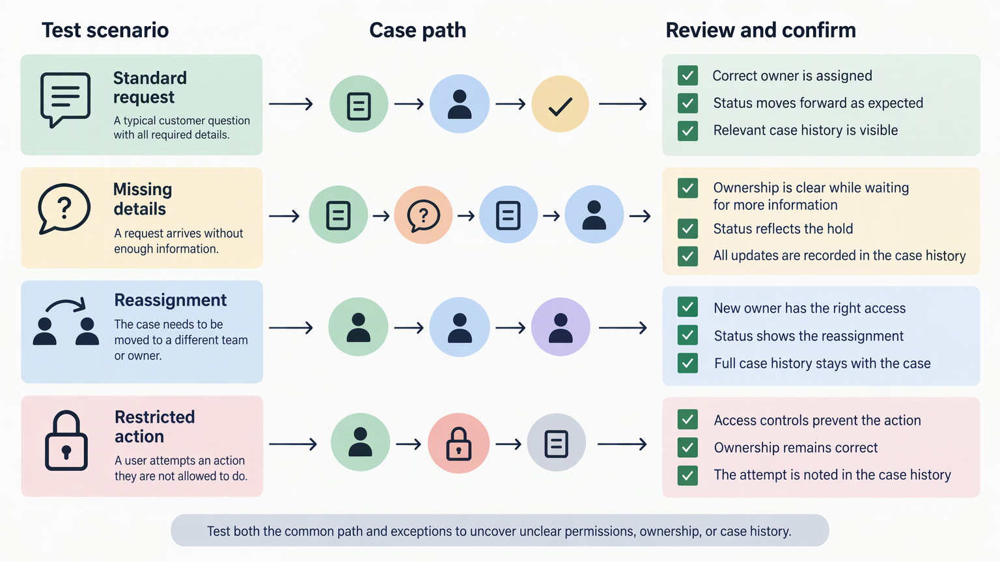

*Published November 4, 2026*

<Frame caption="A useful support system is built around the lifecycle of a specific case, including ownership, context, and controlled resolution.">
  
</Frame>

**Customer support software** is most useful when it reflects how a team actually receives, investigates, assigns, and resolves requests. For founders and small operations teams, the aim is not to reproduce every feature of a broad help desk. It is to create a focused system that removes friction from a specific service workflow while protecting customer information and leaving room for change.

A custom route can make sense when the work depends on unusual records, approvals, handoffs, or internal processes that are awkward to represent in a general-purpose tool. It also introduces responsibility: teams must define the workflow clearly, test it with real users, and decide which capabilities belong in the first release.

## Clarify the job your customer support software must do

<Frame caption="Mapping the normal path, handoffs, and exceptions before building exposes the requirements that matter.">
  
</Frame>

**Start with one repeatable support journey, not a feature list.** A focused definition prevents a project from becoming a broad customer relationship system before it has solved the immediate operational problem.

Begin by documenting the request from arrival to resolution. A request might enter through a form, shared inbox, account area, or staff-created record after a phone conversation. Identify the person or team that first sees it, the information they need to collect, the decisions they make, and the event that makes the case complete.

Before planning a build, gather a small set of prerequisites:

- A named workflow owner who can settle process questions. - Examples of common requests and a few difficult exceptions, with personal details removed where possible. - A list of people who will use the system and what each needs to do. - Agreement on where the first version will run and how internal users will access it.

Use the following steps to turn those inputs into a buildable brief.

1. **Choose the initial case type.** Define a narrow class of work, such as account-access requests, order changes, onboarding questions, or internal escalations. If several types share little information or follow different rules, do not force them into one workflow initially.

2. **Map the current path.** Write the sequence in plain language: a customer submits a request, an agent reviews it, the agent asks for missing details, a specialist approves an action, and the requester receives a final update. Include channels, handoffs, and the records consulted along the way.

3. **Define a successful outcome.** Completion is not always “ticket closed.” It may mean an entitlement was updated, a replacement was arranged, documentation was sent, or a request was routed to another team with the necessary context.

4. **List the information needed at each decision.** Separate what is essential to resolve a case from information that is merely useful. For example, account identifier, request category, current status, owner, and conversation history may be essential; a broad set of profile fields may not be.

5. **Mark exceptions and controls.** Note cases that require approval, identity checks, a different queue, or restricted access. These are often more important to the design than a long list of standard fields.

A useful output is a one-page workflow statement: who submits a request, who works it, what data changes hands, what statuses are used, and what counts as resolution. Review it with the people doing the work. If they cannot recognize their day-to-day process in the statement, revise it before discussing screens or automation.

This exercise also helps distinguish a custom support software project from a configuration task. If the workflow can be represented cleanly in an existing customer service platform without costly workarounds, adapting that tool may be the lower-risk option. Building becomes more defensible when the underlying process, records, or permissions are genuinely specific.

## Plan the core customer support software features

<Frame caption="A first version needs connected records for cases, customers, ownership, and history rather than a large set of disconnected features.">
  
</Frame>

**Build the smallest set of records and actions that lets staff move a case forward.** In an early version, reliable ownership and clear context are usually more valuable than an extensive dashboard.

Most focused systems need a case record, a customer or requester record, and a way to document work. A case record can hold the category, status, priority if relevant, current owner, timestamps, and links to related information. The customer record should contain only the data staff need to serve the request.

Plan the first version around these questions:

- What fields must be present before a request can be assigned or completed?
- Which statuses represent meaningful stages, rather than vague labels?
- Who can create, edit, reassign, close, or reopen a case?
- What should staff see first when they open the tool?
- Which actions change customer-facing information and therefore need review or approval?

Avoid treating a support ticket system as a collection of screens. Its data model and permissions determine whether the workflow remains understandable as more people use it. For instance, “awaiting customer” should have a clear operational meaning: staff have asked for information and no internal action is currently required.

Define roles early. A basic pattern may include an agent who works assigned cases, a team lead who manages queues and reassignment, and an administrator who manages access and workflow settings. The exact labels matter less than the boundaries.

Then turn the requirements into a concise backlog. Prioritize items in three groups: necessary for the core journey, needed to operate safely, and useful later. A new-case form, case list, detail view, assignment control, statuses, internal notes, and authentication may belong in the first group.

Be deliberate about reporting. Early reporting should answer operational questions that the team will actually use, such as what is open, who owns it, and where cases are waiting. If a metric requires data that staff cannot reliably enter, it is not ready to guide decisions.

## Build a functional first version

**Translate the workflow into pages, records, rules, and permissions before generating or coding the application.** This keeps the build discussion concrete and makes testing possible.

A functional first version normally needs four connected layers: interface screens, a data model, backend actions, and access control. The interface lets staff view and update work. The data model stores customers, cases, and activity. Backend actions create, assign, change, and close records. Access control determines who can perform those actions and see particular information.

Use this sequence to create a first release.

1. **Write screen-level requirements.** Describe each page by its user and purpose. A case list might show the current user’s assigned cases, status, requester, and last update. A case detail page might show the history, current fields, internal notes, and only the controls that the user’s role permits.

2. **Define the records and relationships.** Specify what a customer, case, comment, attachment reference, or approval record contains. State how records relate: one customer may have several cases; one case may have many internal notes. Keep the model simple enough that the team can explain it.

3. **Specify valid actions and rules.** Identify who can take each action and what must be true before it succeeds. For example, closing a case may require a resolution category, while reassignment may require an active staff member as the new owner.

4. **Add authentication and authorization.** Decide whether the first release is for internal staff, customers, or both. Internal-only tools can begin with staff authentication, but still need role-aware access. Customer-facing portals require additional care around account identity, data visibility, and self-service actions.

5. **Create an editable application for review.** An AI application builder such as [AutoCoder's AI app builder](https://www.autocoder.cc/platform?utm_source=blog&utm_medium=latest&utm_campaign=CustomerSupportSoftware) can turn written requirements into an editable full-stack application with frontend, backend, database, authentication, and deployment workflows. Treat generated output as a starting point to inspect, refine, and test rather than as proof that the workflow is complete.

6. **Use realistic test records.** Create representative but non-sensitive examples that include a straightforward case, a request with missing details, a reassignment, and a restricted action. Test whether each person can find the right work and whether the history explains the case clearly.

A prototype should not quietly become a production system without operational review. Check where data is stored, who can access it, how changes are tracked, and how the team will handle errors or access requests. If external systems are involved, define the source of truth before connecting them.

## Test and extend the workflow responsibly

<Frame caption="Testing must cover both the common path and exceptions that expose unclear permissions, ownership, or case history.">
  
</Frame>

**Test the real working path with the people who will operate it, then extend only where evidence shows a gap.** A polished interface cannot compensate for ambiguous statuses, missing permissions, or unclear ownership.

Run short scenario reviews with agents, leads, and anyone who receives escalations. Ask them to complete a case from start to finish while noting where they hesitate, leave the system to find information, or create unofficial workarounds.

Evaluate the result against the workflow statement created at the start. Can staff tell what requires attention? Can they identify the next owner? Can they see why a decision was made? Can a lead resolve exceptions without editing records in ways that obscure the history?

When improving the system, make one category of change at a time. Add an integration after the manual process is understood. Add reporting after the team uses consistent fields and statuses. Add automation after the routing rules are stable enough that exceptions will not overwhelm staff.

If the workflow grows beyond its initial scope, retain the ability to edit the application and its source code. [AutoCoder](https://www.autocoder.cc/platform?utm_source=blog&utm_medium=latest&utm_campaign=CustomerSupportSoftware) supports continued editing and source-code export, which can be useful when a team needs to adapt a prototype into a more specialized internal tool. That does not remove the need for technical review, security decisions, or clear ownership as the system becomes more important.

## FAQ

### What is customer support software?

Customer support software is a system used to organize customer requests, the people handling them, and the actions taken to resolve them. It may include case tracking, customer records, internal notes, assignments, statuses, and customer-facing communication. Its scope can range from a general help desk to a focused internal workflow tool.

### What features should customer support software include first?

Start with the features required to receive or create a case, identify the requester, assign ownership, track a meaningful status, record internal context, and complete the work. Add authentication and role-based access from the beginning when staff handle customer information. Delay broad integrations and complex reporting until the core workflow is stable.

### When does it make sense to build custom customer support software?

Custom customer support software is worth considering when the team relies on unusual records, decision rules, permissions, or handoffs that a standard tool cannot represent cleanly. It may also fit an internal process where the support task is tightly connected to operational actions. If an existing tool supports the workflow with straightforward configuration, adaptation may be simpler.

### Can a prototype support system be expanded later?

Yes, provided the early version has understandable records, documented permissions, and a maintainable path for changes. Expand deliberately by validating the basic workflow first, then adding integrations, reporting, automation, or additional case types. Review security and operating responsibilities as the system takes on more critical work.

## Conclusion

**Customer support software should make a defined service process easier to run, not make the process harder to explain.** Begin with one case type, map the people and decisions involved, and build only the records, actions, and permissions needed to move that case to a clear outcome.

For a small team, the disciplined path is to validate the workflow with realistic scenarios before adding channels, dashboards, or automation. Whether the final system is a configured platform or a custom tool, clear ownership, limited scope, and careful testing are the practical foundations for a support operation that staff can use consistently.
