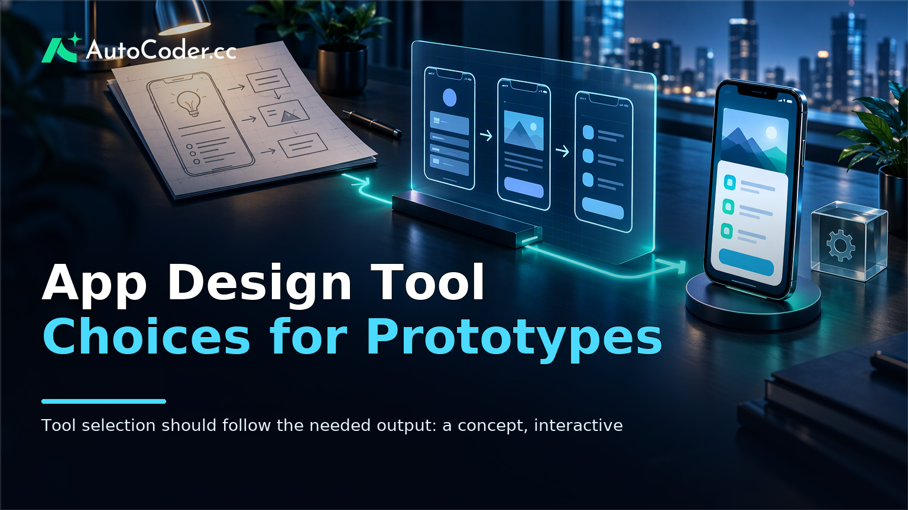
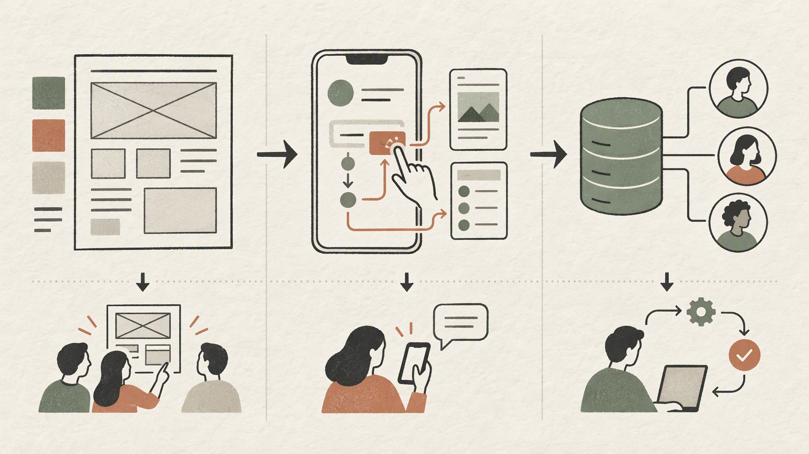
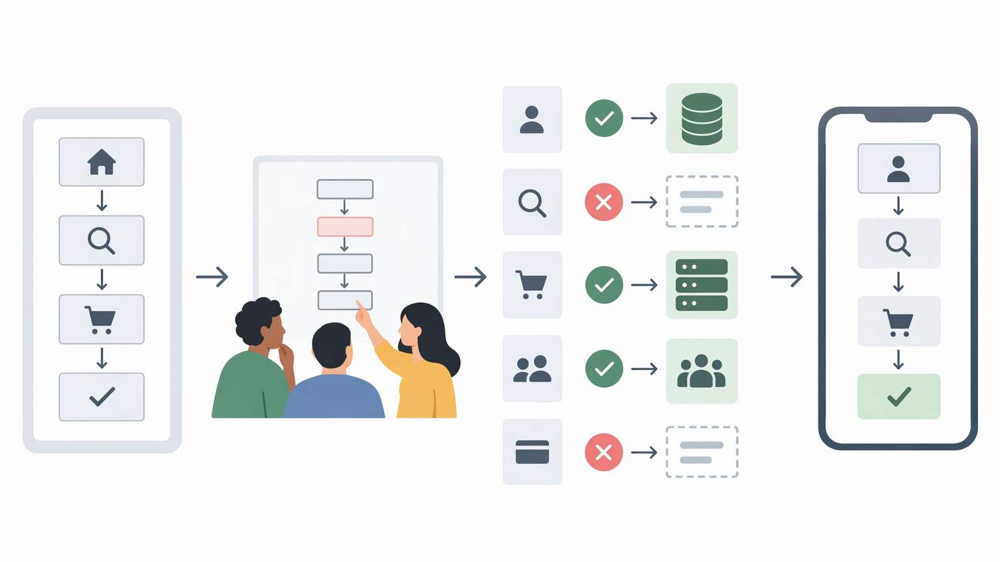

*Published November 4, 2026*

<Frame caption="Tool selection should follow the needed output: a concept, interactive prototype, or functional MVP.">
  
</Frame>

An **app design tool** should match the decision a team needs to make next. A founder gathering reactions to an idea, a product manager planning usability research, and a team preparing an MVP with accounts and data may all use similar-looking tools, but they need different outputs.

The category includes visual design software, interactive prototyping tools, no-code or low-code builders, and systems that generate working applications. These approaches overlap, yet they differ in what can be tested, who can maintain the result, and what happens when the concept needs to become a real product.

The practical question is not which tool has the longest feature list. It is whether the tool produces enough credible evidence for the current stage without adding unnecessary implementation work.

## Define what you need an app design tool to produce

Start with the outcome you need to validate, because output type is the clearest way to narrow the options.

A **visual concept** is mainly a communication artifact. It can show layout, content hierarchy, screen states, and a proposed user journey. This is useful when a team needs to align on a problem, explain a product direction, or review whether an interface makes sense before defining detailed behavior.

An **interactive prototype** adds linked screens and simulated interactions. It helps teams observe whether someone can navigate a task, find a control, and understand the next step. For example, a booking concept might let a participant browse availability, select a time, and reach a confirmation screen without creating an actual appointment.

A **functional prototype** makes at least the critical path work. A person may create a record, submit a form, sign in, or see a status change. It does not need every feature of a finished product. Its purpose is to test whether a workflow remains useful when it includes real rules, data, permissions, and state changes.

An MVP is narrower than a complete product but intended for real use by an initial audience. It needs a controlled scope, a meaningful end-to-end job to be done, and a practical route for continued changes. In many cases, that makes editability, deployment, and source-code access more important than they were during early concept testing.

Before comparing products, write a short outcome statement. For example: “Learn whether operations staff can assign incoming requests without returning to a spreadsheet,” or “Test whether prospective customers understand the first onboarding task.” Then map the smallest user journey that could answer that question. This prevents a polished design from being mistaken for validated product behavior.

## Compare app design tool approaches by output and constraints

<Frame caption="Different app design approaches provide different evidence, from visual alignment to testing a real workflow.">
  
</Frame>

Compare tool categories by the artifact they create and the trade-offs that artifact introduces.

### Design-first software

Design-first mobile app design software is best for exploring interfaces, building component systems, refining layouts, and reviewing screen-level detail. Its output is usually a design specification or a visual representation of a user flow rather than a deployed application.

Choose this approach when the immediate need is visual alignment. It is particularly useful for settling information architecture, content hierarchy, or interaction patterns before implementation. It also supports a clear handoff when a separate engineering team will build the product.

Its limitation is that behavior is often simulated. A button can lead to a prepared next screen without saving data, handling an unexpected input, or applying permissions. A successful click-through does not establish that a workflow is technically feasible or valuable in actual use. Teams should also account for the later handoff from design artifacts to implementation.

### Interactive prototyping tools

An app prototyping tool is appropriate when the team needs to test a defined journey without building a full underlying system. It can be useful for moderated sessions, design reviews, and early task-flow research.

Its main advantage is speed of revision. A team can adjust a confusing sequence after feedback without rebuilding a database, configuring deployment, or implementing every supporting rule. That makes this category a reasonable middle ground when the hypothesis concerns comprehension and navigation.

The trade-off is limited realism. Participants may respond differently when information persists, when errors occur, or when they use their own account and context. Simulated flows also need careful preparation: a prototype that only works along one expected path can conceal important questions. Use this approach to test interaction and understanding, not to confirm technical requirements or sustained adoption.

### No-code and low-code builders

No-code and low-code builders are more suitable when working screens, data, and business rules are needed early. They can support focused internal workflows, directories, portals, and early products that require functioning forms and records.

Their practical benefit is a shorter path from interface idea to live behavior. Teams can learn from people completing real tasks rather than only from reactions to a prepared journey. For a bounded workflow, this may be enough to validate whether the process delivers value.

The limitation is that constraints can become significant as scope changes. Assess data structure, permissions, authentication, custom logic, integrations, deployment, and how easily the application can be changed. A builder may fit an initial workflow while being less appropriate for unusual behavior or a technical architecture the team expects to control directly.

### AI full-stack application builders

An AI app builder is relevant when the team needs to turn written requirements into a working application rather than a design artifact. [AutoCoder's AI app builder](https://www.autocoder.cc/platform?utm_source=blog&utm_medium=latest&utm_campaign=AppDesignTool) is designed to generate frontend, backend, and database components from natural-language requirements, with support for authentication, deployment workflows, and continued source-code editing.

This approach is useful when the hypothesis depends on real workflow behavior. Consider a service where a customer submits a request, an internal user reviews it, and the request status changes over time. Testing that proposition may require roles, records, and persistent state rather than linked screens alone.

Generated output still requires product judgment. Vague requirements can produce an application that does not reflect the intended process. Define the essential entities, roles, permissions, and error conditions before generation, then inspect and test the critical flow. A generated starting point does not remove the need to consider accessibility, data handling, security expectations, or operational details.

## Evaluate the criteria that affect the next stage

Use criteria tied to the next likely decision, rather than selecting a tool solely because it is familiar or visually impressive.

**Behavioral fidelity.** Decide whether people need to view a sequence, click through it, or complete a real task. Visual feedback requires less fidelity than a multi-role approval process. Avoid working infrastructure when a concept test answers the question, but do not rely on simulation when persistence or permissions are central to the product value.

**Collaboration and ownership.** Identify who will revise the work after the first version. Designers may need shared components; researchers may need a controlled test flow; founders may need to adjust copy or rules between conversations. If developers will extend the result, clarify how they can inspect and edit it.

**Data and identity.** List the minimum data required for the core flow: what users create, who can view it, who can change it, and what follows an action. A mockup can use sample content. A functional prototype may need records, accounts, roles, and reliable state changes. This distinction often determines whether an interactive prototype is sufficient.

**Operational dependencies.** Identify external systems that are necessary to test the core promise, such as a calendar, notification process, or internal database. Do not integrate every possible dependency at once. For an MVP, include only the connections required to validate the main workflow.

**Portability and extensibility.** Consider the result if the test succeeds. A disposable prototype may be correct for an uncertain idea. If continued development is likely, ask whether work can be adapted, exported, or edited without recreating the product. [AutoCoder](https://www.autocoder.cc/platform?utm_source=blog&utm_medium=latest&utm_campaign=AppDesignTool) supports source-code export and continued editing, which may suit teams that want an editable path from prototype toward a fuller application.

No category is best across every criterion. Design-first tools prioritize visual control; prototyping tools prioritize quick interaction testing; no-code and low-code tools prioritize operational workflows within platform constraints; and AI full-stack builders prioritize a route from requirements to an editable application. The right choice is the one whose limitations are acceptable for the current product stage.

## Choose a workflow that can evolve

<Frame caption="Teams can avoid overbuilding by identifying which parts of the critical flow require real data, logic, and roles before selecting a tool.">
  
</Frame>

Reduce scope before increasing fidelity, so the team builds only what is needed to learn from the next version.

1. **State the hypothesis and user.** Specify the person, task, and expected outcome. “People like the idea” is not a useful test. A focused statement makes it easier to decide what evidence is required.

2. **Map one critical flow.** Limit the first version to a start, a meaningful action, and a result. For a marketplace concept, this might mean finding one listing, sending one inquiry, and receiving confirmation rather than building every category, profile, and administration feature.

3. **Mark what must be real.** Separate elements that can use sample content from behaviors that must operate. If trust in a request process is the question, validation, confirmation, and status visibility may need to work. If comprehension is the question, a visual flow may be enough.

4. **Choose the least complex viable approach.** Use design-first work for alignment, an interactive prototype for task-flow feedback, or a working builder when learning depends on real logic and state. Do not create an MVP simply because a tool can produce one quickly.

5. **Define an exit decision.** Before building, decide what result leads to revision, further testing, or continued development. This prevents teams from expanding a prototype merely because it exists and clarifies whether an editable codebase or deployment path matters next.

An internal request portal illustrates the sequence. If the uncertainty is whether staff understand request categories, a visual concept or interactive prototype may be enough. If the uncertainty is whether requests can be assigned without missed handoffs, use a functional prototype with real roles and status changes.

## FAQ

### What is an app design tool?

An app design tool is software used to plan, design, prototype, or build an application experience. Depending on the category, it may produce static screens, an interactive click-through, or a working application with data and user actions.

### What is the difference between an app design tool and an app builder?

An app design tool often emphasizes interface structure and presentation. An app builder focuses on working behavior, potentially including screens, logic, data, authentication, and deployment. The labels can overlap, so compare the output and limitations rather than relying on category names alone.

### Can an app design tool create a functional prototype?

Some can. A functional prototype needs working behavior such as saved data, validated forms, user roles, or authentication. Design-first software generally produces visual or simulated interactions, while application builders are more appropriate when users must complete real tasks.

### How should teams choose an app design tool?

Start with the learning goal and the smallest relevant user flow. Then identify which behaviors must be real and compare tool approaches against collaboration, data, ownership, integrations, and extensibility requirements.

## Conclusion

The right **app design tool** produces enough evidence for the next product decision without creating unnecessary work. Use visual design for alignment, interactive prototypes for usability and flow feedback, and functional application builders when the value depends on real behavior, data, or user roles.

For founders, product managers, and designers, the durable selection method is to begin with one critical journey and define what must be true at its end. That makes it easier to choose between a concept, a prototype, and an editable MVP while keeping the trade-offs visible.
