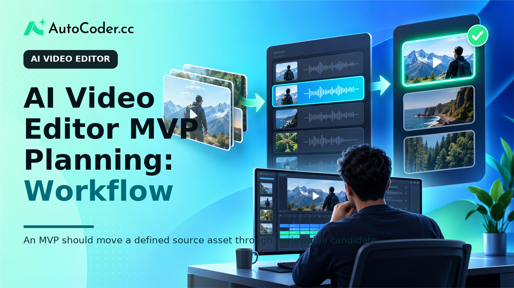
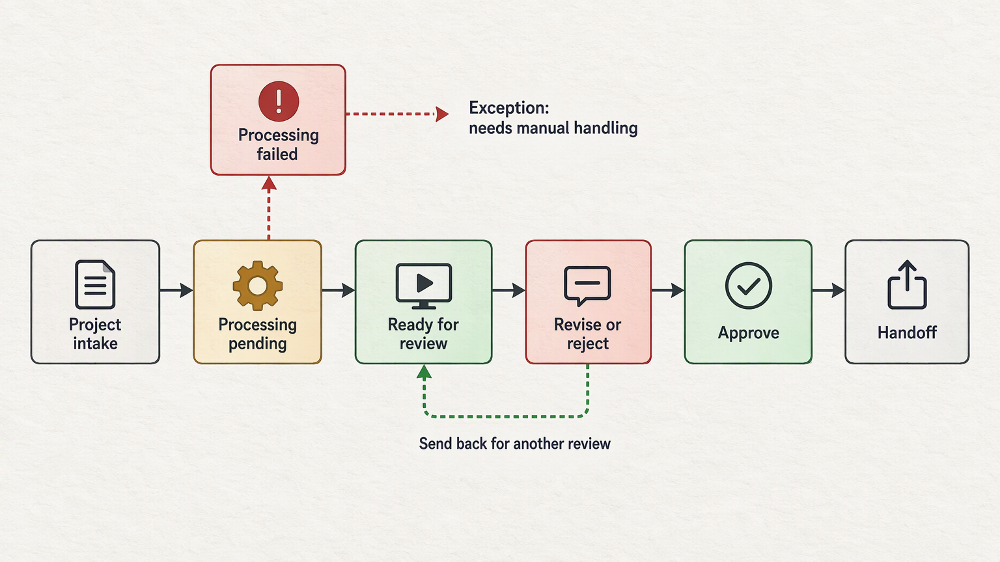
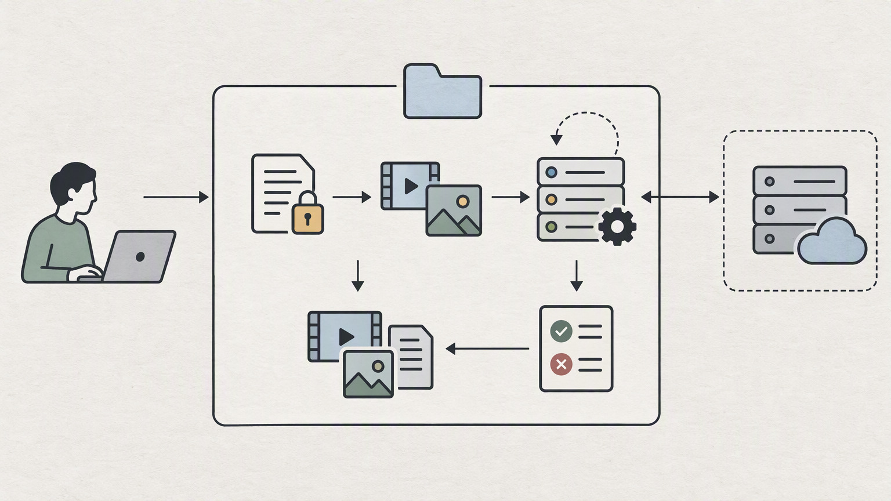

*Published November 3, 2026*

<Frame caption="An MVP should move a defined source asset through reviewable candidate outputs and human approval.">
  
</Frame>

An **AI video editor** MVP should solve one bounded editing problem that users can inspect and correct. That scope is more useful than attempting a broad claim of automated video production. For a founder or product team, the first task is to define the materials that enter the application, the decision the system helps make, and the video-related output a user can approve.

A narrow product may help a social team find candidate clips from a long recording, let an editor revise captions against a transcript, or prepare a project for a specific aspect ratio. In each case, the product remains a working application rather than a generic demonstration: it receives assets, creates a reviewable result, records decisions, and makes the next action clear.

This guide outlines the prerequisites, workflow, architecture, and validation plan for a specialized AI video editing app. It also distinguishes the application experience your team builds from external media-processing or AI services that may need separate technical evaluation.

## Choose one AI video editor problem for the MVP

**Start with a single user decision, not a catalog of intelligent features.** A focused problem gives the team a way to define success, establish boundaries, and recognize what does not belong in the first release.

Before product work begins, assemble a small set of representative source materials and write down the user context for each. These are not benchmark data; they are planning inputs that expose differences in duration, audio clarity, speaker count, file formats, and intended publishing destination.

Useful prerequisites include:

- A defined user role, such as a solo creator reviewing recorded interviews or a marketing editor preparing short clips. - A single input type and a stated upload or import path for the prototype. - One expected output, such as selected clip candidates, an editable caption draft, or a review package.

Then use the following steps to turn the problem into an MVP brief.

1. **Describe the job in plain language.** For example: “After an interview is uploaded, help an editor identify passages worth reviewing for a short social clip.” This describes assistance, not an unqualified promise to produce a publishable video.

2. **Set the unit of work.** A project might contain one source video, a transcript, several generated candidates, reviewer comments, and an export status. Naming these objects early prevents the interface from becoming a loose collection of screens.

3. **Choose one primary output.** A clip candidate with a start and end point is enough for a first workflow. Adding automatic reframing, voice generation, visual effects, multi-language localization, and distribution connections at the same time makes it harder to learn which part users value.

4. **Define what users can change.** If the application proposes a selection, users may need to adjust time ranges, rename a candidate, reject it, or mark it for follow-up. Editable output is central to trust because editing is contextual.

5. **Write the non-goals.** State explicitly what the MVP will not decide or generate. Non-goals help product, design, and engineering make consistent trade-offs when new feature requests appear.

A practical first scope is transcript-led candidate review. The application can organize a source asset and its associated text, present candidate sections, and let an editor accept, alter, or discard them. The intelligence may be important, but the durable product value lies in making the review decision faster and traceable.

## Map the human review process before automation

<Frame caption="A useful video workflow makes processing, review, revision, approval, and exceptions visible as separate states.">
  
</Frame>

**Design the route from suggestion to approval before deciding how much the system should automate.** Video work includes subjective choices about meaning, pace, brand context, and accuracy. An interface that treats a generated output as final leaves users with too little recourse when those choices are wrong.

Map the workflow as a sequence of visible states: project created, media received, processing pending, material ready for review, changes requested, approved, and exported or handed off. The exact terms can vary, but users should be able to tell where a project is and what action is available now.

At minimum, the review workspace should connect the evidence to the recommendation. For a transcript-centered experience, show the relevant transcript segment beside the corresponding candidate range. If an output has a title, caption, or other text, identify it as a draft and provide a direct editing control.

Use these steps to make review operational:

1. **Create a project intake screen.** Collect a project name, source asset, and the context required for the one selected job. Avoid asking for settings that have no effect in the first release.

2. **Separate processing from review.** A submitted item should move to a status-aware project page. This prevents users from wondering whether an upload or request was received and gives the backend an explicit job boundary.

3. **Present suggestions as candidates.** Give each candidate a stable identity and basic context, such as source range, rationale field, and current review status. Do not imply that a suggestion is an editorial decision made on the user’s behalf.

4. **Support reversible changes.** Preserve the original source reference while a reviewer adjusts ranges or text. A simple change record—who changed what and when—may be more useful initially than a complex versioning system.

5. **Make approval consequential.** Approved candidates should move to a distinct next state, whether that is export preparation, a handoff list, or an internal queue. Rejection should likewise be recorded rather than simply hiding the item.

6. **Handle exceptions deliberately.** Include empty states, unsupported input messages, failed processing states, and projects with no suitable candidates. These are normal product states, not edge details to postpone indefinitely.

This approach also clarifies a common misconception: an AI-assisted workflow is not necessarily hands-off. In a well-scoped product, automation can reduce scanning, transcription review, tagging, or initial assembly work while editors retain authority over the result. That division is particularly important where context, consent, or editorial standards matter.

## Plan the application architecture around projects and jobs

<Frame caption="The application should own projects, permissions, statuses, and decisions while external media-processing services remain separately validated integrations.">
  
</Frame>

**Treat the MVP as a project application with media-related integrations, rather than as a single prompt and result page.** This creates a structure that can accommodate review, retries, permissions, and future changes without claiming that one service solves every video-processing requirement.

Start by sketching the records the application must keep. A basic model may include users, projects, source assets, processing jobs, transcript segments or other derived artifacts, candidate edits, review decisions, and export requests. Each record should have an owner or project relationship, timestamps, and a state that the interface can display.

The frontend workspace generally needs a project list, a project detail page, a review surface, and a lightweight settings or account area. Its purpose is to make information and actions understandable, not to reproduce a full professional editing suite.

On the backend, separate application responsibilities from external service responsibilities. The app can authenticate users, authorize access to projects, store metadata, create work items, track job status, and record review actions. Media ingestion, transcription, rendering, or model-assisted analysis may rely on external systems.

A sound job flow is straightforward: the user creates a project; the application registers an asset and a job; a worker or integration completes a stage; the app stores the resulting artifact and updates status; the user reviews candidates; and approval creates the next request. Design each stage to be safely retried and avoid tying project status solely to what the browser happens to display.

Access control deserves early attention. A project page should show only the assets and review decisions available to the signed-in user or authorized collaborator. If teams will share workspaces later, leave room for project membership and roles even if the first prototype supports a simpler model.

For teams that need a functional starting point, [AutoCoder’s AI app builder](https://www.autocoder.cc/platform?utm_source=blog&utm_medium=latest&utm_campaign=AIVideoEditor) can help translate a written project workflow into editable frontend, backend, database, authentication, and deployment components. The product brief should still identify the external media and AI integration requirements rather than assuming they are inherent in the generated application.

## Build and validate the first video editing workflow

**Validate whether users can complete the target decision with realistic materials before expanding the feature set.** The goal is not to prove every possible capability of AI media software. It is to learn whether the project flow, review surface, and output are useful for the narrow job you selected.

Build in the order of the core journey. First, create authenticated access and a project record. Next, implement the intake route and a project status page. Then add the smallest review interface that lets a user inspect, edit, approve, or reject the output.

During prototype work, write acceptance checks in terms of user-visible outcomes. For example, a user can create a project, see whether work is pending or ready, open a candidate, alter the editable fields you chose, save a decision, return later, and find that decision in the project.

Test the workflow with representative media and observers who resemble the intended user. Ask them to complete a specific task and note where they hesitate, seek missing context, or work around the application. Separate feedback on the editing judgment from feedback on the software.

Review findings against three questions:

- Does the product reduce a clearly identified part of the editing workflow without obscuring control?
- Can users understand the origin and current state of an output well enough to approve or change it?
- Which missing capability blocks completion, and which request would merely broaden the concept?

Use the answers to narrow the next iteration. You may discover that better transcript navigation matters before more generation options, or that project sharing must precede export refinement. Resist treating every request as evidence that the MVP needs a wider feature list.

If the team wants to iterate on the application itself, [AutoCoder](https://www.autocoder.cc/platform?utm_source=blog&utm_medium=latest&utm_campaign=AIVideoEditor) supports continuing from a full-stack prototype and editing the resulting source code. Keep product validation independent: a faster way to assemble screens and records does not replace checks on media quality, user permissions, or integration behavior.

## FAQ

### What is an AI video editor?

An AI video editor is an application that uses AI-assisted processes within video-related work, such as organizing material, producing transcript-based suggestions, identifying candidate sections, or drafting metadata. Its practical value depends on how clearly users can inspect and revise outputs.

### What features should an AI video editor MVP include?

Include only what supports one complete job: authenticated project access, asset intake, visible processing status, a reviewable result, editable controls, saved approval or rejection decisions, and a defined handoff or export state. The exact media-processing capability should match the chosen use case.

### How can users review AI-generated video edits?

Show candidates with their source context, make relevant fields editable, preserve the original reference, and provide clear approve, reject, and revision actions. Record the current status so users can return to work without reconstructing prior decisions.

### What should I validate before building an AI video editor?

Validate the target user’s editing job, the source materials and permissions involved, the desired output, the review steps users require, and the behavior of any planned external media or AI integrations. Also test whether the workflow remains useful when no suitable candidate is produced.

## Conclusion

A viable **AI video editor** MVP is a focused application for one reviewable editing decision, not a promise to automate an entire creative process. Define the input, output, user authority, and project states first. Then build the smallest workflow that carries a real asset from intake through processing and human approval. By validating that path with representative material, teams can decide which capability genuinely improves the video editing workflow and which can wait.
