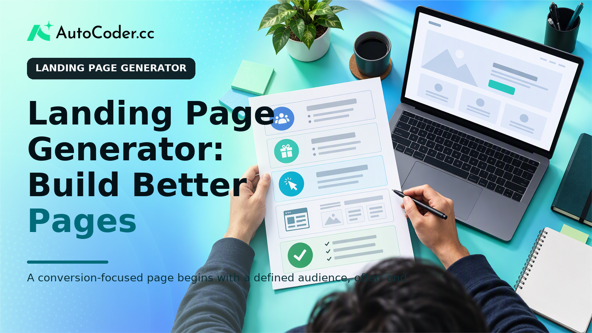
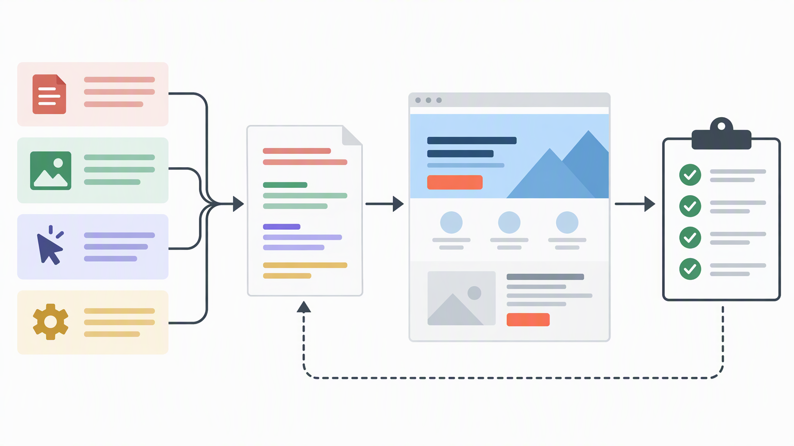

*Published November 3, 2026*

<Frame caption="A conversion-focused page begins with a defined audience, offer, and primary action before any page generation starts.">
  
</Frame>

A **landing page generator** can accelerate production, but it cannot decide what a visitor should understand or do. A useful page begins with a defined audience, a specific offer, and one primary action. The generator then becomes a structured way to turn those decisions into a draft you can inspect, edit, and publish.

For founders, marketers, and small teams, this distinction matters. A fast page with unclear positioning can still create confusion. Conversely, a focused brief can help an AI-assisted workflow produce a practical starting point for an offer launch, waitlist, demo request, download, or early validation effort.

This guide explains how to prepare the inputs, write a usable brief, review the generated page, and make measured improvements after publication.

## Define the landing page goal before generating anything

**Start with one visitor, one offer, and one primary call to action.** This constraint gives the page a job and keeps its structure from becoming a general-purpose overview of everything your business does.

Write a one-sentence goal in this format: “Help [specific audience] understand [specific offer] and take [specific action].” For example, a team validating a scheduling tool might aim to help independent consultants understand the tool’s purpose and request early access. That differs from a page intended to sell a finished subscription or collect registrations for an event.

Before opening a generator, gather the following prerequisites:

- A clear description of the audience, including the situation that brings them to the page.
- The offer’s practical outcome, not just its category or feature list.
- One primary action, such as joining a waitlist, starting an application, booking a conversation, or downloading a resource.
- The information needed to support the claim: product details, process notes, examples you are permitted to use, and answers to likely objections.
- Basic brand inputs, such as a logo, type preferences, color constraints, image assets, and voice guidance where available.

Avoid combining incompatible goals on the same page. Asking visitors to request a demo, read a long product guide, subscribe to updates, and compare plans at once weakens the decision path. Secondary links can exist, but they should not compete with the main action.

Next, identify the visitor’s immediate question. On most landing pages, it is some variation of: “Is this for me, what does it help me do, and what happens if I continue?” The opening section should answer these questions quickly in plain language. A headline that only names a company or uses broad claims leaves too much interpretation to the visitor.

Map the objections that could prevent action. For an early product, a visitor may wonder whether the workflow fits their role, how much effort is involved, whether the offer is available yet, or what submitting a form commits them to. You do not need an exhaustive objection list. Choose the few that are most relevant to the decision and plan where the page will address them.

This preparation also separates landing page copy from internal product language. Feature names, roadmap terminology, and technical implementation details may be useful in other contexts. On a landing page, retain them only when they help the target visitor understand the outcome or evaluate fit.

## Write a landing page generator brief that produces an editable first draft

<Frame caption="A detailed brief produces a more reviewable first draft because it specifies copy, design, action, and technical requirements.">
  
</Frame>

**Give the generator a structured brief rather than a short request for a “modern landing page.”** Specific inputs make the first version easier to evaluate because each section has a reason to exist.

A landing page generator can create layout and copy suggestions quickly, while an AI landing page builder may also help generate more connected website or application elements. In either case, the quality of the initial result depends on the direction supplied. State what is known, label what is provisional, and do not ask the tool to invent evidence, customer results, or technical commitments.

Use this brief structure:

1. **State the audience and context.** Name the role or group, what they are trying to accomplish, and the relevant problem. “Small agency owners who need a simpler way to collect client project requests” is more useful than “businesses that need efficiency.”
2. **Describe the offer and outcome.** Explain what the visitor receives or can do, along with boundaries that prevent overstatement. If an offer is in validation, say that the page is for early access or feedback rather than presenting it as a finished service. 3. **Set the primary action.** Specify the button label, destination, and what follows the action. For a form, list the fields required and the confirmation message or next-step expectation. 4. **Request a section hierarchy.** A sensible starting order might include a headline and action, a concise problem-and-outcome explanation, how it works, relevant proof or operational details, objection handling, and a final action area.

A concise brief might say: “Create a responsive landing page for independent consultants seeking early access to a client-intake workflow. The main action is to join the early-access list through a short form. Explain the workflow in three plain-language steps, address what information the form requests, and use supplied product screenshots only. Do not create testimonials, metrics, pricing, or unsupported claims.”

If the landing page needs more than a static form, consider the underlying workflow early. For example, a directory, booking process, gated application, or personalized results experience may require backend logic and data handling. [AutoCoder’s AI app builder](https://www.autocoder.cc/platform?utm_source=blog&utm_medium=latest&utm_campaign=LandingPageGenerator) is designed to turn natural-language requirements into editable, deployable full-stack applications, which can be relevant when the landing page is the entry point to a working product flow rather than a standalone marketing page.

The useful output of this stage is not a final page. It is a first draft with enough structure to reveal omissions, conflicting messages, and implementation questions.

## Generate and review the first version before publishing

<Frame caption="Reviewing message hierarchy, form behavior, mobile layout, and accessibility is necessary before a generated page is published.">
  
</Frame>

**Treat the generated page as a reviewable draft, not an approved deliverable.** The fastest way to improve it is to inspect the visitor journey from top to bottom and correct issues in order of importance.

Begin with the first screen. Without relying on prior knowledge, check whether a visitor can identify the audience, outcome, and next step. If the headline sounds polished but could describe many unrelated offers, rewrite it. Specificity is generally more useful than abstraction in landing page copy.

Then review the page in this sequence:

1. **Message hierarchy.** Confirm that the headline, supporting text, section headings, and button labels all reinforce the same offer. Remove side messages that introduce a different audience, use case, or action. 2. **Action path.** Check that the primary call to action is visible at reasonable intervals without appearing mechanically repeated. Ensure every button leads to the intended destination and that its label describes the action. 3. **Form behavior.** Submit the form in a test environment. Check required fields, error messages, confirmation states, consent language where applicable, and the destination of submitted information. A visually correct form can still fail the page’s central purpose. 4. **Mobile layout.** Review narrow screens deliberately. Check reading order, button size, image crops, table overflow, sticky elements, and spacing around form controls. Do not assume a desktop layout will translate cleanly. 5.

Review visual choices in the same practical way. Images should clarify the offer, demonstrate a workflow, or help visitors recognize the use case. Decorative imagery can support tone, but it should not substitute for explanation. If the page includes a product interface image, ensure it represents the current experience and does not imply a capability that is unavailable.

It is also useful to read the full page aloud or have a colleague read it without background context. Note where they hesitate, ask for definitions, or interpret a claim differently than intended. These moments often identify more consequential problems than minor adjustments to color or spacing.

For teams that need to move from a landing-page concept into a functional prototype, [AutoCoder](https://www.autocoder.cc/platform?utm_source=blog&utm_medium=latest&utm_campaign=LandingPageGenerator) can generate frontend, backend, and database components from product requirements, with source code that can continue to be edited. That does not remove the need to specify form logic, data handling, and user states; it makes those requirements part of the build conversation.

## Improve the page through focused landing page optimization

**Change one meaningful variable at a time and connect each change to a visitor question.** Landing page optimization is more useful when it resolves a known point of friction than when it produces constant cosmetic variation.

Start by collecting signals that are available to your team. These may include form completion issues, responses from sales or support conversations, feedback from early users, session observations where appropriate, or direct comments on what was unclear. Treat these as prompts for investigation, not as proof that a single design choice caused an outcome.

Prioritize revisions in this order:

1. Clarify the offer if visitors do not understand it.
2. Improve the action path if visitors understand the offer but cannot easily proceed.
3. Address credible objections if visitors hesitate over fit, effort, trust, or timing.
4. Refine presentation if the message and flow are already sound.

A practical revision log prevents random iteration. Record the page version, the question being addressed, the exact change, and the observation you expect to learn from. For example: “Visitors ask whether the early-access form is a purchase commitment. Add a sentence beside the form explaining what submission means.” This is more actionable than “make the page more persuasive.”

Keep the page aligned with the stage of the offer. A page for validation should make it easy to express interest or provide feedback. A page for an established service may need clearer qualification, process details, or comparison information. Copy and design should evolve with what the team can responsibly promise.

Finally, revisit technical quality after major edits. New sections can alter mobile performance, heading order, accessibility, and form handling. A short publication checklist is often enough: test links, submit forms, check confirmation messages, review on mobile, proofread visible text, and verify that analytics or follow-up routes are behaving as expected.

## FAQ

### What should a landing page generator include?

It should support a clear page structure, editable copy and layout, a defined call to action, responsive presentation, and any required form or workflow details. The generator should not be expected to supply proof, customer claims, or product facts that the team has not provided.

### Can I generate a landing page without design experience?

Yes, a generator can provide a usable starting structure and visual direction. You still need to make the core decisions: who the page serves, what it offers, which action matters, and whether the content is accurate and understandable.

### How do I write a useful prompt for a landing page generator?

Describe the audience, their situation, the offer, the desired outcome, the primary action, required sections, brand constraints, and technical needs. Include rules against invented testimonials, metrics, or unsupported claims.

### What should I test before publishing a landing page?

Test the main message, every call to action, form validation and submission, confirmation states, mobile layout, links, readability, and accessibility basics such as labels, contrast, headings, and keyboard navigation.

## Conclusion

A **landing page generator** is most effective when it follows a clear decision process rather than replacing one. Define the audience and action first, provide a structured brief, review the generated draft against real visitor needs, and make focused revisions after launch. That approach produces a page that is easier to understand, easier to maintain, and better aligned with the offer it represents.
