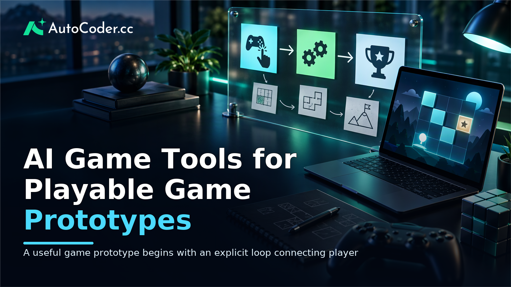
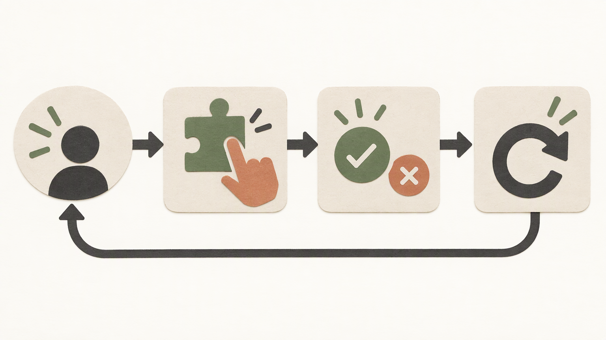
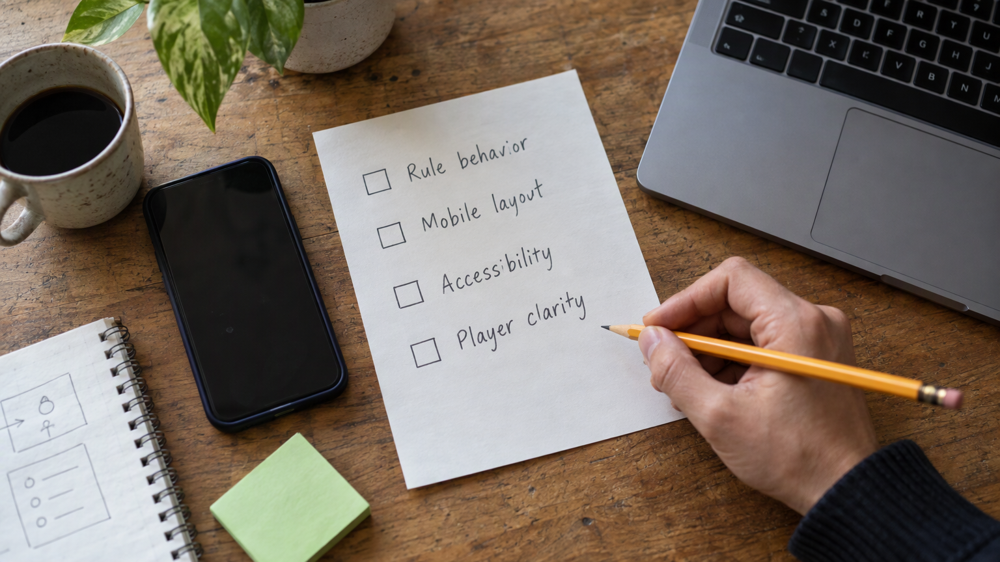

*Published November 3, 2026*

<Frame caption="A useful game prototype begins with an explicit loop connecting player action, system feedback, and a clear outcome.">
  
</Frame>

**AI game tools** are most valuable when they help a team turn one focused game idea into an experience another person can play and assess. For founders, designers, and developers, the objective is usually not a finished commercial game. It is a working web prototype that tests a mechanic, an audience assumption, or a game-adjacent product flow.

That distinction sets the appropriate level of ambition. A useful prototype makes its central interaction understandable in a short session. It might be a timed quiz, a clue-based puzzle, a turn-based choice game, or a game-like onboarding flow. AI can help structure requirements and generate an application, but clear scope, testing, and technical review still determine whether the result is useful.

## What AI game tools can help you build

**Choose tools based on the playable interaction you need to validate.** AI game tools is a broad term covering concept support, writing, asset preparation, code assistance, and application generation. An AI game generator may help produce pieces of a game, while an AI browser game builder can be more relevant when the goal is a shareable web experience with screens, state changes, and basic data handling.

For early validation, browser-based concepts are often manageable because they can be shared without requiring a separate game client. Suitable first projects usually have a limited set of rules and states, such as:

- A quiz with a score, limited attempts, and a results screen.
- A word, matching, or grid puzzle with one repeatable round.
- A turn-based choice game with restricted actions and clear outcomes.
- A task-completion experience that uses points or progress as motivation.
- A voting, prediction, or collection flow where the game loop supports a broader product idea.

These formats are appropriate for game prototype development because a player can encounter the core loop before the team builds extensive content, social functions, or progression systems. In contrast, real-time action, advanced multiplayer, complex physics, and large procedural worlds introduce constraints that are rarely clarified by a minimal web build. They may still be valid projects, but they need more deliberate architecture and specialist testing.

Ask a narrower question than “Can this tool make my whole game?” Ask: “What is the smallest version that lets someone experience the promise of this idea?” If the answer involves one mechanic, a few screens, and a brief session, it is a credible prototype target.

## Define the smallest playable game concept

<Frame caption="A short complete sequence makes a core mechanic easier to test than a broad feature set.">
  
</Frame>

**Write the core loop before selecting features or generating an interface.** A core loop is the repeatable sequence of player action, system response, and reason to continue. If that sequence is unclear, generated code and screens will expose the ambiguity rather than solve it.

Prepare these prerequisites before building:

- A defined target player and the context in which they will play.
- One sentence describing the player’s immediate goal.
- One primary action the player repeats.
- A completion, win, loss, or stopping condition.
- A way to gather feedback from people resembling the target player.

For example: “A player receives three clues, makes one guess about a film, then sees an explanation and score before starting another round.” This defines the loop without prematurely adding accounts, payments, leaderboards, or a large content library.

Use the following steps to create a buildable brief:

1. **Name the decision that makes the game.** It could be choosing an answer, placing a tile, allocating a limited resource, or selecting a story branch. Keep version one centered on that decision rather than combining unrelated mechanics. 2. **Set a short session boundary.** Define what a first play contains: one round, a small set of questions, or one level. A limited session is enough to test whether the interaction is understandable. 3. **Define immediate feedback.** After each action, the player should see what changed. Feedback might be a board update, a correct-or-incorrect result, an updated score, or a narrative consequence. 4. **List essential screens only.** A start screen, active play screen, and outcome screen are often sufficient.

State what is intentionally absent. For example, no accounts, saved progress, purchases, social sharing, or unlimited rounds. Those exclusions protect the test from work that does not answer the main question. A leaderboard, for instance, can introduce identity, storage, score rules, and misuse concerns that have little bearing on whether the core mechanic works.

## Turn game requirements into an AI build prompt

**Treat the prompt as a compact product specification, not a broad creative request.** “Make a fun puzzle game” leaves key decisions unresolved and can yield a polished interface with inconsistent behavior. A stronger prompt explains the player flow, rules, content structure, states, and technical boundaries.

Build the request in a direct sequence:

1. **Describe the product and player.** State the prototype’s purpose, intended player, and device priority. For instance, specify a mobile-friendly daily puzzle for people taking a short break. 2. **Set out the exact loop.** Explain the order of play: start a round, show a clue, accept one selection, reveal feedback, update the score, and offer the next round or restart. Include completion and failure conditions. 3. **Name screens and states.** Specify the start, active play, completion, disabled, and error states that apply. Explain what changes after correct and incorrect moves so controls have reliable consequences. 4. **Define the content model.** For trivia, identify fields such as question, options, correct answer, explanation, and category. Fixed sample content is often enough for initial validation; dynamic content can wait. 5.

An application builder can be useful when the prototype needs more than a static mockup. [AutoCoder's AI app builder](https://www.autocoder.cc/platform?utm_source=blog&utm_medium=latest&utm_campaign=AIGameTools) is designed to turn natural-language product requirements into editable, deployable full-stack applications, including frontend, backend, and database components where required.

Review the generated result against the written rules. Check whether players can raise a score by repeating a choice, advance without a valid action, or receive contradictory completion messages. These are product issues as well as implementation issues.

## Build and review the first playable version

**Verify the full loop before spending time on visual refinement.** Open the prototype as a new player would and complete the intended path without relying on background knowledge.

1. **Run a normal session.** Start, play, reach an outcome, and restart. Confirm that progress, scores, and outcomes match the rules. 2. **Try unexpected actions.** Click quickly, make choices in an unusual order, refresh the page, submit empty input where relevant, and try using controls after a round ends. The prototype should still have predictable boundaries. 3. **Check narrow screens.** Resize the browser or use a phone. Ensure instructions remain legible, controls fit, text wraps cleanly, and touch targets do not overlap. 4. **Read the interface without context.** A new player should be able to identify what to do first, why an action succeeded or failed, and how to begin again. 5.

Decide whether persistence is necessary after this review. Fixed demonstration rounds may work in the browser alone. Player profiles, submitted content, saved streaks, or recurring challenges may justify storage and authentication. Add infrastructure because it supports the test, not because it makes the prototype appear more complete.

If custom logic becomes important, editable source code provides a route beyond the initial output. [AutoCoder](https://www.autocoder.cc/platform?utm_source=blog&utm_medium=latest&utm_campaign=AIGameTools) supports exporting and continuing to edit source code. That does not remove the need for ownership: someone should understand deployment, dependencies, data handling, and rule logic before the application is used more broadly.

## Test the prototype and improve the right things

<Frame caption="Prototype testing should cover rule behavior, small-screen usability, accessibility basics, and whether new players understand the goal without coaching.">
  
</Frame>

**Prioritize player understanding and game feel before expanding the feature set.** A playable prototype creates useful evidence only when people can try it with minimal coaching.

Invite a small set of people who resemble the intended player. Give each person a simple task, such as playing one round and explaining what they think they are trying to achieve. Observe hesitation at the start, confusion after an action, uncertainty about whether the round ended, and attempts to use controls in unintended ways.

Ask specific questions rather than asking whether the game is good. Ask what the player expected after their last action, what rule they inferred, and whether they would choose another round. These responses are more actionable than general approval.

Sort findings into three categories:

- **Comprehension issues:** The goal, controls, or feedback are unclear.
- **Loop issues:** The sequence feels slow, repetitive, too easy, or insufficiently consequential.
- **Expansion requests:** Players ask for more levels, themes, sharing, accounts, or other additions.

Fix comprehension first. A leaderboard or visual theme will not clarify a confusing core action. Then make small, testable loop changes, such as shortening a round, improving a clue, changing attempts, or making the outcome more informative. Keep a brief record of what changed and why so iteration remains tied to evidence.

When you build a game with AI, review content and ownership boundaries too. Have a valid plan for any text, art, audio, or brand material used in the prototype. Avoid treating generated or placeholder assets as final production assets without checking their source and applicable terms. For a test, original text and restrained visual treatment are often enough.

## Prepare the prototype for continued development

**Choose a clear next step based on what the test established.** A validated prototype may justify continued iteration, product infrastructure, or custom engineering. An unclear result may justify stopping or revising the premise.

If players understand and return to the loop, document current rules, defects, content format, and unresolved technical choices. Then identify the next question: whether saved progress matters, whether a broader content set remains engaging, or whether the mechanic improves a non-game workflow.

If you add accounts or stored data, define what information is collected, why it is needed, and how it will be managed. If you introduce shared content, establish who can create it, how it is reviewed, and what happens when it is removed. Before moving beyond a private test, review deployment, access controls, error handling, and codebase ownership.

A prototype can also produce a useful negative result. If players do not understand the mechanic or do not value the loop after reasonable clarification, record that outcome. Revising or ending a weak direction is often more useful than adding features.

## FAQ

### What are AI game tools?

AI game tools assist with parts of game creation, including planning, content drafting, assets, code, interfaces, and application assembly. Their value depends on the task and the clarity of the game requirements.

### Can AI game tools build a playable game from a prompt?

They can help create a playable prototype when the prompt defines a focused mechanic, player flow, rules, and screens. The output still needs testing for usability, consistent rules, and edge cases.

### What should I include in a game-building prompt?

Include the target player, core loop, rules, completion condition, screens, content structure, feedback behavior, device expectations, and any genuine need for data storage or authentication. State what is out of scope as well.

### Can I edit the source code generated by an AI game tool?

That depends on the tool and workflow. For a prototype that may grow, choose an approach that permits source-code inspection, export, and modification for custom logic, integrations, technical review, and maintenance.

## Conclusion

**AI game tools are most effective as a disciplined prototyping aid, not a substitute for product judgment.** Start with one player decision and a short, complete loop. Specify rules and states clearly, build only the infrastructure needed for the test, and observe real players using the result. Once the interaction is understandable, evidence can guide whether more content, persistence, social features, or custom engineering is justified.
