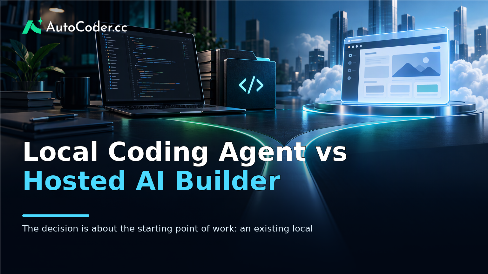
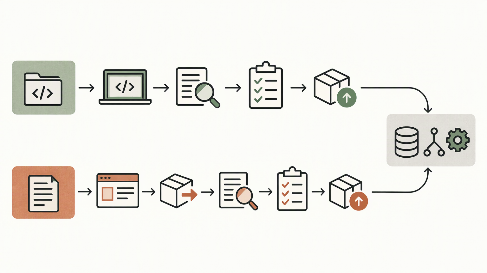

*Published November 3, 2026*

<Frame caption="The decision is about the starting point of work: an existing local repository versus requirements for a new application foundation.">
  
</Frame>

A **local coding agent** can be a practical fit when an AI assistant needs to work inside a developer-controlled project environment. A hosted AI app builder can be a better fit when the immediate goal is to turn a product brief into a working application foundation with less environment setup. Neither approach is inherently better: the right choice depends on where the code lives, who must review it, how much local context matters, and whether a team needs to move quickly from idea to editable implementation.

The distinction is easy to blur because both approaches use natural-language instructions to assist development. Their operating models are different, however. Local tools tend to begin with an existing machine, repository, and development workflow. Hosted builders tend to begin with a browser-based product description and generate an application structure that can be refined, deployed, or exported.

## What is a local coding agent?

A local coding agent is most useful when it can work within the same environment as an existing project. In practical terms, it is an AI coding agent configured to access local project files and participate in a developer’s established workflow.

“Local” does not guarantee a fixed set of capabilities. The model may still be accessed remotely, and a tool’s access to files, terminals, networks, secrets, or services depends on its design and the permissions granted by the user. Treat local access as a workflow characteristic rather than a security claim.

The main value of local AI development is contextual continuity. An agent can potentially work from the repository already under version control, follow the project’s conventions, and account for dependencies that are difficult to reproduce elsewhere.

That value comes with operational responsibility. A local agent does not remove the need to understand a codebase, inspect diffs, manage branches, or validate changes. It can accelerate routine implementation and investigation, but developers remain responsible for architecture, permissions, reliability, and release decisions.

## Local coding agent vs hosted AI app builder: core differences

<Frame caption="Both workflows need review, testing, and maintenance; they differ chiefly in where work begins and when setup occurs.">
  
</Frame>

The practical choice is whether your work should start from an existing local code environment or from a hosted application-generation workflow. Compare the approaches against the constraints of the project, not only against the quality of an initial output.

A local coding agent typically starts with the repository. Its strengths are proximity to existing code, access to local dependencies where permitted, and compatibility with familiar editor, terminal, test, and version-control practices. It is often the more natural option for an established application that needs targeted changes rather than a new product foundation.

A hosted AI app builder starts with a product requirement. It is oriented toward converting a description of users, screens, workflows, and data needs into a working full-stack starting point. For example, a founder might describe a customer portal, booking workflow, internal dashboard, or directory before a repository structure exists.

The trade-off is not simply control versus convenience. Both paths require technical judgment, but at different moments. Local workflows put more emphasis on upfront environment setup, repository access, and developer-led validation. Hosted workflows can reduce the friction of creating an initial application, while later demanding review of generated structure, integrations, deployment choices, and the path from prototype to maintained software.

| Criterion | Local coding agent | Hosted AI app builder |
| --- | --- | --- |
| Starting point | Existing local files and repository | Product requirements or a new application concept |
| Environment context | Can use locally available context within granted permissions | Uses the hosted generation workflow and supplied requirements |
| Setup burden | Usually requires local tooling and access configuration | Usually begins in a browser-based workflow |
| Best fit | Iterating on an established codebase | Creating a full-stack foundation or validating a new workflow |
| Collaboration pattern | Fits developer-led branches, reviews, and local testing | Can help align product and technical stakeholders around an initial application |
| Portability question | Code is already in the local environment | Confirm whether generated code can be exported and maintained elsewhere |

For teams that want a generated foundation without treating it as a closed endpoint, [AutoCoder's AI app builder](https://www.autocoder.cc/platform?utm_source=blog&utm_medium=latest&utm_campaign=LocalCodingAgent) is positioned as a browser-based tool that turns natural-language requirements into editable, deployable full-stack applications. It generates frontend, backend, and database components and supports workflows involving authentication and deployment. It should not be described as a local coding agent; its relevant role in this comparison is as a hosted starting point that can lead to source code a development team continues to edit.

The comparison also has limitations. A hosted builder is not a substitute for understanding a complex existing repository, and a local agent is not automatically the fastest way to make an early product concept tangible. Results vary with the clarity of requirements, the project’s technical constraints, the permissions available, and the team’s ability to test and revise generated work.

## Choose a workflow by project stage and operating constraints

The most reliable recommendation is to choose based on the work immediately in front of the team. Project stage, repository maturity, compliance requirements, and available technical ownership usually matter more than a broad preference for local or hosted tools.

Use a local workflow when an existing application is the center of the task. This is common when a team needs to modify a mature codebase, work around specialized local dependencies, or preserve established testing and release practices.

A local approach also makes sense when environment control is a formal requirement. Teams handling restricted configurations, internal services, or sensitive material should define permission boundaries before introducing any AI-assisted workflow. That may include separating development credentials from production credentials, limiting command execution, and ensuring that human reviewers approve material changes.

Use a hosted AI app builder when the central challenge is turning a product concept into a coherent application foundation. This can suit a technical founder scoping an MVP, a product manager clarifying a workflow with engineers, or a small team that needs an initial implementation for a portal, marketplace, dashboard, booking system, or internal process.

For a hosted workflow, write requirements as operational statements rather than broad aspirations. Specify user roles, the actions each role takes, the data involved, and the expected outcome. Instead of asking for “a platform for bookings,” define whether users create appointments, administrators approve them, and what information is visible at each stage.

A hybrid approach is often reasonable. A team can generate a foundation in a hosted environment, export it, then continue work locally using its usual repository and review practices. Conversely, a developer can use a local agent to extend an existing product while a hosted builder helps explore a separate workflow or prototype.

## Evaluate control, collaboration, and maintenance before committing

A sound decision follows a small set of practical criteria: where the source of truth resides, who can safely make changes, and who will maintain the result after the first demo. These questions prevent a fast initial build from becoming an unclear long-term responsibility.

First, map the source of truth. If the repository, configuration, and development environment are already established, a local coding agent will generally align more naturally with that reality. If there is no application yet, a hosted builder can provide the first organized version of the work.

Second, define the review path. AI-generated code should enter the same engineering scrutiny as other code: inspect behavior, verify authorization logic, test edge cases, and confirm that data handling matches the application’s needs. Local workflows commonly connect to existing pull-request habits. Hosted workflows need an equally clear process for reviewing generated code before it becomes a dependency of the business.

Third, account for collaboration outside engineering. A browser-based app-generation workflow can give product, design, and technical stakeholders a shared artifact for discussing scope. That can reduce ambiguity at the requirements stage. Local work can be more efficient once the team has agreed on the target and needs precise implementation changes.

Finally, assess maintenance rather than judging only the first output. Ask whether the generated code can be understood, changed, tested, and owned by the team that will support it. A tool is more useful when it fits the organization’s documentation, version control, deployment, and incident-response practices.

## How editable source code supports both approaches

<Frame caption="Source-code portability enables a hosted generation step to transition into a developer-owned local maintenance workflow.">
  
</Frame>

Editable source code is the practical bridge between rapid application generation and developer-controlled maintenance. It lets a team treat a generated application as a starting point that can be inspected, extended, moved into a repository, and adapted to its own standards.

This portability matters in a hosted workflow because it protects the ability to continue development when the application grows beyond its initial scope. Before adopting a builder, confirm the export path, understand what parts of the application are included, and establish how the code will be versioned and reviewed after export.

For local development, editable source code is already the baseline, but the same discipline applies. An AI coding agent’s changes should remain traceable through version control and understandable to the people who will maintain them. Small, reviewable changes are usually easier to validate than broad, opaque rewrites.

[AutoCoder](https://www.autocoder.cc/platform?utm_source=blog&utm_medium=latest&utm_campaign=LocalCodingAgent) supports exporting and continuing to edit generated source code, which makes it relevant for teams that want a hosted generation step without abandoning a conventional engineering workflow. Its stated scope includes generating full-stack application components from natural-language requirements, not replacing the review and maintenance practices needed after generation.

A useful handoff process is straightforward:

1. Define the application’s users, workflows, data, and non-negotiable constraints. 2. Generate or implement a narrow initial scope rather than an entire business system at once. 3. Move editable code into the team’s version-control process where appropriate. 4. Review structure, authorization, error handling, and data flows before relying on the application. 5.

This process applies whether the first implementation comes from a hosted builder or from changes proposed by a local agent. The enduring asset is not the prompt; it is maintainable software and a team that can make informed changes to it.

## FAQ

### What is a local coding agent?

A local coding agent is an AI-assisted development tool that works with files and context in a developer-controlled local environment. Its actual access to code, commands, services, and data depends on the tool’s configuration and granted permissions.

### What are the benefits of a local coding agent?

Its main benefits are proximity to an existing repository and alignment with local development practices. It can be useful for targeted code changes, local dependency context, testing workflows, and version-controlled review, provided developers validate its work.

### When should I use a hosted AI app builder instead?

Use a hosted AI app builder when you need to translate a product idea or workflow into an initial application foundation and do not need to begin inside an established local repository. It can be particularly useful for MVPs, prototypes, and new internal tools that require a concrete starting point.

### Can I continue editing generated source code locally?

That depends on the builder’s export and source-code options. Confirm the portability path before committing to a workflow. Once code is available locally, it should be placed under version control and reviewed like any other application code.

## Conclusion

A **local coding agent** is generally the stronger choice when existing code, local dependencies, and developer-controlled environments define the work. A hosted AI app builder is generally more suitable when a team needs to convert requirements into an editable full-stack starting point before a local repository is central to the process. For many teams, the practical answer is a staged workflow: generate or clarify the initial application, retain editable source code, and apply normal engineering review and maintenance practices as the product develops.
