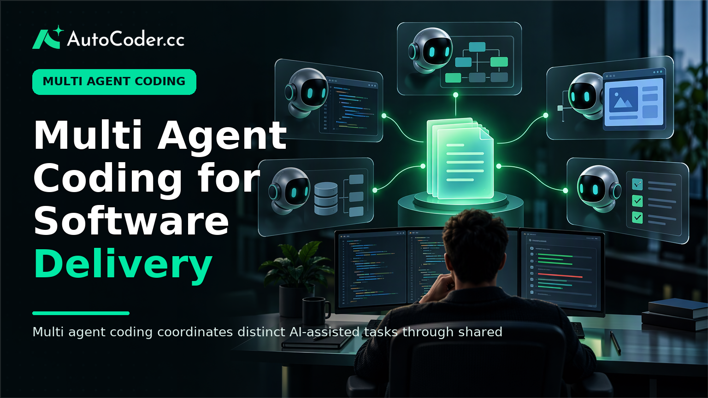
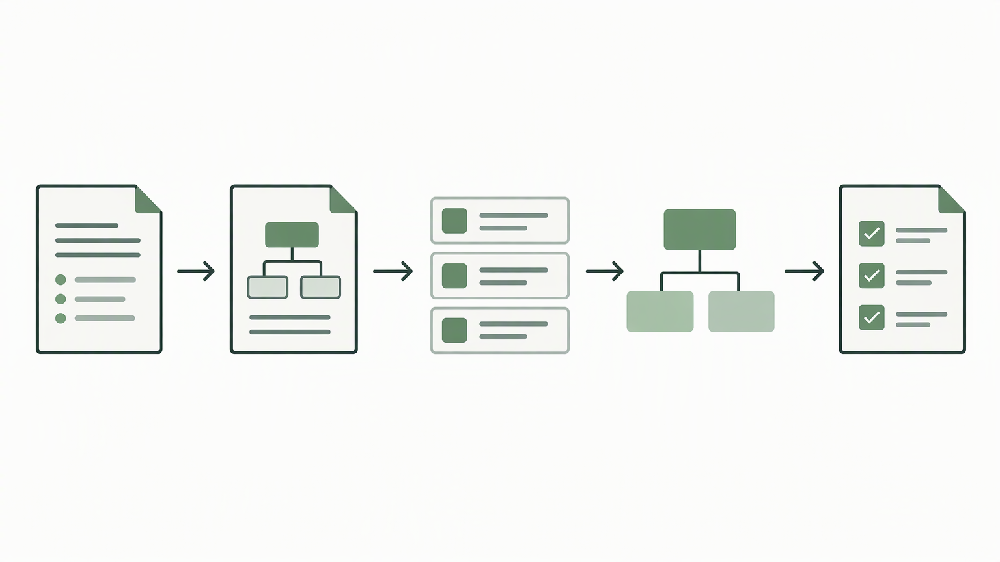
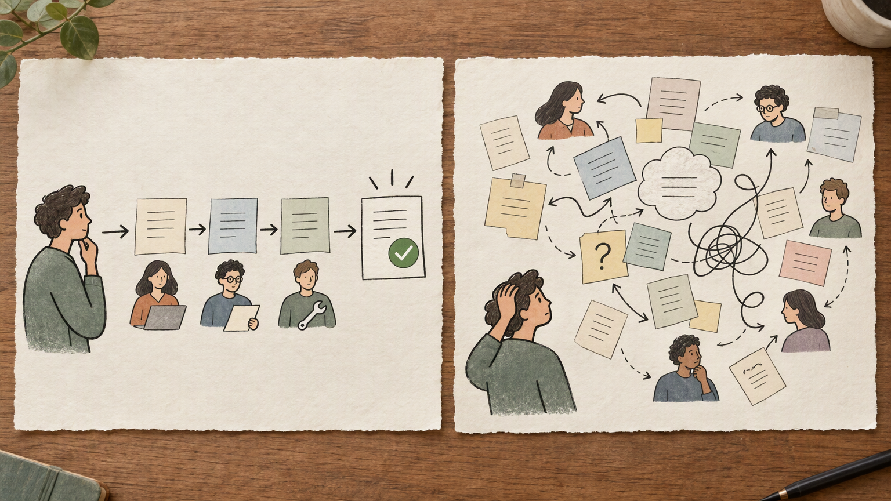

*Published November 4, 2026*

<Frame caption="Multi agent coding coordinates distinct AI-assisted tasks through shared requirements and human review rather than letting independent agents produce disconnected work.">
  
</Frame>

**Multi agent coding** organizes AI-assisted software work around several coordinated responsibilities rather than one broad request to a single assistant. A team may separate product planning, interface construction, backend logic, data design, testing, and documentation, while using shared requirements to keep the work consistent. The approach can help turn a defined product idea into a reviewable application, but it does not remove the need for product judgment, engineering review, or accountable deployment decisions.

For founders, product teams, and developers, the practical question is not whether more agents produce more code. It is whether the workflow makes product decisions, technical boundaries, and handoffs easier to inspect. Coordinated work is most useful when a team can state who the user is, what they need to do, what data changes, and which constraints apply.

## What multi agent coding means

The practical point is to divide work by responsibility while preserving one shared definition of the application. In multi agent coding, several AI coding agents or agent-like roles work on bounded tasks and exchange their outputs through a common plan, technical contract, or review process.

A planning task may turn a short requirement into user journeys, acceptance criteria, and open questions. An interface task can address pages, forms, navigation, empty states, and error states. Backend work can focus on business rules and data access, while a database task considers entities, relationships, required fields, and validation. Testing and documentation can be separate responsibilities rather than afterthoughts.

Coordination is the distinguishing feature. If each task begins from an isolated prompt, the resulting parts can use different field names, make contradictory assumptions about permissions, or expect incompatible data structures. Multi-agent software development instead gives each contributor access to decisions that affect its work: user roles, core records, allowed actions, workflow states, and integration boundaries.

This is different from asking one AI coding assistant to handle an entire project in one conversation. A single assistant can be appropriate for a focused change, such as revising a form, explaining a code path, or drafting a component. It becomes harder to govern when one request also covers product behavior, frontend implementation, server-side rules, persistence, authentication, and deployment concerns.

The model does not require a large application. A contained internal process can benefit from separate attention to requirements, access control, data entry, and verification. At the same time, splitting an unclear idea among many agents does not make it clearer. Coordination works only when the shared inputs are specific enough to guide decisions.

## Why multi agent coding matters for delivery

The practical benefit is traceability. Teams can connect a visible behavior or implementation choice back to a requirement, then identify the relevant task when something needs to change. That matters because full-stack application generation is not complete when a screen looks finished.

Consider a booking workflow. It may include an interface for selecting an option, rules about availability or capacity, records that persist the request, validation of submitted information, and permissions for staff or customers. A polished page can still fail the product need if it accepts invalid entries, exposes the wrong records, or does not enforce the underlying rules.

A coordinated approach also supports narrower MVP delivery. Instead of requesting a broad platform all at once, a team can define one primary user, one important workflow, a limited set of records, and an observable outcome. That scope gives product and engineering reviewers something concrete to test before more features are added.

An AI app builder can provide a practical starting artifact by turning natural-language requirements into editable application components. [AutoCoder's AI app builder](https://www.autocoder.cc/platform?utm_source=blog&utm_medium=latest&utm_campaign=MultiAgentCoding) is designed to generate frontend, backend, and database components for deployable full-stack applications from product requirements. Teams can continue editing exported source code as needs evolve. The tool does not settle ambiguous requirements or prove that a workflow is safe; it makes the proposed implementation available for inspection and revision.

This structure is useful where product and engineering decisions overlap. Founders can make assumptions explicit before building further. Product managers can compare behavior with acceptance criteria. Developers can inspect generated code, apply project conventions, and determine whether operational requirements have been met.

## How a coordinated workflow builds an application

<Frame caption="A coordinated workflow sets requirements and technical boundaries before implementation, then validates one complete user path before expanding scope.">
  
</Frame>

The practical point is to establish shared decisions before dividing implementation, then test one complete path before expanding scope. A dependable AI development workflow may include parallel tasks, but critical dependencies still need ordered handoffs.

1. **Write a constrained product brief.** Identify the intended user, the problem, the primary action, and what is deliberately outside the first release. Include user roles, required data, existing systems, approvals, and privacy considerations where relevant. A brief should describe a workflow, not merely a category such as “marketplace” or “dashboard.”

2. **Describe user flows and acceptance criteria.** Map the path from a user’s initial action to a completed outcome. Include ordinary actions as well as empty states, invalid input, cancellation, and permission boundaries. Criteria should be observable: for example, whether a user can edit only their own submission or whether an administrator can approve a pending request.

3. **Create a shared technical contract.** Define core entities, field names, user roles, workflow states, validation rules, and the expected exchanges between the interface and backend. This contract should be understandable to product stakeholders and developers. It prevents different tasks from independently redefining foundational rules.

4. **Assign bounded tasks with explicit inputs and outputs.** One task may create interface states, another may implement records and business logic, and another may prepare tests or technical documentation. Each should cite the same contract, state its dependencies, and identify what it returns. Do not delegate unresolved product choices to separate tasks and expect their answers to align.

5. **Integrate a vertical slice early.** Connect one complete user journey across the interface, backend, and database before generating many adjacent features. A working end-to-end path reveals conflicts in data shapes, validation, and permissions sooner than a collection of disconnected screens.

6. **Review, test, and revise.** Compare behavior with requirements, inspect source code, test valid and invalid inputs, verify role boundaries, and assess deployment settings. Generated output is a proposed implementation, not evidence that the application works under real operating conditions.

This sequence gives each artifact a clear purpose. The brief records intent, the contract sets boundaries, the vertical slice exposes integration issues, and review determines whether the team should proceed. A platform such as [AutoCoder](https://www.autocoder.cc/platform?utm_source=blog&utm_medium=latest&utm_campaign=MultiAgentCoding) can help move from requirements to an editable full-stack application, while the team remains responsible for governing the process.

## Where multi-agent software development is useful

<Frame caption="Defined, limited workflows are easier to generate, integrate, and validate than broad products with unresolved rules.">
  
</Frame>

The practical point is to begin with workflows that have clear users, repeatable actions, and a limited first release. Coordinated AI work is easier to evaluate when the team can define what “done” means and demonstrate it end to end.

Internal tools are often a sensible starting point because they support known operational work: submitting a request, reviewing an item, managing records, or viewing a status dashboard. Teams can usually identify who acts, what information changes, and what action follows a status update.

Portals, directories, booking systems, and business workflows may also suit this approach when their initial scope is constrained. A first release of a booking product, for instance, might focus on submitting and managing requests rather than trying to automate every exception, communication channel, or commercial process from the outset.

The approach is less appropriate as an unqualified shortcut for poorly understood processes, high-consequence decisions, or systems with extensive external dependencies. An established organization may have exceptions that are not documented. Applications that handle sensitive information require explicit decisions about access, retention, security controls, and operational ownership.

A useful test is whether the team can describe the first user path, the records it changes, the role allowed to approve it, and the condition that completes it. If those answers are unclear, more agent tasks will usually add output without resolving the underlying uncertainty.

## Misconceptions and limits to address early

The practical point is to judge coordination by the quality of decisions and handoffs, not by the number of agents or files produced. Several assumptions can overstate what AI-assisted implementation has achieved.

First, multiple agents do not automatically produce a sound architecture. They can propose components and connections, but people still need to decide system boundaries, ownership rules, and trade-offs suitable for the application. A shared contract reduces inconsistency; it does not remove design responsibility.

Second, generated code is not automatically ready for production. A functional demonstration may omit failure handling, authorization checks, configuration discipline, logging needs, recovery procedures, or edge-case validation. Review effort may move earlier in the workflow, but it remains necessary.

Third, parallel work is not always faster. Tasks with strong dependencies should remain sequenced. An interface can be outlined while data rules are being refined, but it should not be treated as integrated until the required records, validation, and error states are known.

Finally, editable source code matters. Teams need to understand what was produced, change it when requirements shift, and maintain it after the initial build. An AI development workflow should leave the organization with inspectable artifacts, not an opaque result that cannot be adapted.

## What still requires human oversight

The practical point is to place human review at decisions that affect users, risk, and long-term maintenance. Oversight should happen before implementation, during integration, and before deployment rather than only as final polish.

Product owners should confirm that requirements reflect the actual business process and that the first release excludes unnecessary complexity. Product and design teams should check user journeys, terminology, empty states, and error messages against the intended task. Developers should assess code structure, data access, dependencies, and the correctness of implementation choices.

Security-sensitive areas require explicit scrutiny. Teams should verify authentication behavior, role-based permissions, input handling, secret and environment configuration, and what data can be accessed through pages or services. They should test conditions that happy-path generation can miss, including duplicate submissions, missing records, invalid values, interrupted flows, and actions attempted outside a user’s role.

Deployment needs separate ownership as well. Confirm environment configuration, test data practices, integration behavior, and the process for maintaining changes after release. The exact checks will depend on the application, but the principle remains the same: deployable output still requires an accountable team.

## FAQ

### What is multi-agent coding?

Multi-agent coding is an AI-assisted development workflow in which separate agents or roles handle bounded tasks such as planning, interface work, backend logic, data design, testing, and documentation. Coordination comes from shared requirements, interfaces, and review practices.

### How does multi-agent coding differ from using a single AI coding assistant?

A single assistant can work well for a focused task. Multi-agent coding is intended for connected work across several layers of an application, where teams need explicit handoffs, common technical decisions, and review of the integrated result.

### Can multi-agent coding build a full-stack application?

It can support creation of frontend, backend, and database components when requirements and interfaces are sufficiently defined. Teams still need to integrate, test, secure, deploy, and maintain the application.

### What should teams review before deploying AI-generated code?

Teams should review product requirements, permissions, data handling, validation, integrations, error cases, environment configuration, and source code. They should test both intended user journeys and invalid or unexpected inputs.

## Conclusion

The practical conclusion is that **multi agent coding** is most useful as a structured way to turn a defined product workflow into reviewable software. It can divide full-stack work, make dependencies more visible, and help teams progress from requirements to an editable application. It does not resolve unclear product decisions, verify sensitive behavior, or assume responsibility for deployment. Clear scope, shared technical contracts, early integration, and accountable human review are what make the approach dependable.
