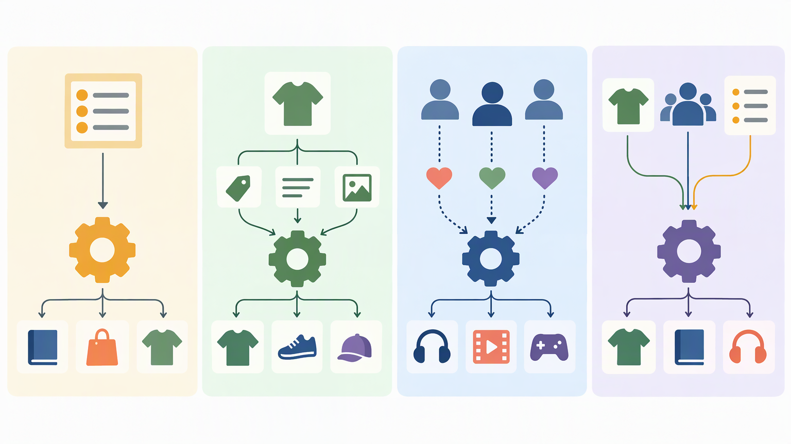
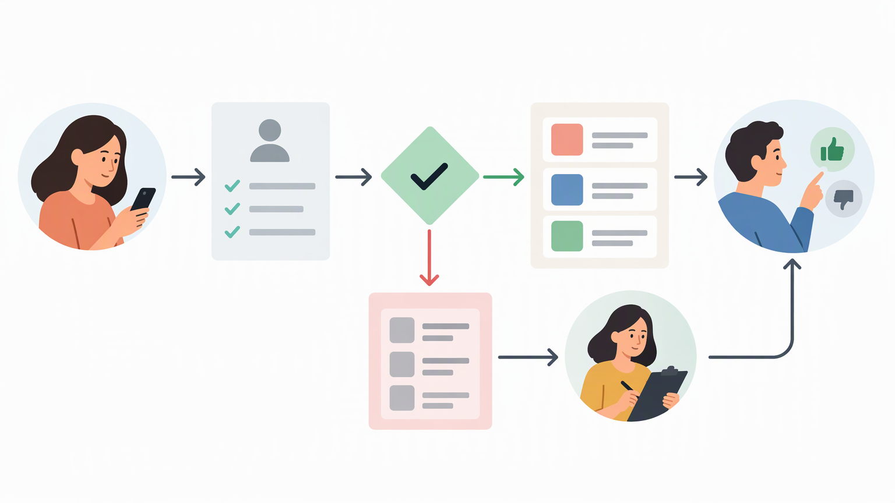

*Published November 3, 2026*

<Frame caption="Recommendations are a controlled workflow: understand context, filter eligible candidates, then rank a useful small set.">
  
</Frame>

A **recommendation engine** helps an application decide which item, piece of content, person, or action may be most relevant to a particular user. For founders and product teams, its value is not simply automated ranking. It is a way to reduce choice friction in a defined moment: selecting a course, finding a local provider, choosing a product, or returning to unfinished work.

The useful question is therefore not “Do we need AI recommendations?” It is “Which decision are users struggling to make, and what evidence can responsibly improve that decision?” A narrowly scoped recommendation system can begin with transparent rules and develop only when product usage justifies more complex methods.

## Start with the user decision: what a recommendation engine does

Define one decision the feature should support before choosing a model. A recommendation engine evaluates available candidates and presents a limited set that appears relevant under a stated objective. That objective might be helping a user discover similar articles, identify compatible listings, continue a learning path, or find items that match explicit preferences.

Recommendations differ from adjacent product features in important ways:

- **Search** responds to an expressed query. The user supplies words or filters, and the system retrieves matching results. - **Filtering** narrows a catalog using conditions chosen by the user, such as location, price range, topic, or availability. - **Editorial collections** are selected by an operator for a broad audience or campaign.

These features can work together. A marketplace may show a search result page, offer filters, and place a “similar listings” module beside an item. A learning product may organize courses into editorial tracks while also suggesting the next lesson based on completed material. Calling every ranked list a recommendation is less useful than documenting what makes the list context-specific.

A product recommendation engine also needs a clear surface in the interface. “Recommended for you” implies some degree of user-level personalization and should be used carefully. “Similar to this item” is a different promise: relevance comes from the item currently being viewed. “Popular in this category” may use no personal information at all.

Before implementation, write a short feature contract. State the page or workflow where the suggestion appears, the candidate set, the signals allowed in ranking, the intended user action, and conditions that exclude an item. For example, a booking product may suggest available services in the user’s selected area and exclude services the user cannot book.

## Choose the recommendation engine approach that matches your evidence

<Frame caption="Each recommendation approach relies on different evidence and has different suitability for an early product.">
  
</Frame>

Begin with the simplest approach that can explain why an item is shown. The best initial method depends on the catalog, the amount of dependable interaction data, and whether users can state preferences directly. Four approaches are common.

### Rules-based recommendations

Rules-based logic uses conditions set by the product team. Examples include showing items in the same category, prioritizing currently available options, suggesting a next step in a defined workflow, or selecting items tagged for a user’s declared goal.

This method is appropriate when the product has limited behavioral data, a small catalog, operational constraints, or a need for easy review. It is also a reasonable choice where a wrong suggestion has meaningful consequences and the team needs direct control over exclusions.

### Content-based recommendation

Content-based recommendation compares the attributes of items with attributes the user has selected, viewed, saved, or completed. In a directory, those attributes might include service type, location, language, and format. In a media application, they might include topic, author, duration, and level.

This approach can work without a large community of users because the item catalog itself supplies useful structure. It also provides an understandable rationale, such as suggesting a resource because it covers a related subject. However, its quality depends on consistent item metadata. Incomplete tags, ambiguous categories, or stale availability can produce weak recommendations regardless of ranking logic.

### Collaborative recommendations

Collaborative approaches use patterns across users and items. Conceptually, if people with similar behavior tend to engage with similar items, the system can use those patterns to suggest candidates a user has not yet encountered. The behavior may be explicit, such as ratings or saves, or implicit, such as completed actions, provided the product defines those signals carefully.

Collaborative methods can expose useful connections that item tags do not capture. They are less suitable at the start of a product with few interactions, sparse repeat usage, or a changing catalog. They also introduce harder questions about event quality, privacy, feedback loops, and how to handle users or items with little history.

### Hybrid recommendations

A hybrid method combines more than one input: rules for eligibility, content similarity for relevance, and behavioral signals where they are sufficiently reliable. This is often a practical direction as a product matures, rather than a necessary starting point.

The trade-off is complexity. Combining signals requires teams to decide how each factor should influence the outcome, monitor unintended effects, and retain a way to inspect individual recommendations. A hybrid system should not become a black box merely because it has more inputs.

For most early products, the recommendation is by use case: use rules when the intended logic is known and constrained; use content-based recommendation when catalog metadata is strong; consider collaborative signals after meaningful interaction patterns exist; and combine methods only when each component has a clear job.

## Build the data model around relevance, limits, and user control

Collect only the data needed to support the stated recommendation decision. A personalization engine is shaped as much by its data model as by its ranking method. If data does not reliably represent relevance, adding more collection will not correct the underlying product ambiguity.

Start with three categories of information. First, **item data** describes what can be recommended: stable identifiers, titles, categories, tags, status, availability, and any domain-specific attributes needed for matching. Second, **user-provided preferences** capture information people intentionally give, such as selected interests, preferred format, stated location, or a saved goal.

Each event should have a clear meaning. A page view may reflect curiosity, an accidental tap, or a successful discovery; it should not automatically carry the same weight as a completed booking or an explicit save. Record the context needed to interpret an event, such as the item, time, source surface, and action type.

Data minimization is practical product design, not only a compliance concern. A system that relies on a few understandable fields is easier to test, explain, and change. Decide which fields are necessary, how long event information remains useful, who can inspect it, and how users can update preferences or decline personalization when that is relevant to the application.

Cold starts deserve explicit handling. A new user has no behavior history, while a new item has no engagement history. Rather than hiding these conditions, create a fallback. For a new user, offer an onboarding choice, a broad category selection, or a non-personalized collection based on the current page.

User control also improves the quality of the feature. A simple “not interested” action, editable interest settings, or an explanation such as “because you saved items in this category” gives people a way to correct the system. The right control depends on the application, but the principle is consistent: users should not be trapped by an incorrect inference.

## Turn a narrow use case into an initial recommendation product

<Frame caption="An initial recommendation MVP can be built as an inspectable sequence with eligibility, fallback, and user-control steps.">
  
</Frame>

Prototype one recommendation surface and make its logic editable. An MVP does not need to solve personalization everywhere. It needs to demonstrate whether a focused suggestion helps users make a specific decision without creating confusing or inappropriate results.

Begin by choosing a single placement: related items on a detail page, suggested next actions in a workflow, or a small discovery module on a dashboard. Define the candidate pool, eligibility rules, ordering logic, and fallback state. Keep the first version inspectable.

A practical build sequence is:

1. **Specify the user moment.** Write the action the module should help with, such as finding a comparable provider after viewing a listing. Do not combine discovery, upsell, retention, and editorial promotion in one initial objective. 2. **Model items and constraints.** Create fields for the attributes that determine eligibility and similarity.

An editable full-stack foundation can make these iterations less costly because the interface, data structure, and backend rules can evolve together. Teams that want to turn the specification into a working prototype can use [AutoCoder's AI app builder](https://www.autocoder.cc/platform?utm_source=blog&utm_medium=latest&utm_campaign=RecommendationEngine) to generate an application from natural-language requirements, including frontend, backend, and database components. The generated application should still be reviewed against the feature contract, particularly around eligibility, user controls, and event handling.

Treat the first release as a learning instrument, not proof that a more elaborate model is required. Review whether suggestions are understandable, whether operational constraints are respected, and whether the selected signals correspond to the user decision. If the baseline cannot produce credible results, more sophisticated ranking is unlikely to fix missing metadata or an unclear product goal.

## Avoid common misconceptions before expanding the feature

Keep the scope grounded in the problem rather than in the label. Several misconceptions can push teams toward complexity too early.

First, a recommendation system does not require a large machine-learning program. Rules and well-maintained item attributes can be appropriate, especially for a constrained catalog or a new application. Second, personalization is not synonymous with surveillance. Explicit settings and contextual relevance often provide enough information for an initial feature. Third, more events do not necessarily mean better recommendations.

Another misconception is that the ranking layer is the entire feature. Relevance also depends on candidate quality, accurate inventory or availability, interface placement, copy, and a useful fallback. A well-ranked list of ineligible items is still a product failure.

Finally, recommendations should not replace user agency. Search, filtering, browsing, and direct controls remain essential when users know what they want or need to compare options on their own terms. The feature works best as decision support, not as an attempt to make the catalog disappear.

## FAQ

### What is a recommendation engine?

A recommendation engine is a product component that selects and ranks items, content, people, or actions that may be relevant in a specific user context. It can use rules, item attributes, user preferences, interaction data, or a combination of these inputs.

### How does a recommendation engine work?

It usually defines a candidate pool, removes ineligible options, applies ranking logic, and presents a limited set on a relevant interface surface. The ranking logic may be rules-based, content-based, collaborative, or hybrid, depending on the data and use case.

### What data does a recommendation engine need?

At minimum, it needs reliable item data and rules that determine what can be shown. Personalization may additionally use explicit preferences or carefully defined interaction events. The required data should be limited to what supports the recommendation decision.

### Can a small product start with rules-based recommendations?

Yes. Rules-based recommendations are often a sensible starting point when the team has limited usage data, needs direct control, or can describe relevance using catalog attributes and operational constraints. They also create a clear baseline for later changes.

## Conclusion

A recommendation engine should begin with a defined user decision, a credible candidate set, and logic that the product team can inspect. Rules-based and content-based approaches often provide a dependable initial foundation; collaborative and hybrid approaches become more relevant when reliable behavioral patterns and product needs justify them.

For an MVP, focus on a single surface, accurate item data, explicit constraints, sensible fallbacks, and user control. Teams can use [AutoCoder](https://www.autocoder.cc/platform?utm_source=blog&utm_medium=latest&utm_campaign=RecommendationEngine) to create an editable full-stack prototype from those requirements, then refine the recommendation feature as the application and its evidence mature.
