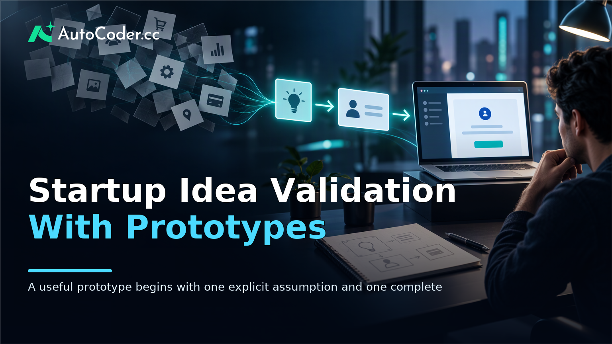
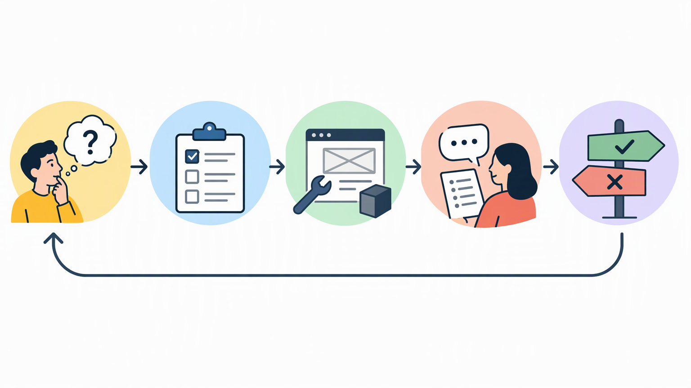

*Published November 4, 2026*

<Frame caption="A useful prototype begins with one explicit assumption and one complete user task, not a broad product concept.">
  
</Frame>

**Startup idea validation** is the process of testing whether a specific group of people has a meaningful problem and whether your proposed workflow helps them address it. A launch alone does not settle either question. It may show that people noticed an offer, but not that they will return to a product, change an existing habit, or accept the trade-offs involved.

For a software idea, a functional prototype can make the test more useful. Instead of asking people to react to a concept, give them a narrow task to complete in a working version of the proposed workflow. The aim is not to prove a business before it exists. It is to reduce uncertainty before committing time to a broad MVP.

## Prerequisites: set a decision and a test boundary

**Start by deciding what evidence would change your next action.** Prototype testing becomes unfocused when the team is trying to learn everything at once. Before recruiting anyone or building screens, write down the decision the test is meant to inform.

Useful preparation includes:

- A defined user group, described by role, situation, and current workflow rather than a broad demographic label.
- One problem worth examining, including when it occurs and how people handle it today.
- A proposed outcome, such as helping a manager review requests in one place or helping a freelancer prepare a recurring report.
- Access to people who reasonably resemble the intended users and can discuss or attempt the relevant task.
- A way to record observations, including what participants did, where they hesitated, and what they said they would need next.

Keep the boundary narrow. “Will small businesses use our platform?” is too broad for an early test. “Can operations managers complete their first request review without a spreadsheet?” gives the prototype a concrete purpose. This preparation also prevents a common error: treating positive feedback about an idea as confirmation that the underlying problem is important.

## Define assumptions before startup idea validation

**Convert the idea into a small set of statements that can be challenged.** An assumption is useful when it links a user, a problem, a behavior, and a condition for success. It should be possible for the test to produce a result that makes the team revise or abandon it.

1. **Describe the user and context.** Name the role, the trigger event, and the existing process. For example, the relevant user may be a team lead who must collect status updates before a weekly meeting, not simply “a manager.”
2. **State the problem hypothesis.** Identify the friction in plain language: updates arrive in different places, the lead spends time reconciling them, and missing information delays decisions. 3. **State the solution hypothesis.** Specify the narrow job the product should help complete, such as collecting updates through a structured request and presenting them in one review view. 4.

This is the product discovery work that gives prototype testing its purpose. Avoid relying on vague statements such as “I would use that.” People can be sincere and still be describing an intention rather than a behavior. Ask about a recent instance of the problem, the tools involved, who else is affected, and what happens when it is not solved.

## Choose the validation method that fits the uncertainty

<Frame caption="Validation is a decision cycle: each method and prototype task should test a named assumption and lead to a next action.">
  
</Frame>

**Use the least elaborate method that can answer the current question.** A functional prototype is valuable when the important uncertainty is about the user journey or the practicality of completing a task. It is not the only method, and building one too early can conceal a weak problem hypothesis behind a polished interface.

Start with conversations and workflow observation when you need to understand the problem. Ask participants to walk through a recent example, including the documents, messages, approvals, and workarounds involved. This reveals context that a feature wish list often misses.

Use a concise landing page or written proposition when you are testing whether the framing is understandable. The page should describe a specific user, situation, and outcome, then invite a relevant next action. It cannot establish product usability, but it can expose confusing language before development begins.

Use a concierge test when the value can be delivered manually for a limited group. For example, if the idea is a workflow that organizes incoming requests, a team may initially perform the organizing work behind the scenes. This can clarify what inputs are necessary and what output users actually value. Be transparent about the manual nature of the service where that affects expectations.

Use a functional prototype when users must interact with the workflow to reveal whether it works. The prototype should support a believable end-to-end path: enter or import the necessary information, make a decision or take an action, and see a useful result. A static mockup may be sufficient for language or layout feedback, but it provides less evidence about whether people can complete work.

These methods can be sequenced. Early interviews inform the hypothesis; a prototype tests the most important interaction; a manual process may test service delivery that the software does not yet support. MVP validation is stronger when each activity addresses a defined uncertainty rather than producing a collection of loosely related opinions.

## Build a focused functional prototype

**Build one complete journey instead of a partial version of every possible feature.** A useful validation prototype is narrow enough to construct and revise quickly, yet real enough that a participant can make a meaningful choice while using it.

6. **Map the smallest end-to-end flow.** Identify the starting point, the information a user needs, the action they take, and the result they should receive. For a booking workflow, that may mean selecting an available option, entering required details, and receiving a clear confirmation. Administrative dashboards, integrations, extensive settings, and edge cases can usually wait unless they are central to the hypothesis. 7. **Define what must function.** List the pieces required for the task to feel credible. Depending on the idea, this may include a simple account flow, stored records, a form, a status change, and a review screen.

A tool such as [AutoCoder's AI app builder](https://www.autocoder.cc/platform?utm_source=blog&utm_medium=latest&utm_campaign=StartupIdeaValidation) can turn natural-language requirements into an editable full-stack application, including frontend, backend, and database components where the workflow needs them. That can be useful for non-technical founders who need a functioning prototype rather than a design-only artifact. The important constraint remains the hypothesis: generate only the parts necessary to test it, then revise based on observed use.

Before inviting participants, test the journey yourself with realistic example information. Check that instructions are understandable, the expected result appears, and any authentication or data setup does not become the entire session. Prepare a fallback if a technical issue occurs, but record the issue rather than quietly treating it as irrelevant. Friction in setup can be part of the product problem.

## Run tests and interpret the results carefully

<Frame caption="Prototype tests should prioritize observed task behavior and friction over general opinions about the idea.">
  
</Frame>

**Observe people attempting a realistic task before asking for an evaluation.** A test session should make room for genuine behavior, including confusion, hesitation, skipped steps, and comparisons with familiar tools. Avoid explaining the interface while the participant is using it; doing so turns your guidance into an unmeasured feature.

Recruit participants who share the relevant role and problem context. A large audience is not required for an early round, but the people should be sufficiently close to the intended user that their workflow is informative. Explain the scenario, give the task, and ask the participant to think aloud if they are comfortable doing so.

During the session, capture what happened rather than only your interpretation. Note whether the participant understood the starting point, what information they expected to have available, where they made an error, and whether the result addressed the stated problem. Follow with questions about a recent real-world situation: what they currently do, what would need to change for this workflow to fit, and what they would do after receiving the result.

Separate evidence into three categories. **Observed behavior** includes task completion and navigation choices. **Reported experience** includes comments about clarity, trust, or missing information. **Commitment signals** include a request to continue, willingness to provide realistic inputs, or an effort to incorporate the workflow into a real process. None is a universal proof of demand, but each has a different meaning.

Do not overread polite reactions. “This is interesting” may indicate goodwill, novelty, or a desire to be helpful. Repeated descriptions of the same costly workflow, successful completion of the central task, and a clear explanation of when the product would be used are more actionable than enthusiasm alone. Look for patterns across sessions, while preserving notable differences between user contexts.

## Decide what to build next from the evidence

**Turn the test into a documented product decision, not a general impression.** After each round, compare observations with the assumptions and decision rule established at the start. Summarize what was supported, what was contradicted, and what remains unknown.

If participants recognize the problem but struggle with the flow, simplify the journey and run another test. If they complete the workflow but do not consider the outcome useful, reconsider the promised value or the user segment. If the problem does not appear recurring or important, stopping or changing direction can be a better use of resources than expanding the prototype.

When the central workflow shows enough promise to continue, convert the prototype into a deliberately scoped MVP plan. Prioritize the capabilities required for repeatable use, reliable handling of real information, and the next high-risk assumption. A prototype created with [AutoCoder](https://www.autocoder.cc/platform?utm_source=blog&utm_medium=latest&utm_campaign=StartupIdeaValidation) can be continued and edited as the requirements become clearer, rather than necessarily being discarded. That continuity is useful only if the team retains the discipline to remove experimental shortcuts and define what a production-ready version requires.

Keep a short decision log after every test cycle. Record the assumption, method, participant context, observations, decision, and next question. This creates a traceable product discovery process and reduces the temptation to reinterpret earlier feedback to support a preferred solution.

## FAQ

### What is startup idea validation?

Startup idea validation is a structured effort to test whether a defined user group has a relevant problem and whether a proposed solution can help. It uses evidence from conversations, observed behavior, and practical tests to guide product decisions before a broad launch.

### What should I validate before building an MVP?

Validate the user context, the importance of the problem, the current workaround, the proposed outcome, and the core user journey. You do not need to settle every product detail first, but you should understand the most consequential assumptions that could make an MVP ineffective.

### How much functionality does a validation prototype need?

It needs enough functionality for a target user to complete the key task and experience the proposed result. If a feature does not affect that task or the assumption under test, it can usually be omitted from the first prototype.

### How can AI help with startup idea validation?

AI tools can help turn written requirements into a working application more quickly, making it easier to test a specific workflow. They do not replace user research, careful scope decisions, or interpretation of participant behavior.

## Conclusion

**Startup idea validation works best when every prototype is tied to a specific decision.** Define the user, problem, and expected behavior; choose the smallest appropriate method; and build one functional journey that participants can actually attempt. Then use observed behavior to refine, redirect, or stop. A functional prototype is not evidence by itself. Its value comes from the disciplined test it makes possible.
