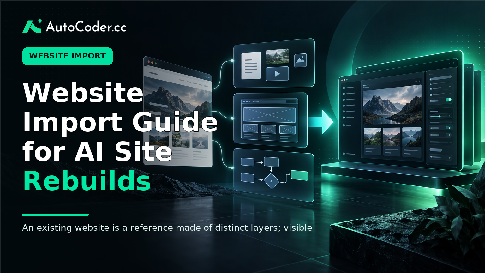
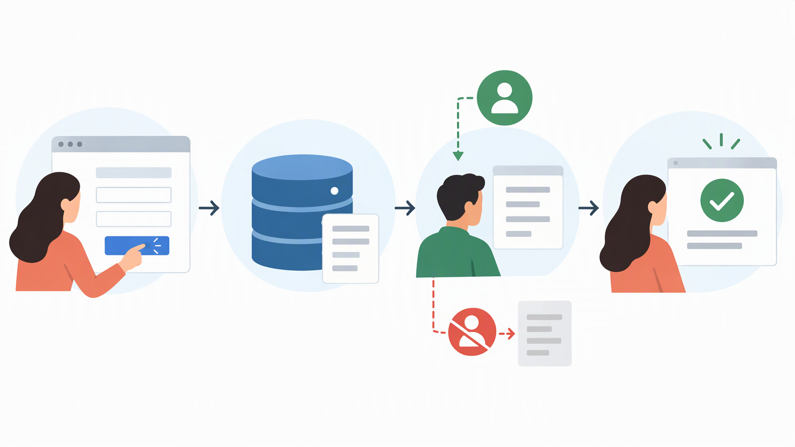

*Published November 3, 2026*

<Frame caption="An existing website is a reference made of distinct layers; visible content and design can inform a rebuild, while application behavior must be specified separately.">
  
</Frame>

A **website import** is best treated as a structured rebuild process, not as a promise that an old site can be copied intact into a new system. For business owners and product teams, the useful goal is to turn an existing website into an editable application while preserving the elements that matter: page hierarchy, approved content, brand direction, and customer journeys.

That distinction matters because a public webpage shows only part of a product. Its layout and visible copy may be clear, while its forms, account logic, data model, permissions, integrations, and internal processes remain unseen.

This guide explains how to audit an existing site, turn observations into requirements, use an AI-assisted build workflow responsibly, and validate the result before replacing or redirecting the original.

## Understand what website import can and cannot do

The practical point is simple: import the reference material you are entitled to use, then explicitly rebuild the behavior that made the original site work.

The phrase “website import” can describe several different activities. Sometimes it means collecting page content and assets from a site you own. Sometimes it means using an existing URL, screenshots, or design files as a visual reference for a new implementation. It can also refer to moving a site between hosting or content systems.

A visual reference can help a team identify the page order, navigation labels, headings, calls to action, visual density, and responsive priorities of an existing site. It does not automatically reveal the rules behind a quote calculator, member area, booking flow, directory, or customer dashboard.

Before beginning, separate the current site into four layers:

1. **Visible structure:** pages, navigation, headings, footers, content sections, and public links. 2. **Reusable materials:** copy, images, illustrations, documents, logos, and brand guidance that you have permission to reuse. 3. **Interaction design:** forms, search, filtering, tabs, validation messages, booking steps, and confirmation states. 4.

The first two layers may be straightforward to carry into a new project when rights are clear. The latter two should be documented as product requirements. Treating a visual page as proof of backend behavior is a common source of missed scope.

This approach also prevents a superficial AI website redesign. Matching colors and section shapes may be useful, but it is not enough if the resulting site fails at the actions customers or staff need to complete. Start with the job of each page, then decide which visual details support that job.

## Audit the existing website before importing

<Frame caption="A useful audit records more than page layouts: it captures owned assets, conversion paths, and the operational work behind visible features.">
  
</Frame>

The practical point is to create a complete inventory before asking a builder or development team to reproduce anything.

An audit gives the rebuild a stable reference. Without one, teams often reconstruct the most visible pages first, then discover late in the work that an old form sent information to a shared inbox, a search page depended on structured records, or an account setting controlled access to content.

Begin with a page inventory. List every public URL that should be retained, retired, consolidated, or redirected. Record the page purpose, intended audience, primary action, source content, and owner. A simple spreadsheet or project document is sufficient.

Next, map navigation and conversion paths. Follow a typical visitor from the homepage to a key action, such as requesting a demo, making a booking, finding a provider, submitting an application, or signing in. Note each decision point and what happens after submission.

Then inventory content and assets separately from the pages where they appear. Ask these questions:

- Which copy is current, approved, and still accurate?
- Which images, fonts, logos, and documents can legally be reused?
- Which pages rely on manually maintained lists or embedded documents?
- Which content should move into editable records rather than remain hard-coded on a page?

Rights review belongs in this stage. Ownership of a domain or access to a webpage does not necessarily grant rights to reuse every photo, illustration, typeface, stock asset, or block of copy. When provenance is uncertain, replace the asset or obtain permission rather than treating it as reusable by default.

Finally, document hidden operations. Interview the person who receives form submissions, updates listings, handles cancellations, changes account access, or publishes new information. Their workflow often reveals the real application requirements. For example, a public directory may need a structured record for each listing, an internal editor, approval status, and a search interface.

An audit does not need to prescribe the final technical architecture. Its role is to make the current state visible enough to decide what to preserve, improve, or remove.

## Convert the site into clear build requirements

<Frame caption="Functional requirements become testable when they specify the user action, stored data, permissions, and expected outcome.">
  
</Frame>

The practical point is to describe the desired outcome in terms of pages, users, data, and actions—not merely “make it look like the current site.”

This is where an AI website builder can be useful. Rather than assuming an existing site can be transferred automatically, provide a clear brief that uses the old site as a reference and states what the new application should do. [AutoCoder's AI app builder](https://www.autocoder.cc/platform?utm_source=blog&utm_medium=latest&utm_campaign=WebsiteImport) is designed to turn natural-language product requirements into editable, deployable full-stack applications, including frontend, backend, database, and authentication components where those are required.

Write requirements in layers. Start with the public experience: required pages, content hierarchy, navigation, brand constraints, responsive behavior, and primary calls to action. Then add the functional layer: who uses the system, what they can do, what data must be stored, and which events should occur after an action.

For a service business, a requirement might state that visitors can view services, submit an enquiry, and receive a confirmation state. If staff need to manage enquiries, add the internal workflow: staff authentication, an enquiry record with a status, fields needed for follow-up, and an interface to review or update records.

Use acceptance criteria for important functions. A concise format works well:

- **User:** A visitor who is not signed in.
- **Action:** Completes the enquiry form with required contact information and a message.
- **Expected result:** Sees a confirmation message and the submission is available to authorized staff.
- **Exceptions:** Required fields show clear feedback when missing or invalid.

Apply the same method to account flows, filters, booking availability, internal dashboards, or marketplace listings. It helps distinguish a brochure-site rebuild from a full application rebuild.

Also identify what should change. A website migration is an opportunity to remove redundant pages, combine similar content, clarify navigation, or replace a fragile manual process. Do not preserve an old workflow simply because it exists. If a feature lacks a defined user, owner, or business purpose, consider retiring it.

At this stage, decide how closely the visual design should follow the reference. You may request preservation of familiar patterns, such as a recognizable navigation structure or page rhythm, while updating typography, accessibility, mobile layout, and component consistency. Make clear which elements are brand requirements and which are starting points for improvement.

## Rebuild and validate the imported website

The practical point is to validate customer journeys and operational behavior, not just whether the rebuilt pages resemble the reference.

Build the smallest useful set of pages and workflows first. For many teams, that includes the homepage, one or two core informational pages, the primary conversion path, and the administrative or data workflow behind it. This reduces the chance of spending time polishing low-priority pages before the central experience works.

When you [use AutoCoder to create an editable application](https://www.autocoder.cc/platform?utm_source=blog&utm_medium=latest&utm_campaign=WebsiteImport), provide the inventory and requirements in manageable increments. Review the generated structure against the requirements after each meaningful stage. Confirm that routes, data fields, user states, and permissions reflect the intended model before expanding the build.

Validation should include visual, functional, and content checks. For visual review, compare hierarchy, spacing, readability, navigation clarity, and mobile behavior against the approved direction. Do not judge only from a large desktop screen. Test narrow screens, touch interactions, and long pieces of real content, since these commonly expose layout assumptions.

For functional review, walk through each critical journey as the intended user. Submit forms with normal and incomplete inputs. Test sign-in and sign-out states if accounts are involved. Check that authorized and unauthorized users see the correct options. Create, edit, search, filter, or delete representative records where those actions are part of the application.

For content review, check that names, legal text, contact details, service descriptions, and policies are accurate. Imported or re-entered material can carry old messaging forward unnoticed. Assign a named owner to approve business-critical content before launch.

Prepare the transition separately. If replacing an existing public site, decide which old URLs map to new pages, which should redirect, and which should remain available temporarily. Preserve access to the old site until the new version has passed review and stakeholders have approved the launch plan.

## Extend the website after the initial import

The practical point is to use the rebuilt site as a maintainable foundation rather than freezing it at the point of visual similarity.

Once the core experience is stable, prioritize additions that reduce manual work or improve a defined customer task. Common examples include a client portal, an internal dashboard, a searchable directory, a booking workflow, or structured content management for frequently updated information.

Keeping the result editable is important because business rules change. A service list may become a directory. A basic form may later need status tracking. A marketing site may need authenticated resources or an internal review process.

Avoid treating the initial reference as a permanent design constraint. The existing site provides evidence about current content and user expectations, but the new application should be judged on whether it supports current goals, works reliably for its users, and can be maintained by the people responsible for it.

## FAQ

### What does website import mean?

Website import can mean bringing content, assets, structure, or a visual reference from an existing site into a new workflow. In a rebuild context, it usually means using the old site as input for a new editable implementation rather than copying every underlying function automatically.

### Can I import an existing website into an AI website builder?

You can use an existing website as a reference for page structure, content, assets you are permitted to use, and design direction. Dynamic behavior still needs clear requirements. Describe forms, user roles, stored data, integrations, and administrative workflows so they can be rebuilt intentionally.

### What parts of a website can be reused after import?

Reusable elements may include approved copy, owned images, logos, page hierarchy, navigation labels, and documented design guidance. Reuse depends on ownership and licensing. Backend behavior, third-party integrations, and internal processes normally require separate reconstruction and testing.

### Can a website import recreate backend functionality?

A visual reference alone cannot establish backend functionality. Features such as authentication, databases, permissions, notifications, and integrations must be specified as requirements, then implemented and tested as part of the new application.

### How do I avoid copying content or design assets without permission?

Create an asset inventory and confirm who owns or licenses each item before reuse. Replace uncertain images, fonts, copy, and design materials, and avoid using a competitor’s content or proprietary design elements as direct source material.

## Conclusion

A website import works best when it is treated as a disciplined rebuild: audit the old experience, separate visible reference material from hidden application logic, define the desired workflows, and test the result against real tasks. That process makes it possible to preserve useful continuity without carrying forward every limitation of the existing site. For teams using a website import as the starting point for an editable application, clear requirements and careful validation matter more than a fast visual imitation.
