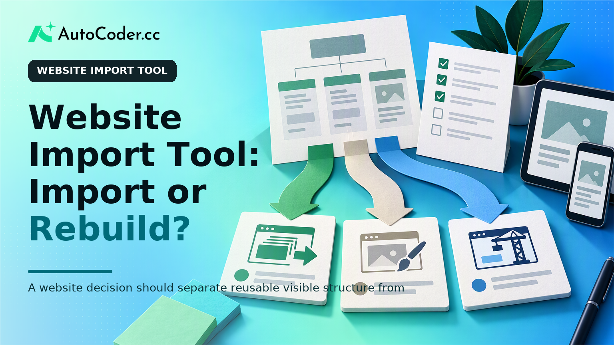
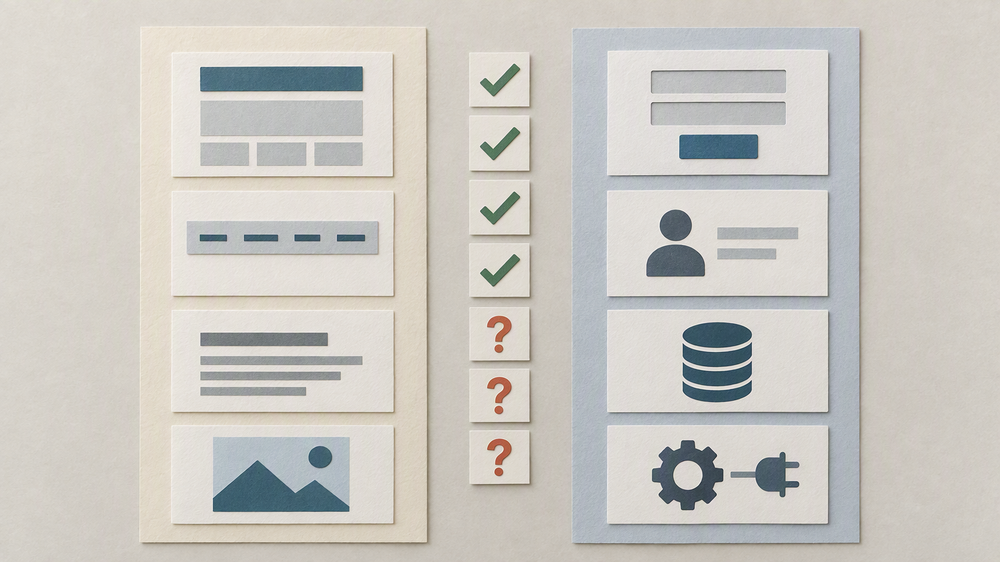

*Published November 2, 2026*

<Frame caption="A website decision should separate reusable visible structure from sections that need redesign or a fresh build.">
  
</Frame>

A **website import tool** can be a practical starting point when an existing site has useful visual structure, page hierarchy, and content worth retaining. It is not, however, a guarantee that the imported result reproduces every behavior behind the original experience. For founders, designers, and small teams, the choice is less about whether import or rebuild is universally better. It is about deciding what the current site gets right, what needs to change, and how much of the final product depends on functionality beyond presentation.

The most reliable decision comes from separating the visible website from the systems that support it. A marketing page may be largely reusable. A site with account flows, forms, third-party services, or data-driven content often needs more deliberate rebuilding and validation.

## What a website import tool can and cannot do

<Frame caption="Importing visible presentation does not automatically reproduce data, forms, accounts, or integrations.">
  
</Frame>

**Use an import when the existing site is a useful design and content reference, not when it is the only specification for the new product.** An import can help establish a starting point for layouts, sections, navigation patterns, typography choices, visible copy, and the relationship between pages. This is especially useful when a team wants to retain brand familiarity while changing the implementation underneath.

In practical terms, a website importer is best understood as a way to capture or recreate the observable layer of a site. It can reduce the blank-page problem: instead of describing every content block from scratch, a team can begin with a recognizable structure and revise it. If the goal is to clone a website layout for a redesign, campaign variation, or early prototype, that starting point may be more efficient than a wholly empty project.

What the visible layer does not reveal is equally important. A page may contain a form, but its field validation, delivery destination, consent handling, error states, and follow-up workflow are separate concerns. A login button does not reveal the authentication model. A directory page does not automatically provide a database, filtering rules, moderation process, or content-management workflow. Embedded calendars, payment flows, analytics, search, and third-party widgets need their own review because their behavior may depend on services outside the page itself.

Content also requires care. Importing or recreating a page does not settle whether the team owns the copy, images, logos, fonts, or other assets, or whether those materials remain accurate. Treat the existing site as an inventory to assess, not as permission to reuse everything without review.

A useful boundary is this: import the parts that communicate structure and intent; explicitly plan the parts that store data, make decisions, exchange information with other systems, or create legal and operational responsibilities. That boundary keeps a visual shortcut from becoming an incomplete implementation.

## Website import versus rebuilding from requirements

**Choose between import and rebuild by assessing the current site's quality, the scale of the intended change, and the importance of hidden functionality.** Both paths can lead to a stronger site, but they begin with different assumptions. Importing assumes the existing experience contains enough value to preserve. Rebuilding from requirements assumes the future experience should be designed around current needs rather than past decisions.

A website import is usually the better fit when the site already has a sensible information architecture, current brand direction, and pages that need refinement rather than replacement. For example, a small firm updating its services site may want to retain its page sequence, familiar calls to action, and core content while improving spacing, responsiveness, and maintainability. Starting from a recognizable reference can make design review more concrete because stakeholders are reacting to an existing baseline.

A rebuild is usually the better fit when the present site has accumulated workarounds, conflicting navigation, outdated messaging, or an implementation that no longer matches the business. It is also the safer choice when the project requires new user roles, private content, workflows, or structured data. In those cases, reproducing the old layout first can preserve constraints that the team actually needs to remove.

Use the following criteria to compare the two approaches:

- **Design quality and relevance:** Import when the visual system and page structure remain credible. Rebuild when the old design is the source of the problem or no longer represents the organization. - **Content usefulness:** Import when most copy and assets have been reviewed and still serve the audience. Rebuild when content needs a new hierarchy, different positioning, or substantial rewriting. - **Functional complexity:** Import can support the visible foundation of simple informational pages. Rebuild requirements for account areas, submission processes, payment-related flows, dashboards, or data-dependent sections.

The trade-off is not merely speed versus quality. Importing may shorten the path to a reviewable baseline, but it can bring along unclear patterns that need cleanup. Rebuilding provides more control over the system and content model, but it requires sharper decisions at the outset. A team that has not defined its goals can spend just as much time revising a fresh build as it would untangling an imported one.

For a brochure-style site with a sound structure, begin with import and create a change list before editing. For a site becoming a product or service workflow, write requirements first and use the current pages only as reference material. For a mixed project, import the stable public pages while rebuilding the areas that require data, permissions, or integrations.

## What to audit after an import

<Frame caption="An imported site needs a structured audit of content, access, responsive behavior, and real user actions before launch.">
  
</Frame>

**Treat the imported result as a candidate implementation that must be checked page by page and behavior by behavior.** Visual similarity alone does not establish that a site works well across devices, supports users with different needs, or accurately represents the business.

Start with structure. Confirm that every intended page is present, that headings follow a sensible hierarchy, and that navigation leads to the right destinations. Check internal links, footer links, calls to action, downloadable resources, and redirects that may be needed when URLs change. A simple page inventory is useful here: list the old URL, the planned destination, the page owner, and whether content is approved, revised, or removed.

Then review responsive behavior. Inspect pages at common narrow and wide viewport sizes, paying attention to navigation, multi-column sections, tables, long headings, images, and forms. An imported layout can look acceptable at one width while becoming difficult to use at another. Do not assume that a desktop pattern naturally translates to smaller screens.

Accessibility should be part of the same review rather than a final visual pass. Check meaningful page titles, heading order, image alternatives where needed, readable contrast, keyboard access, visible focus states, form labels, and understandable error messages. If a component depends on hover alone or uses an icon without a text alternative, it needs a more explicit interaction pattern.

Finally, test the paths that create a real outcome. Submit each form using valid and invalid inputs. Verify confirmation and error states. Test authentication and account recovery where applicable. Review search, filters, dynamic lists, embedded services, and any actions that send information elsewhere. If the imported site represents a process but does not implement it, mark that gap clearly rather than leaving an apparently active control in place.

This audit is also the time to compare content with operational reality. Confirm contact details, service descriptions, policies, team information, legal notices, and calls to action. A website migration tool may help move visible material, but editorial accuracy and operational readiness remain human responsibilities.

## Turning imported pages into an extensible application

**Keep public presentation separate from application requirements so the site can expand without forcing a second redesign.** A team does not need to turn every imported page into software. Informational pages can remain relatively simple while selected parts of the project gain structured content, accounts, internal workflows, or data-backed interactions.

Begin by labeling each page or feature according to its role. Public pages may need only editable content and clear navigation. A resource directory may need structured records and filtering. A customer area may need authentication, permissions, and a database. A booking or request process may need validation, status tracking, and notification logic. This classification prevents teams from applying the same technical approach to every page.

For features that go beyond static presentation, write down the input, the rule, the output, and the owner. For example, a request form needs to identify what information is collected, what makes it valid, where it goes, what the submitter sees next, and who handles it. Those decisions are more useful than a visual reference when building the underlying workflow.

Teams that want to move from a page reference toward editable full-stack work can use [AutoCoder's AI app builder](https://www.autocoder.cc/platform?utm_source=blog&utm_medium=latest&utm_campaign=WebsiteImportTool) to generate applications from natural-language requirements, including frontend, backend, and database components. The relevant question is not whether every imported element should become an application feature. It is whether the project needs an editable implementation for the workflows that matter.

Maintain source-code access and document the purpose of custom components, data models, and integrations. That makes future editing more manageable and reduces dependence on undocumented decisions made during the initial migration.

## A practical decision process for small teams

**Make the choice with a short discovery exercise before committing to production work.** The process can be lightweight, but it should expose assumptions early.

1. **Inventory the current site.** List pages, key assets, forms, external services, and user journeys. Identify which elements are current and which are candidates for removal. 2. **Define the target outcome.** State what the new site must help visitors do and what the team must be able to update after launch. Separate presentation goals from operational requirements. 3. **Mark reusable and non-reusable areas.** Keep layouts, copy, and navigation only where they support the target outcome. Flag authentication, data handling, integrations, and compliance-sensitive areas for separate planning. 4.

This approach gives a founder a clearer scope, gives a designer a visible basis for critique, and gives the eventual builder a usable set of requirements. It also limits the common mistake of assuming that a polished imported page answers every product and operational question.

## FAQ

### What is a website import tool?

A website import tool helps create a starting point from an existing site's visible structure, such as page layout, sections, navigation, and content patterns. Its exact output varies by tool and source site. It should be treated as a foundation for review and editing, not as proof that all underlying functionality has been reproduced.

### Can a website import tool copy an entire website?

It may help reproduce visible pages or a layout, but an entire website includes more than what appears in the browser. Forms, databases, authentication, integrations, private content, business rules, and third-party services need separate validation or implementation. Asset rights and content accuracy also need review.

### What should be checked after importing a website?

Check page coverage, links, navigation, responsive layouts, headings, image alternatives, keyboard access, forms, error states, account paths, dynamic elements, and content accuracy. Also confirm that external services and redirects work as intended.

### When is it better to rebuild a website instead of importing it?

Rebuild when the existing information architecture, design direction, content, or technology no longer supports the business. A rebuild is also more appropriate when the project introduces substantial functionality, such as accounts, data-backed workflows, or new integrations that need clear requirements.

## Conclusion

A **website import tool** is most useful when it preserves a sound visual and content foundation while leaving room for deliberate improvement. Rebuild when the old site encodes the wrong structure or cannot support the workflows now required. In either case, success depends on separating visible pages from the content, accessibility, data, integrations, and ownership decisions that make a website dependable after launch.
