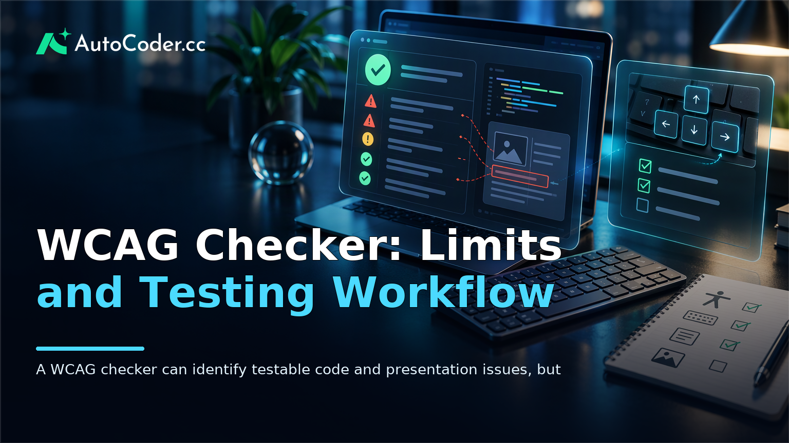
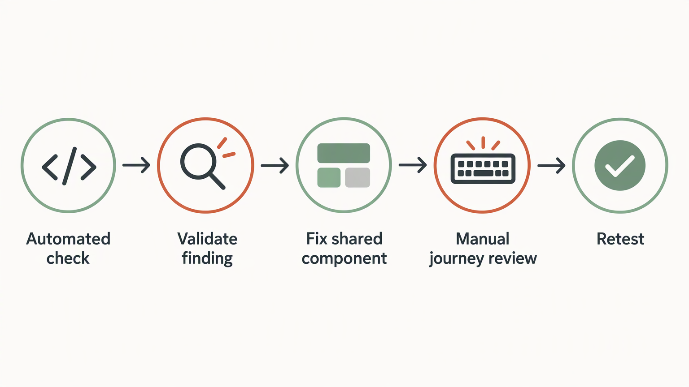
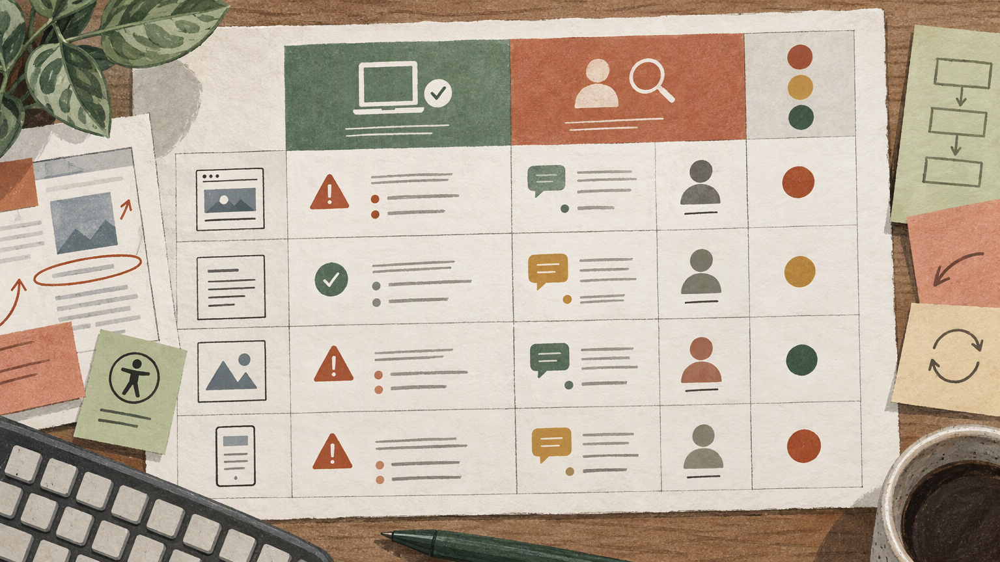

*Published November 3, 2026*

<Frame caption="A WCAG checker can identify testable code and presentation issues, but keyboard and content review are needed to assess usable accessibility.">
  
</Frame>

A **WCAG checker** helps teams find accessibility issues that software can identify consistently, including missing form labels, invalid code relationships, and some color-contrast failures. It does not determine whether a person can understand a page, operate every control, or complete an important task. The most useful approach is to treat automated findings as one part of a broader accessibility practice that also includes design review, keyboard testing, and contextual human judgment.

That distinction matters for product teams building new interfaces, maintaining established products, or prototyping an internal review process. Automated checks can expose repeatable technical defects early. Manual evaluation addresses what a scan cannot reliably infer: whether instructions are clear, focus behavior is usable, and content remains understandable with assistive technology.

## What a WCAG checker evaluates

**Use a checker to uncover machine-detectable patterns, then investigate the affected interface in context.** A WCAG checker is an accessibility checker that reviews a webpage, app view, document, or code against rules associated with the Web Content Accessibility Guidelines (WCAG). Depending on the tool and configuration, it may inspect a URL, a rendered page, uploaded material, or a development environment.

Its core task is to compare observable markup and presentation details with conditions that can be evaluated programmatically. For example, a checker may flag an image without an alternative-text attribute, a form control without an associated label, duplicate IDs, an invalid ARIA relationship, or a contrast combination that appears insufficient from the colors it can read.

These checks matter because a visually complete interface can still omit information needed by screen readers, keyboards, or other assistive technologies. A form field may appear to have a label because nearby text describes it, yet lack the code-level association that communicates its purpose reliably. A custom button may look like a control while exposing no usable name to assistive technology.

The phrase “WCAG compliance checker” needs careful interpretation. WCAG includes criteria that depend on meaning, context, interaction, and the purpose of content. Software can test some conditions related to those criteria, but it cannot make every judgment required for a complete evaluation.

Read the results as evidence rather than a verdict. A clean result means the tool did not identify problems within the rules, page state, and elements it examined. It does not prove that every route, state, or user journey is accessible.

### Common automated findings

Automated website accessibility testing is particularly useful for recurring structural issues. Depending on the checker and the tested state, common findings can include:

- images or icons without programmatic text alternatives;
- inputs, buttons, and links without discernible accessible names;
- missing labels or labels not correctly connected to form controls;
- duplicate identifiers and markup conflicts that can affect assistive technology;
- invalid ARIA roles, attributes, or required parent-child relationships;
- missing page-language declarations;
- heading or structural-markup concerns; and
- some text and interface contrast failures.

Not every finding has the same practical impact. A missing accessible name on a primary action or account field may prevent task completion. A structural concern in a secondary area may be less immediate, although it should still be addressed. Triage should consider the affected journey, likely user impact, available workarounds, and whether the problem is repeated in a shared component.

## Where automated accessibility testing stops

**Reserve human review for questions of meaning, quality, and successful task completion.** Automation cannot reliably decide whether alternative text communicates an image’s relevant purpose, even if it confirms that an `alt` attribute exists. It cannot determine whether a heading sequence makes a complex page understandable, whether error guidance supports recovery, or whether a control name is sufficiently specific in its context.

Keyboard operation is another important boundary. A checker may identify some focus-related markup concerns, but it cannot fully judge whether focus moves in an expected order, remains visible, avoids traps, and supports an entire workflow. Those questions require navigating the actual interface with a keyboard, including menus, dialogs, custom controls, validation states, and route changes.

Dynamic behavior also needs direct review. A page might expose a status message in code but announce it at an unhelpful time. A dialog might include focus management but return focus to the wrong location when it closes. A filtered-results interface might update so frequently that a user cannot reasonably follow what changed. These are interaction questions, not simply markup questions.

Manual evaluation matters for content as well. A checker cannot determine whether repeated “Read more” links are meaningful in a list, whether a video transcript accurately communicates the source material, or whether a complex chart has a useful textual explanation. It may identify a possible concern, but someone who understands the content and user goal must make the decision.

A common misconception is that passing an automated scan means an interface is accessible to every person. Accessibility is not a single binary property produced by one report. People use different devices, browsers, settings, input methods, and assistive technologies. A reliable process acknowledges that range instead of reducing accessibility to a pass/fail label.

Automation remains valuable precisely because it can reduce routine defects at scale. The practical goal is to use it for the work software can perform consistently, then direct human attention to the decisions where context matters.

## Turn WCAG checker results into a remediation workflow

<Frame caption="An accessibility report becomes useful when findings are validated, assigned, fixed at the right layer, manually reviewed, and retested.">
  
</Frame>

**Convert each finding into an owned, testable change instead of treating the report as a backlog by itself.** An accessibility audit tool can generate many alerts, especially in a large product or one built from reusable components. Without a process for grouping, prioritizing, fixing, and retesting them, teams can repeatedly review the same underlying problems.

Start by defining the page states and user journeys that are in scope. A homepage alone rarely represents the accessibility of a product. Include meaningful paths such as sign-in, search, creation flows, forms, tables, settings, error states, and any transaction or booking flow relevant to the product.

Then apply a simple sequence:

1. **Run automated checks on representative pages and states.** Capture the route or screen, the rule or message, and the affected component. Include authenticated states when the issue appears only after sign-in. 2. **Validate the finding before assigning work.** Confirm that the reported element and state are still current.

The remediation record should be understandable to designers, developers, and reviewers. Include the component or page, observed problem, likely user impact, owner, acceptance criteria, and retest status. Screenshots can establish visual context, but they should not replace requirements for semantic structure and interaction behavior.

Designers can contribute before implementation by defining visible focus treatment, error patterns, label requirements, contrast-aware tokens, and content guidance. Developers can run checks during local development or review while recognizing that an automated result is not the complete test plan. Product owners can keep the work connected to real journeys rather than allowing it to become an isolated technical cleanup.

## Build a lightweight accessibility-checking workflow

<Frame caption="A useful internal workflow keeps test context, automated findings, manual checks, ownership, and retest status distinct.">
  
</Frame>

**Prototype clear inputs, review checkpoints, and usable outputs before building a complex audit system.** A lightweight process can reveal what information a team needs to manage findings consistently. At minimum, it needs a way to identify what was tested, record findings, assign remediation work, and confirm a retest.

Begin with a simple intake model. A reviewer selects a URL, route, page state, or uploaded asset; identifies the product area; and notes whether authentication or special setup is required. Retain enough context for another person to reproduce the review without relying on memory or a vague ticket title.

Next, keep automated and manual findings distinct. Automated entries can contain the tool message, affected element, and page context. Manual entries need prompts that make review deliberate: Can every interactive element be reached and operated with a keyboard? Is focus visible and managed predictably? Does the reading order communicate the page structure? Can a user understand and recover from errors?

A small findings register can group issues by component, journey, status, and owner. Its purpose is not to create a single compliance score. It is to show recurring causes and provide a reliable path from discovery to verification. A status such as “needs manual review” is often more accurate and operationally useful than an automatic pass or fail.

Teams exploring a working prototype can use [AutoCoder's AI app builder](https://www.autocoder.cc/platform?utm_source=blog&utm_medium=latest&utm_campaign=WcagChecker) to describe an internal workflow with authenticated roles, intake forms, a findings register, and remediation statuses. The useful starting point is the process definition: what a reviewer enters, which evidence is retained, who determines priority, and what counts as a completed retest. The application should support that process, not imply that it replaces accessibility expertise.

Keep the first version narrow. Support a defined set of journeys and a consistent issue record before trying to cover every possible page type. Add templates for repeated checks only after the team has confirmed that the prompts lead to actionable reviews. Where a prototype needs to develop into an editable full-stack application, [AutoCoder](https://www.autocoder.cc/platform?utm_source=blog&utm_medium=latest&utm_campaign=WcagChecker) can support moving from natural-language requirements toward an application with frontend, backend, and database components.

## Practical misconceptions to avoid

**Avoid treating labels, reports, and scores as substitutes for observed use.** The most common misunderstanding is that an accessibility checker either certifies a product or has little value. Neither view is useful. Its value lies in detecting a defined range of issues repeatedly; its limitation lies in the accessibility decisions that depend on context.

Another misconception is that evaluation should happen only near release. Early checks are easier to act on because component patterns, content models, and interaction designs are still taking shape. A late review can reveal important barriers, but it may also expose defects already repeated across shared interface patterns.

Do not assume manual testing must be unstructured. A short, repeatable script for key journeys can make human review more consistent. Combine keyboard checks, content review, and representative assistive-technology testing with the automated baseline. The purpose is not to eliminate judgment, but to apply it where software cannot make a reliable decision.

## FAQ

### What is a WCAG checker?

A WCAG checker is a tool that assesses webpages, applications, code, or documents for accessibility issues that can be programmatically evaluated against selected WCAG-related rules. It can identify potential defects, but it does not independently establish complete accessibility compliance.

### Can a WCAG checker guarantee accessibility compliance?

No. Automated tools detect only some conditions. A fuller evaluation also requires manual assessment of content meaning, keyboard interaction, focus behavior, error recovery, and representative user journeys.

### What WCAG issues can automated checks detect?

They can often detect missing accessible names, unlabeled form controls, some contrast problems, invalid ARIA usage, missing language declarations, duplicate IDs, and structural-markup concerns. Exact coverage varies by tool and tested page state.

### When is manual accessibility testing required?

Manual testing is required whenever the question depends on context or real interaction. Review keyboard navigation, focus order, instructions, alternative-text quality, dynamic updates, error handling, and whether key tasks can actually be completed.

## Conclusion

A **WCAG checker** is most effective as part of a disciplined accessibility practice. It can identify many recurring technical issues, help teams monitor shared components, and provide a practical starting point for remediation. It cannot determine whether content is meaningful or whether someone can successfully navigate a complete workflow.

Use automated website accessibility testing early and repeatedly, then pair it with targeted manual review of the journeys that matter most. By recording findings, fixing root causes in shared patterns, and retesting changes, teams can turn an accessibility checker from a one-time report into a workable quality process.
