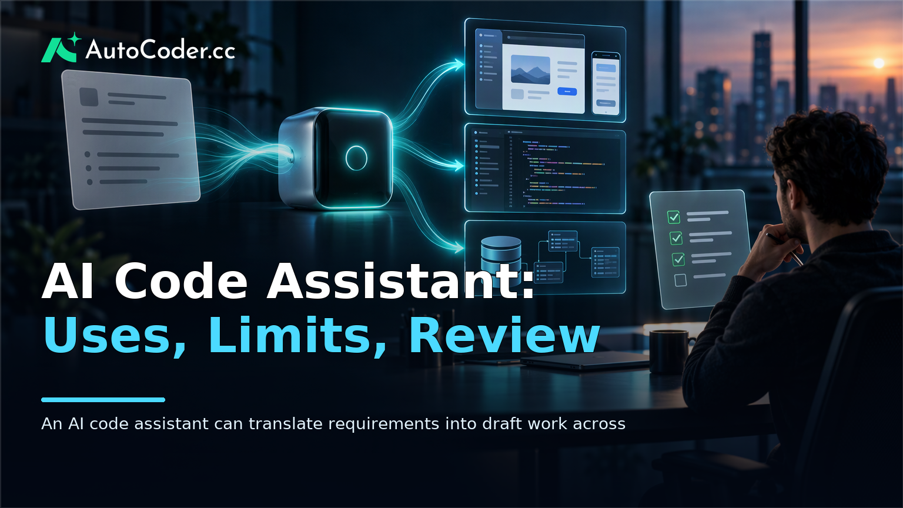
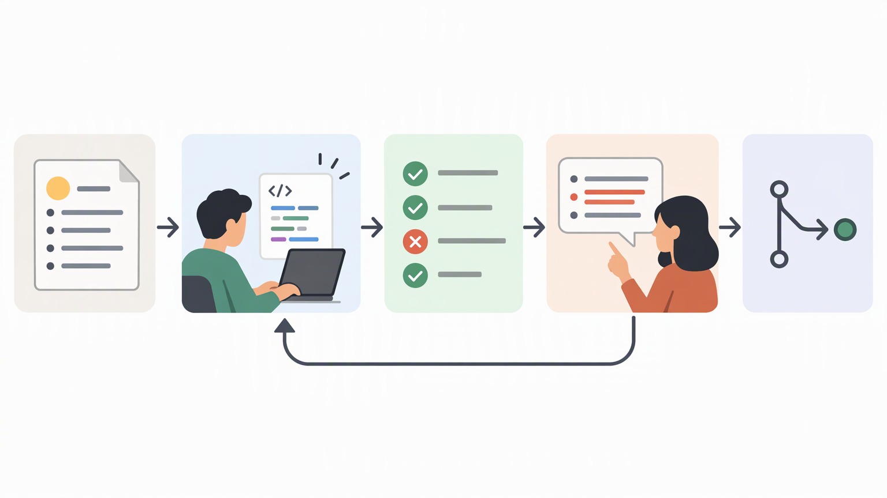
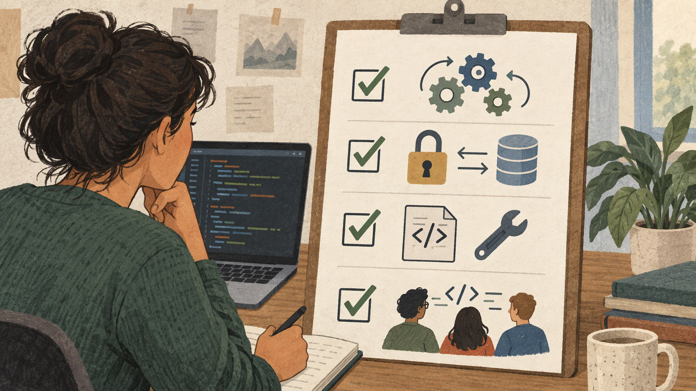

*Published November 3, 2026*

<Frame caption="An AI code assistant can translate requirements into draft work across interface, logic, and data layers, but human review remains a separate essential step.">
  
</Frame>

An **AI code assistant** helps people turn software intent into code, explanations, revisions, and development tasks. It can be useful whether the starting point is a written feature request, an existing codebase, or a rough application prototype. Its value is not that it removes engineering judgment; it is that it can shorten parts of the path from requirement to an inspectable implementation.

For developers, product managers, and founders, the important question is not simply whether a tool can produce code. It is whether the output fits the product’s requirements, can be reviewed and changed, and remains understandable as the application evolves. That distinction is especially relevant when considering AI coding tools for full-stack app development.

## What an AI code assistant is and is not

The practical point: treat an AI code assistant as a collaborator for bounded development work, not as a substitute for product decisions, technical ownership, or review.

A coding assistant is software that accepts context or instructions and returns code-related output. Depending on the tool and workflow, that output may include a function, a component, a database schema, a test outline, an explanation of unfamiliar code, or suggested changes to an existing file. AI code generation can also begin from a product-level description, such as a request for a customer portal with user accounts and an administrative view.

The assistant’s role varies by the scope of the task. In a narrow workflow, a developer might ask for help translating a validation rule into code or refactoring a repeated pattern. In a broader workflow, a team might describe the screens, data, and user actions needed for a prototype, then use the generated application as a starting point for further work.

This does not make the assistant an autonomous delivery team. Software delivery still involves choosing requirements, resolving conflicting behavior, deciding what data should be stored, handling access control, testing failure cases, and maintaining the result. Generated code may look complete while leaving assumptions unspoken. For example, an instruction to create a booking workflow does not by itself define cancellation rules, staff permissions, time-zone handling, or what happens when availability changes.

The distinction matters because the quality of a response depends on the quality and completeness of the context supplied. Clear inputs generally produce work that is easier to evaluate: identify the user, desired action, expected result, constraints, and relevant existing code. Vague prompts can still be useful for exploration, but they should not be mistaken for settled specifications.

## Where AI code assistants fit in the development workflow

<Frame caption="Small, testable generation cycles make AI-assisted development easier to inspect and improve.">
  
</Frame>

The practical point: use the assistant at points where a draft, explanation, or repeatable implementation speeds up informed work, then keep normal product and engineering checkpoints in place.

An AI code assistant can contribute across a development workflow without owning the workflow. Early in planning, it can help convert a feature description into a proposed set of screens, entities, and user flows. During implementation, it can draft frontend views, backend routes, and data structures. Later, it can assist with incremental edits, explain a module, or suggest a test case that a reviewer can refine.

A useful way to frame the workflow is as a sequence of decisions rather than a single prompt:

1. **Define the outcome.** State who will use the feature, the action they need to take, and the result they should receive. Add constraints such as roles, required fields, or systems the feature must connect to.
2. **Break the outcome into reviewable parts.** Separate interface behavior, server-side logic, data storage, authentication, and deployment concerns. This makes it easier to inspect what was generated and locate missing requirements.
3. **Generate a small, testable slice.** Start with one flow, such as account creation or submitting a request, rather than an entire product description with many unresolved rules.
4. **Run and inspect the result.** Check normal paths, invalid input, empty states, permissions, and changes to stored data. Compare actual behavior with the written requirement.
5. **Revise with specific feedback.** Replace broad requests such as “make it better” with observations about the result: which field is missing, which user should have access, or which action should be blocked.
6. **Integrate and maintain deliberately.** Ensure the team understands how the new code fits the wider system and can edit it after the initial generation.

This approach is relevant to both traditional code assistants and broader application-building workflows. For example, [AutoCoder's AI app builder](https://www.autocoder.cc/platform?utm_source=blog&utm_medium=latest&utm_campaign=AICodeAssistant) is intended to turn natural-language product requirements into editable, deployable full-stack applications, including frontend, backend, and database components. That makes it a workflow option for teams that need a functional prototype or an initial application structure, rather than only a snippet inside an existing repository.

The scope of assistance should match the maturity of the work. A product manager may use generated screens to make a proposed workflow concrete before handing it to engineering. A developer may use a coding assistant to accelerate a contained implementation while retaining existing architectural conventions. A non-technical founder may use a generated prototype to clarify requirements, while recognizing that validation, maintenance, and operational choices still need attention.

## Practical uses in full-stack app development

The practical point: choose tasks with observable inputs and outputs, because they are easier to generate, test, and revise.

AI coding tools are often most useful when they reduce setup work or make an idea concrete enough for discussion. Common practical uses include drafting an internal dashboard, structuring a directory, sketching a marketplace flow, or creating the initial views and data model for a booking system. These tasks still require product choices, but they provide visible artifacts that teams can inspect.

For frontend work, an assistant can help translate a written user flow into forms, navigation, status messages, and views for different states. The review should focus on more than appearance: can a user recover from an error, understand required fields, and complete the intended action?

For backend work, it can help outline routes, business rules, and interactions with stored data. The reviewer needs to confirm that the logic reflects actual policy. A generated route for an approval process, for instance, needs explicit definitions of who can approve, what can be changed afterward, and how an action is recorded.

For database work, assistance can speed up an initial model of entities and relationships. It cannot determine, without sufficient context, which data is truly needed, how long it should be retained, or which users are permitted to see it. Those are requirements decisions, not formatting decisions.

The same applies to authentication and deployment workflows. A tool may support these areas, but teams should inspect the configuration and behavior in the environment where the application will run. Treat generated setup as a starting implementation to verify, not a blanket assurance that every operational concern has been resolved.

## How to evaluate generated code responsibly

<Frame caption="Generated code should be assessed for behavior, access controls, maintainability, and the team’s ability to continue editing it.">
  
</Frame>

The practical point: review generated output against behavior, security needs, maintainability, and ownership before relying on it.

Evaluation begins with functionality. Use written acceptance criteria and test the expected user journey from start to finish. Then test conditions that are easy to omit from a first draft: incomplete forms, duplicate entries, expired sessions, unavailable records, and actions attempted by the wrong type of user. The goal is to find the difference between a plausible demonstration and the behavior the product requires.

Security and data handling require separate attention. Review what information is collected, where it is stored, which roles can read or change it, and how access is enforced. If an application handles sensitive or regulated information, the appropriate review process may be more extensive. An assistant can help produce code, but it does not remove the need to apply the organization’s security practices and obligations.

Maintainability is equally important. Ask whether the generated structure is understandable to the people who will change it later. Useful questions include:

- Are names, modules, and responsibilities clear enough to navigate?
- Does the implementation follow the project’s established patterns where those patterns exist?
- Are important assumptions documented in code, tests, or product requirements?
- Can a change to one feature be made without unexpectedly affecting another?

Finally, confirm ownership and continuity. Teams should know whether they can access, export, and continue editing the source code, especially when a prototype may become part of a longer-lived product. [AutoCoder](https://www.autocoder.cc/platform?utm_source=blog&utm_medium=latest&utm_campaign=AICodeAssistant) supports source-code export and continued editing, which is relevant when evaluating an application-building workflow. The broader principle applies to any tool: avoid treating generated output as a closed artifact if the team must maintain it.

A concise evaluation record can help. Keep the original requirement, the generated result, known limitations, test outcomes, and the next changes required. This gives product and engineering stakeholders a shared basis for deciding whether to iterate, integrate, or discard a draft.

## Common misconceptions about AI coding tools

The practical point: separate faster implementation from automatic correctness.

One misconception is that AI code generation produces production-ready software by default. It may produce a useful starting point, but readiness depends on the application’s requirements, review standards, deployment environment, and ongoing maintenance. A simple prototype and a system that supports critical business operations should not be assessed by the same threshold.

Another misconception is that these tools are only useful to developers. Developers may gain direct coding support, while product managers can use generated artifacts to clarify requirements and founders can use them to test whether a workflow is coherent. However, broader access to creation does not eliminate the need for accountable technical review when the result is used beyond exploration.

A third misconception is that a conversational interface removes the need for precise thinking. Natural-language instructions can make development more accessible, but they still need clear rules. Ambiguous requirements create ambiguous software, regardless of how quickly a first version appears.

## FAQ

### What is an AI code assistant?

An AI code assistant is a tool that helps create, explain, modify, or organize software code from instructions and available context. It can support tasks ranging from a small code change to an initial application structure, but its output still requires review.

### Can an AI code assistant build a full-stack app?

Some tools can generate parts of, or an initial version of, a full-stack application, including interface, backend, and database components. The result should be tested for required behavior, access control, data handling, and maintainability before it is relied upon.

### Do developers still need to review AI-generated code?

Yes. Developers and relevant reviewers should check functionality, security considerations, integration with the existing system, tests, and clarity of the implementation. Review is how a generated draft becomes accountable software work.

### How is an AI code assistant different from an AI app builder?

A coding assistant often focuses on code-level tasks within a development workflow. An AI app builder may work from product requirements to generate a broader application structure and workflow. The categories can overlap, so evaluate the actual scope, editability, and source-code access of the tool.

## Conclusion

An **AI code assistant** can make software work more concrete and iterative, from explaining code to creating an initial full-stack application flow. Its practical value depends on disciplined use: define requirements, generate work in reviewable increments, test the result, and retain the ability to understand and change the code. Teams that treat AI assistance as part of a governed development process can assess where it helps without confusing generated output with completed software delivery.
