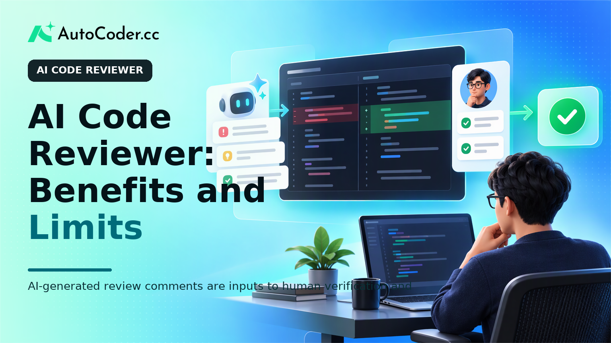
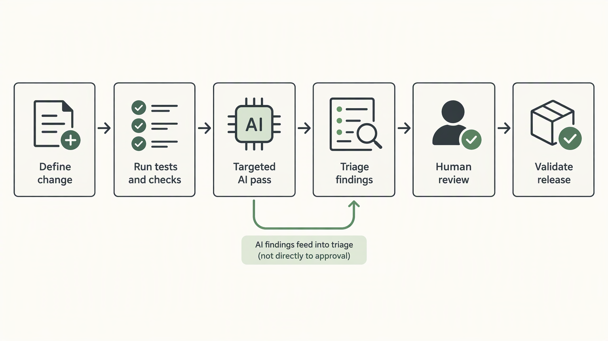
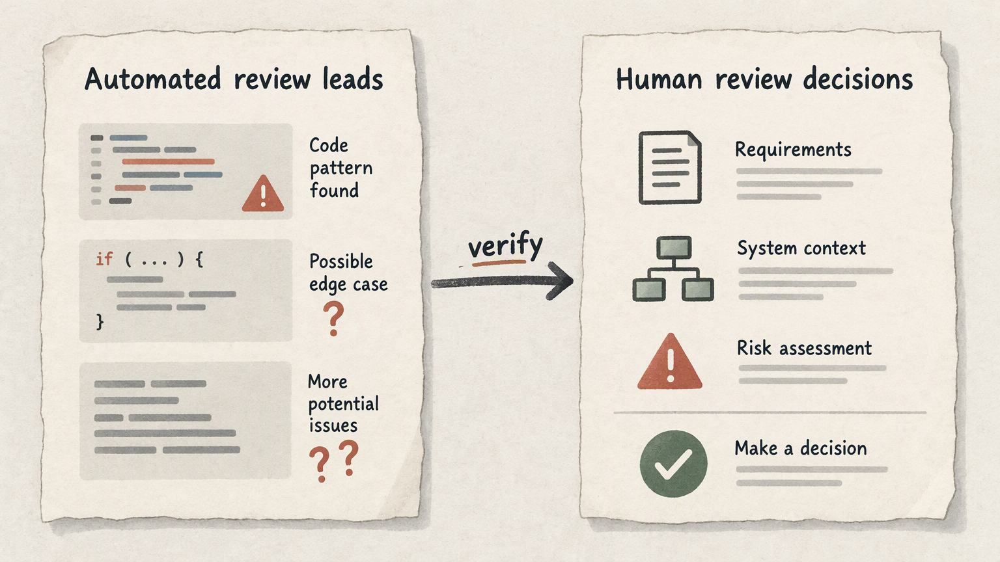

*Published November 3, 2026*

<Frame caption="AI-generated review comments are inputs to human verification and accountable approval, not a final quality verdict.">
  
</Frame>

An **AI code reviewer** is a tool or workflow that examines source-code changes and offers feedback on possible defects, maintainability concerns, style inconsistencies, and implementation risks. It can help teams inspect pull requests more consistently, but it does not establish that code is correct, secure, or appropriate for a product’s requirements.

That distinction matters because review is not one task. It combines reading a change, understanding its purpose, checking its interaction with the wider system, and deciding whether the team should accept the associated risk. AI-assisted feedback can speed up parts of that work. The accountable decision still belongs to people who understand the codebase, users, operational constraints, and business rules.

This guide explains what AI review can do, where it fits in delivery, what it commonly misses, and how to introduce it without weakening existing engineering controls.

## What an AI Code Reviewer Does

**The practical value of an AI code reviewer is focused assistance: it helps reviewers find questions worth investigating, rather than issuing a final verdict on a change.** Depending on the implementation and the context it receives, an AI review process may inspect a diff, related files, tests, comments, or repository conventions. It can then identify patterns that may deserve attention.

Useful review prompts often concern the mechanics of a change. For example, a tool may point out that a new branch appears unreachable, an error return is not handled consistently, a parameter is not validated before use, or duplicated logic makes later changes harder.

This is related to, but different from, traditional static analysis. Rule-based automated code review tools usually apply explicit checks that have known conditions and outputs. AI-based systems may interpret natural-language intent and broader code patterns, which can make their suggestions more flexible. That flexibility also makes validation important: a plausible explanation is not evidence that an issue exists.

A practical review output should therefore be treated as a lead. A reviewer can trace it to the changed lines, reproduce the suspected behavior, inspect relevant tests, and decide whether it matters in this application. If a suggestion cannot be connected to observable code behavior or a documented team convention, it should not block a merge by default.

AI review is also not identical to generating code. In **AI software development**, generated code and reviewed code can both contain mistaken assumptions. A workflow that uses assistance at both stages needs independent checks, including tests, human approval, and clear ownership of changes. For teams building early prototypes with [AutoCoder's AI app builder](https://www.autocoder.cc/platform?utm_source=blog&utm_medium=latest&utm_campaign=AICodeReviewer), exporting and continuing to edit source code creates the same need: generated application components should enter an ordinary review and validation process before production use.

## Why AI Code Review Matters in Everyday Delivery

**AI code review is most useful when it reduces routine review overhead without removing the team’s normal quality gates.** Pull requests often mix straightforward changes with subtle questions. Reviewers may spend time locating relevant files, reconstructing intent from a terse description, or checking repeated implementation details.

In practice, this can support several recurring activities:

- **Pull-request preparation.** An author can request a preliminary critique before asking a colleague to review. This may uncover missing error handling, unclear names, or an incomplete test case while the author still has the change in mind. - **Review orientation.** A summary of the change and its likely dependencies can help a reviewer decide where to start.

The benefit is not that every comment becomes useful. It is that a well-scoped process may make it easier to notice routine issues earlier and give human reviewers more time for the questions that require context.

An AI code reviewer can also make review expectations more visible. For instance, a team may ask for a structured pass over input handling, error paths, logging, tests, and documentation. The resulting checklist is valuable even when the tool makes no finding, because it prompts a repeatable inspection.

## Where an AI Code Reviewer Fits in a Team Workflow

<Frame caption="AI feedback belongs after established automated checks and before human review, with explicit triage before approval.">
  
</Frame>

**Place AI feedback before and alongside human review, not after approval or in place of testing.** The safest workflow gives the assistant a limited role, defines who evaluates its comments, and preserves clear merge requirements.

A workable sequence can look like this:

1. **Define the change and its risk.** The author describes the behavior being changed, relevant constraints, and how it will be tested. For higher-risk work, include affected data, permissions, integrations, and rollback considerations. Good context improves both human and automated review.

2. **Run local and automated checks.** Execute the project’s existing tests, linters, type checks, build process, and other established controls. These tools often provide more deterministic feedback than an AI suggestion and should not be bypassed simply because an assistant has reviewed the diff.

3. **Request a targeted AI pass.** Ask for review against a specific concern, such as error handling in changed endpoints, consistency with an existing module, or edge cases around a new input. Broad requests can produce broad, low-priority feedback. A narrow request gives reviewers a clearer basis for evaluation.

4. **Triage each finding.** The author or reviewer checks the referenced code, identifies the claimed behavior, and determines whether the concern is actionable. Record why significant suggestions are accepted or rejected, especially when the same category recurs.

5. **Conduct accountable human review.** A reviewer examines the diff, tests, architecture, requirements, and operational implications. They should be able to approve or request changes based on their own assessment, rather than relying on an AI summary.

6. **Validate after the merge decision.** Run required integration, staging, or release checks appropriate to the change. Monitoring and rollback plans may be needed for changes that affect production behavior, even when the code review appears clean.

This approach also works when a product team begins with generated full-stack application components. [AutoCoder](https://www.autocoder.cc/platform?utm_source=blog&utm_medium=latest&utm_campaign=AICodeReviewer) supports generating frontend, backend, and database components from natural-language requirements, with source code that can be exported and edited. Once a team takes ownership of that code, its review process should cover requirements, authentication, data handling, tests, and deployment decisions in the same way it would for hand-written changes.

## Limits and Misconceptions Around Automated Code Review

<Frame caption="Automated suggestions can surface leads, while humans must evaluate requirements, context, and risk before making decisions.">
  
</Frame>

**Treating automated review as proof of quality is the central mistake to avoid.** An assistant may produce a detailed explanation that sounds convincing while misunderstanding a project convention, missing a dependency, or inferring behavior not present in the code. False positives consume reviewer attention; false negatives can create unjustified confidence.

One common misconception is that AI code review can replace a senior reviewer. It cannot reliably supply product knowledge, historical context, or accountable judgment. A senior reviewer may know that an apparently redundant check protects a legacy client, that a particular query is safe only because of deployment ordering, or that a requested simplification conflicts with a compliance requirement.

Another misconception is that more comments mean better review. High comment volume can obscure the few issues that matter. Teams should favor findings that are specific, traceable, and relevant to the change. A useful comment identifies the affected code, explains the suspected consequence, and gives the reviewer a way to verify it.

Security-sensitive changes require particular caution. Access control, secrets handling, payment logic, personal data, cryptography, and production infrastructure can involve assumptions outside the visible code. An AI tool may highlight a concern, but it cannot substitute for threat modeling, security review, controlled testing, or organization-specific policies.

Context management is another limit. A review system may see only a patch or a selected set of files. Even with broader repository access, it may not understand runtime configuration, external services, undocumented contracts, or recent decisions made outside the codebase. Teams should be explicit about what context is available and avoid assuming completeness.

Finally, source-code handling deserves its own evaluation. Before adopting any external code quality tools, teams should assess their internal rules for repository access, sensitive information, retention, access controls, and approval. The acceptable setup for a public demo repository may not be acceptable for proprietary or regulated code.

## Safeguards That Keep Review Quality Accountable

**A small set of operational safeguards makes AI assistance easier to evaluate and less likely to distort review decisions.** The goal is not to maximize usage. It is to create a process in which useful feedback is distinguishable from noise.

Start with a written scope. Specify which repositories and change types can use the tool, what information may be shared, and which checks remain mandatory. For example, a team might permit assistance for routine application changes while requiring separate human review for authentication, database migrations, or production configuration.

Next, define a triage standard. Ask reviewers to classify material suggestions as confirmed, not applicable, or uncertain. This does not require a complex reporting program. It creates a feedback loop: recurring confirmed categories may justify a checklist or a deterministic rule, while repeated irrelevant comments suggest that prompts, configuration, or use cases need adjustment.

Keep human ownership visible in pull requests. Authors should explain what they changed and how they tested it. Reviewers should document material concerns in their own words when approval depends on resolving them. AI-generated summaries can be helpful navigation aids, but the record of engineering judgment should remain understandable without them.

Use different expectations by risk level. A documentation adjustment may need only ordinary checks. A change to authorization or data deletion may need reviewers with relevant expertise, focused tests, and a rollback plan. Risk-based review is more useful than applying identical ceremony to every change.

Finally, periodically inspect whether the workflow is helping. Look for practical signals: Are reviewers spending less time on repetitive questions? Are useful findings being verified? Are low-value comments making reviews harder to read? The answer may be to narrow use rather than expand it. Tool adoption is a process decision, not an obligation.

## FAQ

### What is an AI code reviewer?

An AI code reviewer examines source-code changes and offers suggestions about potential defects, maintainability, consistency, or missing cases. Its output is guidance for investigation, not a verified finding or approval decision.

### Can AI code review replace human code review?

No. Human reviewers provide product context, system knowledge, risk judgment, and accountability that an automated system cannot reliably supply. AI assistance can support human review and routine checks, but it should not replace required approvals or testing.

### What should an AI code reviewer check?

Teams can ask it to inspect changed logic, input handling, error paths, duplicated code, naming clarity, test gaps, and consistency with local patterns. The scope should match the change and be verified against the actual codebase and requirements.

### How should teams validate AI code review findings?

Trace each meaningful finding to the relevant code, reproduce or test the claimed behavior, inspect surrounding context, and compare it with documented requirements and team conventions. Record the rationale for important accepted or rejected findings.

## Conclusion

**An AI code reviewer can make code review more focused when teams treat it as an assistant for discovery, not an authority for approval.** It can help identify questions around changed code, explain unfamiliar areas, and support repeatable review checklists. Its limitations are equally important: it may lack context, generate irrelevant suggestions, or miss risks that depend on product and operational knowledge.

The practical standard is straightforward. Keep existing tests and approval rules, validate material findings, protect source-code access, and assign human owners to consequential decisions. Used within those boundaries, AI code review can support a disciplined engineering workflow without implying that automated feedback is a substitute for accountable review.
