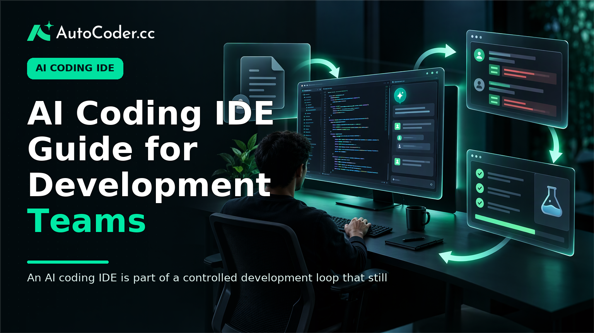
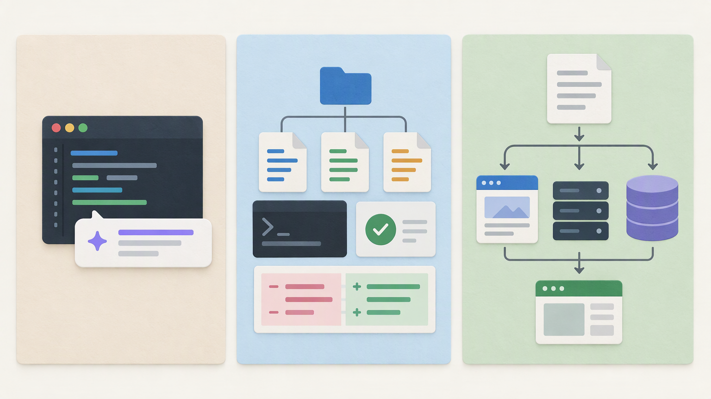
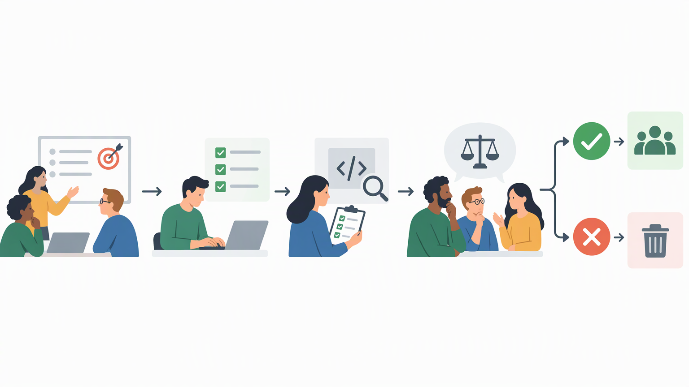

*Published November 3, 2026*

<Frame caption="An AI coding IDE is part of a controlled development loop that still includes context, testing, and review.">
  
</Frame>

An **AI coding IDE** combines a familiar software-development workspace with AI-assisted ways to understand, change, and create code. For developers and engineering leaders, the important question is not whether AI can produce code in isolation. It is whether an environment helps a team move from an understood requirement to a reviewed, maintainable change without weakening established engineering controls.

This distinction matters because the label covers several different products and workflows. Some tools add assistance to an existing editor. Others organize broader task-oriented work around a codebase. Application-generation products may begin with a product description rather than an existing repository.

## What an AI coding IDE is—and is not

<Frame caption="An AI code assistant, AI coding IDE, and AI application builder support different starting points and scopes of work.">
  
</Frame>

**Treat an AI coding IDE as a development environment that adds AI to the work around code, not as a replacement for engineering judgment.** An integrated development environment traditionally brings together editing, project navigation, language support, debugging, testing, and source-control interactions. An AI integrated development environment extends that workspace by letting users request explanations, propose changes, generate code, investigate errors, or work through a multi-file task in natural language.

The exact interaction varies. A developer might ask for an explanation of an unfamiliar module, request a focused refactor, describe an API validation rule, or ask the environment to trace an error through related files. The useful output is not merely a code snippet.

An AI coding IDE is different from an AI code editor in emphasis, although the terms often overlap. An AI code editor may primarily assist while someone writes in a file, for example through completion, suggestions, or an in-editor chat.

It is also different from a standalone AI code assistant. A code assistant may be available in multiple editors or services and may focus on answering prompts or completing code. The IDE is the place where the broader development loop happens: reading the codebase, making edits, running checks, reviewing diffs, and preparing a change for team processes.

Finally, an AI coding IDE is not automatically an AI application builder. An application builder can start from product requirements and generate an initial full-stack application, including frontend, backend, and database components. For example, [AutoCoder's AI app builder](https://www.autocoder.cc/platform?utm_source=blog&utm_medium=latest&utm_campaign=AICodingIde) is designed to turn natural-language product requirements into editable, deployable applications and supports continued source-code editing. That can be useful when a team is starting from an MVP, prototype, internal tool, or a defined business workflow. An IDE more often supports ongoing work within a codebase that the team already owns and understands.

These categories can complement one another. A generated starting point may enter an established engineering workflow, while an IDE can support the subsequent maintenance and extension work. The practical issue is whether the handoff preserves source-code access, reviewability, and the team’s ability to make deliberate changes.

## Common AI coding IDE workflows

**The best way to assess an AI coding IDE is to map it to recurring engineering tasks rather than test it only with a blank prompt.** Useful environments tend to support several points in the development cycle, each with different risks and review needs.

### Understanding an unfamiliar codebase

Developers frequently need to orient themselves before they can safely change anything. An AI-enabled environment may help summarize a module, identify likely entry points, explain a call path, or surface files related to a feature. This can reduce the friction of asking an initial question, but it should not replace direct reading of critical code.

A sensible workflow is to use the explanation as a map, then verify the relevant files, interfaces, configuration, and tests. For a change involving authorization, billing, data handling, or a public API, assumptions should be checked especially carefully.

### Turning a requirement into a bounded change

Natural-language requests are most workable when they specify scope and constraints. Instead of asking for “better user management,” a team can describe a concrete outcome: add an optional profile field, validate it at the service boundary, update the relevant interface, and preserve the current behavior for existing users.

The environment may propose edits across several files. Developers should inspect the diff, confirm that names and abstractions fit local conventions, and identify changes that exceed the request. Bounded tasks make it easier to distinguish an appropriate proposal from a superficially plausible but overbroad rewrite.

### Debugging with project context

AI developer tools can assist with debugging by relating an error message to nearby code, configuration, or recent changes. They may suggest hypotheses, potential instrumentation, or focused fixes. This is most useful as part of a method: reproduce the issue, isolate relevant conditions, inspect the proposed reasoning, and run a targeted verification.

A common mistake is to accept a fix because it removes a visible error. A change can silence a symptom while altering expected behavior elsewhere. Teams should retain their normal debugging discipline, including tests, logs where appropriate, and review of the resulting diff.

### Iterating across frontend, backend, and data work

Full-stack tasks often cross boundaries that are easy to overlook. A new field may require a user interface change, request validation, data-model handling, permissions, error states, tests, and deployment configuration. An AI coding IDE can help a developer enumerate these dependencies or create an initial implementation across the relevant layers.

That convenience does not remove design decisions. Someone still needs to determine the data contract, ownership of validation, migration approach where relevant, and expected failure behavior. When the work begins from a product specification rather than an existing repository, an application-generation workflow such as [AutoCoder](https://www.autocoder.cc/platform?utm_source=blog&utm_medium=latest&utm_campaign=AICodingIde) may provide an editable initial application; the resulting code still benefits from the same checks before it is extended or deployed.

### Preparing a change for review

The final workflow is often more important than generation itself. Before opening a pull request or equivalent review, a developer can ask the environment to summarize the change, identify untested branches, or explain how a modified component interacts with adjacent code. Those prompts can support a better self-review.

They should not replace review by accountable engineers. Reviewers still need enough context to evaluate correctness, security implications, maintainability, and whether the implementation solves the actual requirement. AI programming tools are most compatible with team practices when they make the reasoning and changes easier to inspect.

## How to evaluate an AI coding IDE for team use

<Frame caption="A bounded pilot with defined checks is a practical way to evaluate workflow fit and output quality.">
  
</Frame>

**Evaluate workflow fit, controls, and output quality together; a capable demonstration is not enough.** A small, representative trial gives a clearer signal than a generic code-generation exercise.

Start with repository and context handling. Determine what project material the environment can access, how users choose that context, and whether it makes its proposed file changes visible. Teams working in large or sensitive codebases should understand what data is shared with the service, what organizational settings exist, and which internal policies apply.

Next, assess source-control compatibility. The environment should fit the team’s established branching, diff review, pull-request, and approval practices. Ask whether changes remain ordinary source-code changes that can be inspected, reverted, and attributed through existing tools. A workflow that bypasses review or obscures edits creates a different operational risk than one that produces a clear, narrow diff.

Then test quality with a real but contained task. Choose a modest feature, bug fix, or refactor with known acceptance criteria. Define the relevant tests before using the tool where possible. Compare the proposed changes against the task, local conventions, and expected edge cases.

Extensibility also deserves attention. Projects change after the initial implementation. Teams should consider how easily developers can edit generated code, introduce their own libraries and patterns, debug issues outside the AI workflow, and transfer ownership between contributors. This consideration is especially important for prototypes that may become maintained products.

Finally, check deployment and operational compatibility. An IDE does not need to own deployment to be useful, but its workflow should not conflict with the team’s testing, build, secrets-management, and release practices. If a broader generation tool is part of the evaluation, clarify what it produces, what the team must configure, and how the application moves into the organization’s normal delivery process.

A practical pilot can use a simple sequence:

1. Select one low-risk repository task with clear acceptance criteria. 2. Define the expected tests, review path, and policy constraints. 3. Have several developers use the environment on comparable work. 4. Inspect diffs, test results, rework required, and any workflow friction. 5.

The outcome need not be a single team-wide rule. An environment may be well suited to exploration, repetitive changes, onboarding, or internal tooling while being less appropriate for highly sensitive systems or changes with unclear requirements.

## Misconceptions and practical limits

**A useful adoption decision separates assistance from autonomy.** AI coding IDEs can accelerate parts of development, but they do not remove the need for requirements, architecture, testing, security review, or accountable ownership.

One misconception is that generated code is inherently correct if it compiles. Compilation addresses only a portion of quality. A change may still mishandle edge cases, conflict with domain rules, create an awkward interface, or introduce maintenance costs.

Another misconception is that more repository context always produces a better answer. Extra context can be useful, but relevance matters. A vague task plus a large codebase can lead to broad assumptions and unnecessary edits. Clear constraints, explicit files or interfaces, and incremental requests often produce a more reviewable result.

A third misconception is that adoption is only an individual productivity choice. Engineering leaders also need to consider code ownership, security policy, review standards, onboarding, and consistency across the team. The right operating model may allow experimentation while defining tasks or repositories that require stricter controls.

In practice, AI developer tools work best when they are integrated into an existing quality system. Developers provide a precise goal and domain context. The environment proposes or explains work. Tests and review verify the result. The team then updates the codebase through its normal source-control process.

## FAQ

### What is an AI coding IDE?

An AI coding IDE is an integrated development environment that uses AI to assist with tasks such as understanding project code, proposing edits, generating implementation drafts, investigating errors, and summarizing changes. It remains a workspace for normal engineering activities, including editing, testing, debugging, and review.

### How is an AI coding IDE different from a code editor?

A code editor primarily provides a place to write and navigate files, sometimes with AI features. An AI coding IDE generally emphasizes broader project-aware workflows, potentially connecting AI assistance to codebase context, tests, terminal output, debugging, and version-control changes. Actual capabilities vary by product.

### Can an AI coding IDE generate a full application?

It may help create substantial portions of an application, but full application delivery also requires decisions about requirements, architecture, data, authentication, testing, deployment, and maintenance. Dedicated application builders may start from a product description, while IDEs commonly support ongoing development within a codebase.

### What should teams check before adopting an AI coding IDE?

Teams should check repository-context and data-handling practices, source-control and review compatibility, code quality on a representative task, extensibility of the resulting code, and fit with testing and deployment processes. A bounded pilot is usually more informative than a general demonstration.

## Conclusion

An **AI coding IDE** is most useful when it supports a team’s existing path from requirement to reviewed, tested code. Evaluate it as part of a complete workflow rather than as a prompt-to-code demonstration. By piloting representative tasks, retaining clear source-control practices, and treating AI output as inspectable input rather than final authority, teams can determine where the environment has a practical role and where conventional controls should remain unchanged.
